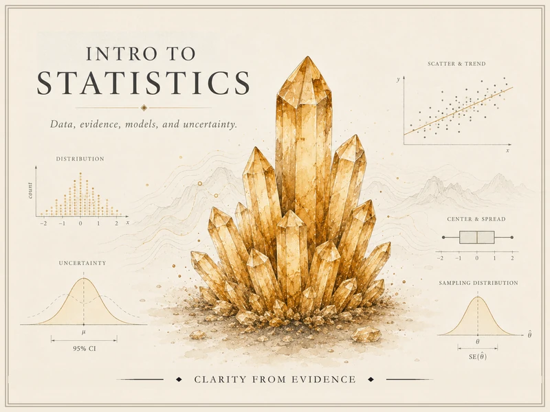

{srcset="assets/figures/intro-stats-hero-web-800.webp 800w, assets/figures/intro-stats-hero-web.webp 1400w" sizes="(min-width: 1200px) 1100px, 92vw" fig-alt="Wide illustrated course identity image for Intro to Statistics, showing an amber crystal cluster surrounded by introductory statistics graphics including distributions, uncertainty, scatterplots, center and spread, and sampling distributions." .course-hero-img}

# Intro to Statistics {.course-landing-title}

This site collects public-facing notes for **Intro to Statistics** — the
concepts and interpretation-focused examples behind reasoning with
**data, evidence, models, and uncertainty**. Curated by
[Matt Hester](https://matthewhester.com).

It is a **reading and review layer**, not a raw course archive. Anything
section-specific lives in the learning management system; this site is
what stays public.

## Where to start

- [Syllabus](syllabus.qmd) — what the course is about and how to use
  this site
- [Schedule](schedule.qmd) — week-by-week topic map with links to the
  weekly notes
- [Notes](notes/index.qmd) — weekly notes and conceptual write-ups
- [Resources](resources/index.qmd) — readings, tools, and links
  (IMS, ISLBS, and StatKey / simulation support)
