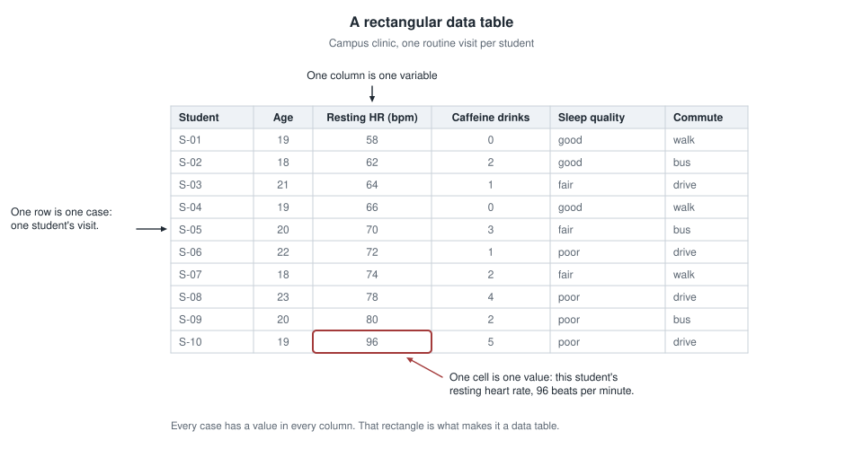
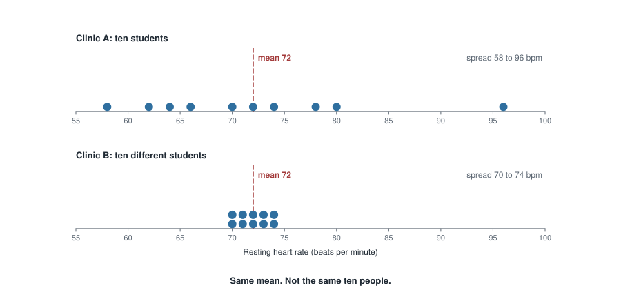
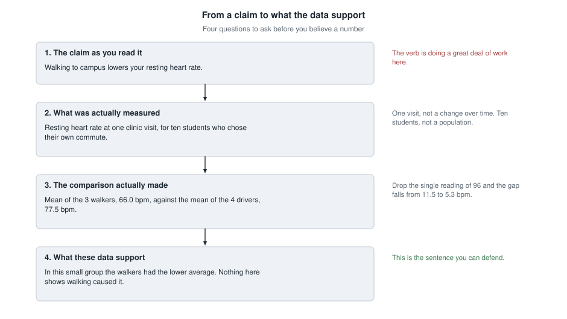

## Where this week starts

Here is the premise the whole term rests on. **Statistics is the discipline of deciding how much a body of evidence supports a claim.** It is not a list of formulas, and it is not a machine that converts numbers into truth. It is a set of habits for asking where a number came from, what it stands in for, and how much weight it can carry.

Statistical claims are everywhere once you start noticing — a poll, a health headline, an average on a dashboard. Behind each one sits some data, and between the data and the claim sits a step of reasoning somebody performed on your behalf, usually without showing you the working. This course is about that step, and taking it well starts with agreeing on the objects: which things were observed, and what was recorded about each. That sounds like bookkeeping, but a surprising number of public mistakes with data begin with somebody being unclear about what one row of a table represented.

By the end of this week, one thing should feel different. When a number lands in front of you, your first instinct should stop being "what do I calculate?" and start being three questions: **what are the cases, what was measured, and what comparison is being made?**

### Why this matters beyond this course

Suppose a clinic tells you the average recovery time after a minor operation is ten days, and you book yourself back at work on day eleven. Now suppose that ten came from a group in which most patients were moving normally by day four, while a handful who were older and sicker than you took six weeks. The average is not wrong. It is simply not a description of any particular patient, and it is not a promise about you. One number replaced a whole spread of people, and you planned against the number.

The same swap drives larger decisions: a district reads one average and closes a program, a city reads one rate and moves a bus route. The arithmetic was right and the conclusion was still unsupported, because nobody asked what the summary discarded.

## What you will be able to do

- **Point** to the cases and the variables in any data table, and say in one sentence what a single row stands for.
- **Classify** a variable as numerical (discrete or continuous) or categorical (nominal or ordinal), and explain why the classification changes what you may do with it next.
- **Name** the explanatory variable and the response variable in a stated comparison.
- **Compute** a mean from a small set of values and state, in plain words, what that mean discards.
- **Separate** a claim from the data behind it and from the inference that joins the two.
- **Rewrite** an overreaching sentence about a data set into one the data can actually carry.

## Words worth owning

| Term | What it means in this course |
|------|------------------------------|
| Case | One thing you observed: a patient, a clinic visit, a county, a benefit claim. Also called the unit of observation. |
| Variable | One characteristic recorded for every case, with its units named. |
| Data table | A rectangle in which every row is one case and every column is one variable. |
| Categorical variable | A variable whose values are labels for groups, such as walk, bus, or drive. |
| Numerical variable | A variable whose values are quantities it makes sense to average, such as heart rate in beats per minute. |
| Explanatory variable | The variable whose groups or levels you are comparing across. |
| Response variable | The variable whose behavior you are comparing between those groups. |
| Statistical inference | Reasoning from what you observed to a statement about what you did not. |

## Cases, variables, and the rectangular table

Almost every data set organized for analysis has the same shape: a rectangle. Rows run down, columns run across, every cell holds one value. That is not a formatting preference — it is a claim that there is a well-defined collection of things, and that the same characteristics were recorded for each.

All week we use one small invented data set. A campus health clinic sees ten students for routine visits and records, for each visit, an identifier, age in whole years, resting heart rate in beats per minute, the number of caffeinated drinks the day before, self-reported sleep quality, and usual commute mode. Ten students is far too few for any real conclusion, and exactly the right size for learning to read a table.

### One row is one case

A **case** is one thing you observed. Here it is one student's clinic visit, and everything on that row belongs to that visit and nothing else.

That sounds obvious until you notice the same study can be tabled at several levels. If each student had come in three times, you could build a table of thirty visits, or a table of ten students with their readings averaged into one row. Both are legitimate rectangles, they answer different questions, and a summary computed on one does not transfer to the other.

So the first question is never "what does this number mean?" It is "what is a row?"

{fig-alt="A ten-row campus clinic data table. Arrows label one row as one case, one column as one variable, and one outlined cell holding a resting heart rate of 96 beats per minute as one value."}

### One column is one variable

A **variable** is one characteristic recorded for every case. Resting heart rate is a variable; 96 beats per minute is a value of that variable for one case. Keep those two words apart: the machinery of this course operates on variables, while most of the stories people tell are about individual values.

Two habits are worth building now. First, carry the units: "age" is not a variable, but "age in whole years at the visit" is. Half the arguments people have about data turn out to be arguments about units nobody stated.

Second, not every column is something to analyze. The identifier column is a label so rows can be told apart; the average of S-01 through S-10 is meaningless, and ID numbers stored as digits are a standing invitation to nonsense.

### Why a variable's type decides everything downstream

Every variable lands in one of four places, and where it lands decides which picture, which summary, and which comparison are honest.

A **numerical** variable records a quantity. It is **discrete** when the quantity is a count and nothing sits between the possible values: a student had two caffeinated drinks or three, never 1.4 of them. It is **continuous** when the underlying quantity can take any value in a range and the recorded number is a rounding of it — the nurse writes 71, but 71.5 beats per minute is meaningful.

A **categorical** variable records which group a case belongs to. It is **nominal** when the groups have no natural order: walk, bus, and drive are three modes of travel, and no arrangement of them is more correct than another. It is **ordinal** when the groups are ordered but the spacing is unknown: poor, fair, and good run in that order, but nothing says the step from poor to fair matches the step from fair to good.

{fig-alt="A tree splitting Variable into Numerical and Categorical. Numerical splits into discrete (caffeinated drinks) and continuous (resting heart rate); Categorical splits into nominal (commute mode) and ordinal (sleep quality)."}

The practical test is to ask whether averaging the values would mean anything. The average of the ten resting heart rates is a quantity you could act on. The average of walk, bus, and drive is not a thing. If someone stores commute as 1, 2, and 3 to tidy the file and then reports a mean commute of 2.1, they have produced a number with no referent.

Ordinal variables are the genuinely awkward case. Coding poor, fair, and good as 1, 2, and 3 and averaging them assumes the steps are equally sized, which nobody has checked. Analysts sometimes do it anyway and say so; what you must not do is do it silently.

## From a pile of numbers to a claim

A rectangle is not yet evidence, because nobody can hold ten numbers in mind at once, let alone ten thousand. To say anything, you compress. Every act of compression is a trade: you gain something you can state in a sentence, and you lose something you can no longer see.

### What a summary keeps and what it discards

A **summary statistic** is a single number computed from many values to stand in for them. The most familiar is the mean:

$$ \text{mean} = \frac{58 + 62 + 64 + 66 + 70 + 72 + 74 + 78 + 80 + 96}{10} = \frac{720}{10} = 72 $$

So the mean resting heart rate is 72 beats per minute. True, checkable, useful — and also the moment ten numbers became one.

What left the room? The mean does not tell you that five of the ten students sat below 72, four above it, and one exactly on it. It does not tell you the values run from 58 to 96, a range of 38 beats per minute. It does not tell you that the single reading of 96 is pulling it upward: drop that student and the remaining nine total 624, a mean of about 69.3. A mean is a property of a group, not a description of a person.

{fig-alt="Two dot plots on a shared resting heart rate axis. Clinic A's ten values are scattered from 58 to 96; Clinic B's ten values sit tightly between 70 and 74. Both panels carry the same dashed mean line at 72 beats per minute."}

Clinic B's ten students have heart rates of 70, 70, 71, 71, 72, 72, 73, 73, 74, and 74. Those also total 720, so Clinic B's mean is 72 beats per minute — exactly Clinic A's. Read only the summary and the two clinics are indistinguishable; look at the pictures and they are not the same place at all. In Clinic B, 72 describes essentially everybody; in Clinic A it describes almost nobody. A nurse deciding whom to follow up would behave differently in the two rooms, and the mean alone would never tell her which room she was in.

### Explanatory and response: naming the comparison

Most interesting claims are comparisons, and the two roles have names. The **explanatory variable** is the one whose groups or levels you compare across. The **response variable** is the one whose behavior you compare between them. In "students who walk to campus have lower resting heart rates than students who drive", commute mode is explanatory and resting heart rate is the response.

Two cautions. These roles are not properties of the columns; they are a decision by the person asking. And calling a variable "explanatory" does not mean it explains anything: the word labels a position in your comparison, not a finding about the world.

### Claim, data, and the inference in between

Nearly every quantitative statement in public has three layers stacked on each other. The **claim** is the sentence someone wants you to believe. The **data** are the recorded values actually in hand. The **inference** is the reasoning carrying the second to the first: the step saying these ten students license a statement about students in general, or about cause.

Descriptive statistics lives entirely in the data layer. Say "the mean resting heart rate among these ten students was 72 beats per minute" and you have made no inference at all; you cannot be wrong unless your arithmetic is. Say "students have a mean resting heart rate of 72" and you have crossed into inference. This week the goal is to notice when you cross.

## Worked example — reading a campus clinic table

**Setting.** The clinic table above: ten students, one routine visit each, six columns.

**Step 1 — say what a row is.** One row is one student's routine clinic visit, so there are ten cases. A case is not a student's whole term, and not a heart rate. Everything below has to stay consistent with this sentence.

**Step 2 — list the variables with units and types.** Age in whole years and resting heart rate in beats per minute are both numerical and continuous underneath. Number of caffeinated drinks is numerical and discrete, because it is a count. Sleep quality is categorical and ordinal. Commute is categorical and nominal. The identifier is a label.

**Step 3 — summarize one numerical variable.** The ten heart rates sum to 720, so the mean is 720 divided by 10, or 72 beats per minute. Sorted, the fifth and sixth values are 70 and 72, so the middle of the list sits at 71. The two differ by one beat per minute, because the single high reading of 96 pulls on the mean but not on the middle.

**Step 4 — summarize one categorical variable.** For sleep quality you count rather than average: three students reported good, three fair, and four poor. Three plus three plus four is ten, the check that no case was lost. As a proportion, four out of ten, or 0.40, reported poor sleep. The type of the variable chose the summary for you.

**Step 5 — state what the summaries do and do not carry.** In these ten visits the mean resting heart rate was 72 beats per minute and 40 percent of students reported poor sleep. That describes ten people who walked into one clinic. It is not an estimate of anything about the campus, because we have said nothing about how these ten came to be in the table, and it says nothing about whether poor sleep raises heart rate.

**What the result means in context.** Step 5 fixes what you may say once the arithmetic is over.

### The same reasoning, transferred

Same pass, different numbers, different subject. A state office reports that the mean time to process a benefit claim last month was twelve days. Eight claims were processed, taking 3, 4, 5, 5, 6, 7, 9, and 57 days.

A row is one claim, not one claimant — someone who filed twice appears twice. The variable is processing time in days, numerical and continuous underneath, recorded to the whole day. The eight values sum to 96, so the mean is 96 divided by 8, exactly 12 days. The middle of the sorted list falls between 5 and 6, at 5.5 days. Seven of the eight claims, or 87.5 percent, finished in nine days or fewer.

What stayed the same: the pass itself, and naming the case before touching a number. What changed: the cases are claims rather than people, and the distortion is far worse, because the reported mean is longer than every claim but one. "We process claims in twelve days on average" is misleading in both directions at once — it overstates the wait for nearly everybody while hiding the person who waited two months.

## Second worked example — taking a headline apart

**Setting.** Someone reads the clinic table and writes: *"Walking to campus lowers your resting heart rate."* Your job is not to agree or disagree on instinct, but to take the sentence apart.

{fig-alt="Four stacked boxes flowing downward: the claim as read, what was actually measured, the comparison actually made using group means of 66.0 and 77.5 beats per minute, and the weaker statement the data actually support."}

**Step 1 — restate the claim, including its verb.** The claim is causal: *lowers*. It says that if a person switched from driving to walking, their resting heart rate would fall — a statement about a change, far stronger than a statement about what was seen.

**Step 2 — say what was actually measured.** Resting heart rate at a single visit, for ten students who chose their own way to campus. Nobody was assigned a commute, measured twice, or followed over time.

**Step 3 — do the comparison the claim rests on.** Three students walk, with heart rates of 58, 66, and 74; those sum to 198, so the walkers' mean is 198 divided by 3, or 66.0 beats per minute. Four drive, with 64, 72, 78, and 96; those sum to 310, so the drivers' mean is 310 divided by 4, or 77.5. The gap is 77.5 minus 66.0, which is 11.5 beats per minute. As a check, the three bus riders sum to 212, and 198 plus 212 plus 310 is 720 — the total we already know is right.

**Step 4 — test how much weight the comparison can hold.** One driver's reading of 96 is the highest value in the table; remove that student and the remaining three drivers average 214 divided by 3, or about 71.3, so the gap falls from 11.5 to about 5.3. A comparison that more than halves when one person leaves the room is not carrying much. The groups also overlap heavily: one walker sits at 74, higher than two of the four drivers. And they differ in other ways at once — the drivers averaged about 2.75 caffeinated drinks the previous day against about 0.7 for the walkers, and 21.25 years of age against about 18.7. Any of that could be doing the work the claim credits to walking.

**Step 5 — write the sentence the data can carry.** *Among these ten students, the three who walked had a lower mean resting heart rate (66.0 beats per minute) than the four who drove (77.5), a gap of 11.5 beats per minute; with three and four students per group and clear differences in caffeine and age between them, these data cannot tell us whether commuting mode has any effect at all.*

**What the result means in context.** Notice what happened to the verb. "Lowers" became "had a lower mean", with a hedge attached. That is not timidity; it is the strongest sentence this table can support.

## The misreading to avoid

Here is the sentence students write in week one, almost verbatim:

> *"The mean resting heart rate is 72, so a typical student's resting heart rate is about 72."*

It sounds harmless. It is the most consequential misreading of the term, and three things are wrong with it.

**First, the mean is not a typical case.** It is a balance point of all the values. In the benefit-claims table the mean of twelve days is longer than seven of the eight actual waits. A mean can land where nobody is, and when a distribution has one long tail, it usually does.

**Second, the two halves of the sentence are about different things.** "The mean is 72" is a fact about the ten rows in front of you. "A typical student is at 72" is a claim about students, a much larger group that was never observed. You crossed from the data layer into the inference layer inside one sentence, and the word "so" did it without asking permission.

**Third, "typical" is quietly asking for a spread, not a center.** It is a statement about where most students fall, and no measure of center carries that alone. That is why the two clinic panels look nothing alike despite sharing a mean.

A companion misreading is worth naming too: *"the numbers are real, so the claim is true."* Correct arithmetic can accompany a false claim, because the failure is rarely in the arithmetic — it is in the leap from what was measured to what is asserted. Every figure in the walking example was right to the last decimal, and the headline still was not supported.

The repair for both is cheap. Before writing a sentence about data, name the cases you are describing, say whether you are describing them or generalizing beyond them, and quote a measure of spread beside any measure of center.

## Practice on your own

These are for your own checking, not for submission. Compare with a classmate.

1. A shelter records, for each of 40 dogs housed, its weight in kilograms, its age in whole years, its breed group, and whether it is house-trained. State what a case is, classify each of the four variables as numerical (discrete or continuous) or categorical (nominal or ordinal), and explain why "mean breed group" is not a thing.

2. Six delivery times, in minutes, are 18, 22, 25, 25, 30, and 100. Compute the mean and the middle of the sorted list. Which would you quote to a customer deciding whether to order, and what would you say alongside it?

3. A campus paper reports: "Students who use the tutoring center earn higher grades, so the center raises grades." Identify the explanatory variable, the response variable, and the exact word that turns a description into a causal claim. Then list two ways the students who use the center might already differ from those who do not.

4. Using the clinic table, compute the mean resting heart rate for the three bus riders and compare it with the walkers' 66.0 and the drivers' 77.5. Write one sentence about all three groups that a careful reader would sign, and one that overreaches.

## Where to read more

- [Introduction to Modern Statistics, Chapter 1, "Hello data"](https://openintrostat.github.io/ims/data-hello.html) is this week's reading. It covers cases, variables, and variable types with a different data set — the best kind of second explanation.
- [Chapter 2, "Study design"](https://openintrostat.github.io/ims/data-design.html) is where next week begins; skimming its opening pages will make that material easier.
- [The whole of Introduction to Modern Statistics](https://openintrostat.github.io/ims) is online and is the main text for the course.
- [Introductory Statistics for the Life and Biomedical Sciences](https://www.openintro.org/book/biostat) is the supplementary text, and its health examples sit close to our contexts.
- The course [schedule](../schedule.qmd) lists what each meeting covers, the [syllabus](../syllabus.qmd) states the policies, and the [resources](../resources/index.qmd) page collects everything in one place.

## Where this goes next

This week you learned to read the table. Next week you learn to ask where the table came from, which decides how much any of it is worth. [Week 2](week02-study-design.qmd) covers observational studies and experiments, populations and samples, the forms of bias you will meet, and the difference between randomly *sampling* people and randomly *assigning* them to groups. The walking example is left deliberately unfinished: everything that made it unconvincing — self-selected groups, tiny numbers, other differences between the groups — has a name, and next week supplies them.

Keep the clinic table in mind. We return to it in Week 3 to describe one variable properly, in Week 4 to compare groups honestly, and in Week 6 to ask whether caffeine or age was doing the work we credited to walking. The [notes index](index.qmd) lists every unit.
