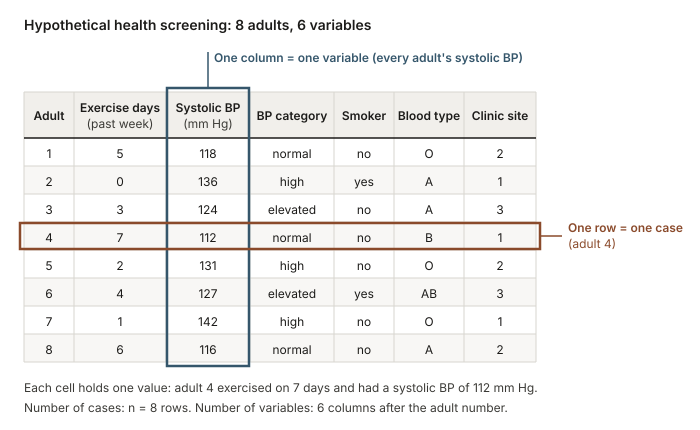
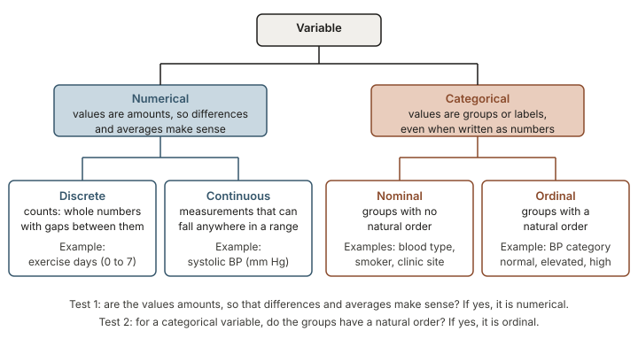
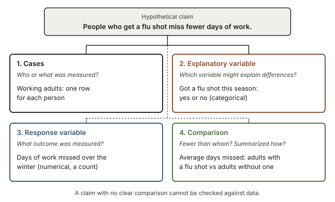
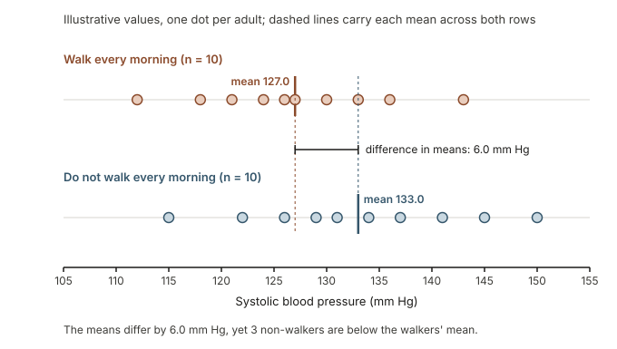
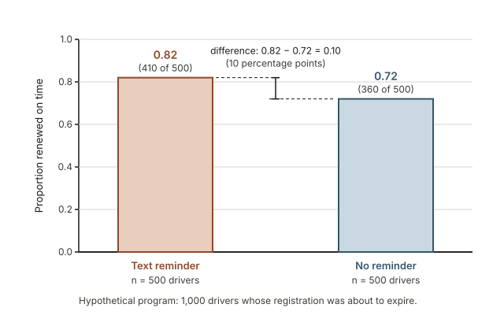

## Warm-up: what would it take to believe a health headline?

Suppose you come across this headline (it is made up for this week): **"Adults who walk every morning have lower blood pressure."**

Before you decide whether to believe it, take two minutes and write down what you would want to know. Some questions worth asking:

- Who was studied? How many people, and how were they chosen?
- What exactly was measured? What counts as "walking every morning", and how was blood pressure taken?
- Lower than whom? People who do not walk, or the same people before they started walking?
- How much lower? A gap of 1 on the blood pressure scale and a gap of 15 are very different findings.

Keep your list. By the end of this week you will have a precise word for almost every item on it, and the first worked example takes this same headline apart step by step.

## Why reading data carefully matters now

Claims built on data reach you every day. A news story says a habit lowers the risk of heart disease; a city reports that a new program reduced missed appointments; a phone app says your sleep improved by 12%. Some of these claims are well supported, some are weak, and many are worded so loosely that you cannot tell which. Real decisions about health, money and public policy rest on claims like these.

Statistics, as this course treats it, is the discipline of weighing that evidence. It asks how the data were produced, what was measured and on whom, what comparison a claim rests on, and whether a pattern is large and consistent enough to take seriously. Formulas come later, and they serve those questions. This week builds the vocabulary every later week uses: cases, variables, kinds of variables, the roles variables play, and the comparison behind a claim.

## What you will be able to do

By the end of this week you can:

- explain what it means to treat data as evidence, and name things that data alone cannot establish;
- identify the cases (the units of observation) and the variables in a data matrix or in a description of a study;
- classify a variable as numerical (discrete or continuous) or categorical (nominal or ordinal), including a variable recorded with number codes;
- identify the explanatory variable and the response variable in a claim or a research question;
- state the comparison a claim rests on, and choose a summary that fits it: a mean for a numerical response, a proportion for a categorical response.

## Words to know this week

| Term | Meaning | Example from this week |
|---|---|---|
| Data | Recorded values, with a description of what was measured, on whom, and how | Blood pressure readings from a health screening |
| Case (observational unit, unit of observation) | The person, animal, place or thing that one row of data describes | One adult in the screening |
| Variable | A characteristic recorded for every case, whose value can differ between cases | Systolic blood pressure |
| Data matrix | A table with one row per case and one column per variable (also called a data frame) | The 8-row screening table |
| Numerical (quantitative) variable | Values are amounts, so differences and averages make sense | Exercise days in the past week |
| Discrete | A numerical variable whose values are counts | 0 to 7 exercise days |
| Continuous | A numerical variable that can take any value in a range | Systolic blood pressure in mm Hg |
| Categorical variable | Values are groups or labels, called levels | Smoker: yes or no |
| Nominal | A categorical variable whose levels have no natural order | Blood type: A, B, AB or O |
| Ordinal | A categorical variable whose levels have a natural order | Blood pressure category: normal, elevated, high |
| Explanatory variable | The variable we suspect might explain or predict differences in another | Walks every morning (yes or no) |
| Response variable | The variable whose differences we want to understand (the outcome) | Systolic blood pressure |
| Comparison | What a claim sets side by side, and the summary it compares | Mean blood pressure of walkers versus non-walkers |

## Data as evidence: cases, variables, and comparisons

Most data sets you will meet share the same simple structure, and almost every claim based on data rests on a comparison. This section builds both ideas. One piece of background first: **systolic blood pressure** is the upper number in a reading such as 118/76, measured in millimeters of mercury (mm Hg). It appears in several examples below.

### What data can tell us and what they cannot

Data are records of what happened to particular cases under particular conditions. That makes them powerful and limited at the same time.

Data can **describe the cases that were observed** (how many adults in a screening had high blood pressure, what a typical reading was), **show variability** (no two people have exactly the same blood pressure, and one person's reading changes from morning to evening), and **reveal patterns**, such as one group having a higher average than another.

Data alone cannot:

- **tell you why a pattern exists.** If walkers have lower blood pressure, walking might be the reason, or the walkers might also be younger, eat differently or smoke less. How the data were produced decides which explanations can be ruled out; that is the subject of Week 2.
- **tell you about cases that were not observed**, unless the observed cases were chosen in a way that represents the larger group you care about.
- **tell you, from a raw difference by itself, whether it is larger than ordinary variation would produce.** Two groups almost never have exactly the same average, even when nothing real separates them. Weeks 11 and 12 give methods that use the data to judge this.
- **rescue a vague question or a poor measurement.** If "walking every morning" was never defined, no analysis recovers what was not recorded.

::: {.callout-note}
Variability is the reason statistics exists. If every person responded in exactly the same way, one observation would settle every question. Because people, animals and places differ, we need methods that separate a real pattern from the ordinary scatter of individual values.
:::

### Cases and the data matrix

Data organized for analysis are almost always stored in a **data matrix**: a table in which each **row** is one **case** and each **column** is one **variable**. The figure shows a small hypothetical health screening of 8 adults.

{fig-alt="Table of 8 hypothetical adults from a health screening, with columns for adult number, exercise days, systolic blood pressure, blood pressure category, smoker, blood type and clinic site. Row 4 and the blood pressure column are outlined."}

The cell where a row and a column meet holds one value: adult 4 exercised on 7 days of the past week and had a systolic blood pressure of 112 mm Hg. The number of rows is the number of cases, written $n$; here $n = 8$. The adult number only labels the rows, so we do not count it as a variable. That leaves 6 variables.

### The unit of observation is a choice

The first question to ask of any data set is: **what does one row describe?** That is the case, also called the observational unit or unit of observation. In a health survey it is usually a person, but it can be a hospital, one day at an air-quality monitor, one clinic visit (so the same patient can appear on many rows), or a state.

The unit of observation limits the conclusions you can draw. Suppose a hypothetical report lists the 50 US states with two variables: the percent of adults who exercise regularly and the percent of adults with high blood pressure. The cases are states, not people; both percents are numerical variables describing a state, even though each was built from yes-or-no information about individuals. If states with more exercisers tend to have lower high-blood-pressure percents, that is a statement about states; it does not show that the individuals who exercise are the ones with lower blood pressure. To learn that, you would need data in which each row is a person. Assuming that a pattern among groups also holds for the individuals inside them is a well-known error, sometimes called the ecological fallacy.

### Numerical and categorical variables

The kind of values a variable takes decides which graphs and summaries make sense, so everything in Weeks 3 and 4 depends on classifying variables correctly.

A **numerical variable**, also called a **quantitative variable**, has values that are amounts, so differences and averages mean something.

- **Discrete** variables are counts: days a person exercised last week, doctor visits in a year, eggs in a nest. There is nothing between 2 days and 3 days.
- **Continuous** variables are measurements that could take any value in a range: blood pressure, body weight, time to recover. Recorded values are rounded (blood pressure to the nearest mm Hg), but the quantity measured is continuous.

A **categorical variable** has values that are groups, called levels.

- **Nominal** variables have levels with no natural order: blood type, smoker (yes or no), the clinic where a person was seen.
- **Ordinal** variables have levels with a natural order: blood pressure category (normal, elevated, high), or pain described as none, mild, moderate or severe. The order is real, but the distance between levels is not an amount: "high" minus "elevated" is not a number.

{fig-alt="Tree diagram. A variable is numerical, either discrete (counts such as exercise days) or continuous (measurements such as blood pressure), or categorical, either nominal (blood type) or ordinal (blood pressure category)."}

The two tests at the bottom of the figure do most of the work. Ask first whether a difference such as "2 more days" or "6 mm Hg higher" means something; if so, the variable is numerical, and you then ask whether it counts or measures. If not, it is categorical, and you ask whether the levels have a natural order. A categorical variable with exactly two levels, such as smoker, is often called binary.

### Explanatory and response variables

When a question involves two variables, it usually gives them different roles. The **explanatory variable** is the one we suspect might explain, influence or predict differences in the other. The **response variable** is the one whose differences we want to understand. In "Does walking every morning lower blood pressure?", the walking habit is explanatory and blood pressure is the response.

Some guidelines help:

- **Find the outcome the question cares about.** The response is usually the result that matters: a health measurement, a recovery, a behavior a policy is trying to change.
- **Use time order.** The explanatory variable usually comes first (a habit, a treatment, a policy) and the response after it.
- **Either type can fill either role.** The explanatory variable can be categorical (walker or not) or numerical (exercise days per week), and so can the response.
- **Some questions have no roles.** "Is arm span related to height?" has no natural direction; it is enough to ask whether the two variables are associated.

Most important: **labeling is not proof.** Calling a variable explanatory states a suspicion about how the world might work. It does not show that one variable causes changes in the other. Whether a study can support a causal conclusion depends on how the data were produced (Week 2) and on other variables that may be involved (Week 6).

### The comparison behind every claim

Almost every claim from data compares something with something else, even when the comparison is left unstated. Words such as *lower*, *more*, *better*, *reduces*, *linked to* and *risk* signal a comparison. Three kinds are common.

1. **Between groups:** adults who walk every morning against adults who do not.
2. **Within the same cases over time:** blood pressure before and after 12 weeks of walking.
3. **Against a benchmark:** the proportion of screened adults with high blood pressure against a stated program target (for example, a hypothetical goal of no more than 0.20).

Next ask which summary is compared. The type of the response variable decides this. For a **numerical response**, compare means (and, as Weeks 3 and 4 show, medians and spreads). For a **categorical response**, compare proportions: the fraction of each group that falls in the level of interest.

{fig-alt="Diagram splitting the hypothetical claim that people who get a flu shot miss fewer days of work into cases (working adults), explanatory variable (flu shot, yes or no), response variable (days missed) and the comparison."}

The figure applies four questions to a hypothetical claim: *people who get a flu shot miss fewer days of work*. The cases are working adults; the explanatory variable (flu shot this season) is categorical; the response (days of work missed) is numerical and discrete. The word "fewer" hides the comparison: fewer on average, adults with a flu shot against adults without one. If you cannot answer the fourth question, the claim cannot yet be checked against data, and noticing that is already useful.

## Worked example 1: dissecting a claim about morning walks and blood pressure

**The question.** Return to the warm-up headline: "Adults who walk every morning have lower blood pressure." Suppose the story rests on illustrative readings from 20 adults: 10 who report walking at least 30 minutes every morning and 10 who do not. Their systolic blood pressures, in mm Hg, are:

- Walkers: 112, 118, 121, 124, 126, 127, 130, 133, 136, 143
- Non-walkers: 115, 122, 126, 129, 131, 134, 137, 141, 145, 150

Identify the cases, the variables and their roles, compute the comparison, and say what these data can and cannot support.

**Step 1: the cases.** Each case is one adult. There are $n = 20$ cases, 10 in each group.

**Step 2: the variables and their types.** Walks every morning (yes or no) is categorical and nominal, with two levels. Systolic blood pressure (mm Hg) is numerical and continuous.

**Step 3: the roles.** The headline suggests that walking might explain differences in blood pressure, so the walking habit is the explanatory variable and systolic blood pressure is the response variable.

**Step 4: the comparison and its summary.** This is a comparison between groups with a numerical response, so we compare means. Add each group's readings and divide by 10:

$$\bar{x}_{\text{walk}} = \frac{112 + 118 + 121 + 124 + 126 + 127 + 130 + 133 + 136 + 143}{10} = \frac{1270}{10} = 127.0 \text{ mm Hg}$$

$$\bar{x}_{\text{no walk}} = \frac{115 + 122 + 126 + 129 + 131 + 134 + 137 + 141 + 145 + 150}{10} = \frac{1330}{10} = 133.0 \text{ mm Hg}$$

The difference in means is $133.0 - 127.0 = 6.0$ mm Hg: on average, the walkers' readings were 6.0 mm Hg lower.

**Step 5: look at the individuals, not only the means.**

{fig-alt="Dot plot of illustrative systolic blood pressures. Walkers range from 112 to 143 mm Hg, mean 127.0; non-walkers range from 115 to 150, mean 133.0. The groups overlap a lot; the means differ by 6.0 mm Hg."}

The groups overlap a great deal. Three non-walkers (115, 122 and 126 mm Hg) are below the walkers' mean of 127.0, and two walkers (136 and 143 mm Hg) are above the non-walkers' mean of 133.0. Within each group the readings cover more than 30 mm Hg: the range (largest minus smallest) is $143 - 112 = 31$ mm Hg for walkers and $150 - 115 = 35$ mm Hg for non-walkers, more than five times the 6.0 mm Hg gap between the means. The dashed lines in the figure carry each group's mean across both rows, so you can count the three non-walkers to the left of the walkers' mean and the two walkers to the right of the non-walkers' mean.

**Step 6: what these data can and cannot support.** They support a description: in these 20 adults, the walkers' mean reading was 6.0 mm Hg lower. By themselves they do not show:

- that walking *caused* the difference, because these adults chose whether to walk, and walkers might differ in age, weight, diet or smoking;
- that the same gap holds for adults in general, because we do not know how these 20 were chosen;
- that 6.0 mm Hg is more than chance variation. With 10 adults per group and this much spread, a gap of this size is not obviously beyond what chance alone could produce; Weeks 11 and 12 show how to check.

**Conclusion in context.** In these illustrative data, adults who walk every morning had a mean systolic blood pressure 6.0 mm Hg lower than adults who do not (127.0 versus 133.0 mm Hg), with heavy overlap between individuals. The data match the headline as a description of these two groups, but on their own they do not show that walking lowers blood pressure.

## Worked example 2: classifying the variables in a small health screening

**The question.** A hypothetical campus health screening recorded the following for 8 adults (the values in the data matrix figure). Here the blood pressure category comes from the systolic reading alone: normal below 120, elevated from 120 to 129, high at 130 or above. (Clinical categories also use the lower, diastolic, number.)

| Adult | Exercise days (past week) | Systolic BP (mm Hg) | BP category | Smoker | Blood type | Clinic site |
|---|---|---|---|---|---|---|
| 1 | 5 | 118 | normal | no | O | 2 |
| 2 | 0 | 136 | high | yes | A | 1 |
| 3 | 3 | 124 | elevated | no | A | 3 |
| 4 | 7 | 112 | normal | no | B | 1 |
| 5 | 2 | 131 | high | no | O | 2 |
| 6 | 4 | 127 | elevated | yes | AB | 3 |
| 7 | 1 | 142 | high | no | O | 1 |
| 8 | 6 | 116 | normal | no | A | 2 |

What are the cases, what type is each variable, and which summaries make sense for which variables?

**Step 1: the cases.** Each row is one adult, so the cases are adults and $n = 8$.

**Step 2: classify each variable, with a reason.**

| Variable | Type | Reason |
|---|---|---|
| Exercise days (past week) | Numerical, discrete | A count, a whole number from 0 to 7 |
| Systolic BP (mm Hg) | Numerical, continuous | A measurement; any value in a range is possible |
| BP category | Categorical, ordinal | Three groups with a natural order |
| Smoker | Categorical, nominal | Two groups, yes and no, with no order |
| Blood type | Categorical, nominal | Four groups with no order |
| Clinic site | Categorical, nominal | The digits 1, 2 and 3 name places; site 3 is not "more" than site 1 |

Notice that systolic BP and BP category record the same measurement in two ways. The category throws away detail: readings of 131 and 142 mm Hg both become "high".

**Step 3: check the classification with summaries.** For the numerical variables, a mean is meaningful:

$$\text{mean exercise days} = \frac{5 + 0 + 3 + 7 + 2 + 4 + 1 + 6}{8} = \frac{28}{8} = 3.5 \text{ days}$$

$$\text{mean systolic BP} = \frac{118 + 136 + 124 + 112 + 131 + 127 + 142 + 116}{8} = \frac{1006}{8} = 125.75 \approx 125.8 \text{ mm Hg}$$

For the categorical variables, counts and proportions are meaningful. Two of the 8 adults smoke, so the sample proportion of smokers is $\hat{p} = 2/8 = 0.25$. For BP category, 3 adults are normal, 2 elevated and 3 high, giving proportions $3/8 = 0.375$, $2/8 = 0.25$ and $3/8 = 0.375$, which add to 1 as they must.

Now try averaging the clinic site codes: $(2 + 1 + 3 + 1 + 2 + 3 + 1 + 2)/8 = 15/8 = 1.875$. There is no site 1.875, and the number would change if the clinics had been numbered in a different order. The meaningful summary is a count for each site: 3 adults at site 1, 3 at site 2 and 2 at site 3.

**Step 4: a question these data could address.** "Do adults who exercise on more days tend to have lower systolic blood pressure?" uses exercise days as the explanatory variable and systolic BP as the response, both numerical. That comparison runs across the whole range of exercise days rather than between two groups; it is the topic of Week 5. By contrast, a question such as "Do smokers have higher blood pressure?" would rest on only 2 smokers (136 and 127 mm Hg), far too few to say anything about smokers in general.

**Conclusion in context.** In this screening, each case is an adult. Two variables are numerical (exercise days, discrete; systolic BP, continuous) and four are categorical (BP category, ordinal; smoker, blood type and clinic site, nominal). Means summarize the numerical variables (3.5 days, about 125.8 mm Hg), proportions summarize the categorical ones (0.25 of the adults smoke), and the clinic codes only name groups.

## Transfer: the same reasoning for a text-message reminder program

**The setting.** A hypothetical city registration office wants to know whether text-message reminders help drivers renew their vehicle registration before it expires. Over one month, 1,000 drivers whose registration was about to expire were included: 500 received a text reminder two weeks before the expiration date and 500 received none. Of the reminder group, 410 renewed on time; of the no-reminder group, 360 did. The office's report says: "Text reminders make drivers more likely to renew on time."

The same questions apply, with two changes: the setting is public policy, and the response is categorical, so the comparison uses proportions instead of means.

**Step 1: the cases.** Each case is one driver, and $n = 1{,}000$. The case is not the city and not a text message.

**Step 2: the variables, types and roles.** Reminder (text or none) is categorical and nominal; it is the explanatory variable. Renewed on time (yes or no) is categorical and nominal; it is the response variable.

**Step 3: the comparison and its summary.** We compare the proportion of each group that renewed on time:

$$\hat{p}_{\text{reminder}} = \frac{410}{500} = 0.82 \qquad \hat{p}_{\text{none}} = \frac{360}{500} = 0.72$$

The difference is $0.82 - 0.72 = 0.10$.

{fig-alt="Bar chart. 410 of 500 drivers who got a text reminder renewed on time (0.82), compared with 360 of 500 who got no reminder (0.72), a difference of 0.10, or 10 percentage points."}

**Step 4: state the size of the difference carefully.** A difference of 0.10 between two proportions is a difference of 10 percentage points (82% against 72%). That is not the same as "10% more". Relative to the no-reminder group, the increase is $0.10/0.72 \approx 0.139$, so in relative terms about 14% more drivers renewed on time. Both statements are correct, but they answer different questions, so a careful report says which one it uses.

**Step 5: what the data can and cannot support.** The word "make" in the report is a causal claim, and whether it is justified depends on how drivers ended up in each group. If the office used a chance process to decide who got a text, the two groups should be similar in other respects apart from chance differences, and a causal reading becomes reasonable (Week 2 explains why). If drivers signed up for texts themselves, the reminder group may hold more organized drivers who would have renewed on time anyway. The counts look exactly the same in both situations; only the description of how the data were produced tells them apart. Whether a gap of this size, with groups of 500, is larger than chance variation would produce is a question for Weeks 11 to 13.

**Conclusion in context.** In this hypothetical program, 82% of drivers who received a text reminder renewed on time, compared with 72% of drivers who did not, a difference of 10 percentage points. Whether the reminders caused that difference depends on how drivers were chosen to receive them.

## Common misreadings to avoid

Two misreadings come up often when people first read data, and the ideas from this week are enough to catch both.

### Misreading 1: a variable recorded as numbers must be numerical

Data files store many categorical variables as numbers: clinic site as 1, 2 and 3; ZIP codes; a smoker column coded 1 for yes and 0 for no; blood type coded 1 for A, 2 for B, 3 for AB and 4 for O. Software will average these codes without complaint, but the result usually means nothing. In Worked example 2 the "average clinic site" came out to 1.875, which describes no clinic at all. The test is not whether the values are written with digits but whether differences and averages are amounts. An adult with 7 exercise days had 2 more than an adult with 5; one ZIP code minus another is not an amount of anything.

One exception is worth knowing. For a two-level variable coded 0 and 1, the average of the codes equals the proportion of 1s. If the smoker column were coded that way, the average would be $2/8 = 0.25$, the proportion of smokers. The variable is still categorical; the average simply happens to compute its proportion.

### Misreading 2: a difference in averages describes every individual

A headline such as "walkers have lower blood pressure" invites the reading that each walker has lower blood pressure than each non-walker. The dot plot in Worked example 1 shows why that is wrong. The means differ by 6.0 mm Hg, yet the non-walker at 115 mm Hg is lower than 9 of the 10 walkers, and the walker at 143 mm Hg is higher than 8 of the 10 non-walkers. A group comparison describes averages or proportions, and individuals vary around them. When you read "people who do X have lower Y", translate it to "on average, the group that does X had lower Y", and then ask how much the groups overlap.

## Practice questions (ungraded)

1. A biologist records, for each of 40 lakes, the surface area (square kilometers), whether the lake is stocked with fish (yes or no), the number of fish species found, and water clarity rated low, medium or high. What are the cases? Classify each variable. *What to look for:* one variable is a count, and one has levels with a natural order.

2. Take the claim "Teenagers who use their phones after midnight report more headaches." Name the cases, the explanatory variable and the response variable, with the type of each. Then rewrite the claim so that the comparison and its summary are explicit. *What to look for:* "more headaches" could mean headaches per week (numerical) or whether a teenager had any headache (categorical); your rewrite should say which.

3. A hypothetical clinic records each patient's insurance type as 1 for private, 2 for public and 3 for none, and the number of visits the patient made in the past year. A report states that the average insurance type is 1.6. Explain why that number is not useful, and name a summary of insurance type that would be. Which of the two variables could sensibly be averaged?

4. In a hypothetical study, 150 of 200 patients treated with a new wound dressing healed within two weeks, compared with 126 of 200 patients given the standard dressing. Compute each proportion and the difference in percentage points. Name one thing these numbers alone cannot tell you.

5. A report compares all 50 US states on average commute time (minutes) and the percent of workers who bike to work. What are the cases? Why are these data not enough to decide whether an individual worker who bikes tends to have a shorter commute than one who drives?

## Where to read more

- *Introduction to Modern Statistics*, 2nd edition (Çetinkaya-Rundel and Hardin), Chapter 1, [Hello data](https://openintrostat.github.io/ims/data-hello.html). It opens with a case study from medicine and then covers the ideas of this week: cases, variables and data frames, types of variables, and explanatory and response variables. The book shows R code in places; you can skip the code and read the output and the explanation.
- Optional, for more biomedical examples: *Introductory Statistics for the Life and Biomedical Sciences* (Vu and Harrington), Chapter 1, Introduction to data, free from the [book's OpenIntro page](https://www.openintro.org/book/biostat/).
- The course [resources page](../resources/index.qmd) lists all the free sources used this term.

## Where this goes next

This is the first week, so there is no previous week. Worked example 1 and the transfer example both ended with the same open question: how were the data produced? [Week 2: Study design, bias, and causality](week02-study-design.qmd) takes that question up directly: how cases are chosen, whether the explanatory variable is assigned or only observed, and why that decides when a causal claim such as "reminders make drivers renew on time" is justified.

You can return to the [list of all weekly notes](index.qmd) or check the [course schedule](../schedule.qmd).
