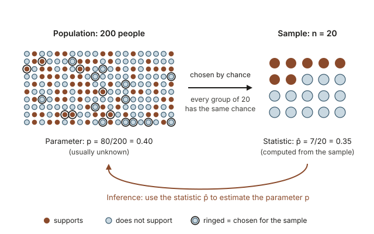
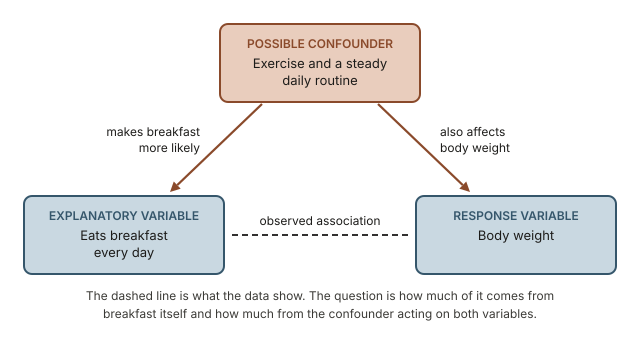
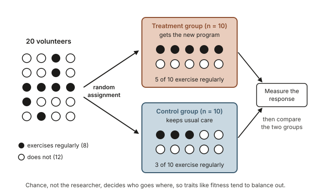
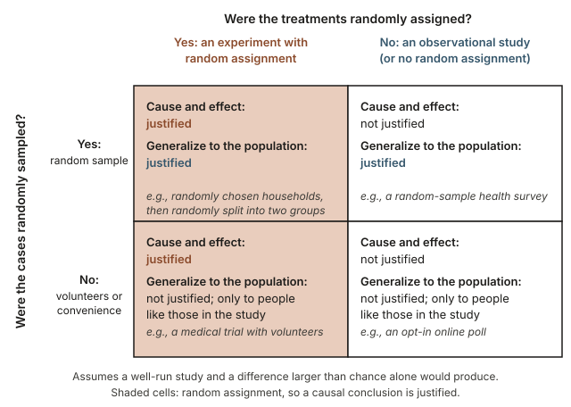
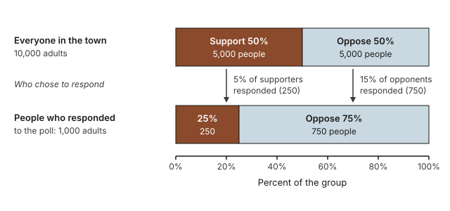
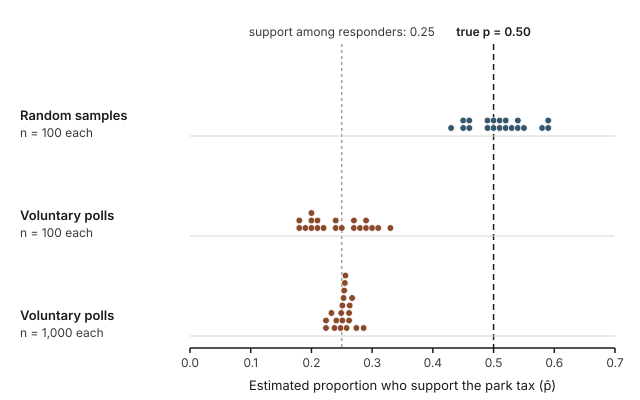

## Warm-up: does eating breakfast make people slimmer?

A hypothetical headline reads: *"Adults who eat breakfast every day weigh less than adults who skip it."* Behind it is a survey of 5,000 adults who reported their eating habits and their weight, and the daily breakfast eaters did weigh less on average.

Before reading on, think about these questions:

1. Could the breakfast eaters weigh less for a reason that has nothing to do with breakfast itself?
2. Would this survey justify telling a friend, "Eat breakfast and you will lose weight"?
3. What would you want to know about how the 5,000 adults were chosen before believing the result describes adults in general?

In [Week 1](week01-data-evidence.qmd) you asked what the data are: the cases, the variables, and the comparison being made. This week asks **how the data were produced**, because that decides what they can and cannot tell you. No amount of careful arithmetic later can repair a weak design.

## Why the way data were collected matters

Claims built on data are everywhere. A poll says most residents oppose a new tax. A report says people who take a vitamin supplement catch fewer colds. Each claim is only as good as the process behind its numbers. A poll that hears mostly from angry residents overstates opposition however many people respond. Comparing people who chose to take a supplement with people who did not mixes the supplement's effect with everything else that differs between those two groups, such as diet and income.

Two design questions come before any graph or calculation:

- **Who was measured, and how were they chosen?** This decides whether results can be generalized from the sample to a larger population.
- **Who decided which cases got which treatment?** This decides whether a difference between groups can be read as cause and effect.

Health agencies issuing advice, city councils reading a public survey, and doctors choosing a treatment all rely on these two questions whenever they act on evidence.

## What you will be able to do

By the end of this week you can:

- tell whether a study is an observational study or an experiment, and name its cases, explanatory variable, and response variable;
- explain what random sampling and random assignment each allow you to conclude;
- place a study in the scope-of-inference grid and say who its conclusions apply to and whether they can be causal;
- recognize convenience samples, voluntary response, and non-response, and predict which way a bias is likely to push an estimate;
- explain what a confounding variable is and why it blocks causal conclusions from observational data;
- describe what a control group, a placebo, and blinding each add to an experiment.

## Words to know this week

| Term | Meaning |
|---|---|
| Population, sample | The whole group of cases you want to learn about; the cases actually measured. |
| Parameter | A number describing the population, such as $p$ or $\mu$; usually unknown. |
| Statistic | A number computed from a sample, such as $\hat{p}$ or $\bar{x}$, used to estimate a parameter. |
| Simple random sample | A sample chosen so that every possible group of $n$ cases has the same chance of being selected. |
| Bias | A tendency of a method to miss the parameter in the same direction, sample after sample. |
| Convenience sample | Cases that were easy to reach, such as people walking past a table on campus. |
| Voluntary response sample | People who chose to respond to an open invitation, such as an online poll. |
| Non-response bias | Bias that arises when selected people do not respond and differ from those who do. |
| Observational study | A study that records variables without assigning treatments; the cases sort themselves into groups. |
| Experiment | A study in which the researcher assigns the treatment to the cases. |
| Random assignment | Using chance to decide which cases receive which treatment. |
| Control group | The comparison group, which gets no treatment, usual care, or a placebo. |
| Placebo | A fake treatment that looks like the real one but has no active ingredient. |
| Blinding | Keeping participants (single-blind), or participants and evaluators (double-blind), unaware of who got which treatment. |
| Confounding variable | A variable associated with both the explanatory and the response variable, so its effect is mixed up with the effect being studied. |
| Scope of inference | Who a study's conclusions apply to, and whether those conclusions can be causal. |

## Where the data came from: samples and populations

Most statistical questions are about a **population**: all adults in a town, or all patients with a certain condition. Measuring everyone, which is called a **census**, is usually too costly or too slow, so we measure a **sample** and learn about the population from it. Whether that works depends on how the sample was chosen.

### Populations, parameters, and statistics

A **parameter** describes the population; a **statistic** is computed from a sample. The notation keeps them apart: $p$ is a population proportion and $\hat{p}$ (read "p-hat") is a sample proportion, while $\mu$ and $\bar{x}$ are the matching means. Parameters are usually unknown, and statistics are how we estimate them.

The figure below shows a hypothetical population of 200 people, 80 of whom support a proposal, so $p = 80/200 = 0.40$. In real life you would never see this. Chance picked 20 of the 200, and 7 of those 20 support the proposal, so $\hat{p} = 7/20 = 0.35$.

{fig-alt="Grid of 200 dots for a hypothetical population with 80 supporters, so p = 0.40. Twenty dots chosen by chance are ringed and copied into a sample of 20; 7 of the 20 support the proposal, so p-hat = 0.35."}

The statistic is close to the parameter but not equal to it. Another random sample would almost surely contain different people and could give a different $\hat{p}$, perhaps 0.45 or 0.30. This **sampling variability** is not a mistake, and because chance did the choosing, later weeks can measure its size.

### Random sampling lets chance choose who is measured

In a **simple random sample** of size $n$, every possible group of $n$ cases has the same chance of being the sample. In practice you number a list of the population (the sampling frame) and let a random number generator pick $n$ of the numbers. Neither the researcher nor the cases decide who is in the sample: chance does.

This matters because people choosing "typical" cases tend to pick convenient or memorable ones, while chance has no preferences. A random sample tends to resemble the population in every respect, including traits nobody measured, so its statistics vary *around* the parameter rather than landing systematically above or below it.

Chapter 2 of *Introduction to Modern Statistics* (IMS), the free textbook linked under Read further, also describes **stratified sampling**, which takes a simple random sample within each of several groups (such as each class year), and **cluster sampling**, which randomly chooses whole groups (such as residence halls) and measures everyone in them. Both still let chance do the choosing.

### How samples go wrong: sources of bias

A sampling method is **biased** if it tends to miss the parameter in the same direction, sample after sample. Common sources:

- **Convenience samples.** Asking students at the campus gym how often they exercise will overstate exercise among all students.
- **Voluntary response.** Online polls and call-in shows hear from people who choose to respond, often those with strong feelings, especially negative ones.
- **Non-response.** Even a random sample becomes biased when many selected people do not respond and differ from those who do. If only 20% respond, ask who the other 80% are.
- **Undercoverage.** The sampling frame leaves people out, as when a survey that calls only landlines misses everyone without one.
- **Response bias.** Question wording or a sensitive topic pushes replies one way. "Do you agree that the city should protect children by lowering speed limits near schools?" invites agreement.

Size offers no protection. In 1936 a popular US magazine mailed mock ballots to about ten million people, received more than two million back, and predicted that Alf Landon would defeat President Franklin Roosevelt. Roosevelt won in a landslide. The magazine's mailing lists leaned toward better-off households, and the people who mailed ballots back leaned toward Landon as well.

So keep two kinds of error apart. **Sampling variability** (chance error) comes from which cases happened to be chosen; under random sampling it is centered on the truth and shrinks as $n$ grows. **Bias** comes from how cases were chosen or measured; it pushes every sample the same way, and a larger sample does not shrink it. Worked example 2 puts numbers on this difference.

## Observational studies and experiments

The second design question is how the cases ended up in the groups being compared.

### Observational studies record what already happens

In an **observational study**, researchers record variables without assigning any treatment. The breakfast survey is observational: the adults decided for themselves whether to eat breakfast. Observational studies are often the only ethical or practical option, since nobody can be assigned to smoke for twenty years or to live next to a highway. They can reveal an **association**, a pattern in which values of one variable tend to go with values of another. On their own, they cannot show that one variable causes changes in the other.

### Confounding: why association is not causation

A **confounding variable** is associated with both the explanatory and the response variable, so its effect gets mixed up with the effect being studied. People who eat breakfast every day may also exercise more and keep steadier routines, and those habits affect weight on their own. If so, breakfast eaters would weigh less on average even if breakfast had no effect at all.

{fig-alt="Arrow diagram. A possible confounder, exercise and a steady daily routine, points to both eating breakfast every day (explanatory variable) and body weight (response variable); a dashed line marks the observed association."}

Confounding does not make the causal claim false; it means the data cannot separate the competing explanations. Breakfast might help, do nothing, or even work slightly against weight loss while the confounder does the work. [Week 6](week06-confounding.qmd) returns to confounding, including comparisons made within groups of a confounder, which help only for confounders someone thought to measure.

### Experiments and the power of random assignment

In an **experiment**, the researcher assigns the treatment. That alone is not enough: a doctor who gives a new drug to the patients she expects to benefit most creates groups that differ before the drug does anything. The remedy is **random assignment**, letting chance decide who gets which treatment, for example by shuffling cards or using a random number generator.

The diagram below shows 20 hypothetical volunteers, 8 of whom exercise regularly, split by chance into two groups of 10. The treatment group got 5 of the regular exercisers and the control group got 3. That is not a perfect split, but no one chose it, and with larger groups the proportions tend to come out closer together.

{fig-alt="Twenty hypothetical volunteers, 8 of whom exercise regularly, are split by chance into two groups of 10. The treatment group gets 5 regular exercisers and the control group gets 3; the response is then measured and compared."}

Random assignment tends to balance every trait in this way, including traits nobody measured, such as diet, genetics, and motivation. If the groups' responses then differ by more than chance alone would produce, the treatment is the most plausible explanation. That is why a well-run randomized experiment can support a cause-and-effect conclusion and an observational study cannot.

### Control groups, placebos, and blinding

IMS lists four principles of experimental design:

- **Control.** Keep everything except the treatment as alike as possible across groups (IMS's example: every patient takes the pill with the same glass of water), and compare the treatment with a control group. Colds and back pain often improve on their own, so improvement means little without a comparison.
- **Randomize.** Assign treatments at random.
- **Replicate.** Use enough cases that chance differences between groups are small compared with a real effect.
- **Block.** If a variable such as age is known to affect the response, sort the cases into blocks by that variable and randomize within each block.

People often feel better simply because they believe they are being treated; this is the **placebo effect**. So a drug trial usually gives the control group a **placebo**, such as a sugar pill that looks like the real drug, and the comparison then isolates the effect of the active ingredient. **Blinding** guards against expectations: patients who know their group may report differently, and evaluators who know may judge the treated group more favorably without meaning to. In a **double-blind** study neither the patients nor the evaluators know who got which treatment. When blinding is impossible (people know whether they have been assigned to walk thirty minutes a day), a careful report says that expectations may explain part of any difference.

## Scope of inference: what sampling and assignment each allow

Random sampling and random assignment are two different uses of chance, and each buys something different:

- **Random sampling** decides *who is in the study*. It lets you **generalize** from the sample to the population.
- **Random assignment** decides *which treatment each case gets*. It lets you draw a **cause-and-effect** conclusion.

Crossing the two gives a study's **scope of inference**.

{fig-alt="Two-by-two grid. Columns: treatments randomly assigned or not. Rows: cases randomly sampled or not. Random assignment justifies cause and effect; random sampling justifies generalizing to the population."}

- **Both (top left).** Rare, because randomly sampled people usually cannot be required to join an experiment. One example: randomly chosen households are randomly sent one of two letters about saving water. The conclusion is causal and applies to the population sampled.
- **Sampling only (top right).** A well-run random-sample survey. Associations generalize to the population, but no causal claim is justified.
- **Assignment only (bottom left).** Most medical trials, which randomly assign volunteers. The conclusion is causal for people like the volunteers; extending it further is a judgment the design does not guarantee.
- **Neither (bottom right).** An opt-in or convenience study. It shows an association among the people studied, and nothing more.

### When is a causal claim justified?

From a single study, a causal claim is justified when the study is a well-run randomized experiment and the difference between groups is larger than chance alone would plausibly produce. Weeks 11 and 12 show how to judge that.

Observational studies cannot establish causation one at a time, but many of them together sometimes can. Smoking and lung cancer is the classic case. Randomly assigning people to smoke was never an option, yet the evidence became overwhelming: the association was strong and appeared in study after study and population after population, risk rose with the amount smoked, smoking came before the disease, and laboratory work showed how tobacco smoke damages lung tissue. Each of these features makes confounding a less believable explanation, and no single observational study supplies them all.

When you read a claim, ask: Was the treatment assigned, and was the assignment random? Was there a control group, and blinding? Who was studied, and how were they chosen? Does the language match the design? Words like *causes*, *reduces*, and *boosts* claim causation; *is linked to* and *is associated with* claim only association. "Breakfast linked to lower weight" fits an observational survey; "Breakfast causes weight loss" does not.

## Worked example 1: standing desks and back pain

**The question.** A physical therapist recruits 60 office workers through a flyer at one large hospital (all numbers in this example are hypothetical). A random number generator places 30 of them in a group that gets a standing desk for eight weeks; the other 30 keep their usual desks. Each worker rates their back pain from 0 (none) to 10 (worst imaginable) at the start and at the end. On average, ratings fell by 1.8 in the standing-desk group and by 0.6 in the usual-desk group. What kind of study is this, can it support a cause-and-effect claim, and to whom does it apply?

**Step 1: cases and variables.** The cases are the 60 workers. The explanatory variable is desk type (standing or usual), which is categorical. The response variable is the change in back-pain rating, which is numerical.

**Step 2: observational study or experiment?** The therapist, not the workers, decided who got a standing desk, so this is an experiment.

**Step 3: random assignment and balance.** Chance made the assignment. As a check, 24 of the 60 workers reported at the start that they exercise regularly; 13 of them landed in the standing-desk group and 11 in the usual-desk group, so the proportions of regular exercisers were

$$\frac{13}{30} \approx 0.43 \qquad \text{and} \qquad \frac{11}{30} \approx 0.37.$$

They are not identical, but nobody chose them, and the same chance balance applies to traits that were never measured.

**Step 4: control, placebo, blinding.** The usual-desk group is the control group, and it matters here: back pain often eases with time, and the control group's ratings fell by 0.6 with no new desk. No placebo desk exists, and workers cannot be blinded to their own desk. Because pain is self-rated, part of any difference could come from expectations.

**Step 5: the comparison.** The difference in mean change is

$$1.8 - 0.6 = 1.2$$

on the 0-to-10 rating, so the standing-desk group's ratings fell 1.2 more on average. Whether that is more than random assignment alone would produce is a question for [Week 11](week11-simulation-based-inference.qmd); for this example, suppose it is.

**Step 6: random sampling?** No. The workers volunteered after seeing a flyer at one hospital, and people who respond to a flyer about back pain may have worse pain, or more motivation, than office workers in general.

**Step 7: the grid.** Random assignment yes, random sampling no: the bottom-left cell of the scope-of-inference grid.

**Conclusion in context.** If the 1.2 difference is larger than chance alone would produce, the design supports the claim that standing desks reduced back pain *for these 60 volunteers*, with the caution that they knew their desk and rated their own pain. It does not by itself justify the same claim for all office workers. That would need a good argument that these volunteers resemble office workers generally, or a study that samples workers more widely.

## Worked example 2: how voluntary response distorts a town poll

**The question.** A town of 10,000 adults is considering a small tax to build a park (all numbers here are hypothetical). Suppose, though in real life no one could know it, that the town is evenly split, so $p = 0.50$. The town posts an online poll open to everyone. Supporters feel only mildly positive, and 5% of them respond; opponents feel strongly, and 15% of them respond. What will the poll report, and would a bigger poll fix the problem?

**Step 1: supporters and opponents.**

$$0.50 \times 10{,}000 = 5{,}000 \text{ supporters} \qquad \text{and} \qquad 10{,}000 - 5{,}000 = 5{,}000 \text{ opponents}.$$

**Step 2: who responds.**

$$0.05 \times 5{,}000 = 250 \text{ supporters}, \qquad 0.15 \times 5{,}000 = 750 \text{ opponents}, \qquad 250 + 750 = 1{,}000 \text{ respondents}.$$

The overall response rate is $1{,}000 / 10{,}000 = 0.10$, or 10%.

**Step 3: the poll's estimate.** Among respondents, the proportion who support the tax is

$$\hat{p} = \frac{250}{1{,}000} = 0.25,$$

so the poll reports 25% support and 75% opposition.

{fig-alt="Two stacked bars. In a hypothetical town of 10,000 adults, 50% support a park tax. Only 5% of supporters and 15% of opponents responded, so of the 1,000 respondents 25% support the tax and 75% oppose it."}

**Step 4: the error.**

$$\hat{p} - p = 0.25 - 0.50 = -0.25,$$

so the poll understates support by 25 percentage points. An evenly split town looks opposed three to one, since $0.75 / 0.25 = 3$.

**Step 5: would a bigger poll help?** In a city of 100,000 adults with the same split and the same response rates, 50,000 support the tax and 50,000 oppose it, so

$$0.05 \times 50{,}000 = 2{,}500, \qquad 0.15 \times 50{,}000 = 7{,}500, \qquad \hat{p} = \frac{2{,}500}{2{,}500 + 7{,}500} = \frac{2{,}500}{10{,}000} = 0.25.$$

Ten times as many respondents give exactly the same wrong estimate. The error comes from *who* responds, and more responses of the same kind do not change it.

The dot plots below simulate 20 polls for each of three methods. In the voluntary polls, as in the town, supporters respond one-third as often as opponents. Random samples of 100 adults, assuming everyone selected responds, gave estimates from 0.43 to 0.59, scattered around the true 0.50. Voluntary polls of 100 gave estimates from 0.18 to 0.33. Voluntary polls of 1,000 were much tighter, from 0.224 to 0.286, but clustered around 0.25, not 0.50. Even the closest of the 40 voluntary polls, at 0.33, was 0.17 below the truth.

{fig-alt="Dot plots of simulated estimates of support. Random samples of 100 fall from 0.43 to 0.59 around the true 0.50. Voluntary polls of 100 fall from 0.18 to 0.33, and of 1,000 from 0.224 to 0.286, near 0.25."}

**Step 6: what would fix it?** A random sample, plus serious follow-up (reminders, calls) so that nearly everyone selected responds. Random selection protects you only if the selected people actually respond. The random samples above scatter because of sampling variability, but they are centered on the truth, and that scatter shrinks as $n$ grows. The same arithmetic describes non-response bias: if a random sample were drawn but supporters answered at one-third the rate of opponents, the estimate would be pulled the same way.

**Conclusion in context.** The poll's 25% support reflects who chose to respond, not the town, which is evenly divided. A bigger voluntary poll would only repeat that figure with more apparent precision: the design, not the sample size, is the problem. And because a real pollster never sees the response rates of supporters and opponents, this kind of bias is hard to detect or correct afterward.

## Transfer: text-message reminders at a health clinic

The same reasoning applies in a new setting (hypothetical numbers): do a clinic's text-message reminders reduce missed appointments?

**Design A: patients choose.** Last year patients could sign up for reminders. Of the 400 who signed up, 32 missed their next appointment; of the 600 who did not, 90 missed it:

$$\frac{32}{400} = 0.08 \qquad \text{and} \qquad \frac{90}{600} = 0.15,$$

a gap of $0.15 - 0.08 = 0.07$, or 7 percentage points.

Who decided which patients got reminders? The patients did, so this is an observational study. Patients who sign up may be more organized, have reliable phones and transportation, or be more engaged with their own care, and each of those traits lowers missed appointments on its own. Because of these possible confounders, the gap of 7 percentage points mixes the effect of reminders with the effect of being the kind of patient who signs up.

**Design B: chance chooses.** This year the clinic takes 4,000 patients with upcoming appointments and randomly assigns 2,000 to receive reminders and 2,000 not to. With reminders, 220 missed; without, 280 missed:

$$\frac{220}{2{,}000} = 0.11 \qquad \text{and} \qquad \frac{280}{2{,}000} = 0.14,$$

a gap of $0.14 - 0.11 = 0.03$, or 3 percentage points.

Random assignment balances organization, phone access, transportation, and engagement between the groups, apart from chance differences. If a gap of 3 percentage points is larger than chance alone would produce, it can be attributed to the reminders, for this clinic's patients. The 4,000 were not sampled from patients everywhere, so applying the result to a clinic that serves a very different community is a judgment call.

**What to notice.** The observational gap (7 percentage points) is more than twice the experimental gap (3 percentage points). Taking the experiment's 3 percentage points as the better estimate of what reminders do, most of the 7 percentage point gap in Design A came from *who chose* reminders, not from the reminders. (The two designs also drew on different years' patients, so this comparison is rough.) The same two questions settled it: who decided the groups, and who was studied.

## A common misreading: a random sample proves cause and effect

The misreading goes like this: *"The researchers used a large random sample of 10,000 adults, so their finding that coffee drinkers live longer means coffee extends life."* (The study is hypothetical.)

Random sampling makes the sample look like the population. But the coffee drinkers in the sample still *chose* coffee. If coffee drinkers in the population differ from non-drinkers in income, smoking, or health, a representative sample reproduces those differences faithfully. Random sampling copies the population's confounding into the sample rather than removing it. Only random assignment of the treatment breaks the link between the treatment and everything else about the people who get it.

The mirror-image mistake is just as common: *"A randomized trial proved the drug works, so it works for everyone."* Random assignment supports a causal conclusion for people like those who were studied. If every volunteer was under 50, the trial says little directly about 80-year-olds.

A short way to remember the difference: random **sampling** is about *who* is in the study; random **assignment** is about *what* they get.

## Practice questions (ungraded)

1. A hypothetical college emails a survey about dining-hall hours to all 8,000 of its students, and 900 reply. Name the population and the sample, compute the response rate, and describe one way the 900 might differ from the students who did not reply. *What to look for:* who cares most about dining-hall hours?
2. In a hypothetical study using medical records, a researcher finds that adults who own dogs have lower average blood pressure than adults who do not. Is this an observational study or an experiment? Name one possible confounding variable and explain how it alone could produce the association.
3. Forty hypothetical students who responded to a campus ad are randomly assigned to use a sleep-tracking app or not for a month, and the app group reports sleeping longer. Which cell of the scope-of-inference grid does this study belong in? What can it conclude, and about whom?
4. Why does a trial of a new pain reliever give the control group a placebo instead of nothing, and what does making the trial double-blind add?
5. A hypothetical news website's poll of 50,000 readers finds that 70% oppose a new state law. A friend says 50,000 is so many that the result must be accurate. What is wrong with this reasoning, and what would be a better way to learn what the state's adults think? *What to look for:* can size fix bias?
6. A hypothetical health department mails a survey to a simple random sample of 400 households, and 120 surveys come back. What is the response rate, and why might the results be biased even though the households were chosen at random?

## Read further on study design

- [Introduction to Modern Statistics, Chapter 2: Study design](https://openintrostat.github.io/ims/data-design.html) covers sampling principles and strategies, observational studies, and experiments.
- [Introduction to Modern Statistics, Chapter 3: Applications: Data](https://openintrostat.github.io/ims/data-applications.html) applies the ideas of the first two chapters to a case study.
- Optional, for biomedical examples: [Introductory Statistics for the Life and Biomedical Sciences](https://www.openintro.org/book/biostat/), Chapter 1, Introduction to data.

The IMS book shows R code in places. Skip the code and read the output and the explanation around it; you will not write or run any code in this course.

## Where this goes next

The previous week, [Week 1: Data, evidence, and statistics](week01-data-evidence.qmd), set up the vocabulary of cases and variables used here. Next, [Week 3: One-variable summaries](week03-one-variable-summaries.qmd) describes what data show, one variable at a time. Keep this week's design questions in mind there: a careful summary of a biased sample precisely describes the wrong group.

Later, [Week 6: Confounding and multivariable thinking](week06-confounding.qmd) develops confounding, and [Week 11: Simulation-based inference](week11-simulation-based-inference.qmd) uses random assignment itself to judge whether a difference is larger than chance alone would produce. See also [all weekly notes](index.qmd) and the [course schedule](../schedule.qmd).
