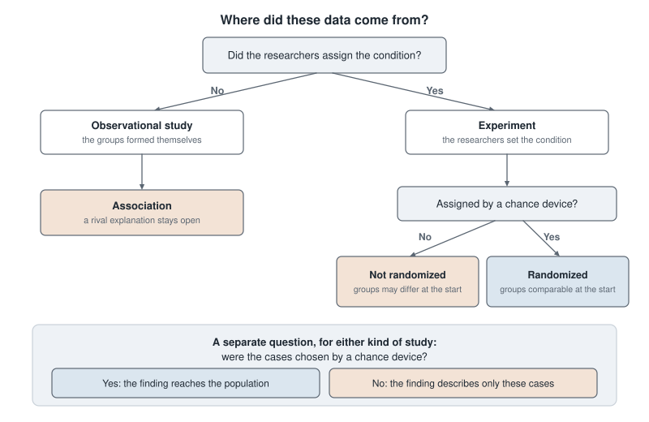
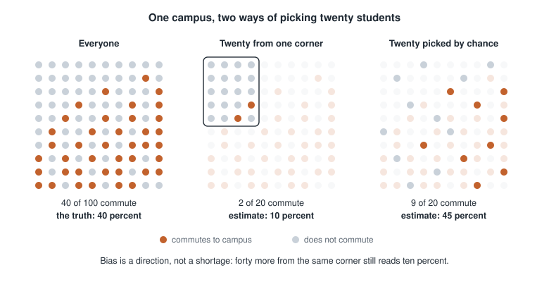
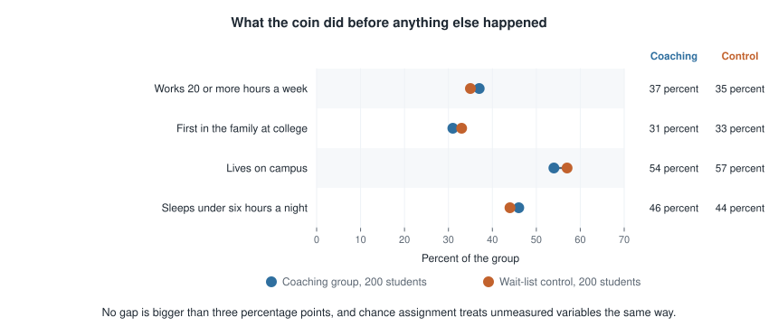
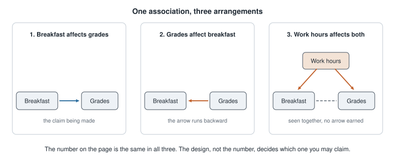

## Where this week starts

Week 1 ended with a habit: before interpreting any number, ask what the cases are, what was measured, and what comparison is being made. This week pushes that first question further back. Before the data table existed, somebody decided who would be in it and under what conditions.

That decision, not the arithmetic afterwards, settles what the number is worth. Two studies can report the same difference, from samples of the same size, and one supports a recommendation while the other supports a raised eyebrow. Nothing in the two numbers tells you which is which, so the question for the week is: where did these data come from?

By the end of this week, "students who eat breakfast have higher grades, so eat breakfast" should stop sounding like one claim and start sounding like two: one the data can check, and one that has been attached to it.

### Why this matters beyond this course

A state health department is deciding whether to fund home visits for new parents. One evaluation compares families who signed up for an existing program with families who did not, and the sign-up families do better. A second study offers the program to everyone and lets a chance device decide who receives it. The first comparison can be explained entirely by who signs up — families with a working phone, a schedule with slack in it, someone who already trusts the department. If money follows that evidence, families get a program that may do nothing, and one that would have helped never gets built.

The smaller version arrives weekly, in a supplement label or a campus survey. Asking "who ended up in this comparison, and who decided?" costs one sentence and is the cheapest protection you have.

## What you will be able to do

- Classify a study as observational or experimental by naming who assigned the condition.
- Name the population, the sampling frame, and the sample, and say where the gaps between them sit.
- Spot selection, non-response, and measurement bias, and say which direction each pushes the result.
- Distinguish random assignment from random sampling, and state what each buys.
- Explain what a control group and blinding change about what a comparison supports.
- Rewrite a causal headline into the strongest claim its design supports.

## Words worth owning

| Term | What it means in this course |
|------|------------------------------|
| Population | Every case the conclusion is meant to cover. |
| Sampling frame | The list the sample was really drawn from. Rarely the whole population, and that gap is where trouble starts. |
| Observational study | Researchers record conditions the cases already had. Nobody assigns anything. |
| Experiment | Researchers assign the condition each case receives. |
| Random sampling | A chance device decides which cases enter the study at all. |
| Random assignment | A chance device decides a case's group, once it is already in the study. |
| Confounding variable | A variable linked to the explanatory variable and separately related to the response, so it offers a rival explanation. |
| Bias | Systematic error: a push in one direction that stays put however much data you collect. |

## What happened before the data existed

Every dataset is the residue of a procedure: somebody chose the cases, somebody set the conditions those cases were under, somebody chose how the outcome would be measured. Each can put a result where it does not belong.

### Somebody assigned the condition, or nobody did

The most useful question you can ask about a study is who decided which cases got which condition. Not whether the topic is medical, not whether the sample is large — who did the assigning?

A clinic wants to know whether a twelve-week walking program lowers resting heart rate. Version one: the clinic advertises the program, sixty patients sign up, sixty similar patients do not, and it compares resting heart rate at the end. Version two: the clinic recruits one hundred and twenty patients and lets a chance device decide, for each one, between walking and stretching. In version one the patients sorted themselves, which makes it observational; in version two the clinic sorted them with a coin, which makes it an experiment.

The difference is not effort or expense. In version one the groups were assembled by whatever makes a person sign up for a walking program — energy, free time, a doctor's warning, a working knee — and each is separately related to resting heart rate. In version two the only thing separating the groups is the coin.

{fig-alt="A decision tree. The first question asks who assigned the condition, splitting into observational study and experiment; the experiment branch splits again on random assignment. A separate band asks whether the cases were chosen by chance."}

Read the tree twice. First follow the branches from the top: assignment, then whether it was randomized. Then read only the band across the bottom, which asks how the cases entered the study at all. The two questions are independent, and collapsing them is the most common error of the week.

### Population, frame, and the gap between them

Suppose you want to know what fraction of the roughly nine thousand undergraduates at a university commute to campus. The population is those nine thousand, and the sample is the group you get data on. Between them sits the sampling frame: the list or situation the sample was really drawn from.

The frame is where studies quietly go wrong, because it is almost never announced. Email a random selection from the registrar's list and the frame nearly matches the population. Stand outside the library at ten on a Tuesday morning and the frame is "students near the library, mid-morning, mid-week" — and commuters compress their schedules and leave, so they are less likely to be there. Your sample is not a small version of the population; it is a faithful version of a different group.

{fig-alt="Three copies of a hundred-dot campus with forty commuters. A twenty-dot corner sample finds two, an estimate of ten percent; a twenty-dot chance sample finds nine, forty-five percent, against the true forty percent."}

Forty of the hundred students commute, so the truth is forty percent. The corner sample of twenty finds two and reports ten percent; the chance sample of twenty finds nine and reports forty-five. The chance sample is not perfect — another draw would miss differently — but the corner sample is wrong in a way luck has nothing to do with. Keep collecting from that same corner, however many students you add, and you keep landing near ten percent. Chance error shrinks as you collect more; bias does not move at all.

### Three shapes of bias you will actually meet

**Selection bias**: the procedure that gets a case into the sample is itself related to what you are measuring. The library steps are selection bias — standing where commuters are not, in order to count commuters — and it pushes the estimate down. Online reviews qualify too, because people who write them felt something strongly.

**Non-response bias**: you invite a proper sample, but who replies depends on the topic. A campus emails a food-service survey to nine thousand students and four hundred reply. Students who had a bad week have a reason to click; content students have none, so measured satisfaction is pushed down.

**Measurement bias**, sometimes called response bias: the instrument or the question moves the recorded value away from the real one. A bathroom scale reading two pounds heavy does it. So does asking students how many alcoholic drinks they had last week while a nurse holds the clipboard, and so does "do you agree that the university should protect students by expanding the shuttle service?", which puts the reason for agreeing inside the question.

Naming the shape is half the work; say the direction too. "There might be bias" is a shrug. "Non-response bias, pushing satisfaction down, so the real figure is probably higher than these four hundred replies suggest" is usable.

## What randomizing buys, and what it does not

The word "random" appears in two places in study design, doing two different jobs. Separate them firmly enough that you can say which one a study is missing.

### Random assignment buys a fair comparison

A university health center runs a four-week sleep-coaching program. A chance device puts two hundred of its four hundred students into coaching and two hundred onto a wait list. Before anything starts, the center records background characteristics of both groups.

{fig-alt="A dot chart of four background characteristics measured before the sleep program began. The coaching and wait-list percentages sit within three percentage points of each other in every row."}

Thirty-seven percent of the coaching group works twenty or more hours a week, against thirty-five percent of the control group. The other three rows behave the same way, and no gap exceeds three percentage points.

The coin knew nothing about work hours, family background, housing, or baseline sleep. It balanced those four because it balances everything — motivation, anxiety, caffeine, roommate noise, and the dozen variables nobody would think to measure. Random assignment is the only move in statistics that handles variables you have never heard of.

Be exact about "balanced", though. It does not make the groups identical, and on any single variable they will not be. It makes any difference a product of chance alone, and chance is something the second half of this course knows how to quantify. Large systematic differences become unlikely, not impossible, and less likely as the groups grow.

### Random sampling buys reach

Random sampling does a different job: it decides who enters the study at all. When a chance device draws cases from a frame that matches the population, the sample resembles the population in that same "differs only by chance" way, so conclusions about the sample extend to the population.

Random assignment does none of that. Assign four hundred volunteers to two groups with a perfect coin and you have a clean comparison among those four hundred volunteers. If volunteers are unusual, and they usually are, the effect you measure need not be the effect anywhere else. The two randomizations combine like this:

| | Cases assigned by chance | Cases not assigned by chance |
|---|---|---|
| **Cases sampled by chance** | A causal claim about the population | An association in the population |
| **Cases not sampled by chance** | A causal claim about these cases only | An association among these cases only |

Read it as a diagnostic. The column decides whether your verb may be causal; the row decides who the sentence is about. Randomized trials almost always sit in the bottom-left cell, because chance decided the groups but not who joined the study.

### Control groups and blinding

A control group makes the comparison mean something. Colds resolve in a week, chronic pain fluctuates, and students sleep more after a heavy exam period whatever anyone teaches them. Measure one group before and after and you have measured the program plus everything else that happened, with no way to separate the two. A placebo goes further, holding the experience of being treated constant so the comparison isolates the active ingredient rather than the attention.

Blinding keeps expectation out of the measurement. In a single-blind study the participants do not know their condition; in a double-blind study the people recording the outcome do not know either. A participant who believes she got the real treatment reports feeling better, and an assessor who knows the group reads an ambiguous result generously. Blinding participants in the sleep study is impossible — a student knows whether she attended four weeks of sessions — which is why a wrist device, not a question, should record the outcome.

## Three explanations for one association

When two variables move together in an observational study, at least three arrangements produce the pattern, and the data alone cannot tell them apart.

{fig-alt="Three panels for the same breakfast and grades association: an arrow from breakfast to grades, an arrow from grades to breakfast, and a third where work hours points at both while breakfast and grades share a dashed line."}

The first panel is what the headline wants. The second is reverse causation, which sounds silly until you say it out loud: students whose coursework is going well have calmer mornings, and calmer mornings include breakfast. The third is confounding, and it does the most damage, because a third variable pushing both breakfast and grades produces the same association with no causal path between them.

A fourth rival the picture cannot draw is chance: the association may be a fluke of who landed in this sample. Ruling chance out removes one rival of four rather than promoting an association to a cause.

## Worked example — reading a headline about breakfast and grades

**Setting.** A campus newspaper surveys six hundred students and reports "Eating breakfast raises your grades". The two hundred forty who eat breakfast most days have a mean grade point average of 3.12; the other three hundred sixty average 2.88.

**Step 1 — name the pieces.** The cases are the six hundred respondents. The explanatory variable is the breakfast habit, categorical with two levels; the response is grade point average on a four-point scale.

**Step 2 — find who assigned.** Nobody. Students arrived with their habits already attached, so this is observational and the groups assembled themselves.

**Step 3 — compute what was observed.** The difference in means is

$$3.12 - 2.88 = 0.24$$

on the four-point scale. As a check, the overall mean is

$$\frac{240 \times 3.12 + 360 \times 2.88}{600} = \frac{748.8 + 1036.8}{600} = 2.976$$

closer to 2.88 than to 3.12, as it should be, since the non-breakfast group is larger.

**Step 4 — state what the verb requires.** For "raises" to be earned, the groups would have to be alike in everything else that affects grades: paid work, morning classes, commuting, sleep, financial stress, course load.

**Step 5 — show a rival explanation that fits the same numbers.** Suppose the real driver is paid work. Split each group by whether the student works twenty or more hours a week:

| Group | Works under twenty hours | Works twenty or more hours | Group mean |
|-------|--------------------------|----------------------------|------------|
| Eats breakfast most days | 222 students, mean 3.15 | 18 students, mean 2.75 | 3.12 |
| Does not eat breakfast | 117 students, mean 3.15 | 243 students, mean 2.75 | 2.88 |

Check it. For the breakfast group,

$$\frac{222 \times 3.15 + 18 \times 2.75}{240} = \frac{699.30 + 49.50}{240} = 3.12$$

and for the other group,

$$\frac{117 \times 3.15 + 243 \times 2.75}{360} = \frac{368.55 + 668.25}{360} = 2.88$$

Both group means come out exactly as reported. Now look inside the columns. Breakfast eaters and non-eaters share a mean of 3.15 among students working under twenty hours, and 2.75 among those working twenty or more, so breakfast makes no difference within either kind of student. The whole 0.24 gap comes from the mix: 18 of 240 breakfast eaters work heavy hours, seven and a half percent, against 243 of 360, or sixty-seven and a half percent.

**Step 6 — what this means.** The table is not a finding. It shows that the reported numbers are perfectly consistent with breakfast doing nothing, and equally consistent with breakfast helping; the survey cannot separate those, so the headline's verb claims more than the design carries. A defensible rewrite: students who eat breakfast most days averaged 0.24 higher, a gap that may reflect breakfast or may reflect who has a schedule with room for it.

**Step 7 — what would license the verb.** Random assignment of breakfast would, within the study. Failing that, comparing like with like on the plausible confounders, the technique Week 6 develops, gets closer — but you can adjust only for what you measured.

### The same reasoning, transferred

Among a city's forty neighborhoods, the twenty with the most tree cover have a childhood asthma rate of 8.2 percent and the twenty with the least have 11.6 percent, a difference of 3.4 percentage points. A council member says planting trees prevents childhood asthma.

What stayed the same: nobody assigned tree cover, so the groups formed themselves; rival explanations appear as soon as you look, since household income, traffic volume, and the age of housing all travel with tree cover and each separately affects asthma; and the honest verb is still "is associated with".

What changed: the response is a proportion rather than a mean, and the cases are neighborhoods rather than children. Even if the association were causal, it is a statement about neighborhood rates. It does not follow that one child's risk falls when a tree goes in on her street, because a pattern across groups need not hold within them.

## Second worked example — a randomized sleep-coaching trial

**Setting.** The health center emails all four thousand students an invitation, and four hundred enrol. A chance device assigns two hundred to a four-week coaching program and two hundred to a wait list who receive it at the end. A wrist device records nightly sleep for one week before and one week at the end, so the outcome never depends on memory.

**Step 1 — classify the design.** The center assigned the condition, so this is an experiment, and it assigned by chance, so it is randomized. But the four hundred volunteered, so the cases were not sampled at random: the bottom-left cell above.

**Step 2 — check that the coin worked.** The balance figure above is this study. No background gap exceeds three percentage points, which is what chance assignment usually looks like at this size.

**Step 3 — compute the comparison.** Baseline mean nightly sleep was 6.4 hours in both groups. At the end, coaching averaged 7.2 hours and control 6.6:

$$7.2 - 6.6 = 0.6 \text{ hours,}$$

thirty-six minutes a night. Because the baselines matched, the difference in change is the same: coaching gained 0.8 hours, control gained 0.2, and $0.8 - 0.2 = 0.6$. Notice that the control group moved. Without it you would have credited the program with the full 0.8 hours, when a quarter of that gain happened to students who received nothing.

**Step 4 — what the design supports.** Among these four hundred students, the thirty-six-minute difference is caused by the program, so long as it is larger than chance assignment alone would produce — the question the second half of this course answers. Random assignment left chance as the only rival explanation, including for the variables nobody measured; the wrist device removed self-report bias; the wait-list control removed everything else that happened during those four weeks.

**Step 5 — what it does not support.** The four hundred are volunteers out of four thousand invited, an enrolment rate of ten percent, and volunteers for a sleep study are plausibly the students most unhappy with their sleep — the ones with the most room to improve. So "the average student here would gain thirty-six minutes" is not supported. Random assignment never bought that sentence; random sampling would have, and this study did none.

**Step 6 — how to repair the reach.** Draw a random sample from the registrar's list, invite those students, and report what fraction agreed, so a reader can judge how far the finding travels. Or replicate the program in visibly different groups. Generalization is earned by design or by replication, never by sample size.

## The misreading to avoid

The wrong thought, in the words students actually use: *"That survey had fifty thousand responses and the experiment had two hundred people. Obviously the survey is more reliable."*

It deserves a serious reply, because more data really is better when the data are aimed at the right target. Take a campus of ten thousand students, thirty percent of whom — three thousand — favour a parking proposal. A voluntary web poll goes out. Opponents are angrier, so thirty percent of the seven thousand opponents reply, giving 2,100, while ten percent of the three thousand supporters bother, giving 300. Out of 2,400 replies,

$$\frac{300}{2400} = 0.125,$$

so the poll reports 12.5 percent against a truth of thirty percent. Run the same procedure on a campus ten times the size: 3,000 supporter replies and 21,000 opponent replies, and 3,000 divided by 24,000 is 12.5 percent again. Ten times the data, identical error. A genuine random sample of two hundred would instead scatter around thirty percent, and the scatter shrinks as the sample grows.

The over-correction is the second wrong thought: *"So observational studies prove nothing and it is all just correlation."* Nobody ever randomly assigned people to smoke for thirty years, yet the link between smoking and lung cancer is about as settled as anything in health science. It was built from many observational studies whose biases pointed in different directions, from a dose-response pattern in which heavier smoking tracked higher risk, and from the failure of every rival explanation proposed. Observational evidence carries extra assumptions; the job is to state them, not to ignore them or give up.

The third misreading is quieter: *"It was a randomized trial, so it applies to everyone."* Randomized assignment says the comparison inside the study is fair. It says nothing about who got into the study.

## Practice on your own

Work these for your own checking.

1. A fitness company reports that customers who open its app at least four times a week lost more weight over six months than customers who open it less. Name the cases, the explanatory variable, the response, and who assigned the condition. Then write the strongest claim the design supports, plus one rival explanation.

2. A dining service leaves comment cards at one dining hall exit for a week. Three hundred come back and seventy-four percent report being satisfied. Identify the population and the frame this procedure used. Which shape of bias is most serious, and which direction does it push the seventy-four percent?

3. A trial assigns three hundred patients with chronic knee pain, by a chance device, to physical therapy or usual care. Pain is rated by the patients themselves from zero to ten. Write down what the randomization handled and what it did not, then name one change to the measurement that would strengthen the study.

4. Two studies report the same difference in average blood pressure between a low-sodium and a usual diet. Study A assigned diets by chance to one hundred fifty volunteers recruited by advertisement. Study B drew fifteen thousand adults at random from a national list and recorded what they already ate. For each, say what the design licenses you to claim, and about whom.

5. Find a health claim you saw this week. Copy the sentence, circle its verb, and write out what would have to be true about the study for that verb to be earned.

## Where to read more

- [Introduction to Modern Statistics, Chapter 2: Study design](https://openintrostat.github.io/ims/data-design.html) covers this week's spine, including sampling methods and experimental principles.
- [Chapter 3: Applications — Data](https://openintrostat.github.io/ims/data-applications.html) works through study descriptions of the kind this week's material uses.
- [Chapter 1: Hello data](https://openintrostat.github.io/ims/data-hello.html) is worth a second pass if cases and variables still feel slippery.
- [Introductory Statistics for the Life and Biomedical Sciences](https://www.openintro.org/book/biostat) treats study design with clinical examples.
- The [course schedule](../schedule.qmd) lists what each meeting covers, and the [resources page](../resources/index.qmd) collects extra practice.

## Where this goes next

Next week the course turns from where data come from to what a single variable looks like once you have it. [Week 3](week03-one-variable-summaries.qmd) is about shape, center, and spread. That work assumes this week: a beautifully drawn histogram of a badly collected sample is a beautifully drawn wrong picture, and you will be expected to say so.

The third-variable problem returns in [Week 6](week06-confounding.qmd) as confounding, where you learn to compare like with like and to read "adjusted for age" in an abstract. The chance explanation is the business of the second half of the term. The vocabulary of cases and variables is back in [Week 1](week01-data-evidence.qmd), and the [notes index](index.qmd) has everything in order.
