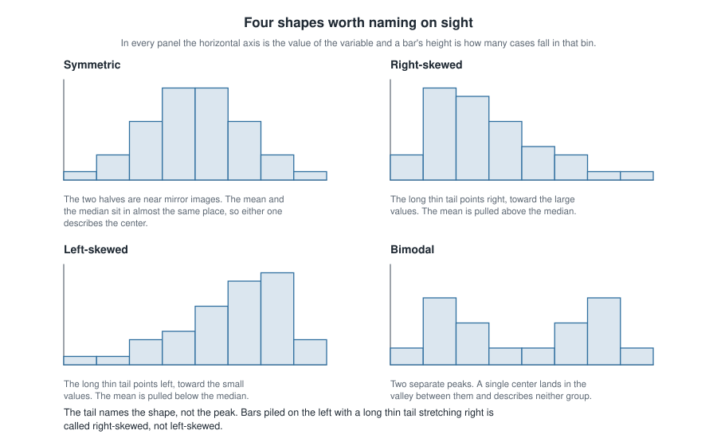
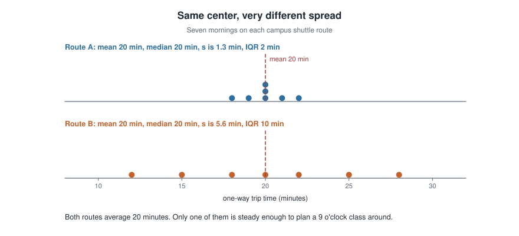
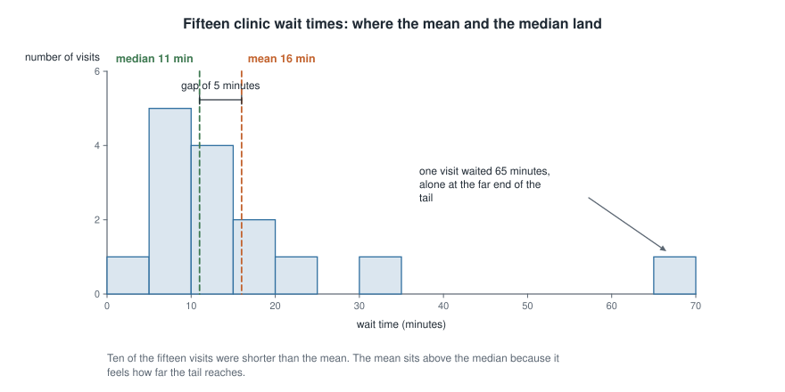
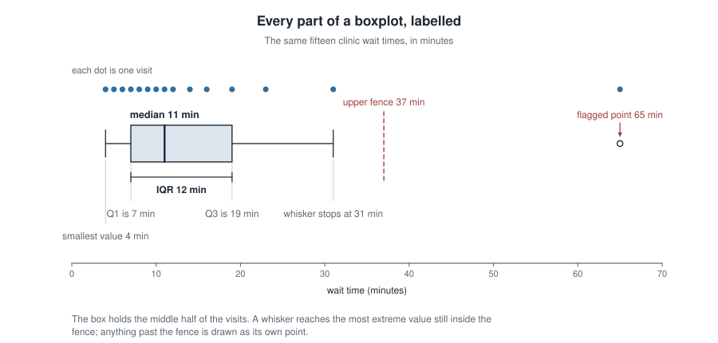

## Where this week starts

Weeks 1 and 2 asked where numbers come from: what was measured, who was sampled, who was assigned. Neither week asked you to look at one column of numbers and say what it contains. That is this week.

Take a single variable — the wait for a clinic visit, the trip time on a shuttle route, this morning's commute — and answer three questions: what **shape**, what **center**, how much **spread** around that center. Always in that order, because shape decides which center and which spread are honest to report.

By the end of this week one instinct should have changed: hand you forty numbers today and you will probably average them, and averaging first should come to feel incomplete.

### Why this matters beyond this course

A campus shuttle office runs two routes to the same building. Both average 20 minutes, and both averages get published. On one route the trips run 18 to 22 minutes; on the other, 12 to 28. A student with a 9 o'clock class picks whichever is convenient. The average hid the only thing that student needed: one route lets you plan, the other makes you late some mornings, and the published number gave no warning.

The same failure follows averages everywhere they travel without their spread and their shape: a clinic staffed to an average wait leaves the patients in the long tail sitting for an hour. Nobody lied; somebody reported one number where three were needed.

## What you will be able to do

- Read a dot plot or a histogram and name its shape: symmetric, right-skewed, left-skewed, or bimodal.
- Rebuild a histogram at a different bin width and say which features are real and which came from the bins.
- Choose between the mean and the median and defend the choice from the shape, not from habit.
- Compute a standard deviation by hand and read it as a typical distance from the mean.
- Build a five-number summary, draw its boxplot, and read a boxplot back into five numbers.
- Apply the 1.5 times IQR rule to flag an unusual value, then investigate and report it rather than dropping it.

## Words worth owning

| Term | What it means in this course |
|------|------------------------------|
| distribution | The whole pattern of values a variable takes: which ones occur, and how often. |
| shape | The silhouette of that pattern — symmetric, right-skewed, left-skewed, bimodal. |
| center | One value standing in for "around here": the mean or the median. |
| spread | How far the values sit from the center. |
| standard deviation | Roughly the typical distance from a value to the mean, in the variable's units. Written s. |
| interquartile range | The width of the middle half: Q3 minus Q1. Written IQR. |
| resistant | Barely moved by one extreme value. The median and IQR are; the mean and s are not. |
| outlier | A value far from the rest, flagged so you go and look at it. Not a synonym for "mistake". |

## Three questions to ask of any distribution

Every quantitative variable in this course gets the same interrogation. **What shape? What center? What spread?** Report a center before you have looked at the shape and you may report a number that describes nobody.

### Making the picture: dot plots, histograms, and bin width

A **dot plot** is the honest picture of a small sample: draw a number line, put one dot above each case's value, stack the ties. Nothing is discarded, and it works up to roughly fifty cases.

A **histogram** handles more. Cut the number line into **bins** of equal width, count how many cases land in each, and draw a bar of that height. Two mechanics matter. Settle a boundary convention: here, a value sitting exactly on a boundary goes into the bin on its right, so a 20-minute commute counts in the bin from 20 up to 30. And the bars touch, because the horizontal axis is a continuous number line, unlike the gapped bars of a category chart.

Bin width is a real decision, and the first place a distribution gets misrepresented without anyone lying. Too narrow and nearly every case gets its own spike, so you read random wobble as structure; too wide and genuine structure — a second peak, a gap, a tail — collapses into one fat bar. For a few dozen cases aim for five to fifteen bins, and always redraw at a second width. A feature that survives both widths is in the data; a feature that vanishes is a fact about your bins.

### Shape: symmetric, skewed, and bimodal

{fig-alt="Four small histograms in a two by two grid labelled symmetric, right-skewed, left-skewed, and bimodal, each with one sentence about what that shape does to the mean and the median."}

A **symmetric** distribution has halves that are near mirror images. A **right-skewed** one has a long thin tail stretching toward the large values with most cases bunched low; a **left-skewed** one is its mirror. A **bimodal** distribution has two separate peaks, usually because two kinds of case were mixed into one column. Right skew is the default for a great many variables you will meet — wait times, incomes, hospital lengths of stay — because all of them have a floor at zero and no ceiling.

::: {.callout-warning}
## Name the skew by the tail, never by the peak

The most common shape error in this course sounds like this: "the bars are all piled up on the left, so it's left-skewed." It is not. The tail names the shape: bars piled on the left with a long thin tail reaching right is **right**-skewed. Picture the tail as an arm and read the direction it points.
:::

### Why shape decides which center you report

The **mean** is the sum divided by the count — physically, the balance point of the dot plot, where you would hold a ruler of weights level. The **median** is the middle value once the data are sorted, or the average of the two middle values when the count is even; half the cases sit at or below it.

Here is the difference that matters. The mean counts *how far* each value is from the balance point; the median counts only *how many* values sit on each side. So one enormous value moves the mean and leaves the median exactly where it was.

Watch it happen. Take the fifteen clinic wait times you will meet below, but with the longest wait recorded as 31 minutes rather than 65: the mean is 13.7 minutes, the median 11. Now change that one value back to 65. The median does not move at all — 11 is still the eighth of fifteen sorted values — while the mean rises by 34 divided by 15, about 2.3 minutes, to 16.0.

That is the whole rule. In a symmetric distribution the two centers nearly coincide and either is defensible. In a skewed one they separate, with the mean pulled along the tail, and the median usually describes a typical case more honestly. The mean still earns its place when the total matters, since a clinic's total patient waiting time really is the mean wait multiplied by the number of visits.

## Measuring spread and flagging the unusual

Center without spread is half a summary, and often the misleading half. Two variables can share a center and behave completely differently.

### Standard deviation as a typical distance from the mean

The crude measure is the **range**, largest minus smallest. It uses two cases and discards the rest, so one strange value can double it: fine as a sanity check, useless as a summary.

The **standard deviation** asks the natural question — how far is a typical case from the mean? — and answers it like this: take each value's distance from the mean, square those distances, average the squares using $n - 1$ rather than $n$, then take the square root to get back to the original units.

$$ s = \sqrt{\frac{(x_1 - \bar{x})^2 + (x_2 - \bar{x})^2 + \cdots + (x_n - \bar{x})^2}{n - 1}} $$

Here $\bar{x}$ is the mean and $n$ is the number of cases. Dividing by $n - 1$ is a small correction: every distance was measured to the sample's *own* mean rather than to the unknown true mean, so the squares come out slightly too small. What matters is that s carries the units of the variable, so it can be compared to the mean directly.

Do one by hand. Seven mornings on shuttle Route A gave trip times summing to 140 minutes, so the mean is 20 exactly. Lay the distances out underneath:

```
trip time     18   19   20   20   20   21   22     sum
distance      -2   -1    0    0    0    1    2       0
squared        4    1    0    0    0    1    4      10
```

Divide that 10 by $n - 1 = 6$ for about 1.67, then take the square root: s is about 1.3 minutes.

Route B, the same seven mornings, also sums to 140, so its mean is 20 again; the middle of its seven sorted values is 20 as well, so the medians match too. Only the distances differ:

```
trip time     12   15   18   20   22   25   28     sum
distance      -8   -5   -2    0    2    5    8       0
squared       64   25    4    0    4   25   64     186
```

Divide 186 by 6 for 31, whose square root is about 5.6 minutes.

{fig-alt="Two dot plots on a shared time axis. Route A's seven dots cluster between 18 and 22 minutes around a dashed mean line at 20; Route B's seven dots spread from 12 to 28 minutes around the same mean line."}

Same mean, same median, standard deviations of 1.3 and 5.6 minutes. Every practical difference between these routes lives in the spread and is invisible in the center. One caveat: squaring gives large gaps extra weight, so s runs a little above the plain average distance from the mean, which on Route A is only about 0.86 minutes. "Typical distance" says what s is *for*, not exactly what it computes.

### The five-number summary, the boxplot, and the IQR

Because it squares distances, the standard deviation is not resistant: one far value can dominate it. The resistant alternative is built from position instead.

Sort the data. The **median** splits it in half. **Q1** is the median of the lower half and **Q3** the median of the upper half; when the count is odd, leave the overall median out of both halves. (Software uses several slightly different quartile conventions, so state the one you used.) With the smallest and largest values these make the **five-number summary**: minimum, Q1, median, Q3, maximum. The **interquartile range** is $\text{IQR} = Q_3 - Q_1$, the width of the middle half; it ignores the outer quarters entirely, which is why one extreme value cannot inflate it.

A **boxplot** is that summary drawn. The box runs from Q1 to Q3 with a line at the median. Whiskers reach toward the extremes, but the **fences** stop them:

$$ \text{lower fence} = Q_1 - 1.5 \times \text{IQR}, \quad \text{upper fence} = Q_3 + 1.5 \times \text{IQR} $$

Each whisker stops at the most extreme value still inside its fence. Anything past a fence is drawn as its own point and is what this course calls an **outlier**. The 1.5 multiplier is a convention, set so that a roughly symmetric variable throws very few flags.

### An outlier is a question, not a verdict

The word tells you a value is far from the others. It tells you nothing about why, and the three reasons demand different things. It might be a **recording error**, such as 650 minutes entered without the decimal point, which you document and then correct or set aside. It might be a **case outside the population you meant to study**, such as a staff member's blood pressure in a patient file, which you remove while naming the reason. Or it might be **real, correct, and the most important number you have**: the patient who waited 65 minutes is the reason anyone is looking at wait times. The number by itself cannot tell you which, so flagging begins an investigation and never ends one.

## Worked example — fifteen wait times at a walk-in clinic

**Setting.** A campus health clinic logs the minutes between check-in and being seen for the first fifteen walk-in visits on one Wednesday. Sorted, in minutes:

```
4  5  6  7  8  9  10  11  12  14  16  19  23  31  65
```

**Step 1 — shape.** Draw before computing. With bins five minutes wide the counts run 1, 5, 4, 2, 1, 0, 1, then six empty bins, then 1.

{fig-alt="A right-skewed histogram of fifteen clinic wait times with a dashed green line at the median of 11 minutes, a dashed orange line at the mean of 16 minutes, the 5 minute gap between them bracketed, and one lone bar at 65 minutes."}

Unimodal (one peak), clearly right-skewed, one value far out along the tail. Everything below follows from that sentence.

**Step 2 — center.** The values add to 240, so the mean is 240 divided by 15, or 16.0 minutes. The median is the eighth of the fifteen sorted values: 11 minutes. The mean sits 5 minutes above the median, the signature of right skew, matching the shape you just named.

**Step 3 — spread.** The range is 65 minus 4, or 61 minutes. The squared distances from 16 add to 3,324; divide by $n - 1 = 14$ for about 237.4, and the square root is about 15.4 minutes. Pause there. A standard deviation of 15.4 against a mean of 16.0 says a typical visit differs from the average by nearly the whole average, which does not match a picture where ten of the fifteen visits are under 16 minutes. The 65-minute visit sits 49 minutes from the mean, contributing 49 squared, or 2,401, of that 3,324 — about 72 percent of the squared distance comes from one visit.

Now the resistant measures. The lower half is the first seven values, 4 through 10, so Q1 is 7; the upper half is the last seven, so Q3 is 19.

```
five-number summary    min 4    Q1 7    median 11    Q3 19    max 65
IQR                    19 - 7 = 12 minutes
1.5 times the IQR      18 minutes
fences                 7 - 18 = -11        19 + 18 = 37
```

So the middle half of visits were seen between 7 and 19 minutes after check-in.

**Step 4 — anything unusual.** No wait time can fall below the lower fence. The largest value, 65, is past the upper fence of 37, so it is flagged; the next largest, 31, is not.

{fig-alt="A labelled boxplot of fifteen clinic wait times under a strip of raw dots, marking smallest value 4, Q1 7, median 11, Q3 19, IQR 12, the whisker stopping at 31, a dashed upper fence at 37, and one flagged point at 65 minutes."}

Read the picture against the numbers. The box spans 7 to 19 with its line at 11, the left whisker runs to the actual minimum of 4, and the right whisker stops at 31 — the largest value still inside the fence — rather than at 65, which is drawn on its own.

**Step 5 — what it means.** Because the distribution is skewed, lead with the resistant summary: half the visits were seen within 11 minutes, the middle half between 7 and 19 minutes, and one visit waited 65 minutes.

Then show what that one visit was doing to the other numbers. Set it aside: the remaining fourteen values add to 175, so the mean becomes 12.5 minutes, and the median becomes the average of the seventh and eighth values, 10 and 11, so 10.5. The mean fell by 3.5 minutes, the median by half a minute; s falls from about 15.4 to about 7.6, while the IQR moves only from 12 to 9. That is "resistant", measured rather than asserted.

And here is the argument against routine deletion. With 65 gone, Q1 is still 7 and Q3 becomes 16, so the IQR is 9 and the upper fence is 29.5. The largest remaining value, 31, is now flagged in its turn. Deleting outliers is not a procedure that terminates.

### The same reasoning, transferred

Same four steps, different variable, different verdict. A nurse records resting heart rate in beats per minute for eleven patients: 58, 62, 64, 66, 68, 70, 72, 74, 76, 78, 82.

**Shape:** the values step up in near-equal gaps on both sides of the middle, so roughly symmetric. **Center:** they add to 770, so the mean is 70 beats per minute, and the median is the sixth of eleven sorted values, also 70. **Spread:** the squared distances from 70 add to 528; divide by 10 and take the square root for about 7.3 beats per minute. Q1 is the median of the lower five, 64, and Q3 the median of the upper five, 76, so the IQR is 12. **Anything unusual:** one and a half times 12 is 18, so the fences sit at 46 and 94, and every value falls between them. Nothing is flagged.

Same four questions, same arithmetic; a different verdict at each step. The symmetric shape makes the two centers agree exactly, so the choice between them stops mattering. Nothing crosses a fence, so both whiskers reach the true minimum and maximum. And no single value is doing outsized work, so s and the IQR describe the same spread rather than telling two stories the way they did at the clinic.

## Second worked example — what bin width does to a commute story

**Setting.** Forty students in a Wednesday section report this morning's one-way commute, in minutes. Sorted:

```
 4  5  6  7  8  9 10 11 12 12 13 14 14 15 16 17 18 19 21 23
25 28 32 35 38 40 41 42 43 44 45 45 46 47 48 50 52 54 55 56
```

**Step 1 — bins ten minutes wide.** Counting, with a boundary value going to the bin on its right:

| Commute (minutes) | Number of students |
|-------------------|--------------------|
| 0 to under 10 | 6 |
| 10 to under 20 | 12 |
| 20 to under 30 | 4 |
| 30 to under 40 | 3 |
| 40 to under 50 | 10 |
| 50 to under 60 | 5 |

The counts add to 40, the first thing to check on any frequency table. The picture has two peaks with a clear valley: a tall bar at 10 to 20, a collapse across 20 to 40, a second tall bar at 40 to 50. Bimodal.

**Step 2 — bins thirty minutes wide.** Same forty values, now in two bins:

```
0 to under 30      6 + 12 + 4 = 22 students
30 to under 60     3 + 10 + 5 = 18 students
```

Two bars, near enough the same height. The valley is gone, and the variable now looks like one unremarkable lump.

**Step 3 — decide from the values, not the bars.** Eighteen of the forty commutes are under 20 minutes, fifteen are 40 minutes or more, and only 7 fall anywhere in between. That gap survives any bin width in the five-to-fifteen-bar range. The wider bins did not disprove it; they averaged across it.

**Step 4 — what the summary numbers would have told you.** The values add to 1,120, checkable one bin at a time:

```
39 + 171 + 97 + 105 + 441 + 267 = 1,120
```

so the mean is 28.0 minutes, and the median is the average of the twentieth and twenty-first values, 23 and 25, so 24.0 minutes. Both land inside the 20-to-40 range where only 7 of the 40 students actually are, so both centers describe a commute close to nobody's. Notice too that the mean sits four minutes above the median even though the shape is not a single skewed mound: a gap between mean and median says the mass of the data is unbalanced, not that the shape is skewed.

**Step 5 — what to do about it.** For a bimodal variable the useful move is not a better single summary. It is to find the variable that splits the two groups — here, almost certainly, students who live on campus against students who drive in — and summarize them separately. That is Week 4.

## The misreading to avoid

**"The average tells me what a typical visit is like."**

This is the week's real error, and it is not laziness. It is a reasonable-sounding sentence that happens to be false for skewed data. Back to the clinic: the mean wait was 16.0 minutes. How many of the fifteen visits actually lasted about 16 minutes? Ten were *shorter* than 16, one was exactly 16, and four were longer. Two-thirds of the patients waited less than the average wait, so a manager staffing to "the average visit" is planning around an experience two-thirds of patients did not have.

The reason is structural. The mean balances *distances*, not head counts, so one visit sitting far out on the right offsets many visits sitting a little way below. Whenever a variable has a floor and a long right tail, expect most cases to fall below the mean. Say "half of visits were seen within 11 minutes" rather than "the average visit was 16 minutes", and you have said something true of an actual patient.

**"The rule flagged an outlier, so I should delete it."**

Having learned a rule that identifies unusual values, students treat it as permission to remove them. But you already watched what happens: drop the 65-minute wait and 31 minutes, perfectly ordinary a moment ago, is flagged in its place. A rule that always finds an outlier is not detecting errors; it is detecting the tail, which is supposed to be there. Worse, here the flagged value is the finding — the patient who sat for over an hour is exactly the case that should drive the conversation.

A way to catch yourself in either error: after writing a summary sentence, ask how many of the actual cases it describes. If you cannot point to them in the picture, rewrite it.

## Practice on your own

These are for self-checking, not for submission.

1. A nutrition class records the servings of vegetables each of twelve students ate yesterday: 0, 1, 1, 2, 2, 2, 3, 3, 4, 5, 6, 12. Build the five-number summary, compute the IQR, apply the fence rule, and decide whether 12 is flagged. Then write one sentence describing this distribution for a reader who never sees the data.

2. For those same twelve values, compute the mean and the median. Which is larger, and does the direction match the shape you named? Now suppose the student who ate 12 servings had eaten 30 instead. Recompute both, and say which one moved and why.

3. Rebuild the commute frequency table above with bins twenty minutes wide. Does the two-group structure still show? What does that tell you about how many widths to try before describing a variable?

4. A county newsletter reports average household income as 78,000 dollars, while a state agency gives the median for the same county as 52,000 dollars. What shape does that gap imply, and which number should a discussion about housing affordability use?

## Where to read more

- [Exploring numerical data, Chapter 5 of Introduction to Modern Statistics](https://openintrostat.github.io/ims/explore-numerical.html) — the core chapter this week: dot plots, histograms, mean and median, standard deviation, quartiles, boxplots, and the 1.5 times IQR rule.
- [Exploring categorical data, Chapter 4 of Introduction to Modern Statistics](https://openintrostat.github.io/ims/explore-categorical.html) — the counterpart for variables that are not numbers.
- [Introduction to Modern Statistics, the whole book](https://openintrostat.github.io/ims) — for browsing ahead or looking something up.
- [Introductory Statistics for the Life and Biomedical Sciences](https://www.openintro.org/book/biostat) — the same material in health and biology contexts.
- [StatKey](https://www.lock5stat.com/statkey) — under the descriptive statistics tools, load one quantitative variable and drag the bin width back and forth.
- Course pages: [the course home page](../index.qmd), [the schedule](../schedule.qmd), and [the resources page](../resources/index.qmd).

## Where this goes next

This week you learned to describe one variable completely: shape, then center, then spread, then anything unusual. Next week that description becomes a comparison. [Week 4](week04-comparing-groups.qmd) puts two groups side by side and asks how their outcomes differ, which needs every tool from this week at once — two groups can share a center and differ enormously in spread, or differ on average while most individual people in them are indistinguishable.

Look backward too. [Week 2](week02-study-design.qmd) argued that how data are produced decides what a comparison can support. A beautifully described distribution from a badly designed study is still a badly designed study, and no picture will tell you that. The whole sequence is on [the schedule](../schedule.qmd).
