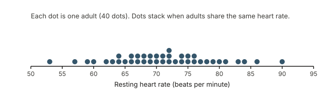
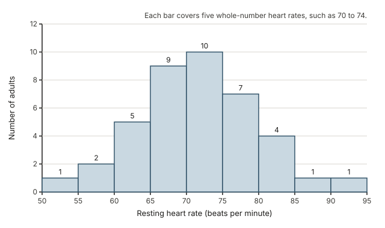
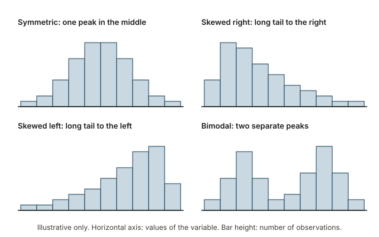
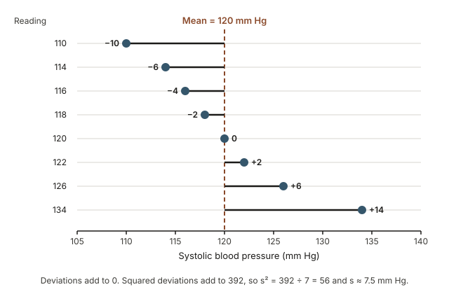
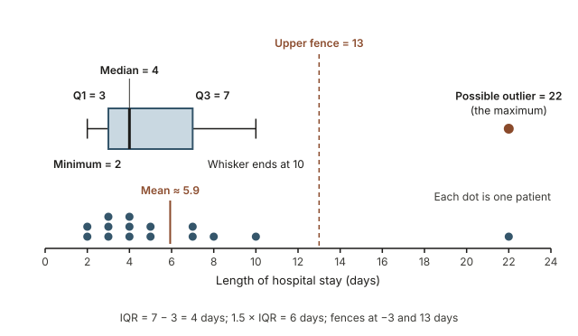
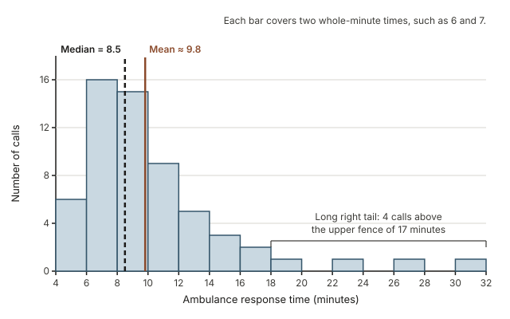

## Warm-up: two clinics with the same average wait

Two hypothetical walk-in clinics each report an average wait of 20 minutes. At Clinic A, almost every wait falls between 15 and 25 minutes. At Clinic B, most patients wait 5 to 10 minutes, but roughly one patient in six waits more than an hour.

Before reading on, write down which clinic you would rather visit, and what the single number "20 minutes" hides about each one.

Week 2 asked how data are produced. This week takes the next step: once the values of one variable are recorded, how do you describe them honestly? The warm-up shows the difficulty. Two sets of waits can share an average and still feel completely different, because one number cannot show both where the values sit and how far they spread.

## Why summaries matter when you weigh evidence

Public claims are full of summaries: the average hospital stay, the median household income in a county, the typical ambulance response time. Each compresses hundreds or thousands of values into one or two numbers. That is useful, because nobody can read ten thousand values, and risky, because the choice of summary shapes the impression. A mean pulled up by a few extreme cases can make the typical case sound worse than it is, and a center reported without any measure of spread hides whether most cases are near it or far from it.

So read every summary with three questions: What does the whole distribution look like? Does the chosen summary suit that shape? What does it leave out? The graphs and numbers this week answer those questions, and they are the building blocks for comparing groups in Week 4, association in Week 5 and every inference method later in the term.

## What you will be able to do

By the end of this week you can:

- read a dot plot, a histogram and a box plot of one quantitative variable;
- describe a distribution in context by its shape, center, spread and unusual values;
- compute the mean, median, quartiles and IQR by hand, and the standard deviation of a small data set;
- apply the 1.5 × IQR rule to flag possible outliers;
- choose between the mean with the standard deviation and the median with the IQR, and explain why;
- summarize a categorical variable with counts and proportions.

## Words to know this week

| Term | Meaning |
|---|---|
| Distribution | The values a variable takes and how often each occurs. |
| Dot plot | A number line with one dot per observation; equal values stack. |
| Histogram | Bars showing how many observations fall in each of a set of equal-width bins. |
| Box plot | A graph of the five-number summary, with possible outliers drawn as separate dots. |
| Shape | Symmetric or skewed (right or left, the direction of the long tail), and how many peaks. |
| Mode | A prominent peak. A distribution with one peak is unimodal; with two, bimodal. |
| Mean, $\bar{x}$ | The sum of the values divided by how many there are; the balance point. |
| Median | The middle value once the values are in order. |
| Standard deviation, $s$ | Roughly, the typical distance of a value from the mean, in the variable's units. |
| Quartiles, $Q_1$ and $Q_3$ | The medians of the lower and upper halves of the ordered data. |
| Interquartile range (IQR) | $Q_3 - Q_1$, the width of the middle half of the data. |
| Five-number summary | Minimum, $Q_1$, median, $Q_3$, maximum. |
| Outlier | A value unusually far from the rest; here, flagged by the 1.5 × IQR rule. |
| Resistant summary | One that barely changes when an extreme value changes, like the median and IQR. |

## Picturing one quantitative variable

A quantitative variable records a number for each case, such as a heart rate or a length of stay. Always graph it first: a graph shows the whole distribution at once, and the numbers computed later only make sense once you have seen it. This section uses one illustrative data set, the resting heart rates (beats per minute) of 40 hypothetical adults.

### Dot plots: one dot for each observation

A dot plot places each observation as a dot above a number line, and equal values stack. Nothing is hidden: you could read all 40 values back off the plot.

{fig-alt="Dot plot of 40 resting heart rates from 53 to 90 beats per minute, one dot per adult. Most dots sit between 60 and 80, the tallest stack is three dots at 72, and single dots lie out at 53 and 90."}

The heart rates run from 53 to 90, and most sit between 60 and 80. But the stacks are short: 40 adults are spread over nearly 40 possible whole-number values, so the tallest stack is only three dots (at 72), and the overall shape is hard to judge. Dot plots work best for small data sets, or when you need to see individual values.

### Histograms: counting values in bins

A histogram groups nearby values. Divide the number line into bins of equal width, count the observations in each bin, and draw a bar of that height. For the heart rates, bins five beats wide work well: 50 to 54, 55 to 59, and so on.

{fig-alt="Histogram of 40 resting heart rates in bins from 50 to 54 up to 90 to 94 beats per minute, with counts 1, 2, 5, 9, 10, 7, 4, 1 and 1. One peak at 70 to 74; the two sides are roughly mirror images."}

Now the shape is clear. The single peak is the 70 to 74 bin, with 10 of the 40 adults, and the counts fall off at a similar rate on each side (9 and 7, then 5 and 4, then 2 and 1), so the distribution is roughly symmetric.

::: {.callout-warning}
**Read the axes before the bars.** The horizontal axis shows values of the variable; the bar height shows *how many* observations fall in that bin. The bar over 70 to 74 has height 10 because ten adults had heart rates from 70 to 74, not because anyone's heart rate was 10.
:::

Bin width is a choice: very wide bins merge everything into a few blocks, and very narrow ones bring back the short stacks. Distrust a feature, such as a gap, that appears for only one unusual choice of bins.

## Describing a distribution: shape, center, and spread

A good description of one quantitative variable covers its **shape**, its **center** (a typical value), its **spread** (how much the values vary) and any **unusual values**, always in the context of the data.

### Shape: symmetry, skew, and the number of peaks

{fig-alt="Four illustrative histograms: symmetric with one central peak; skewed right with a peak on the left and a long tail to the right; skewed left, its mirror image; and bimodal with two separate peaks."}

A distribution is **symmetric** when its two halves are rough mirror images, like the heart rates. It is **skewed right** when a long tail stretches toward large values and **skewed left** when the tail stretches toward small values. Skew is named for the tail, not for the side where the peak sits. Right skew is common when there is a floor but no ceiling: incomes, hospital stays and waiting times cannot fall below zero, but a few can be very large. Left skew appears when there is a ceiling. Gestational age at birth is an example: most babies are born at around 39 to 40 weeks, with a tail of earlier births.

Most distributions you will meet are unimodal. A bimodal distribution often signals two groups mixed together, such as weekly hours worked by a mix of part-time and full-time employees. When you see two peaks, ask what the groups are.

### Center: the mean and the median

The **mean** adds the values and divides by how many there are:

$$\bar{x} = \frac{x_1 + x_2 + \cdots + x_n}{n} = \frac{\sum x_i}{n}.$$

Think of it as a balance point: a see-saw with an equal weight at each dot of the dot plot would balance at $\bar{x}$. The **median** is the middle value of the ordered data, at position $(n+1)/2$. When $n$ is even, that position falls between two values, and the median is their average.

For the 40 heart rates, the values add to 2,846, so

$$\bar{x} = \frac{2846}{40} = 71.15 \text{ beats per minute}.$$

The median sits at position 20.5, halfway between the 20th and 21st ordered values; both are 71, so the median is 71. For a roughly symmetric distribution the mean and median are close. In a right-skewed distribution the mean is usually pulled toward the tail, above the median, and in a left-skewed one it usually ends up below. Worked example 2 shows this happening.

### Spread: the standard deviation

The **standard deviation** measures how far values typically sit from the mean. Find each **deviation** $x_i - \bar{x}$, square it, add the squares, divide by $n - 1$, and take the square root:

$$s = \sqrt{\frac{\sum (x_i - \bar{x})^2}{n - 1}}$$

The deviations are squared because the raw deviations always add to zero. The quantity under the root, $s^2$, is the **variance**; it is in squared units, so the square root returns to the original units. Dividing by $n - 1$ rather than $n$ makes $s^2$ a slightly better estimate of the population's variance; with large samples the difference is tiny. (For a whole population, the mean and standard deviation are written $\mu$ and $\sigma$.) The standard deviation is never negative, and it is 0 only when every value is the same.

For the 40 heart rates, a calculator gives $s \approx 8.02$, about 8 beats per minute. To read it: in a roughly symmetric, single-peaked distribution, usually about two-thirds of the values lie within one standard deviation of the mean and nearly all lie within two. Here, $71.15 \pm 8.02$ runs from about 63.1 to 79.2 and holds 28 of the 40 values (70%); two standard deviations either side, about 55.1 to 87.2, holds 38 of the 40 (95%). Worked example 1 does the whole calculation by hand for a smaller data set.

### Spread: quartiles and the interquartile range

The spread measure that goes with the median is the **interquartile range**. To find the quartiles by hand in this course:

1. Put the values in order and find the median.
2. Split the list at the median. If $n$ is odd, leave the median out of both halves.
3. $Q_1$ is the median of the lower half, and $Q_3$ is the median of the upper half.

Then $\text{IQR} = Q_3 - Q_1$ is the width of the middle half of the data. The minimum, $Q_1$, median, $Q_3$ and maximum together make the **five-number summary**.

For the heart rates, each half holds 20 values. $Q_1$ is the average of the 10th and 11th ordered values, both 66, and $Q_3$ is the average of the 30th and 31st, both 76. So $\text{IQR} = 76 - 66 = 10$: the middle half of these adults have resting heart rates within a 10-beat range. The five-number summary is 53, 66, 71, 76, 90.

::: {.callout-note}
Software and calculators use several slightly different quartile rules, so they may report quartiles a little different from a hand calculation, especially for small data sets. The differences do not change the description. The heart-rate, hospital-stay and ambulance data on this page were chosen so the common rules agree; for a small set such as the blood pressure readings, software may report slightly different quartiles.
:::

### Box plots and the 1.5 × IQR rule for outliers

An **outlier** sits unusually far from the bulk of the data. Box plots use the **1.5 × IQR rule** to decide what counts as unusually far:

$$\text{lower fence} = Q_1 - 1.5 \times \text{IQR}, \qquad \text{upper fence} = Q_3 + 1.5 \times \text{IQR}.$$

Any value beyond a fence is flagged as a possible outlier. For the heart rates, $1.5 \times 10 = 15$, so the fences are $66 - 15 = 51$ and $76 + 15 = 91$. The minimum, 53, and the maximum, 90, are inside the fences, so nothing is flagged.

A **box plot** draws a box from $Q_1$ to $Q_3$ with a line at the median, whiskers from the box to the smallest and largest values inside the fences, and a separate dot for each flagged outlier. Worked example 2 builds a fully labeled one. Box plots are compact, which makes them good for comparing groups on one scale in Week 4, but they hide detail such as two peaks, so look at a histogram or dot plot as well.

The rule flags values; it does not say what to do with them. An outlier may be a data-entry error or a real and important case, such as a patient with a serious complication. Investigate before setting a value aside, and never delete one just because it is inconvenient.

### Resistant and non-resistant summaries

A summary is **resistant** if a few extreme values cannot move it much. Suppose the largest heart rate, 90, had been typed as 900.

- The sum grows by 810, from 2,846 to 3,656, so the mean jumps from 71.15 to $3656/40 = 91.4$, higher than every real heart rate in the data.
- The standard deviation jumps from about 8 to about 131.
- The median stays 71, because the 20th and 21st ordered values have not changed. $Q_1$ and $Q_3$ stay 66 and 76, so the IQR stays 10.

The median and IQR depend only on the values at a few positions in the ordered list (the middle and the two quartiles), so changing an extreme value leaves them alone; the mean and standard deviation use the size of every value, so they are **not resistant**. (The IMS textbook calls resistant summaries *robust statistics*.)

| If the distribution is | Report the center with | and the spread with |
|---|---|---|
| roughly symmetric, with no outliers | the mean, $\bar{x}$ | the standard deviation, $s$ |
| clearly skewed, or with outliers | the median | the IQR or the five-number summary |

Whichever pair you use, name it and show a graph when you can. Reporting both the mean and the median does no harm, and a large gap between them is itself worth describing.

### Summarizing a categorical variable instead

A categorical variable, such as blood type or smoking status, places each case in a group, so a mean or standard deviation of its values makes no sense. Summarize it with **counts** and **proportions**, and graph it with a bar chart. If 26 of the 40 hypothetical adults above exercise on at least three days a week, the sample proportion is

$$\hat{p} = \frac{26}{40} = 0.65,$$

or 65%. One link between the two kinds of summary: code "yes" as 1 and "no" as 0, and the mean of those 0s and 1s is exactly the proportion of yeses. Week 13 returns to categorical outcomes.

## Worked example 1: mean and standard deviation of eight blood pressure readings

**Question.** At a hypothetical health screening, eight adults had these systolic blood pressures, in millimeters of mercury (mm Hg): 110, 114, 116, 118, 120, 122, 126, 134. Find the mean, the median and the standard deviation, and say what the standard deviation means in context.

**Step 1: the mean.** The readings add to 960, so

$$\bar{x} = \frac{110 + 114 + 116 + 118 + 120 + 122 + 126 + 134}{8} = \frac{960}{8} = 120 \text{ mm Hg}.$$

**Step 2: the median.** With $n = 8$, the median sits at position $(8+1)/2 = 4.5$, halfway between the 4th and 5th values:

$$\text{median} = \frac{118 + 120}{2} = 119 \text{ mm Hg}.$$

**Step 3: deviations and squared deviations.** Subtract 120 from each reading, then square.

| Reading $x_i$ | Deviation $x_i - \bar{x}$ | Squared deviation $(x_i - \bar{x})^2$ |
|---|---|---|
| 110 | $-10$ | 100 |
| 114 | $-6$ | 36 |
| 116 | $-4$ | 16 |
| 118 | $-2$ | 4 |
| 120 | $0$ | 0 |
| 122 | $2$ | 4 |
| 126 | $6$ | 36 |
| 134 | $14$ | 196 |
| Sum | $0$ | 392 |

The deviations add to 0, as they must, which checks the arithmetic.

**Step 4: the variance and the standard deviation.** Divide by $n - 1 = 7$, then take the square root:

$$s^2 = \frac{392}{7} = 56, \qquad s = \sqrt{56} \approx 7.48 \approx 7.5 \text{ mm Hg}.$$

{fig-alt="Eight systolic readings from 110 to 134 mm Hg, each on its own row with a line to the mean of 120. Deviations are −10, −6, −4, −2, 0, +2, +6 and +14; they add to zero, and 134 lies farthest from the mean."}

**Step 5: read the result.** Six of the eight readings are within 6 mm Hg of the mean, and 134 is farthest out, 14 above. A standard deviation of about 7.5 mm Hg is a typical size for these distances. The plain average of the eight distances is 44/8 = 5.5 mm Hg; $s$ comes out larger, 7.5, mainly because squaring gives the one large distance, 14, extra weight (dividing by 7 rather than 8 adds a little more). The single 134 reading contributes 196, exactly half of the 392 total, and this extra weight on large deviations is one reason the standard deviation is not resistant.

**Conclusion in context.** For these eight hypothetical adults, systolic blood pressure averaged 120 mm Hg (median 119 mm Hg), and a typical reading was about 7.5 mm Hg from that average. The mean and median are close, which fits a fairly balanced set of readings, although eight values are too few to say much about shape.

## Worked example 2: hospital stays where the mean and median disagree

**Question.** A hypothetical hospital recorded the length of stay, in days, for 15 patients after the same routine surgery. In order: 2, 2, 3, 3, 3, 4, 4, 4, 5, 5, 7, 7, 8, 10, 22. A newsletter wants to report the typical stay. Find the mean and the five-number summary, check for outliers, and decide which center to report.

**Step 1: the mean.** The stays add to $2+2+3+3+3+4+4+4+5+5+7+7+8+10+22 = 89$ days, so $\bar{x} = 89/15 \approx 5.93$ days.

**Step 2: the median.** The median is in position $(15 + 1)/2 = 8$. The 8th ordered value is 4, so the median is 4 days.

**Step 3: the quartiles.** Because $n$ is odd, leave the 8th value out of both halves.

- Lower half (1st to 7th values): 2, 2, 3, 3, 3, 4, 4. Its median, the 4th of these seven, is $Q_1 = 3$.
- Upper half (9th to 15th values): 5, 5, 7, 7, 8, 10, 22. Its median is $Q_3 = 7$.

The five-number summary is 2, 3, 4, 7, 22 days, and the IQR is $7 - 3 = 4$ days.

**Step 4: the 1.5 × IQR rule.** Here $1.5 \times 4 = 6$ days, so

$$\text{lower fence} = 3 - 6 = -3, \qquad \text{upper fence} = 7 + 6 = 13.$$

No stay can be below $-3$ days, so nothing is flagged on the low side. On the high side, 22 is above 13, so it is flagged as a possible outlier. The next-longest stay, 10 days, is inside the fence, so the upper whisker ends at 10.

{fig-alt="Box plot of 15 stays: minimum 2, Q1 3, median 4, Q3 7 days. The whisker stops at 10; 22 days lies beyond the upper fence of 13 and is drawn as a possible outlier. Dots below show each stay; the mean, about 5.9, is right of the median."}

**Step 5: compare the mean and the median.** The mean, about 5.93 days, is almost 2 days above the median. The dots under the box plot show why: most stays are 2 to 5 days, and the single 22-day stay pulls the balance point right. Ten of the 15 patients, two-thirds, stayed less than the mean.

To see how much one patient matters, set the 22-day stay aside. The other 14 stays add to $89 - 22 = 67$ days, a mean of $67/14 \approx 4.79$ days, but their median is still 4 (the 7th and 8th of the 14 values are both 4). One patient moved the mean by more than a day and the median not at all. The standard deviation, from a calculator, drops from about 5.0 days to about 2.4 days.

**Step 6: decide what to report.** The distribution is skewed right with one high outlier, so the median and IQR describe a typical patient better than the mean and standard deviation.

**Conclusion in context.** For these 15 hypothetical patients, the typical stay after this surgery was 4 days, and the middle half stayed 3 to 7 days. One patient stayed 22 days, far longer than anyone else; that stay deserves its own look (a complication, perhaps), not removal from the data. The mean of about 5.9 days is not wrong. It answers a different question: if the hospital wants total bed-days, the mean times the number of patients, $15 \times 89/15 = 89$, is exactly that total.

## Transfer: ambulance response times in a county report

The same reasoning applies to any skewed variable in which a few large values matter. Here the setting is public safety, and you start from software output rather than a raw list.

**Question.** A hypothetical county recorded the ambulance response time (minutes from call to arrival, rounded to the nearest minute) for 60 emergency calls in one month. Its software reports:

```
Response time (minutes), n = 60 calls
  Mean   Std dev   Min   Q1   Median   Q3   Max
  9.82     5.02     4     7     8.5    11    31
```

A county commissioner concludes: "A typical caller waits about 10 minutes, give or take 5." Is that a fair description?

**Step 1: look at the shape.**

{fig-alt="Right-skewed histogram of 60 response times from 4 to 31 minutes in 2-minute bins. Most calls took 6 to 11 minutes, with a long right tail. The median is 8.5 minutes and the mean, about 9.8, lies to its right."}

The histogram is skewed right: 40 of the 60 calls were reached in 6 to 11 minutes, and a thin tail stretches past 30. The output hints at this too, since the maximum is 20 minutes above $Q_3$ while the minimum is only 3 minutes below $Q_1$.

**Step 2: check for outliers.** The IQR is $11 - 7 = 4$ minutes and $1.5 \times 4 = 6$, so the fences are $7 - 6 = 1$ and $11 + 6 = 17$ minutes. No call is below 1 minute, but four calls are beyond 17; the underlying records show 19, 22, 26 and 31 minutes.

**Step 3: compare the centers.** Half of the calls were reached within the median of 8.5 minutes. The mean, 9.82, is pulled to the right by the tail, and 37 of the 60 calls (about 62%) were faster than the mean.

**Step 4: think about spread.** "Mean give or take one standard deviation" runs from $9.82 - 5.02 = 4.80$ to $9.82 + 5.02 = 14.84$ minutes. For these skewed data the calls outside that range are lopsided: the county's full list of 60 times shows 2 calls below it and 7 above it. The quartiles give a cleaner picture: the middle half of calls took 7 to 11 minutes.

**Conclusion in context.** "About 10 minutes, give or take 5" overstates the typical wait a little and hides what matters most for public safety. A fairer summary: the median response time was 8.5 minutes and the middle half of calls were reached in 7 to 11 minutes, but a long right tail includes four calls that took 19 to 31 minutes. Because long waits matter most in an emergency, the report should also say how many calls exceeded a meaningful time: here, the full list shows 18 of 60 (30%) took longer than 10 minutes. That is a proportion, the categorical summary from earlier, applied to a quantitative variable split at a threshold.

## A common misreading: the average is the typical value

When a report says "the average stay is 5.9 days", it is tempting to picture a typical patient at that value. For a roughly symmetric distribution that picture is about right. For a skewed one it is not: in Worked example 2, 10 of the 15 patients stayed less than the mean, and in the transfer example, 37 of the 60 calls were faster than the mean. Household income is strongly skewed right, so most households earn less than the mean income, which is one reason income is usually reported with the median.

The mean is the balance point, not the middle, so a long tail drags it outward. Two more cautions: "average" in the news usually means the mean, but not always, and "typical" has no fixed meaning, so check which summary was used. And a center says nothing about spread: the warm-up clinics had the same mean wait, yet at Clinic B most patients waited far less than 20 minutes and about one in six waited far more.

The better habit: describe the shape first, choose the center that suits it, and always pair a center with a measure of spread.

## Practice for this week (ungraded)

1. Seven hypothetical adults slept these numbers of hours last night: 5, 6, 6, 6, 7, 8, 11. Find the mean and the median. Which is larger, and which value is responsible? *What to look for:* a value far from the others, and which summary it can pull.

2. Set A is 48, 50, 52 and Set B is 30, 50, 70; both have mean 50. Without calculating, which has the larger standard deviation? Then compute both. *What to look for:* the sizes of the deviations from 50.

3. A hypothetical study of daily sodium intake reports the five-number summary 1,400; 2,600; 3,200; 3,900; 6,500 milligrams. Find the IQR and both fences. Is 6,500 flagged as an outlier? Is 1,400?

4. A histogram of hypothetical pharmacy prices for a common prescription has one peak near 12 dollars and a long tail out to 85 dollars. Would you expect the mean price to be above or below the median? Which pair of summaries would you report, and why?

5. In a hypothetical survey of 250 adults, 85 said they had a flu vaccine this season. Summarize this variable with a count and a proportion, and name a suitable graph.

6. Suppose a news story says the average home sale price in a small town rose sharply this year, mainly because two mansions sold. Which summary of sale prices would change a lot, and which would barely move? What should the story report instead?

## Where to read further

- *Introduction to Modern Statistics* by Çetinkaya-Rundel and Hardin (OpenIntro, free online), [Chapter 5: Exploring numerical data](https://openintrostat.github.io/ims/explore-numerical.html), covers dot plots, histograms, variance and standard deviation, box plots and robust statistics. The book shows R code in places; skip the code and read the output and explanation. Its [Chapter 4: Exploring categorical data](https://openintrostat.github.io/ims/explore-categorical.html) covers counts, proportions and bar charts.
- Optional, for biomedical examples: *Introductory Statistics for the Life and Biomedical Sciences* by Vu and Harrington (OpenIntro), Chapter 1, Introduction to data. See the [book page](https://www.openintro.org/book/biostat/).
- [StatKey](https://www.lock5stat.com/statkey/), a free tool in your browser: open **Descriptive Statistics and Graphs**, then **One Quantitative Variable**. Pick a built-in data set, or enter a small one of your own such as the blood pressure readings from Worked example 1, and compare its summaries with your hand calculations. Its quartiles may differ slightly from yours, for the reason given above.

## Where this goes next

This week described one quantitative variable at a time. Week 4 puts these tools side by side, with side-by-side box plots or stacked dot plots on one scale and differences in medians or means, to compare an outcome across groups such as treatment and control. Keep the habit of looking at the shape before choosing a summary.

- Previous: [Week 2: Study design, bias, and causality](week02-study-design.qmd)
- Next: [Week 4: Comparing groups](week04-comparing-groups.qmd)
- [All weekly notes](index.qmd)
- [Course schedule](../schedule.qmd)
