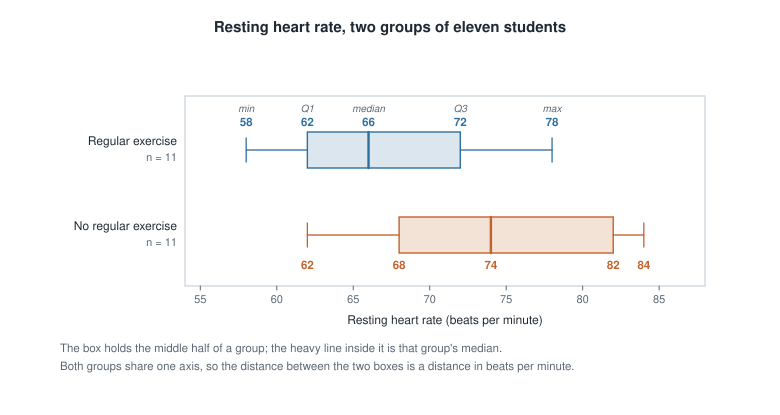
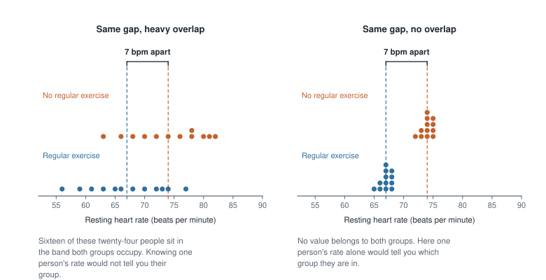
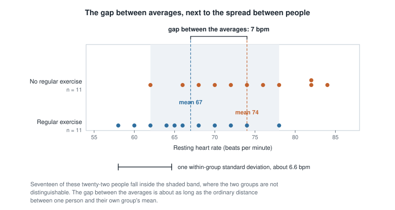
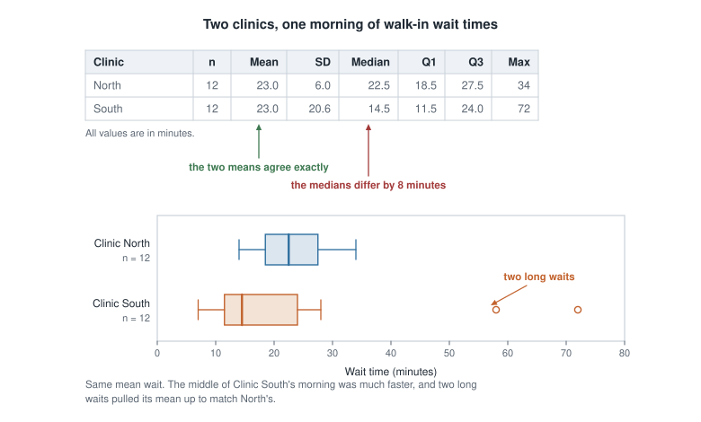

## Where this week starts

Last week you learned to describe one variable on its own: its shape, its center, its spread, and the numbers that stand in for a whole column of data. By itself that rarely settles anything, because almost every question people bring to data is a comparison. Do patients on the new protocol recover faster than patients on the old one? One distribution is a description; two side by side are the beginning of an argument. So the unit of thought changes this week: what you study is no longer a group but the *difference between* two groups.

The move is easy to do badly, and most people do. It is very natural to compute two averages, subtract, and stop. But a difference in averages tells you almost nothing about what any individual person experienced. This week's real content is the discipline that keeps you from stopping there: compare centers, but also spreads, also shapes, and always look at how much the groups overlap before you say anything about a person.

By the end of this week you should be able to look at a pair of side-by-side boxplots, or a small table of group summaries, and write two or three sentences a careful reader would accept: how big the gap is in the units of the problem, how much the groups overlap, and what the comparison does not establish. One thing it cannot establish is whether a gap this size could have appeared by chance alone. We name that question this week and leave it until Week 11.

### Why this matters

Picture an administrator choosing between two staffing plans for a walk-in clinic. The average wait is twenty-three minutes under Plan A and twenty-three under Plan B, so the choice looks like a coin flip and the administrator picks whichever is cheaper. But suppose that under Plan A nearly every patient waits between fifteen and thirty minutes, while under Plan B most are seen inside a quarter of an hour and a handful wait more than an hour. Those are not the same clinic to be a patient in. The average hid the entire difference, and a real decision got made on the wrong number.

The same failure runs through health reporting and education policy, wherever a program is called effective because the treated group's mean came out higher. Comparing distributions instead of averages changes decisions the same week you learn it.

## What you will be able to do

- Read side-by-side boxplots on a common axis and say which group sits higher, which is more spread out, and which is more skewed.
- Compute a difference in means and a difference in medians, and report each in the units of the measurement with its direction named.
- Describe how much two groups overlap using a count of individuals, not an impression.
- Set a group difference beside the person-to-person variation inside the groups and judge whether it is large in that context.
- Read a group summary table of sample sizes, means, standard deviations, medians, and quartiles, and describe each distribution from it.
- State what a two-group comparison does not establish, including cause and including chance.

## Words worth owning

| Term | What it means in this course |
|---|---|
| side-by-side display | Two or more groups on one axis at the same scale, so a distance can be read across groups |
| difference in means | One group's mean minus the other's, in the original units, with the direction named |
| difference in medians | The same subtraction done with medians; the resistant version, preferred when either group is skewed |
| within-group spread | How much individuals inside one group differ from one another, by standard deviation or interquartile range |
| overlap | The stretch of values both groups contain, and how many individuals sit in it |
| group summary table | One row per group, carrying its sample size, center, and spread |
| practically important | Large enough to matter for the decision at hand, in the units of the problem |

## Four questions to ask of any comparison

From now until December, every time this course sets two groups next to each other, you will ask the same four questions in the same order.

1. **Where is each group centered?** Report a mean or a median for each, and say which you used.
2. **How spread out is each group?** Report a standard deviation or an interquartile range for each. A group with a wide spread is a group whose members disagree with one another.
3. **What shape does each group have?** Symmetric, right-skewed, left-skewed, more than one peak. Shape decides whether the mean or the median is the more honest center.
4. **How much do the two groups overlap?** How many individuals in one group carry values that would be perfectly ordinary in the other?

Only after all four do you subtract. Subtracting is the easy part; the four questions are what make it mean something.

### The comparison is the thing, not the group

A common way to write up a two-group study is to describe group one thoroughly, then group two, and leave the reader to compare. Do not: the reader came for the comparison.

Two habits follow. Always state a direction: "the group reporting no regular exercise was higher" is a sentence someone can act on, while "there was a difference" is not. And always state the units — a gap of seven beats per minute and a gap of seven minutes of waiting are both "seven" and mean entirely different things.

### Centers, spreads, and shapes together

Two groups can differ in three independent ways, and a comparison that mentions only one is incomplete. They can differ in **center**: one group's typical value sits above the other's. That is what most people mean when they say two groups differ.

They can differ in **spread** while sharing a center — the case in the second worked example below, where two clinics post the same average wait and one of them is far less predictable than the other.

They can differ in **shape** while sharing both, one symmetric and one with a long right tail. Shape decides whether the mean or the median is the better summary, and it is why a difference in means and a difference in medians can report different sizes, or even opposite directions.

Because the three move independently, no single number recovers a comparison.

### Reading a pair of side-by-side boxplots

Here is the study the rest of the concept material uses. A campus wellness center measured resting heart rate, in beats per minute, for twenty-two student volunteers: eleven reported regular aerobic exercise, eleven reported none. Nobody was assigned to exercise, so this is an observational comparison and Week 2's warning about causal verbs applies.

{fig-alt="Two boxplots on a shared axis of beats per minute. The no-regular-exercise group sits higher, with median 74 against 66, and its box is wider, spanning 68 to 82 against 62 to 72; the two ranges overlap from 62 to 78."}

Read it in the order of the four questions. **Centers:** the exercise group's median is 66 beats per minute, the other group's is 74. **Spreads:** the exercise box runs from 62 to 72, an interquartile range of 10; the other runs from 68 to 82, an interquartile range of 14, so the no-exercise group is both higher and more variable. **Shapes:** in each box the median sits near the middle and the whiskers are not wildly lopsided, so neither group is strongly skewed. **Overlap:** the part most readers skip. The two boxes share the stretch from 68 to 72, and the two full ranges share everything from 62 to 78.

That last sentence has teeth. The boxes look mostly separated, but the highest value in the exercise group, 78 beats per minute, is higher than seven of the eleven values in the other group and ties an eighth. Each box stands in for eleven separate people, and a picture this compact makes them easy to forget.

## Overlap, and why an average gap is not a personal gap

Everything difficult about comparing groups lives in one gap: the distance between a statement about averages and a statement about people. Averages are properties of piles, and an individual can sit anywhere in their pile.

### Two studies with the same gap

Suppose two research teams report the same headline: the group means differ by seven beats per minute. Nothing in that sentence says whether the groups hold different kinds of people.

{fig-alt="Two dot-plot panels, each with group means seven beats per minute apart. On the left the two groups overlap heavily and most dots lie in a shared band; on the right each group is tightly clustered and the two do not overlap at all."}

Both panels show a gap of exactly seven beats per minute between the means, 67 against 74. On the left, sixteen of the twenty-four individuals fall inside the stretch of axis both groups occupy; hand someone a heart rate from that band and they could not name its group. On the right, the highest value in the lower group is 68 and the lowest in the upper is 72, so no value belongs to both groups and one number identifies a person's group with certainty.

Same difference in means, completely different claim about individuals. What changed is not the gap but the within-group spread: when that spread is large compared with the gap, the gap is a statement about averages and nothing more.

### Putting a difference next to the ordinary variation

That gives you a move for any two-group result: hold the gap up against the typical distance between an individual and their own group's mean.

{fig-alt="Individual heart rates for both groups on one axis, with a shaded band from 62 to 78 holding seventeen of the twenty-two students. The bracketed seven beats per minute gap between the means is about as long as the marked standard deviation."}

These are the same twenty-two students, drawn as individuals: the boxplot showed five summary numbers per group, while this shows every person.

The means, 67 and 74, are seven beats per minute apart. The standard deviation is about 6.1 beats per minute inside the exercise group and about 7.2 inside the other, so call the typical within-group distance from a mean roughly 6.6. The two lengths drawn in the figure are nearly identical: stepping from one group's average to the other's is about the same size step as stepping from the average person in a group to a fairly ordinary person in that same group.

That is a real difference worth reporting. It is not a difference that lets you read one student's heart rate and name their exercise habits: seventeen of these twenty-two sit between 62 and 78 beats per minute, a band both groups occupy.

## The question we are not answering yet

Everything above is description. A careful reader will ask one more question, and this week we name it and stop: **could a gap this size have appeared even if the two groups were really no different?**

Twenty-two people is not many. Shuffle any twenty-two people into two groups of eleven at random and compute the difference in means, and you will not get zero; you will get some difference, purely from who landed where. Before treating seven beats per minute as evidence of anything, you would want to know how large a difference the shuffling alone tends to produce.

Building that machinery is the business of Week 11. For now, write the description and add the honest sentence: whether a gap this size is more than ordinary chance variation is a separate question a description cannot settle.

## Worked example — resting heart rate in two groups of students

**Setting.** The wellness center's twenty-two volunteers, resting heart rate in beats per minute, each group already sorted:

```
Regular exercise (n = 11):     58  60  62  64  65  66  68  70  72  74  78
No regular exercise (n = 11):  62  66  68  70  72  74  76  78  82  82  84
```

**Step 1 — center each group.** Add the eleven exercise values: $58 + 60 + 62 + 64 + 65 + 66 + 68 + 70 + 72 + 74 + 78 = 737$. Divide by eleven.

$$\bar{x}_{\text{exercise}} = \frac{737}{11} = 67.0 \text{ beats per minute}$$

The other eleven values add to 814, so

$$\bar{x}_{\text{no exercise}} = \frac{814}{11} = 74.0 \text{ beats per minute}$$

Each group has eleven values, so each median is the sixth in its sorted list: 66 and 74.

**Step 2 — subtract, with a direction and a unit.** The difference in means is $74.0 - 67.0 = 7.0$ beats per minute, no-exercise group higher. The difference in medians is $74 - 66 = 8$ beats per minute, same direction. The two are close, which is what you expect when neither group is badly skewed. When they disagree sharply, suspect skew or an extreme value and trust the medians.

**Step 3 — spread inside each group.** The exercise deviations from 67 are $-9, -7, -5, -3, -2, -1, 1, 3, 5, 7, 11$. Their squares add to 374, so the sample variance is $374 / 10 = 37.4$ and

$$s_{\text{exercise}} = \sqrt{37.4} \approx 6.1 \text{ beats per minute}$$

The same work on the other group gives a variance of $512 / 10 = 51.2$ and a standard deviation of about 7.2. Both groups vary internally by six or seven beats per minute; hold onto that.

**Step 4 — overlap, counted rather than eyeballed.** Both groups contain values from 62 through 78: nine of the eleven exercisers and eight of the eleven non-exercisers, seventeen of the twenty-two students. Nine of the eleven exercisers also sit below the other group's median of 74.

**What the result means.** Write it as you would say it aloud. *Among these twenty-two students, the group reporting no regular exercise had a mean resting heart rate 7.0 beats per minute higher, and a median 8 beats per minute higher, than the group reporting regular exercise. That gap is about the size of the ordinary variation among individuals within a group, and seventeen of the twenty-two fall in a band both groups occupy, so resting heart rate does not identify a student's exercise habits. Because students were not assigned to exercise, this comparison cannot show that exercise lowered anyone's heart rate, and whether a gap this size is more than chance variation is a separate question it does not settle.*

Three sentences, and the report is complete.

### The same reasoning, transferred

Now the same four steps on different numbers. A city measured minutes of moderate physical activity on one weekday for five residents of a neighborhood with a new walking trail and five from a neighborhood without one.

```
Trail neighborhood (n = 5):     22  28  31  35  44
No-trail neighborhood (n = 5):  15  20  26  33  41
```

**Centers.** The trail values add to 160, a mean of $160 / 5 = 32$ minutes and a median of 31; the others add to 135, a mean of $135 / 5 = 27$ minutes and a median of 26. **Subtracting.** The difference in means is $32 - 27 = 5$ minutes, trail neighborhood higher, and the difference in medians is $31 - 26 = 5$ minutes, same direction and size. **Spread.** The standard deviations work out to about 8.2 and 10.3 minutes. **Overlap.** Both neighborhoods contain values from 22 to 41 minutes, a stretch holding seven of the ten residents.

*What stayed the same:* the four questions, their order, the insistence on direction and units, and the refusal to attach a causal verb to an observational comparison.

*What changed:* the verdict on size. In the heart-rate study the gap was about as large as the within-group spread. Here it is 5 minutes while people inside one neighborhood routinely sit 8 to 10 minutes from their own mean — roughly half the ordinary variation. With five residents per group, report that as small and unsettled, not as a finding.

## Second worked example — two clinics with the same average wait

**Setting.** A health system compares walk-in wait times, in minutes, at two clinics on the same Wednesday morning. Twelve patients at each, sorted:

```
Clinic North (n = 12):  14  16  18  19  20  22  23  25  27  28  30  34
Clinic South (n = 12):   7   9  11  12  13  14  15  17  20  28  58  72
```

**Step 1 — the means.** North's twelve values add to 276; South's also add to 276. Both means are $276 / 12 = 23.0$ minutes, so the difference in means is exactly zero. Stop here and you would report that the clinics perform identically. Keep going.

**Step 2 — the medians.** With twelve values the median is the average of the sixth and seventh: for North, $(22 + 23) / 2 = 22.5$ minutes; for South, $(14 + 15) / 2 = 14.5$ minutes. The difference in medians is $22.5 - 14.5 = 8.0$ minutes, South faster.

**Step 3 — spread and shape.** North's standard deviation is exactly 6.0 minutes; South's is about 20.6. Their middle halves are similar in width — North's quartiles are 18.5 and 27.5, a span of 9 minutes, and South's are 11.5 and 24.0, a span of 12.5 — but South's longest wait is 72 minutes against North's 34. Now notice where each mean sits relative to its own median. South's mean of 23.0 is far above its median of 14.5, the signature of a long right tail; North's 23.0 and 22.5 nearly agree, the signature of a roughly symmetric distribution. Week 3's outlier flag puts South's upper fence at $24.0 + 1.5 \times 12.5 = 42.75$ minutes, so the 58 and 72 minute waits are flagged; North has none.

{fig-alt="A table gives both clinics a mean wait of 23.0 minutes, but Clinic South has median 14.5 against North's 22.5 and a standard deviation of 20.6 against 6.0. The boxplots below show South compact and low with two long waits far to the right."}

**Step 4 — overlap and what a patient experiences.** Five of the twelve South patients were seen faster than the fastest North patient. Going the other way, only one North patient was seen faster than South's median.

**What the result means.** *The two clinics posted the same mean wait, 23.0 minutes, but they did not deliver the same experience. South's median wait was 14.5 minutes against North's 22.5, and five of South's twelve patients were seen faster than any North patient, yet two South patients waited 58 and 72 minutes and pulled South's mean up to match. North was slower in the middle and far more predictable, with a standard deviation of 6.0 minutes against South's 20.6. Which clinic is better depends on whether the health system is minimizing the typical wait or the worst wait, and one morning cannot settle either.*

Notice what this example exercised that the first did not. The difference in means was zero; the whole real comparison lived in the medians, the spread, and the shape. A report built on means alone would have been actively wrong.

## The misreading to avoid

Here is the thought, in the words students genuinely use: **"The exercisers averaged 67 and the non-exercisers averaged 74, so exercisers have lower heart rates than non-exercisers."**

The sentence sounds harmless. It is doing two illegitimate things at once.

The first is the slide from groups to individuals. "Exercisers have lower heart rates" reads as a claim about people: pick one of each, and the exerciser will be lower. In this data that fails often enough to matter. The exerciser whose resting rate is 78 beats per minute is higher than seven of the eleven non-exercisers. A difference in averages is a statement about two piles of numbers, not about any pair of people you might draw from them.

The second is the smuggled verb. "Have lower heart rates" sounds descriptive, but nearly everyone who writes it goes on to reason as though exercise *produced* the lower rate. Nobody assigned these students to exercise. Students who exercise regularly differ from those who do not in many ways at once — sleep, other health conditions, medication, caffeine, baseline fitness, age — and any of those could be carrying the difference. Week 2 gave you the rule and Week 6 the tools; for now, an observational comparison earns a verb like "was associated with" and nothing stronger.

A third, quieter misreading is worth naming: **"The boxes barely touch, so the groups are clearly different."** A box holds only the middle half of its group and says nothing about how far the rest reach, so two boxes can sit well apart while individuals are thoroughly mixed. Whenever overlap matters, and it usually does, ask for the individuals or at minimum the full ranges.

A repaired version of the original sentence reads: *in this sample, students reporting regular exercise had a mean resting heart rate 7.0 beats per minute lower than students reporting none, though the two groups overlap heavily and the study cannot show that exercise caused the difference.* Longer, less quotable, and true.

## Practice on your own

For your own checking, not for submission. Verify your arithmetic twice.

1. A campus food pantry recorded days between visits for two sets of users. Regular users: 6, 7, 7, 9, 11. Occasional users: 10, 14, 18, 25, 33. Compute the mean, median, and range for each group, plus both differences. Which difference would you report to the pantry director, and why?

2. Two sections of a lab course reported hours spent on a project, twelve students each. Section A: mean 9.0 hours, standard deviation 1.2. Section B: mean 11.0 hours, standard deviation 5.5. Without the raw data, describe how the shapes probably differ and what you would want to see before writing that Section B works harder.

3. Sketch two dot plots, twelve values per group, with a difference in means of 4 units and so much overlap that one value tells you almost nothing about its group. Then sketch two more with the same difference and no overlap. Name the quantity you changed.

4. A summary table reports, for 40 patients, a mean systolic blood pressure of 128 and a median of 121; for a comparison group of 40, a mean of 127 and a median of 126. What does the gap between mean and median say about each group's shape? Compute both differences, notice they disagree even about direction, and decide which to report.

5. Return to the two clinics, and suppose the health system's goal is that no patient waits more than forty-five minutes. Using only the summary numbers in the figure above, say which clinic came closer to that goal, and state what those numbers cannot tell you.

## Where to read more

- [Introduction to Modern Statistics, Chapter 5: Exploring numerical data](https://openintrostat.github.io/ims/explore-numerical.html) — side-by-side boxplots and comparing distributions.
- [Introduction to Modern Statistics, Chapter 6: Applications, Explore](https://openintrostat.github.io/ims/explore-applications.html) — case studies that put these habits to work.
- [Introduction to Modern Statistics](https://openintrostat.github.io/ims) — the whole open text.
- [Introductory Statistics for the Life and Biomedical Sciences](https://www.openintro.org/book/biostat) — a second open text, health and biology examples throughout.
- [StatKey](https://www.lock5stat.com/statkey) — a browser tool that draws side-by-side displays and computes group summaries. Nothing to install, no code to write.
- [Course resources](../resources/index.qmd) and the [course schedule](../schedule.qmd).

## Where this goes next

Next week the two groups become two *variables*. Instead of asking whether one pile of numbers sits above another, you will ask whether two measurements on the same person move together: does resting heart rate track with hours of sleep? The picture becomes a scatterplot and the four questions become three — direction, form, and strength — but the discipline is identical. Look at the picture before you compute. [Week 5](week05-association.qmd) picks it up there.

Two other threads open this week and close later: whether a gap could be chance alone is Week 11's business, and what else might explain a group difference is Week 6's. Looking backward, [Week 3](week03-one-variable-summaries.qmd) holds the shape, center, and spread vocabulary this week assumed, and the [notes index](index.qmd) lists every unit.
