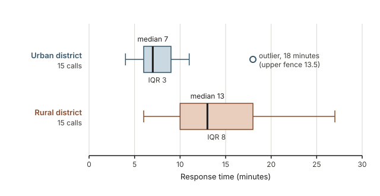
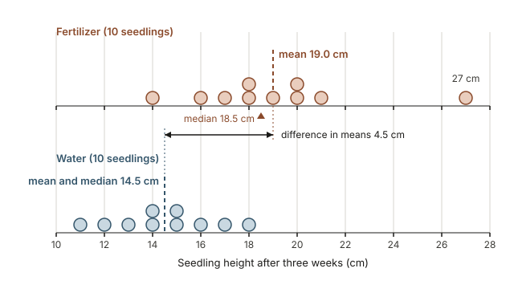
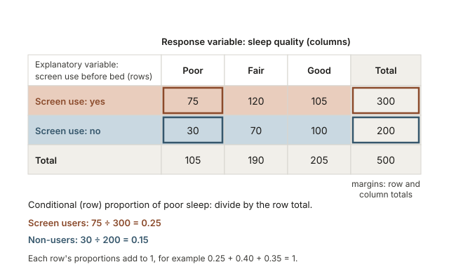
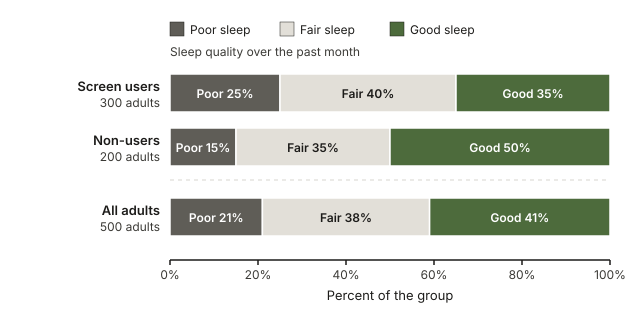
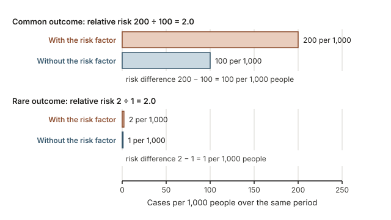

## Warm-up: compared with what?

A hypothetical community clinic puts up a poster: "Patients in our spring walking program lost an average of 3 pounds." Before deciding whether the program works, write down one question you would want answered.

Most good questions come down to *compared with what?* Did patients outside the program also lose weight this spring? Were the walkers different to begin with? Did everyone lose about 3 pounds, or did a few lose a lot while most lost nothing? One average for one group cannot settle these. You need a second group, compared fairly and completely.

[Week 3](week03-one-variable-summaries.qmd) described one variable at a time. This week puts distributions side by side: a quantitative response across groups, a categorical response across groups, and two ways to express a difference in risk.

## Why comparisons carry the evidence

Most claims in health, science and public policy are comparisons, even when not phrased as one. "The new dressing lowers infections" compares patients who got it with patients who did not. Three questions do most of the work:

1. What explanatory variable defines the groups, and what response variable is being compared?
2. How big is the difference, and in what units: minutes, centimeters, percentage points, or a ratio?
3. Is the comparison group a fair one, alike in the other ways that matter?

This week's graphs and numbers handle the first two questions; the third links back to study design in [Week 2](week02-study-design.qmd) and ahead to confounding in [Week 6](week06-confounding.qmd).

## What you will be able to do

By the end of this week you can:

- name the explanatory variable, the response variable and the comparison in a claim about groups;
- compare groups in side-by-side box plots and stacked dot plots: center, spread, overlap and unusual values;
- compute and interpret differences in means and medians, with units and a direction;
- build a two-way table, compute conditional proportions, and read a segmented bar chart;
- compute and interpret a risk difference and a relative risk, and explain why a report needs both;
- explain how the comparison group, and the direction of a comparison, change what the numbers say.

## Words to know this week

| Term | Meaning |
|---|---|
| Explanatory variable | The variable that defines the groups, such as treatment (fertilizer or water). |
| Response variable | The outcome measured on each individual and compared across groups. |
| Side-by-side box plots | Box plots of the same response for each group, on one shared axis. |
| Stacked dot plot | One row of dots per group, one dot per individual, on a shared axis. |
| Difference in means | $\bar{x}_1 - \bar{x}_2$, in the units of the response. |
| Overlap | How much of two groups' values fall in the same range. |
| Two-way table | Counts for two categorical variables, one in the rows and one in the columns (also called a contingency table). |
| Marginal total | A row or column total in a two-way table. |
| Conditional proportion | A proportion computed within one group only. |
| Segmented bar chart | One 100% bar per group, divided by that group's percentages in each response category. |
| Risk | The proportion of a group that has an outcome over a stated period. |
| Risk difference | One group's risk minus the comparison group's risk, often in percentage points. |
| Relative risk | One group's risk divided by the comparison group's risk (also called the risk ratio). |
| Comparison group | The baseline group for a comparison, also called the reference group. |

## Comparing a quantitative response across groups

For a quantitative response, compare the groups on the features from Week 3 (shape, center, spread and unusual values) plus one new feature: **overlap**, how much of the groups' values fall in the same range.

### Side-by-side displays put the groups on one scale

Always draw the groups on a **shared axis**. On separate axes with different scales, your eye compares positions that mean different things; on one axis, differences in center, spread and overlap are visible at a glance.

- **Stacked dot plots** show every individual, so they suit small groups.
- **Side-by-side box plots** show each group's five-number summary (minimum, $Q_1$, median, $Q_3$, maximum). Values more than $1.5 \times \text{IQR}$ beyond the quartiles (past the lower fence $Q_1 - 1.5 \times \text{IQR}$ or the upper fence $Q_3 + 1.5 \times \text{IQR}$) are drawn as separate dots (possible outliers), and the whiskers stop at the most extreme values inside the fences.

Here are hypothetical ambulance response times (minutes from the emergency call to arrival) for 15 calls in each of two districts:

- Urban: 4, 5, 5, 6, 6, 7, 7, 7, 8, 8, 9, 9, 10, 11, 18
- Rural: 6, 8, 9, 10, 11, 12, 12, 13, 14, 15, 16, 18, 20, 23, 27

With 15 sorted values, the median is the 8th value and the quartiles are the medians of the 7 values on each side of it (the median-of-halves rule; software may use a slightly different rule).

| District | Minimum | $Q_1$ | Median | $Q_3$ | Maximum | IQR |
|---|---|---|---|---|---|---|
| Urban (15 calls) | 4 | 6 | 7 | 9 | 18 | 3 |
| Rural (15 calls) | 6 | 10 | 13 | 18 | 27 | 8 |

{fig-alt="Box plots on one axis from 0 to 30 minutes. Urban, 15 calls: whiskers 4 to 11, box 6 to 9, median 7, one outlier at 18. Rural, 15 calls: whiskers 6 to 27, box 10 to 18, median 13. The boxes do not overlap."}

- **Center.** The difference in medians is $13 - 7 = 6$ minutes (rural minus urban).
- **Spread.** The rural IQR is 8 minutes against 3 minutes for urban, so rural response times are far more variable.
- **Overlap.** The boxes do not overlap: the rural $Q_1$ (10 minutes) is above the urban $Q_3$ (9 minutes). The whiskers overlap, but only one rural call (6 minutes) was faster than the urban median and only one urban call (18 minutes) slower than the rural median.
- **Unusual values.** The 18-minute urban call is beyond the urban upper fence, $9 + 1.5 \times 3 = 13.5$ minutes, so it is drawn as a separate dot and the whisker stops at 11. Ask what happened on that call (heavy traffic, a wrong address, a recording error) before deciding how to treat it.

A complete comparison says all of this in context: *in these hypothetical data, rural response times were typically about 6 minutes longer than urban ones (medians 13 and 7 minutes) and much more variable (IQR 8 versus 3 minutes); the middle halves do not overlap, although one urban call took 18 minutes.*

### Differences in centers: means and medians

The **difference in means** is $\bar{x}_1 - \bar{x}_2$, and the **difference in medians** is one group's median minus the other's. Three habits keep these numbers readable.

1. **State the direction.** "Rural minus urban is 6 minutes" and "urban minus rural is $-6$ minutes" are the same finding; a bare $-6$ leaves the reader guessing.
2. **Keep the units** of the response: minutes, centimeters, millimeters of mercury.
3. **Match the center to the shape.** The mean is pulled toward long tails and outliers; the median is not. The urban mean, $120 / 15 = 8.0$ minutes, sits a minute above the urban median largely because of the 18-minute call. With a rural mean of $214 / 15 \approx 14.3$ minutes, the difference in means ($14.3 - 8.0 = 6.3$ minutes) is close to the difference in medians, but with skewed data the two can disagree. When they do, report the one that fits the shape and say why.

### Spread and overlap: the gap is not the whole story

A difference in centers describes groups, not individuals. If both groups are tightly clustered, a 6-minute gap separates them almost completely; if both are widely spread, the same gap leaves most values in a shared range, and a person's group tells you little about that person's own value. So compare the gap with the spread, for example by counting how much of one group lies beyond the other group's median. Spread can even be the main finding: two hypothetical bus routes with the same median trip time are not equally reliable if one has an IQR of 4 minutes and the other 20.

## Worked example 1: seedling heights with and without fertilizer

**Question.** In a hypothetical experiment, a biology class randomly assigned 20 tomato seedlings to two groups of 10: one group received a liquid fertilizer and the other plain water, with the same light, soil and pots for all plants. After three weeks the heights, to the nearest centimeter, were:

- Fertilizer: 14, 16, 17, 18, 18, 19, 20, 20, 21, 27
- Water: 11, 12, 13, 14, 14, 15, 15, 16, 17, 18

How do the two groups compare in center, spread and overlap?

**Step 1: name the variables and the direction.** The explanatory variable is the treatment (fertilizer or water), which is categorical. The response variable is height in centimeters, which is quantitative. We subtract fertilizer minus water.

**Step 2: plot both groups on one axis.** Each dot is one seedling, and the dashed line in each row marks that group's mean. The small triangle under the fertilizer row marks that group's median; in the water group the mean and median are the same.

{fig-alt="Stacked dot plots on one axis in centimeters. Fertilizer, 10 seedlings from 14 to 27, mean 19.0, median 18.5. Water, 10 seedlings from 11 to 18, mean and median 14.5. The groups overlap from 14 to 18; one seedling at 27 stands apart."}

**Step 3: compute the centers.** The means are

$$\bar{x}_{F} = \frac{14+16+17+18+18+19+20+20+21+27}{10} = \frac{190}{10} = 19.0 \text{ cm}$$

$$\bar{x}_{W} = \frac{11+12+13+14+14+15+15+16+17+18}{10} = \frac{145}{10} = 14.5 \text{ cm}$$

With 10 values, each median is the average of the 5th and 6th sorted values: fertilizer $(18 + 19)/2 = 18.5$ cm and water $(14 + 15)/2 = 14.5$ cm. So the difference in means is $19.0 - 14.5 = 4.5$ cm and the difference in medians is $18.5 - 14.5 = 4.0$ cm.

The two differences disagree mainly because one fertilized seedling grew to 27 cm. That plant pulls the fertilizer mean up but barely moves the median. It is also beyond the upper fence: with $Q_1 = 17$ (the median of the lower five values, 14 to 18) and $Q_3 = 20$ (the median of the upper five, 19 to 27), the fence is $20 + 1.5 \times 3 = 24.5$ cm. Nothing suggests a measuring error, so the plant stays in the data, but the difference in medians (4.0 cm) is the safer summary of the typical gap.

**Step 4: compare the spreads.** The ranges are $27 - 14 = 13$ cm for fertilizer and $18 - 11 = 7$ cm for water; without the tall plant, the fertilizer range would also be $21 - 14 = 7$ cm. The standard deviations, built from each value's deviation from its own group mean, tell the same story:

$$s_{F} = \sqrt{\frac{(-5)^2 + (-3)^2 + (-2)^2 + (-1)^2 + (-1)^2 + 0^2 + 1^2 + 1^2 + 2^2 + 8^2}{10 - 1}} = \sqrt{\frac{110}{9}} \approx 3.5 \text{ cm}$$

$$s_{W} = \sqrt{\frac{(-3.5)^2 + (-2.5)^2 + (-1.5)^2 + (-0.5)^2 + (-0.5)^2 + 0.5^2 + 0.5^2 + 1.5^2 + 2.5^2 + 3.5^2}{10 - 1}} = \sqrt{\frac{42.5}{9}} \approx 2.2 \text{ cm}$$

The tall plant's squared deviation, $8^2 = 64$, is more than half of the fertilizer total of 110. Apart from that one plant, the two groups are about equally spread out.

**Step 5: describe the overlap.** Five of the 10 fertilized seedlings (14, 16, 17, 18 and 18 cm) are no taller than the tallest water seedling (18 cm). No water seedling reached the fertilizer median of 18.5 cm, and only one fertilized seedling (14 cm) fell below the water median of 14.5 cm.

**Conclusion in context.** In this hypothetical experiment, fertilized seedlings were typically about 4 cm taller after three weeks than seedlings given water (medians 18.5 and 14.5 cm; means 19.0 and 14.5 cm), but the groups overlap: half of the fertilized seedlings were no taller than the tallest water seedling. Random assignment makes the fertilizer a plausible explanation, although with only 10 plants per group, part of the gap could come from which seedlings landed in which group ([Week 11](week11-simulation-based-inference.qmd) shows how to check).

## Comparing a categorical response across groups

When the response is categorical, each individual falls into a category (infected or not; sleep rated poor, fair or good), and the summaries become counts and proportions.

### Two-way tables and conditional proportions

A **two-way table** counts individuals by two categorical variables at once. Put the explanatory variable in the rows and the response variable in the columns, with totals in the margins. Here is a hypothetical survey of 500 adults: whether they usually use a phone or other screen in the hour before bed, and how they rated their sleep over the past month.

| Screen use before bed | Poor | Fair | Good | Total |
|---|---|---|---|---|
| Yes | 75 | 120 | 105 | 300 |
| No | 30 | 70 | 100 | 200 |
| Total | 105 | 190 | 205 | 500 |

Raw counts mislead when groups differ in size: more screen users than non-users rated their sleep good (105 versus 100) simply because there are more screen users (300 versus 200). Instead, compute **conditional proportions**: divide each count by its row total, so that each row describes its own group.

{fig-alt="Table with screen use in rows and sleep quality in columns. Yes: 75 poor, 120 fair, 105 good, total 300. No: 30, 70, 100, total 200. The notes below show 75 divided by 300 is 0.25 and 30 divided by 200 is 0.15."}

- Screen users: poor $75/300 = 0.25$, fair $120/300 = 0.40$, good $105/300 = 0.35$.
- Non-users: poor $30/200 = 0.15$, fair $70/200 = 0.35$, good $100/200 = 0.50$.

Each row adds to 1 (100%), because it is the whole distribution of the response within one group. Now the comparison is clear: 35% of screen users rated their sleep good versus 50% of non-users, and 25% rated it poor versus 15%.

The bottom margin gives the **marginal** distribution of all 500 adults: $105/500 = 0.21$ poor, $190/500 = 0.38$ fair and $205/500 = 0.41$ good. Each sits between the two groups' values, because the whole sample mixes the two groups.

Direction matters. Dividing by row totals asks "among screen users, what fraction sleep poorly?" Dividing by column totals asks "among poor sleepers, what fraction used screens?", which is $75/105 \approx 0.71$. Only the first compares the response across the explanatory groups. Whenever you read a percentage, ask: percent *of whom*?

### Segmented bar charts

A **segmented bar chart** draws conditional proportions. Each group gets one bar of the same length (100%), divided into segments for the response categories, so groups of different sizes can be compared directly.

{fig-alt="Three 100 percent bars. Screen users: poor 25, fair 40, good 35 percent. Non-users: poor 15, fair 35, good 50 percent. All 500 adults: poor 21, fair 38, good 41 percent."}

The "Good" segment is 15 percentage points longer for non-users (50% versus 35%), and the "Poor" segment is 10 percentage points longer for screen users (25% versus 15%). If sleep quality were unrelated to screen use in these data, the top two bars would be divided in the same places. They are not, so the two variables are associated in this sample.

A survey like this cannot show that screens cause poor sleep: people who already sleep badly may reach for a phone when they cannot fall asleep, and stress could affect both. [Week 5](week05-association.qmd) and [Week 6](week06-confounding.qmd) return to associations like this one.

## Absolute and relative differences

When the response has two categories, such as infected or not infected, each group's proportion with the outcome is its **risk** over a stated period. There are two standard ways to compare two risks, and they measure different things.

### Risk difference and relative risk

Write $\hat{p}_1$ for the risk in the group of interest and $\hat{p}_2$ for the risk in the comparison group.

- The **risk difference**, $\hat{p}_1 - \hat{p}_2$, is an absolute difference: how many more (or fewer) cases per 100 people. It is usually reported in **percentage points**.
- The **relative risk**, $\hat{p}_1 / \hat{p}_2$, is a ratio: how many times as large the risk is. A value of 1 means equal risks; above 1, the group of interest has the higher risk; below 1, the lower risk.

For example, suppose 30% of one hypothetical group and 20% of another catch a cold over a winter. The risk difference is $0.30 - 0.20 = 0.10$, or 10 percentage points. The relative risk is $0.30 / 0.20 = 1.5$, so the first group's risk is 1.5 times the second's.

That example holds two kinds of "percent". The first group's risk is 10 **percentage points** higher (30% versus 20%), an absolute difference, and 50 **percent** higher (10 is half of 20), a relative difference. News reports often confuse the two: "risk is 10 percent higher" understates this gap, and "risk is 50 percent higher" without the baseline hides how many people are affected. A relative risk below 1 is often reported as a **relative risk reduction**, $1 - \text{relative risk}$; for instance, a relative risk of 0.75 is a 25% relative reduction.

### Same ratio, different stakes

A relative risk on its own cannot tell you how many people are affected, because it leaves out the baseline risk. The figure shows two hypothetical situations in which a risk factor (a trait or exposure that may raise the risk) has the same relative risk of 2.0.

{fig-alt="Bars of cases per 1,000 people. Common outcome: 200 with the risk factor and 100 without, a difference of 100 per 1,000. Rare outcome: 2 with and 1 without, a difference of 1 per 1,000. Both ratios equal 2.0."}

For the common outcome, 200 versus 100 cases per 1,000 people is a risk difference of 100 per 1,000 (10 percentage points). For the rare outcome, 2 versus 1 per 1,000 is a risk difference of 1 per 1,000 (0.1 percentage points). "Twice the risk" is true of both, yet one means 100 more cases per 1,000 people with the risk factor than without it, and the other means 1 more. For decisions, by a patient or by a health department, the absolute difference usually matters most; the relative risk helps compare the strength of an association across settings. A careful report gives both, together with the baseline risk.

### Why the comparison group matters

Every difference and every ratio is measured against something, and that something shapes the number.

- **Direction.** A relative risk of 0.5 for a new treatment compared with a standard one is the same finding as a relative risk of 2.0 for the standard treatment compared with the new one. Say which group is on top of the fraction, or first in the subtraction.
- **Fairness.** The comparison group should resemble the group of interest in every way that matters except the explanatory variable. Random assignment ([Week 2](week02-study-design.qmd)) is the most reliable way to get that.
- **Existence.** A before-and-after comparison with no comparison group is weak evidence, because many things change over time. The warm-up's walking program needs similar patients who did not join, followed over the same spring.

## Worked example 2: infection risk with two wound dressings

**Question.** Records from a hypothetical hospital cover 600 patients who had the same surgery. The surgeons chose the dressing: 250 patients received a new antimicrobial dressing and 350 received the standard dressing. Within 30 days, 15 patients with the new dressing and 42 with the standard dressing developed a wound infection. Compare the infection risks.

**Step 1: name the variables and the direction.** The explanatory variable is dressing type (new or standard) and the response variable is wound infection within 30 days (yes or no); both are categorical. The standard dressing is the comparison group, so we compute new minus standard and new divided by standard.

**Step 2: build the two-way table.** Fill in the missing counts by subtraction: $250 - 15 = 235$ and $350 - 42 = 308$ patients without infection, and $15 + 42 = 57$ infections in all.

| Dressing | Infection | No infection | Total |
|---|---|---|---|
| New | 15 | 235 | 250 |
| Standard | 42 | 308 | 350 |
| Total | 57 | 543 | 600 |

**Step 3: compute the conditional proportions (the risks).**

$$\hat{p}_{\text{new}} = \frac{15}{250} = 0.06 \qquad \hat{p}_{\text{std}} = \frac{42}{350} = 0.12$$

That is 6% of new-dressing patients and 12% of standard-dressing patients. The raw counts, 15 versus 42 infections, would exaggerate the gap, because the standard group is larger.

**Step 4: compute the risk difference.**

$$\hat{p}_{\text{new}} - \hat{p}_{\text{std}} = 0.06 - 0.12 = -0.06$$

The infection risk was 6 percentage points lower with the new dressing: 60 versus 120 infections per 1,000 patients, or 60 fewer per 1,000.

**Step 5: compute the relative risk.**

$$\frac{\hat{p}_{\text{new}}}{\hat{p}_{\text{std}}} = \frac{0.06}{0.12} = 0.50$$

Patients with the new dressing had half the infection risk of patients with the standard dressing, a 50% relative reduction ($1 - 0.50 = 0.50$). Reversing the direction, $0.12 / 0.06 = 2.0$: the standard dressing's risk was twice the new dressing's. Both statements describe the same table.

**Step 6: check the comparison group.** The surgeons, not a random process, chose the dressing. If they tended to give the new dressing to healthier patients, or to use it after shorter operations, part of the gap could come from those differences rather than from the dressing.

**Conclusion in context.** In these hypothetical hospital records, the infection risk was 6% with the new dressing and 12% with the standard one: a risk difference of 6 percentage points (60 fewer infections per 1,000 patients) and a relative risk of 0.5. Because surgeons, not chance, chose the dressing, this is an association; a randomized trial would be needed before crediting the new dressing with the whole difference.

## Transfer: school start times and teen driver crashes

The same reasoning carries over to a public-policy question. Two hypothetical school districts start high school at different times: District L at 8:45 a.m. and District E at 7:30 a.m. Over one school year, 36 of District L's 2,400 licensed teen drivers and 60 of District E's 2,500 were involved in at least one crash. A news story reports: "Later start linked to 37.5% fewer teen crashes." Is that accurate, and is it the whole story?

- **Variables and direction.** The explanatory variable is start time (later or earlier) and the response variable is crash involvement during the year (yes or no); the earlier-starting District E is the comparison group.
- **Risks.** District L: $36 / 2{,}400 = 0.015$, or 1.5%. District E: $60 / 2{,}500 = 0.024$, or 2.4%.
- **Risk difference.** $0.015 - 0.024 = -0.009$, so the risk was 0.9 percentage points lower in District L: 15 versus 24 crash-involved drivers per 1,000, or 9 fewer per 1,000.
- **Relative risk.** $0.015 / 0.024 = 0.625$, a relative reduction of $1 - 0.625 = 0.375$, or 37.5%. The headline's number is correct as a relative figure, but it gives no baseline. Strictly, 37.5% is a drop in the proportion of drivers involved in a crash, not in the number of crashes; a raw count comparison (36 versus 60, 40% fewer) would mix in the districts' different sizes.
- **Comparison group.** The districts were not formed by random assignment. If District E is more rural, its teens may drive longer distances on faster roads, and that alone could raise its crash risk.

A fair summary for a general audience: *In these two hypothetical districts, teen drivers in the later-starting district were less likely to be in a crash during the year (1.5% versus 2.4%, or 9 fewer per 1,000 teen drivers), a 37.5% relative reduction. The districts may differ in other ways, so this comparison alone cannot show that the later start caused the difference.*

## A common misreading: comparing counts instead of rates

**The misreading.** A hypothetical town has 10,000 adults: 9,000 are vaccinated against a respiratory illness and 1,000 are not. During one winter, 45 vaccinated adults and 30 unvaccinated adults are hospitalized with the illness. A post online says: "Most of the people in the hospital were vaccinated, so the vaccine does not work."

The count is right: 45 of the 75 hospitalized adults, or 60%, were vaccinated. The conclusion does not follow.

**Why it is wrong.** The post compares counts from groups of very different sizes, and it divides in the wrong direction. To learn about the vaccine, divide each count by the size of its own group:

$$\text{vaccinated: } \frac{45}{9{,}000} = 0.005 \qquad \text{unvaccinated: } \frac{30}{1{,}000} = 0.03$$

That is 5 hospitalizations per 1,000 vaccinated adults versus 30 per 1,000 unvaccinated adults, a relative risk of $0.005 / 0.03 \approx 0.17$: a vaccinated adult's risk was about one-sixth of an unvaccinated adult's. The 60% is large mainly because 90% of the town is vaccinated, and a big enough group can supply most of the cases even when its risk is much lower. A fuller analysis would also ask whether the groups differ in age or health, but the count comparison misleads either way.

**The fix.** Compare rates, not counts: divide each group's count by that group's size, and check that the denominator is the explanatory group. Base rates return in [Week 10](week10-probability-risk-diagnosis.qmd), where they shape what a positive diagnostic test means.

## Practice for this week (ungraded)

1. A hypothetical study compares resting systolic blood pressure for adults who do and do not add salt at the table: medians 128 and 122 mm Hg, IQRs 18 and 16 mm Hg. Write one or two sentences comparing the groups. What to look for: a direction, a size with units, the spread, and no claim about every individual.
2. Side-by-side box plots of hypothetical commute distances for students at two campuses show medians 1 mile apart, but the boxes overlap almost completely. Is it fair to say students at one campus "live farther away"? What would you add?
3. A hypothetical clinic sent text reminders to 400 patients and none to 350 others. Of those reminded, 88 missed their appointment; of the others, 112 missed. Build the two-way table, then compute each group's proportion who missed, the risk difference and the relative risk (reminded compared with not reminded). What to look for: a difference in percentage points and a ratio below 1.
4. A headline says a hypothetical food additive "raises the risk of a rare condition by 50%." If the risk without the additive is 2 in 10,000, what is the risk with it, and what is the risk difference per 10,000 people?
5. A report gives a relative risk of 0.8 for group A compared with group B. What is the relative risk for group B compared with group A? Do the two numbers describe different findings?
6. A hypothetical city reports 40 bicycle injuries on Main Street and 10 on Oak Street last year and concludes that Main Street is four times as dangerous. What information is missing?

## Read further on comparing groups

- *Introduction to Modern Statistics* (IMS), Chapter 4, [Exploring categorical data](https://openintrostat.github.io/ims/explore-categorical.html): contingency (two-way) tables, row and column proportions, and bar plots for two categorical variables.
- IMS Chapter 5, [Exploring numerical data](https://openintrostat.github.io/ims/explore-numerical.html): box plots and comparing a numerical variable across groups. The book shows R code in places; skip the code and read the output and the explanation.
- [StatKey](https://www.lock5stat.com/statkey/): under **Descriptive Statistics and Graphs**, open **One Quantitative and One Categorical Variable** or **Two Categorical Variables** and explore the built-in data sets.
- For medical and biological examples, *Introductory Statistics for the Life and Biomedical Sciences* ([OpenIntro Biostat](https://www.openintro.org/book/biostat/)), chapter 1, Introduction to data.

## Where this goes next

[Week 5: Association](week05-association.qmd) asks how two variables vary together, and [Week 6](week06-confounding.qmd) asks what happens when a third variable, such as patient health in the dressing example, lies behind a comparison. Later, [Week 11](week11-simulation-based-inference.qmd) asks whether a gap between groups is larger than chance alone would produce, and [Week 13](week13-categorical-outcomes.qmd) returns to proportions and two-way tables.

- Previous: [Week 3: One-variable summaries](week03-one-variable-summaries.qmd)
- Next: [Week 5: Association](week05-association.qmd)
- [All weekly notes](index.qmd) and the [course schedule](../schedule.qmd)
