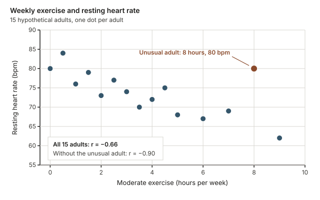
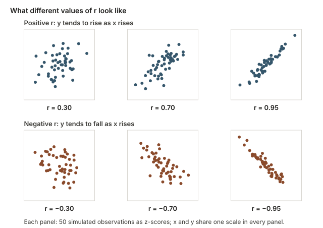
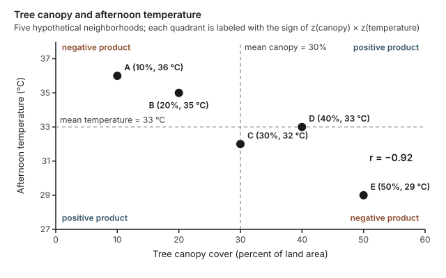
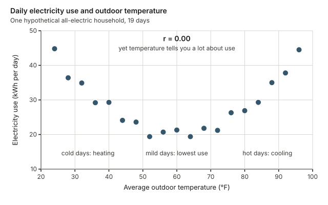
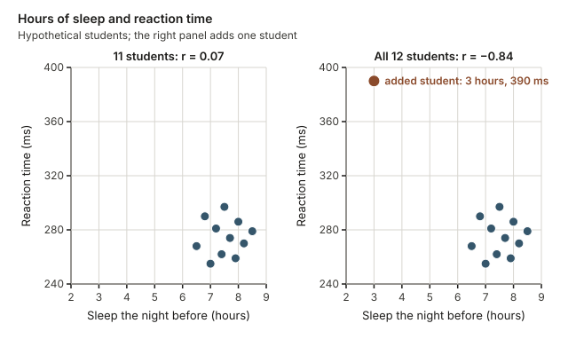
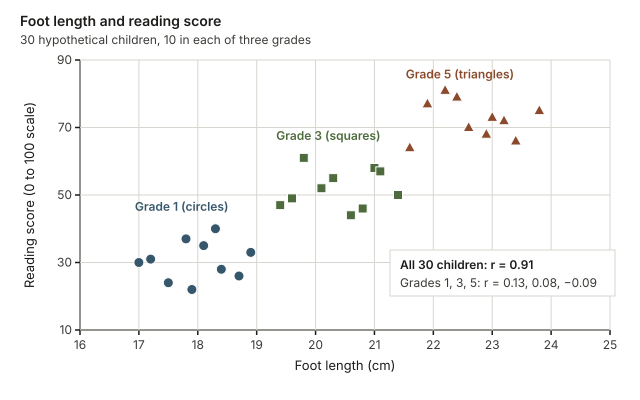

Weeks 3 and 4 summarized one variable at a time and compared one variable across groups. This week asks a new question: when two variables are measured on the same cases, do they move together, and what can that pattern tell you?

## Warm-up: does more exercise go with a lower heart rate?

A hypothetical fitness app reports that among its users, people who log more weekly exercise tend to have lower resting heart rates. Before reading on, jot down a short reply to each question.

1. What kind of graph would let you see this claim for yourself?
2. If the claim holds, does every person who exercises more have a lower heart rate than every person who exercises less?
3. Would the pattern show that exercising more lowers a person's heart rate?

Keep your replies. This week sharpens each one: the first with a scatterplot, the second with the idea of strength, and the third with the difference between association and causation.

## Why association matters: claims that link two things

Much of the evidence you meet in daily life says that two things go together. City planners say that neighborhoods with more tree cover stay cooler on hot afternoons. Public health reports say that counties with higher smoking rates have shorter life expectancy. Each is a claim about an **association**: knowing the value of one variable tells you something about the likely value of the other.

Associations help you predict and point researchers toward possible causes. They are also easy to over-read. A pattern can come from a cause you care about, from a cause nobody measured, or from a single unusual case. Week 2 showed why study design matters for causal claims; this week shows how to describe an association honestly before anyone argues about why it exists.

## What you will be able to do

By the end of this week you can:

- choose the explanatory and response variables for two quantitative variables and read their scatterplot;
- describe a scatterplot in context by its direction, form, strength and unusual observations;
- explain what the correlation $r$ measures, state its properties, and compute it for a small data set;
- recognize when $r$ misleads: a curved pattern or a single unusual observation;
- explain why an association alone does not show that one variable causes the other, and name a plausible lurking variable;
- decide whether two categorical variables are associated by comparing conditional proportions.

## Words to know this week

| Term | Meaning in this course |
|---|---|
| Association | Knowing the value of one variable tells you something about the likely value of the other. |
| Scatterplot | A graph of two quantitative variables measured on the same cases, one dot per case. |
| Explanatory variable | The variable that might help explain or predict the other; it goes on the horizontal axis. |
| Response variable | The variable you want to explain or predict; it goes on the vertical axis. |
| Direction | Positive if larger values of one variable tend to go with larger values of the other; negative if they go with smaller values. |
| Form | The shape of the pattern: roughly linear (straight-line), curved, or clustered. |
| Strength | How closely the dots follow the form. |
| Outlier in a scatterplot | An observation that falls well away from the overall pattern. |
| Correlation $r$ | A number from $-1$ to $1$ measuring the direction and strength of a straight-line association between two quantitative variables. |
| Lurking variable | A variable left out of the analysis that is related to both variables and can create or hide an association between them. |
| Conditional proportion | A proportion computed within one group only, such as the proportion of rural adults with a regular health care provider. |

## Scatterplots: two quantitative variables at once

A **scatterplot** shows two quantitative variables measured on the same cases. Each case (a person, a neighborhood, a day) becomes one dot, placed horizontally by its value of one variable and vertically by its value of the other. Because each dot keeps the two values paired, a scatterplot shows what two separate histograms cannot: whether the variables tend to rise and fall together.

### Which variable goes on which axis

When one variable might help explain or predict the other, it is the explanatory variable and goes on the horizontal axis; the response variable goes on the vertical axis. In the warm-up, weekly exercise is explanatory and resting heart rate is the response, because the natural question is whether heart rates differ for people who exercise different amounts. Calling a variable "explanatory" describes your question. It does not claim that the variable causes anything.

### Four things to describe: direction, form, strength and unusual observations

Describe a scatterplot as you would a single distribution: the overall pattern first, then departures from it.

- **Direction.** In a positive association the dots rise from lower left to upper right: above-average values of one variable tend to go with above-average values of the other. In a negative association the dots fall from upper left to lower right.
- **Form.** Is the trend roughly a straight line, a curve, or separate clusters? Form matters because the correlation in this week's notes, and the fitted lines of Week 8, are built for straight-line patterns.
- **Strength.** If knowing one variable narrows down the other a great deal, the association is strong. If the dots scatter widely around the trend, it is weak.
- **Unusual observations.** Look for dots far from the pattern and ask what might explain them: a recording error, an unusual case, or a real feature worth reporting.

Describe the pattern in context, with units. "Adults who exercise more tend to have lower resting heart rates" is a description; "negative, linear, moderate" is only a checklist.

## Worked example 1: reading a scatterplot of exercise and resting heart rate

**Question.** A hypothetical wellness survey recorded, for 15 adults, hours of moderate exercise in a typical week and resting heart rate in beats per minute (bpm). Describe the relationship, then interpret the correlation that software reports.

{fig-alt="Scatterplot of resting heart rate against weekly exercise hours for 15 hypothetical adults. Rates drift down from about 80 to 62 bpm; one adult at 8 hours and 80 bpm sits well above the pattern. r = −0.66, or −0.90 without that adult."}

**Step 1: cases and variables.** The cases are 15 adults. Weekly exercise is the explanatory variable and resting heart rate is the response. Both are quantitative, so a scatterplot fits.

**Step 2: direction.** The dots drift downward. The three adults who exercise 0 to 1 hours a week have resting rates of 76 to 84 bpm, while the adults who exercise 5 hours or more (setting one adult aside for now) have rates of 62 to 69 bpm. The association is negative.

**Step 3: form.** The downward drift looks roughly like a straight line, with no clear bend.

**Step 4: strength.** The dots do not sit on a line: the adults at 4 and 4.5 hours have rates of 72 and 75 bpm, higher than the adult at 3.5 hours (70 bpm). The association is clear but not tight.

**Step 5: unusual observations.** One adult, at 8 hours and 80 bpm (orange), sits well above the others who exercise 6 hours or more, whose rates are 62 to 69 bpm. That value should be checked (was it taken right after climbing stairs?), not simply deleted.

**Step 6: the correlation.** Software reports:

```
Correlation of exercise (hours per week) and resting heart rate (bpm)
  all 15 adults                        r = -0.66
  without the adult at 8 hours         r = -0.90
```

The value $r = -0.66$ is negative, matching the downward drift, and its size indicates a moderately strong straight-line association (as a rough guide, explained in the next section, a size of about 0.5 is moderate and about 0.8 or more is strong). Without the unusual adult, $r = -0.90$, a strong association. A careful report gives both values and says why they differ, rather than choosing the more impressive one.

**Conclusion.** In these 15 hypothetical adults, those who exercise more tend to have lower resting heart rates: a negative, roughly linear, moderately strong association ($r = -0.66$, or $-0.90$ without one unusual adult). This describes the sample. It does not show that exercise lowers heart rate, because the adults chose how much to exercise and may differ in other ways, such as age or general health.

## Correlation: one number for a straight-line pattern

Alongside the scatterplot, it helps to have one number that says how strong a straight-line pattern is. That number is the **correlation**, written $r$.

### How r is built from z-scores

A **z-score** says how many standard deviations a value sits above or below its mean: $z = (x - \bar{x})/s$. To compute $r$, convert both variables to z-scores, multiply each case's two z-scores, add the products, and divide by $n - 1$:

$$
r = \frac{1}{n-1}\sum_{i=1}^{n} \left(\frac{x_i - \bar{x}}{s_x}\right)\left(\frac{y_i - \bar{y}}{s_y}\right)
$$

Here $s_x$ and $s_y$ are the standard deviations of the two variables. The logic matters more than the formula. A case above average on both variables has two positive z-scores, so its product is positive; a case below average on both also gives a positive product. A case above average on one variable and below on the other gives a negative product. When the positive products outweigh the negative ones, $r$ is positive; when the negative products outweigh the positive ones, $r$ is negative; when they roughly cancel, $r$ is near 0. Software normally computes $r$, but doing it once by hand, as in Worked example 2, shows where the number comes from.

### Properties of r you can rely on

{fig-alt="Six scatterplots of 50 simulated observations each. Top row: r = 0.30, 0.70 and 0.95. Bottom row: r = −0.30, −0.70 and −0.95. Dots hug a line more tightly as the size of r grows; the sign sets the direction."}

- **Range.** $r$ is always between $-1$ and $1$, and equals $1$ or $-1$ only when every dot lies exactly on a straight line.
- **Sign and size.** The sign gives the direction; the size gives the strength of the straight-line pattern. In the figure, $r = 0.70$ and $r = -0.70$ are equally strong associations running in opposite directions. $r$ measures how closely the dots follow a line, not how steep the line is; a gently sloping pattern can have $r$ near 1. (The panels look steeper as $r$ grows only because both variables in each panel are drawn as z-scores on the same scale.)
- **No units.** Built from z-scores, $r$ has no units, and changing units leaves it unchanged: temperature in Fahrenheit or Celsius, weight in pounds or kilograms, the same $r$.
- **Symmetric.** The correlation of $x$ with $y$ equals the correlation of $y$ with $x$, so swapping the axes does not change $r$.
- **Straight lines and quantitative variables only.** $r$ can badly understate a curved relationship, and it cannot be computed for categorical variables such as blood type.
- **Sensitive to outliers.** Like the mean and standard deviation it is built from, $r$ can be pulled a long way by one unusual observation.

How strong is strong? There is no official cut-off. As a rough guide in this course, a correlation whose size (ignoring the sign) is about 0.8 or more is strong, about 0.5 is moderate, and about 0.3 or less is weak. The field matters too: two readings from the same bathroom scale should correlate far more strongly than a quick screening measurement and a health outcome years later.

## Worked example 2: computing r for tree canopy and afternoon temperature

**Question.** A city is deciding where to plant trees. An analyst compares tree canopy cover (the percent of land area shaded by tree crowns) with afternoon air temperature, measured on the same hot summer day, in five hypothetical neighborhoods. Compute $r$ by hand and interpret it.

| Neighborhood | Canopy cover $x$ (%) | Afternoon temperature $y$ (°C) |
|---|---|---|
| A | 10 | 36 |
| B | 20 | 35 |
| C | 30 | 32 |
| D | 40 | 33 |
| E | 50 | 29 |

**Step 1: the means.** $\bar{x} = (10 + 20 + 30 + 40 + 50)/5 = 150/5 = 30$ percent and $\bar{y} = (36 + 35 + 32 + 33 + 29)/5 = 165/5 = 33$ °C.

**Step 2: the standard deviations.** The deviations of $x$ from its mean are $-20, -10, 0, 10, 20$; their squares add to $400 + 100 + 0 + 100 + 400 = 1000$, so $s_x = \sqrt{1000/4} = \sqrt{250} \approx 15.811$. The deviations of $y$ are $3, 2, -1, 0, -4$; their squares add to $9 + 4 + 1 + 0 + 16 = 30$, so $s_y = \sqrt{30/4} = \sqrt{7.5} \approx 2.739$.

**Step 3: z-scores and their products.** Divide each deviation by its standard deviation, then multiply the two z-scores for each neighborhood (rounded to three decimal places).

| Neighborhood | $z_x$ | $z_y$ | Product $z_x z_y$ |
|---|---|---|---|
| A | $-20/15.811 = -1.265$ | $3/2.739 = 1.095$ | $-1.385$ |
| B | $-10/15.811 = -0.632$ | $2/2.739 = 0.730$ | $-0.461$ |
| C | $0/15.811 = 0$ | $-1/2.739 = -0.365$ | $0$ |
| D | $10/15.811 = 0.632$ | $0/2.739 = 0$ | $0$ |
| E | $20/15.811 = 1.265$ | $-4/2.739 = -1.460$ | $-1.847$ |

**Step 4: add and divide by $n - 1$.** The products add to $-1.385 - 0.461 + 0 + 0 - 1.847 = -3.693$. With $n = 5$, $r = -3.693/4 \approx -0.92$. Software, which does not round along the way, gives $r = -0.9238$, which also rounds to $-0.92$.

**Step 5: connect the number to the picture.** The figure splits the scatterplot at the two means. A and B are below average on canopy and above average on temperature, and E is the reverse, so all three products are negative. C and D each sit on a mean line and add nothing. No neighborhood falls in the "both above" or "both below" regions, so no product is positive and $r$ must be negative. A and E, far from both means, contribute large negative products, which is what makes $r$ strongly negative.

{fig-alt="Scatterplot of neighborhoods A to E with dashed lines at the mean canopy, 30 percent, and mean temperature, 33 °C. A and B sit upper left and E lower right, where products are negative; C and D sit on a mean line and add zero. r = −0.92."}

**Conclusion.** In these five hypothetical neighborhoods, more tree canopy goes with lower afternoon temperature: a strong negative straight-line association ($r \approx -0.92$). Two cautions belong in any report. Five neighborhoods is a very small sample, so one more could change $r$ noticeably. And canopy was not assigned at random, so leafier neighborhoods may differ in other ways that affect temperature, such as less pavement. The correlation describes the pattern; it does not tell the city how much cooler a street would become if trees were planted.

## Where correlation falls short

A correlation summarizes one kind of pattern, a straight line. The two situations below show why you should look at the scatterplot before trusting the number.

### A curved pattern can have r near zero

{fig-alt="Scatterplot of daily electricity use against average outdoor temperature on 19 days. Use is lowest, about 20 kWh, near 60 °F and rises to about 45 kWh at both 24 °F and 96 °F, a U shape. r = 0.00."}

The figure shows electricity use on 19 days for a hypothetical household that heats and cools with electricity. On the coldest day (24 °F) the heating runs and the household uses 44.8 kilowatt-hours (kWh). On mild days, between about 50 and 70 °F, use falls to 19 to 22 kWh. On the hottest day (96 °F) the air conditioning runs and use climbs back to 44.5 kWh. Temperature tells you a great deal about electricity use, yet $r = 0.00$ to two decimal places.

The reason is that $r$ measures only straight-line association. The pattern slopes down on the cold side and up on the hot side, so the positive and negative products of z-scores cancel. A correlation near 0 means "no straight-line pattern," not "no relationship." The reverse mistake is possible too: a gently bending curve can have $r$ close to 1, so a large $r$ does not prove the form is a straight line.

### One unusual observation can move r a long way

{fig-alt="Two scatterplots of reaction time against hours of sleep. Left: 11 hypothetical students sleeping 6.5 to 8.5 hours show no pattern, r = 0.07. Right: adding one student with 3 hours and 390 ms gives r = −0.84."}

The left panel shows 11 hypothetical students who slept 6.5 to 8.5 hours before a reaction-time task. Their times run from 255 to 297 milliseconds (ms) with no visible pattern, and $r = 0.07$. The right panel adds a twelfth student who slept 3 hours and took 390 ms. With that student included, $r = -0.84$, which would usually be called a strong negative association.

Nothing about the other 11 students changed; the correlation comes almost entirely from one observation far from the rest. An observation whose removal changes a summary this much is called **influential**, an idea that returns in Week 8. The slow time is not meaningless (very short sleep may well slow reactions), but with only one student below 6.5 hours of sleep, these data say almost nothing about that range. Report $r$ with and without such an observation. In Worked example 1, one unusual adult weakened a correlation from $-0.90$ to $-0.66$; here one unusual student creates a strong correlation where the other cases show none.

## Association is not causation

A strong association invites a causal story: exercise lowers heart rate, trees cool streets. The story may be right. But in observational data, where nobody assigned the explanatory variable, an association fits several explanations, and the data alone usually cannot tell them apart.

### Lurking variables: a preview of Week 6

{fig-alt="Scatterplot of reading score against foot length with three clusters by grade. Overall the dots rise from lower left to upper right, r = 0.91, but within each grade there is almost no pattern (r = 0.13, 0.08 and −0.09)."}

The figure shows foot length and reading score for 30 hypothetical children, 10 each from grades 1, 3 and 5. Across all 30 children the association is strong and positive, $r = 0.91$: children with longer feet tend to read better.

Nobody believes that growing feet improves reading. Grade, and with it age, is a **lurking variable**: older children have longer feet and have also had more years of reading instruction. Within one grade the pattern almost disappears; the within-grade correlations are $0.13$ for grade 1, $0.08$ for grade 3 and $-0.09$ for grade 5. Nearly the whole association comes from comparing children of different ages. In real studies the lurking variable is rarely this obvious: adults who exercise more may also smoke less or be younger, and leafier neighborhoods may have higher incomes. Week 6 develops this idea, called confounding.

### Other explanations to weigh before a causal claim

When an explanatory variable and a response are associated, consider each possibility:

1. **The explanatory variable affects the response.** Possible, and usually what the headline claims.
2. **The response affects the explanatory variable.** People who feel unwell may exercise less, so poor health could lead to less exercise rather than the reverse.
3. **A lurking variable drives both**, as grade does for foot length and reading score.
4. **Chance.** In a small sample, a moderate correlation can appear even when the larger population has no association. Weeks 11 and 12 develop the reasoning for judging whether chance alone could explain a pattern; in StatKey, the **Randomization Hypothesis Tests** menu item **Test for Slope, Correlation** applies the same shuffling idea to $r$.
5. **One unusual case**, as in the sleep example.

The most convincing way to rule out the second and third explanations is the design from Week 2: a randomized experiment, in which chance assigns the explanatory variable, so the groups are alike, on average, in everything else. When an experiment is not possible or not ethical, causal evidence must be built from many studies, comparisons that account for lurking variables, and a plausible mechanism.

## Association between two categorical variables

Correlation needs two quantitative variables. When both variables are categorical, compare **conditional proportions**: the proportion in a response category, computed separately within each group of the explanatory variable.

A hypothetical survey of 400 adults in one state recorded where each person lives and whether they have a regular health care provider.

| Where they live | Has a regular provider | No regular provider | Total |
|---|---|---|---|
| Urban | 190 | 60 | 250 |
| Rural | 99 | 51 | 150 |
| Total | 289 | 111 | 400 |

Within each group, the proportion with a regular provider is $\hat{p}_{\text{urban}} = 190/250 = 0.76$ and $\hat{p}_{\text{rural}} = 99/150 = 0.66$. These differ by $0.76 - 0.66 = 0.10$, or 10 percentage points, so in this sample, where people live is associated with having a regular provider. With no association, both conditional proportions would be close to the overall proportion, $289/400 \approx 0.72$.

Two habits carry over from scatterplots. Compare proportions, not counts: more urban than rural adults have a provider (190 against 99) partly because more urban adults were surveyed. And the association is not causation: rural and urban adults may differ in age, insurance or distance to a clinic. Week 13 returns to two-way tables.

## Transfer: reading correlation output for county health data

**Question.** A hypothetical state health office has data on 60 counties: the percent of adults who smoke, the percent who report no leisure-time physical activity, and average life expectancy. Its report prints the correlations below and says that "smoking is the strongest driver of life expectancy in our counties." How should you read the output, and does it support that sentence?

| Pair of variables (60 hypothetical counties) | Correlation $r$ |
|---|---|
| Smoking (%) and physical inactivity (%) | $0.62$ |
| Smoking (%) and life expectancy (years) | $-0.71$ |
| Physical inactivity (%) and life expectancy (years) | $-0.66$ |

**Step 1: cases and variables.** The cases are counties, not people. All three variables are quantitative county-level percentages or averages, so correlations are a reasonable summary if the patterns are roughly linear.

**Step 2: direction and strength.** The correlation of $-0.71$ says counties with higher smoking rates tend to have lower life expectancy, a fairly strong negative straight-line association. Inactivity and life expectancy show a similar, slightly weaker negative association ($-0.66$). Smoking and inactivity are positively associated ($0.62$): counties with more smokers tend to have more inactive adults.

**Step 3: what the numbers cannot show.** None of these values reveals the form of a pattern or whether a few unusual counties drive it. Ask to see the three scatterplots, just as you would check for a curve or an outlier.

**Step 4: the causal sentence.** "Strongest driver" is a causal claim, and the table does not support it. Smoking and inactivity rise together, so each one's correlation with life expectancy partly reflects the other, and both may track county income, access to care or residents' ages. The gap between $-0.71$ and $-0.66$ is small and could reverse with a different set of counties. And a pattern among county averages need not hold in the same way for individual people.

**Conclusion.** In these hypothetical counties, higher smoking and higher inactivity rates each go with lower life expectancy, and the two tend to occur together. The correlations describe association among counties; they do not rank causes. That smoking harms health is well established, but from decades of other evidence, not from a table like this. A careful report would say "is associated with" rather than "drives," show the scatterplots, and point to the adjusted comparisons of Week 6.

## A common misreading: treating r as a percentage or its sign as strength

**"A correlation of 0.6 means the variables are 60 percent related."** Correlation is not a percentage of anything, and $r = 0.6$ is not "twice as related" as $r = 0.3$ in any simple sense. What you can say is that $r = 0.6$ describes a moderately strong positive straight-line association. In Week 8 you will meet $R^2$, the square of $r$ for a fitted line, which does have a percentage reading: the proportion of the variability in the response that the straight-line model accounts for. For $r = 0.6$, $R^2 = 0.6^2 = 0.36$, or 36 percent, not 60 percent.

**"A negative correlation means a weak or bad relationship."** The sign gives direction only. A correlation of $-0.9$ describes a stronger association than a correlation of $0.5$; it simply runs the other way. In Worked example 2, $r \approx -0.92$ is a strong association even though it is negative.

Read the sign for direction, the size for strength, and the scatterplot for everything else.

## Practice (ungraded): association and correlation

1. For each pair, name the explanatory and response variable and predict the direction of the association: (a) the age of a used car and its asking price; (b) the daily high temperature and the number of hot drinks sold at a campus café; (c) the hours a student works at a paid job each week and the hours they sleep each night. *What to look for:* direction describes how the response tends to move as the explanatory variable increases.
2. Match each description to one of $r = -0.95$, $r = -0.40$, $r = 0.05$ and $r = 0.75$: (a) dots rise from lower left to upper right with moderate scatter; (b) dots fall almost exactly along a straight line; (c) a shapeless cloud; (d) a loose downward drift. *What to look for:* decide the sign first, then how tightly the dots hug a line.
3. For a hypothetical sample of adults, a researcher finds $r = 0.68$ between height in inches and weight in pounds. A colleague converts to centimeters and kilograms and recomputes. What correlation will the colleague get, and why?
4. For 25 hypothetical patients, the correlation between the dose of a medication (in milligrams) and a symptom-relief rating is $r = 0.02$. A student concludes that dose has no relationship with relief. What would you want to see before agreeing? *What to look for:* what kinds of pattern can hide behind a correlation near 0?
5. Across 40 hypothetical cities, the number of coffee shops per 10,000 residents has a correlation of $0.55$ with median household income. Name one lurking variable that could help explain this association, and say how it might be related to both variables.
6. In a hypothetical survey, 45 of 60 students who live on campus and 54 of 90 students who commute use the campus library at least once a week. Compute the two conditional proportions. Is library use associated with where students live in this sample? *What to look for:* compare proportions within each group, not the counts 45 and 54.

## Read further on association and correlation

- *Introduction to Modern Statistics* (Çetinkaya-Rundel and Hardin, OpenIntro, free online), [Chapter 7: Linear regression with a single predictor](https://openintrostat.github.io/ims/model-slr.html). Read the opening material and the part on correlation, which covers this week's ideas with more examples; the rest of the chapter belongs with Week 8. The book shows R code in places; you can skip the code and read the output and explanation.
- For two categorical variables, [Chapter 4: Exploring categorical data](https://openintrostat.github.io/ims/explore-categorical.html) in the same book shows two-way tables and conditional proportions.
- [StatKey](https://www.lock5stat.com/statkey/), a free browser tool: open **Descriptive Statistics and Graphs**, then **Two Quantitative Variables**. Choose a built-in data set, describe the scatterplot in words, and guess $r$ before you look at the correlation StatKey reports.

## Where this goes next

This week described associations and showed why an association alone cannot establish a cause. [Week 6: Confounding and multivariable thinking](week06-confounding.qmd) takes the lurking-variable idea further: a third variable can create, hide or even reverse an association, and comparing like with like can change what the evidence supports. Later, [Week 8: Simple regression](week08-simple-regression.qmd) turns a straight-line pattern into a fitted line $\hat{y} = b_0 + b_1 x$ and connects it to $r$.

- Previous: [Week 4: Comparing groups](week04-comparing-groups.qmd)
- Next: [Week 6: Confounding and multivariable thinking](week06-confounding.qmd)
- All weekly notes: [notes overview](index.qmd)
- Week-by-week plan: [course schedule](../schedule.qmd)
