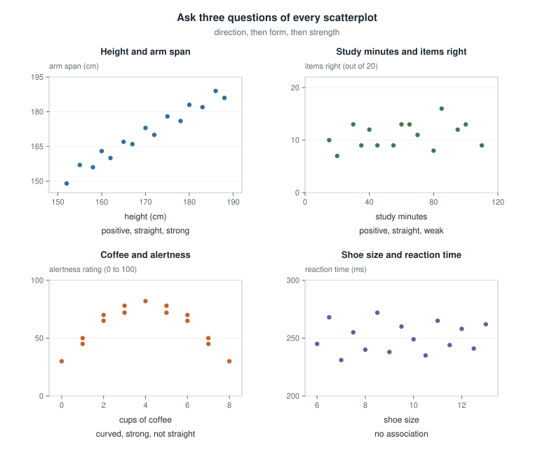
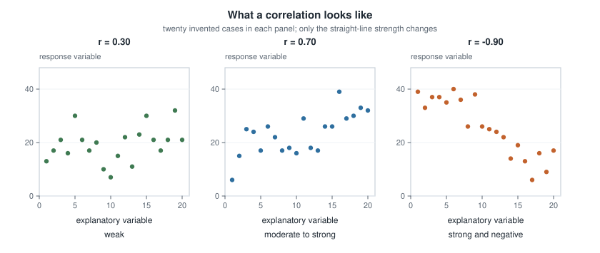
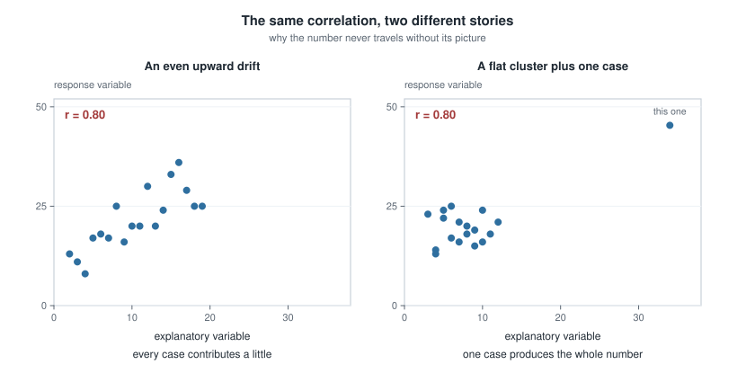
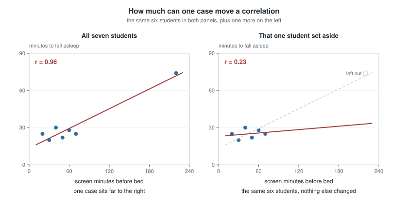

## Where this week starts

Every comparison you made in [Week 4](week04-comparing-groups.qmd) had a group in it. You put the walkers beside the non-walkers, lined two boxplots up on one axis, and read the gap between their centers. The explanatory variable was a label, and the work was comparing.

This week that label turns into a number. A clinic does not only ask whether a patient walks; it asks how many minutes a day. A county does not only ask whether a town is remote; it asks how many miles to the nearest hospital. When both variables are numerical and both are measured on the same case, the question changes shape. It is no longer "which group is higher?" but "as one number goes up, what happens to the other?"

That question comes with a picture of its own, the scatterplot, and a number of its own, the correlation. Both are easy to over-read, so this week spends about as much time on what they refuse to tell you as on what they say.

One thing this week deliberately does not do is fit a line. You will see a line drawn through a cloud once, because nothing else makes its point as fast, but the recipe waits for Week 8. For now the job is describing a relationship honestly.

### Why this matters

A regional health system is choosing where to open three walk-in clinics. The slide that decides it shows one number: across the forty neighborhoods already served, the correlation between the number of clinics and the share of adults reporting a routine checkup is 0.72. Strong, positive, obvious — build more clinics.

Nobody asks to see the scatterplot. If they had, they would have seen thirty-seven neighborhoods in one shapeless blob and the whole correlation coming from three dense downtown neighborhoods that have many clinics because many people already live and work there. The number was not wrong; it answered a narrower question than the room thought, and three cases were carrying it. That is a real decision, made on a picture nobody looked at.

## What you will be able to do

- Build or read a scatterplot, and say which variable you put on the horizontal axis and why.
- Describe any scatterplot in three parts — direction, form, strength — before computing anything.
- Interpret a correlation as a unitless measure of straight-line strength, state its range, and say what its sign means.
- Explain, with a picture, why a correlation near zero does not mean "these two variables are unrelated".
- Recompute a correlation with one unusual case set aside, and report how far it moved.
- Refuse three over-readings: that a correlation measures steepness, that it measures any relationship, and that it establishes cause.

## Words worth owning

| Term | What it means in this course |
|------|------------------------------|
| Scatterplot | One dot per case, explanatory variable across the bottom, response up the side. |
| Explanatory variable | The variable you treat as coming first, or as the possible reason. |
| Response variable | The outcome you are watching. |
| Direction | Whether the cloud drifts upward (positive) or downward (negative), left to right. |
| Form | The shape of the drift: a straight band, a curve, several clumps, or nothing. |
| Strength | How tightly the dots hug that shape. Tight is strong, loose is weak. |
| Correlation, written r | One number between -1 and 1 for how tightly a cloud hugs a *straight* line, and in which direction. |
| Influential case | An observation whose presence noticeably changes a summary. Find it by setting it aside and recomputing. |

## Look at the picture before you compute

The scatterplot is the first display in this course where a single dot carries two measurements at once. A dot at horizontal position 45 and vertical position 68 says: *this one person walked 45 minutes a day and had a resting heart rate of 68 beats per minute*. Both facts belong to the same body, which is what lets the display show a relationship at all.

Because it shows every case, a scatterplot is honest in a way no summary number can be: the clump, the drift, the gaps, the case off in the corner. Everything else this week compresses that picture, and every compression loses something.

### Which variable goes on the horizontal axis

The convention is fixed and it is not decoration. The explanatory variable goes across the bottom; the response variable goes up the side. If you think minutes of walking might help explain resting heart rate, minutes go across the bottom. If either variable is categorical, the scatterplot is the wrong display and last week's side-by-side boxplots are the right one.

Two warnings come with that convention. First, deciding which variable is explanatory is a judgment you are making, not something the data announced; it can quietly smuggle in a causal story you have not earned. Second — and this one surprises people — the correlation does not care which variable you put where. It comes out identical either way, which is your first hint that correlation is not a statement about one variable acting on another.

### Direction, form, and strength, in that order

Say these three things about every scatterplot, before reaching for a calculator.

**Direction.** Read left to right. If the cloud tends upward, the association is positive: larger values of one variable go with larger values of the other. If it tends downward, it is negative. If neither, say so.

**Form.** Is the drift a straight band, or does it bend? Does it fan out as you move right? Are there two clumps rather than one cloud? Form is the question students skip, and it decides whether the correlation you are about to compute means anything at all.

**Strength.** How tightly do the dots hug the form you just named? Strong means a narrow band; weak means a wide scatter with the pattern barely visible through it. Strength and direction are separate: a strong negative association is as strong as an equally tight positive one.

{fig-alt="Four scatterplots. Height and arm span rise together in a tight band; study minutes and items right drift up loosely; alertness rises with coffee and then falls in a hump; shoe size and reaction time show no pattern at all."}

Work the panels with the three questions. Height and arm span: positive, straight, strong — a narrow band, correlation 0.98 for those invented values. Study minutes and items right on a twenty-item quiz: positive, straight, weak — an upward tilt with students scattered all over it, correlation 0.30. Cups of coffee and alertness: strong, curved, emphatically not straight — alertness climbs to a peak near four cups and comes back down. Shoe size and reaction time: no association, a shapeless blob, correlation 0.07.

Hold on to the third panel. That relationship is the strongest of the four in the ordinary sense of the word — coffee intake tells you a great deal about alertness — and yet the correlation of those invented numbers is exactly 0.00. Not "about zero": the values were built symmetric around four cups, so every upward product on the left cancels a downward one on the right. A number built to measure straight-line drift reports nothing when the drift goes up and then comes down.

## Correlation as one number for straight-line strength

Now the compression. The correlation, written $r$, turns a whole cloud of dots into one number, and its blind spots follow from how it is built.

### What the number is actually measuring

Start with something you already did in Week 3: measuring how far a value sits from its own mean. For each case, find how far its $x$ is from the mean of the $x$ values and how far its $y$ is from the mean of the $y$ values, then multiply those two distances.

That product is the whole idea. A case above average on both variables gives a positive product. A case below average on both also gives a positive product, because a negative times a negative is positive. A case above average on one and below on the other gives a negative product. Add the products up: if most cases agree, high with high and low with low, the sum is strongly positive; if they mostly disagree, strongly negative; if they cancel, near zero.

That sum depends on your units, so it is divided by a scaling factor built from the spread of each variable:

$$ r = \frac{\sum (x - \bar{x})(y - \bar{y})}{\sqrt{\sum (x - \bar{x})^2 \; \sum (y - \bar{y})^2}} $$

In words: the sum of the products of the two distances-from-average, divided by a factor made from how spread out each variable is. Three consequences fall out of that division:

- $r$ always lands between -1 and 1. Exactly 1 means every dot sits on one upward-sloping straight line; exactly -1 means one downward-sloping straight line; 0 means no straight-line drift at all.
- $r$ has no units. Minutes per day and beats per minute go in; a bare number comes out. Convert minutes to hours and $r$ does not budge. That lets you compare associations measured in different units, and it is exactly why $r$ cannot tell you how big anything is.
- $r$ is symmetric. Swap which variable you call $x$ and which you call $y$ and the number is unchanged.

### Calibrating your eye

Most people badly overestimate how tight a reported correlation will look, so matching pictures to numbers is the cheapest accuracy you will buy all term.

{fig-alt="Three scatterplots of twenty cases each, labelled r = 0.30, r = 0.70 and r = -0.90. The cloud tightens around a straight line as the size of r grows, and the third panel slopes downward instead of upward."}

The left panel, at 0.30, is a real upward drift you would struggle to see unlabelled — and 0.30 is a correlation many published health studies would call meaningful. The middle panel, at 0.70, has a pattern you would notice unprompted, but individual cases still miss it badly. Only the right panel, at -0.90, is tight enough to look like the word "relationship" in ordinary speech, and being negative takes nothing from its strength. Resist attaching labels such as "weak" or "strong" to fixed cutoffs; what counts as strong depends on the field.

### Three things correlation does not measure

**It does not measure steepness.** A correlation of 0.90 says the dots sit close to some straight line. It says nothing about whether that line rises by half a beat per minute or by fifteen. Steepness is the slope, it carries units, and it is Week 8's subject.

**It does not measure any relationship — only straight-line relationship.** You have already seen the coffee panel: an obvious, strong, useful relationship with a correlation of exactly zero. Read "the correlation was near zero" as "there was no straight-line drift", never as "nothing was going on".

**It does not measure cause.** Correlation describes two columns of numbers sitting side by side. It cannot distinguish "walking lowers heart rate" from "healthier hearts make people more able to walk" from "younger people both walk more and have lower rates". That last possibility, the lurking third variable, is the whole of [Week 6](week06-confounding.qmd).

There is a fourth, and it is why the picture comes first: two datasets can carry the same correlation and tell completely different stories.

{fig-alt="Two scatterplots both labelled r = 0.80. The left panel is an even upward-drifting cloud; the right panel is a flat cluster of cases plus one far-out case that produces the whole correlation by itself."}

Both panels report a correlation of 0.80. On the left that number is a fair summary: every case contributes a little to the upward drift, and dropping any single case leaves the correlation between 0.77 and 0.83. On the right the number is a fiction produced by geometry. Seventeen cases sit in a cluster whose own correlation is 0.00; one far-out case, well to the right and well above them, is far above average on both variables at once, so its single product accounts for about 94 percent of the sum. Delete that one case and 0.80 becomes 0.00. Same number, opposite meaning.

## Worked example — resting heart rate and daily walking

**Setting.** A community clinic enrolls six adults in a walking program. For each person it records the average minutes of brisk walking per day over a month and the resting heart rate in beats per minute at the end. Six people is a very small study; the point here is the arithmetic and the description, not a finding about walking.

**Step 1 — set the picture up.** Minutes walked goes across the bottom, resting heart rate up the side. The people who walk more sit lower: the direction is negative, the form is roughly straight, the strength looks high.

**Step 2 — find both means.** The minutes are 10, 20, 30, 30, 40, 50, which add to 180, so the mean is 30 minutes a day. The heart rates are 82, 75, 76, 68, 69, 62, which add to 432, so the mean is 72 beats per minute.

**Step 3 — build the columns.** For each person, take the distance from each mean and multiply.

| Minutes | Heart rate | Minutes − 30 | Rate − 72 | Product | (Minutes − 30)² | (Rate − 72)² |
|---:|---:|---:|---:|---:|---:|---:|
| 10 | 82 | −20 | 10 | −200 | 400 | 100 |
| 20 | 75 | −10 | 3 | −30 | 100 | 9 |
| 30 | 76 | 0 | 4 | 0 | 0 | 16 |
| 30 | 68 | 0 | −4 | 0 | 0 | 16 |
| 40 | 69 | 10 | −3 | −30 | 100 | 9 |
| 50 | 62 | 20 | −10 | −200 | 400 | 100 |
| **Total** | | **0** | **0** | **−460** | **1000** | **250** |

Check as you go: both distance columns must add to zero, and they do. If yours does not, a mean is wrong.

**Step 4 — divide.** The scaling factor is the square root of 1000 times 250, which is the square root of 250,000, which is exactly 500.

$$ r = \frac{-460}{500} = -0.92 $$

**What this means in context.** Among these six adults, minutes of daily walking and resting heart rate have a strong negative association: those who walked more tended to have lower rates, and the dots sit close to a straight downward band. That is the entire claim. It does not say walking lowered anyone's heart rate, it does not say what ten more minutes is worth in beats per minute, and with six people it is not evidence of much. Notice too that the pattern is not perfect — one person walking 30 minutes a day had a *higher* rate (76) than the person walking 20 (75). A strong correlation describes the cloud; it promises nothing about two individuals in it.

### The same reasoning, transferred

Now run the identical recipe with the opposite sign. A state health department looks at six rural counties, recording the miles from the county seat to the nearest hospital and the average ambulance response time in minutes.

The miles are 4, 8, 12, 16, 20, 24, averaging 14. The response times are 15, 19, 17, 21, 25, 23, averaging 20. The same three columns give a sum of products of 124, and sums of squared distances of 280 for miles and 70 for minutes. The scaling factor is the square root of 280 times 70, that is the square root of 19,600, or exactly 140. So $r = 124 / 140 = 0.886$, which is 0.89 rounded.

What stayed the same: every step, and the three-part description that came before it. What changed: the context, the units, and the sign. Positive here means the two move together — the farther the hospital, the longer the wait — which anyone would expect, and which is why the number alone is worth little.

## Second worked example — one student who moves the number

**Setting.** A campus wellness survey records, for seven students, minutes of screen use in the hour before bed and minutes taken to fall asleep. Six students report between 20 and 70 screen minutes. The seventh reports 220 screen minutes and 74 minutes to fall asleep — not an error, but a real student with a real habit.

**Step 1 — the six ordinary students.** Their screen minutes are 20, 30, 40, 50, 60, 70, averaging 45. Their times to fall asleep are 25, 20, 30, 22, 28, 25, averaging 25. The sum of products is 80, and the sums of squared distances are 1,750 and 68. The scaling factor is the square root of 1,750 times 68, that is the square root of 119,000, or about 345. So $r = 80 / 345 = 0.23$ to two decimals: a weak drift, barely visible.

**Step 2 — put the seventh student back.** The mean screen time jumps from 45 to 70 minutes and the mean time to fall asleep from 25 to 32, because that case sits far from everything. The sum of products becomes 7,430 and the sums of squared distances become 28,000 and 2,126. The scaling factor is the square root of 28,000 times 2,126, or about 7,715. So $r = 7430 / 7715 = 0.96$ to two decimals.

**Step 3 — look at what happened.**

{fig-alt="Two panels on the same axes. With the student at 220 screen minutes included, the fitted line climbs steeply and r is 0.96. With that one student set aside, the line is nearly flat and r falls to 0.23."}

One observation out of seven moved the correlation from 0.23 to 0.96, and tilted the line that best follows the cloud from nearly flat to about six times steeper. Look at where that case sits: far to the right of everyone else. A case extreme in the explanatory direction acts like someone at the end of a see-saw — it need not be unusual on the response side to have huge leverage on the tilt.

**What this means in context.** The honest report is not "screen time before bed is strongly associated with taking longer to fall asleep". It is this: among six students with similar habits there was almost no association, and one student with an extreme habit accounts for essentially all of the association in the group of seven. Both numbers get reported, with the reason they differ. Deleting the student would be worse than useless — that student may be the most informative case in the study — but a conclusion resting on one observation is not available either. These data justify a request for more students at the high end, and nothing stronger.

::: {.callout-note}
The habit to build: whenever a scatterplot has a case sitting well away from the rest, compute the summary twice, with it and without it, and report both. If they agree, say so. If they disagree, that disagreement is the finding.
:::

## The misreading to avoid

The sentence to watch for, in your writing and other people's, is some version of this: **"The correlation was only 0.05, so there's no relationship between these two variables."**

It feels airtight, and it is wrong in a specific way. A correlation near zero says exactly one thing: the cloud has no consistent straight-line drift. It says nothing about curves, clumps, thresholds, or fans. The coffee-and-alertness panel earlier on this page has a correlation of exactly 0.00 and an obvious, strong, practically important relationship — alertness climbs to a peak and comes back down, and the two halves cancel inside the sum. A drug that helps at moderate doses and harms at high ones produces that shape. Reporting "no relationship" there would be a serious error, and no amount of recomputing would catch it; only the picture catches it. Write "no linear association" and you have said something true and narrow.

Two smaller misreadings ride along. One is treating $r$ like a percentage: 0.80 is not twice 0.40, and the gap between 0.90 and 0.95 matters far more in practice than the gap between 0.10 and 0.15. The other is hearing "strong correlation" and picturing a big effect. Strength is how tightly the dots hug the line; size of effect is how steeply that line climbs. A tight, gently sloping cloud has a high correlation and almost no practical consequence. And until next week does the causal work properly, the verb to use is "is associated with".

## Practice on your own

These are for your own checking, not for submission; a calculator and graph paper suffice.

1. Sketch four scatterplots of about ten dots each: strongly positive and straight, weakly negative and straight, strongly curved, and no association. Write the three-part description under each, then guess each correlation and say which guess you trust least.
2. Two variables have a correlation of -0.85, and a classmate calls the association weak because the number is negative. Write the one-sentence correction.
3. A campus office reports that across 30 study rooms, the correlation between the number of chairs and the hours booked last term is 0.61. Write two sentences the number supports, and two that people would be tempted to write but that it does not.
4. Take the six walking-program adults above and change the last person's resting heart rate from 62 to 92, leaving everything else alone. Recompute the mean, the columns, and the correlation, then say how one changed value moved the description of the group.
5. A study reports a correlation of 0.03 between hours of sleep and afternoon concentration, and concludes that sleep does not affect concentration. Name two things that could be true of the scatterplot that would make that conclusion wrong, and say what you would ask to see.

## Where to read more

- [Introduction to Modern Statistics, Chapter 7](https://openintrostat.github.io/ims/model-slr.html) — the opening sections on scatterplots and correlation. Stop where it starts fitting a line; that is Week 8.
- [Introduction to Modern Statistics, Chapter 5](https://openintrostat.github.io/ims/explore-numerical.html) — a refresher on means and spread, the raw material for everything above.
- [Introductory Statistics for the Life and Biomedical Sciences](https://www.openintro.org/book/biostat) — a second explanation with health and biology examples.
- [StatKey](https://www.lock5stat.com/statkey) — its descriptive tools show a scatterplot and its correlation together, so you can watch the number move as the picture changes.
- The [course home page](../index.qmd) and the [schedule](../schedule.qmd) for where this week sits.

## Where this goes next

You now have a picture and a number for the relationship between two numerical variables, and a short list of things that number is not entitled to say. The largest item on that list — that an association, however tight, says nothing about cause — is what [Week 6](week06-confounding.qmd) takes apart. It introduces the lurking variable properly, shows what "adjusted for age" means in an abstract, and works a case where splitting a group reverses the direction of the association entirely.

Week 8 then returns to these scatterplots to do what this week refused to do: put a line through the cloud, give it a slope with units, and use it. The description you built this week is what makes that line safe to fit — a line through a curved cloud, or one dragged by a single influential case, is a worse summary than no line at all.
