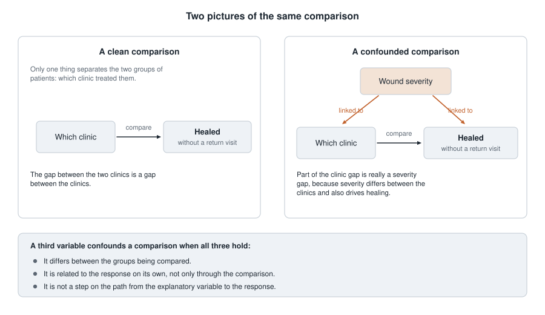
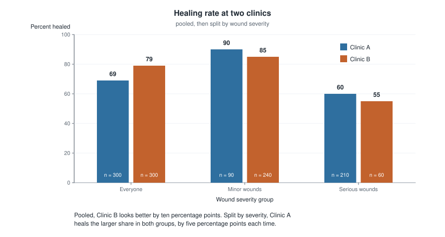
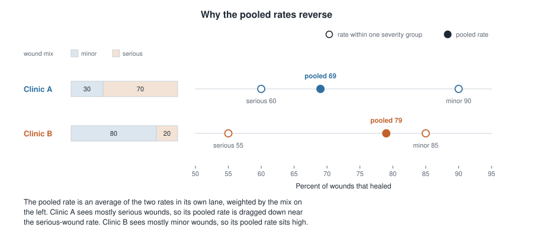
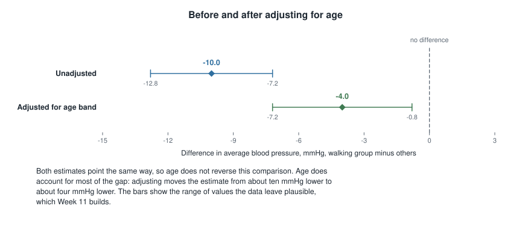

## Where this week starts

Last week you learned to describe a relationship: put two variables on a scatterplot, say whether the cloud drifts up or down, judge how tightly it holds, attach a correlation. That is honest work, but it stops one question short. A relationship is a fact about the data. It is not yet an explanation.

This week supplies the missing question, short enough to carry around in your head: **what else could explain this?** It is not asking whether the pattern is really in the data — you can see that it is. It is asking whether the two variables are tied to each other, or whether both are tied to some third thing you have not yet put in the picture.

Give that third thing a name. If a variable differs between the groups you are comparing, is related to the response on its own, *and* is not simply a step on the path from one to the other, it is a **confounding variable**, and a comparison that ignores it is partly a comparison of that variable instead. The main tool against it is blunter than it sounds: stop comparing everybody to everybody, and start comparing like with like.

This week builds the vocabulary, puts it on real-looking tables including the case where splitting the data reverses the conclusion, and applies it to a study you have not seen. By the end, reading "patients at Clinic A did worse" should prompt a question about who those patients were rather than a verdict about the clinic.

### Why this matters

A city newspaper ranks local hospitals by the share of surgery patients who survive the year. One hospital sits at the bottom. Readers avoid it, a health board threatens it, funding is cut. But that hospital is the regional referral centre: it takes the transfers and complications the others cannot handle. Its patients were sicker before anyone touched them. The table compares hospitals; what it partly measures is who walked through the door.

This is the ordinary way a naive comparison goes wrong, and the costs are real: patients get steered toward whichever hospital is best at avoiding hard cases. The habit this week installs — *ask who is in each group before you compare the groups* — is worth more in daily life than any formula in the course.

## What you will be able to do

- State the three conditions a third variable must meet to confound a comparison, and check them against a described study.
- Stratify a comparison: split the data by a third variable and redo the comparison inside each slice.
- Recombine the slices into one adjusted comparison and say how far it sits from the unadjusted one.
- Recognize Simpson's paradox when a pooled comparison points the opposite way from every split one, and explain the reversal by group sizes.
- Read "adjusted for age and smoking status" and say what has been ruled out and what has not.
- Give two reasons an adjusted comparison can still mislead.

## Words worth owning

| Term | What it means in this course |
|------|------------------------------|
| Confounding variable | Differs between the groups compared, separately moves the response, and is not a step on the path between them, so part of the gap belongs to it |
| Lurking variable | A confounder nobody has identified yet |
| Stratum | One slice of the data defined by a value of the third variable |
| Stratification | Splitting the data into strata and comparing separately inside each one |
| Unadjusted comparison | The comparison on everybody at once, ignoring the third variable. Also called crude |
| Adjusted comparison | The comparison after both groups are put on the same footing by reweighting strata |
| Simpson's paradox | The extreme case where the pooled comparison points the opposite way from every stratum |
| Residual confounding | Confounding that survives adjustment, because the variable was measured coarsely or not at all |

## What makes a variable a confounder

### Three conditions, checked one at a time

Students meeting this idea often start objecting to every comparison they see. "But they didn't account for shoe size." That objection is true and useless. Three things must hold at once before a third variable can distort a comparison.

**One: it differs between the groups being compared.** If two clinics see the same mix of wound severities, severity cannot explain any part of the gap between them, however powerfully it affects healing. A balanced variable has nothing to explain.

**Two: it is related to the response on its own.** Suppose the clinics really do see very different mixes of shoe size. If shoe size has nothing to do with healing, that imbalance is harmless. An imbalance matters only when the imbalanced thing moves the response.

**Three: it is not a step on the path from the explanatory variable to the response.** Suppose Clinic A heals better *because* its nurses irrigate wounds more thoroughly. Thoroughness is not a rival explanation — it is how the clinic difference happens. A variable on that path is a **mediator**, and adjusting for one subtracts out part of the thing you wanted to see.

Conditions one and two make confounding possible; condition three keeps adjustment from destroying a real finding. When you hear an objection to a study, ask which of the three is being claimed — and check condition one against the numbers the report already prints.

### The picture the conditions describe

{fig-alt="Two diagrams. On the left a single arrow runs from which clinic to whether the wound healed. On the right, wound severity points at both, so part of the clinic gap is a severity gap. Three conditions for a confounder appear below."}

On the left, one arrow. The only systematic difference between the two groups of patients is which clinic treated them, so the whole gap in healing belongs to the clinics. On the right, a second variable feeds both boxes: severity helps decide which clinic a patient reaches, and separately affects whether the wound heals. What you measure is now a clinic effect and a severity effect tangled together, and the two-variable table cannot separate them.

The right-hand picture is a warning label, not a verdict. It does not say the clinics are identical, only that the observed gap is not clean.

### Confounding belongs to a comparison, not to a variable

It is tempting to file "age" away as a confounder and be done. Resist that. Age is a confounder *for a particular comparison in a particular study*. If your two groups happen to have identical age distributions, age confounds nothing here, even though it predicts almost every health outcome there is.

This is also where Week 2 comes back. Random assignment balances every background variable at once, on average — including the ones nobody measured or even thought of. That is why a randomized experiment leans far less on this week's machinery — any one trial can still come out imbalanced — and why this week is the repair work observational studies require.

## Comparing like with like

### Stratify first: split, then compare inside each slice

The fix is unglamorous and it works: stop comparing everybody. Split the data by the suspected confounder and make the comparison separately inside each slice. Within "minor wounds only", both clinics are treating minor wounds, so severity cannot be doing any of the work.

Stratification is a discipline rather than a formula: name the variable that most plausibly differs between the groups, then look at the comparison inside its levels. Usually that means reading a table one row deeper than you were about to.

### Then put the slices back together

Stratified results are honest but awkward: you wanted one number and now you have several. The standard move is to combine them into a single **adjusted** comparison — a weighted average across strata that uses the *same* weights for both groups.

$$ \text{adjusted rate} = w_1 \times (\text{rate in stratum one}) + w_2 \times (\text{rate in stratum two}) $$

In words: pick a common mix of strata, with $w_1 + w_2 = 1$, then ask what each group's rate would have been facing that mix. The weights usually come from combining both groups, so the target is everybody in the study — and any difference between the adjusted numbers is one the mix cannot manufacture.

::: {.callout-note}
Adjustment never changes the rate inside a stratum — those are what they are. It changes only the weights used to average them. Do not think of it as correcting the data; think of it as averaging both groups over the same mix.
:::

### What "adjusted for age" is telling you

When a report says a comparison is "adjusted for age", read it as this sentence: *the researchers put the groups on the same age footing and then compared them.* That is a real accomplishment and a narrow one. It says nothing about income, smoking, or prior illness, and nothing about how finely age was handled — two broad bands is far weaker than single years.

So when you meet "adjusted for age and sex" in an abstract, the useful follow-up questions are: adjusted how finely, and what was left out?

## Worked example — Two clinics whose ranking reverses

**Setting.** A city health department reviews wound care at two urgent-care clinics. Each treated 300 patients with a stitched wound. The response is whether the wound healed without a return visit. At intake, before treatment, every wound was recorded as minor or serious.

| Clinic | Minor wounds | Serious wounds | All patients |
|--------|--------------|----------------|--------------|
| Clinic A | 81 healed of 90 | 126 healed of 210 | 207 healed of 300 |
| Clinic B | 204 healed of 240 | 33 healed of 60 | 237 healed of 300 |

**Step one — the unadjusted comparison.** Clinic A healed 207 of 300, or 69 percent. Clinic B healed 237 of 300, or 79 percent. Clinic B leads by ten percentage points. If the report stopped here, Clinic A would be the one in trouble.

**Step two — stratify.** Among minor wounds: Clinic A healed 81 of 90, or 90 percent, Clinic B 204 of 240, or 85 percent. Among serious wounds: Clinic A healed 126 of 210, or 60 percent, Clinic B 33 of 60, or 55 percent. Clinic A leads by five percentage points in each slice.

{fig-alt="Paired bars of healing rates. Pooled, Clinic A is 69 percent and Clinic B is 79 percent. Among minor wounds A is 90 and B is 85; among serious wounds A is 60 and B is 55. The ranking reverses when the data are split."}

**Step three — check the three conditions.** Severity differs between the clinics: 210 of Clinic A's 300 wounds are serious, or 70 percent, against 60 of Clinic B's 300, or 20 percent. Severity moves healing on its own: the rate falls from 90 to 60 percent inside Clinic A and from 85 to 55 inside Clinic B. And it is not a step on the path from clinic to healing, because it was recorded at intake. All three hold.

**Step four — adjust.** Pool the caseloads for a common mix: 90 plus 240 gives 330 minor wounds, and 210 plus 60 gives 270 serious, out of 600. The weights are 0.55 and 0.45. Score each clinic against that same mix.

$$ \text{Clinic A} \colon \; 0.55 \times 0.90 + 0.45 \times 0.60 = 0.495 + 0.270 = 0.765 $$

$$ \text{Clinic B} \colon \; 0.55 \times 0.85 + 0.45 \times 0.55 = 0.4675 + 0.2475 = 0.715 $$

Adjusted for severity, Clinic A heals 76.5 percent against Clinic B's 71.5 — a lead of five percentage points, the same five it held inside each slice. That must happen when both slices show the same gap: a weighted average of five and five is five.

**Step five — what it means.** Unadjusted, Clinic A trails by ten percentage points; on the same mix of wounds, it leads by five. Both are correct, and they describe different things. The pooled table says what happened to the patients each clinic actually saw. The adjusted comparison says how the clinics did on comparable wounds — what a patient choosing a clinic wants to know.

The reversal stops being mysterious the moment you look at the mix.

{fig-alt="A percentage axis with one lane per clinic. Clinic A, seeing 70 percent serious wounds, has rates of 60 and 90 and pools to 69, near the lower rate. Clinic B, seeing 80 percent minor wounds, has 55 and 85 and pools to 79."}

Each clinic's pooled rate is the average of its own two rates, weighted by its own caseload. Clinic A is 70 percent serious, so 0.30 times 90 plus 0.70 times 60 gives 69, close to its serious-wound rate. Clinic B is 80 percent minor, so 0.80 times 85 plus 0.20 times 55 gives 79. Clinic A's higher rates are averaged over a harder caseload and lose. Nothing was faked; an average moves when its weights move.

### The same reasoning, transferred

A university health clinic tests two appointment reminders. Six hundred appointments were reminded, 300 by text message and 300 by phone call, and the response is whether the patient arrived. The third variable is whether the appointment was a first visit or a follow-up, because first visits are missed more often and staff had been using text mainly for them.

By text, 150 of 200 first visits arrived, or 75 percent, and 90 of 100 follow-ups, or 90 percent; overall 240 of 300, or 80 percent. By phone, 70 of 100 first visits arrived, or 70 percent, and 170 of 200 follow-ups, or 85 percent; overall 240 of 300, again 80 percent.

Pooled, the two reminders look identical. Split, text leads by five percentage points in both slices. Adjusting confirms it: combined, there are 300 first visits and 300 follow-ups, so both weights are one half, giving text an adjusted 82.5 percent against phone's 77.5 percent.

What stayed the same: a third variable that differed between the groups and moved the response on its own, and the same split-then-reweight arithmetic. What changed: the pooled comparison did not reverse — it *vanished*. Confounding does not always flip a sign; far more often it hides a real difference, shrinks one, or inflates one. A pooled zero is not evidence of no difference.

## Second worked example — A walking program and an age gap

**Setting.** A community health centre offered a free walking group for one season and followed 300 adults: 120 joined and 180 did not. The response is numerical this time — average systolic blood pressure in mmHg at the end of the season. Age was recorded in two bands, under 55 and 55 and over. Spread inside each band was roughly twelve mmHg.

| Group | Under 55 | 55 and over | Everyone |
|-------|----------|-------------|----------|
| Walking group | 90 adults, mean 124 | 30 adults, mean 136 | 120 adults, mean 127.0 |
| No walking group | 45 adults, mean 128 | 135 adults, mean 140 | 180 adults, mean 137.0 |

**Step one — the unadjusted comparison.** For the walking group, 90 times 124 plus 30 times 136 gives 15,240, and dividing by 120 gives 127.0. For the others, 45 times 128 plus 135 times 140 gives 24,660, divided by 180 gives 137.0. The walking group averages 10.0 mmHg lower.

**Step two — is age a confounder here?** It differs between the groups: 90 of 120 walkers are under 55, or 75 percent, against 45 of 180 non-walkers, or 25 percent. It moves the response on its own: the mean rises from 124 to 136 across the bands inside the walking group and from 128 to 140 inside the other. And it is not on the causal path, since joining a walking group does not change how old you are.

**Step three — stratify.** Under 55, the difference is 124 minus 128, or 4.0 mmHg lower for walkers. At 55 and over, 136 minus 140, again 4.0 lower. The gap inside each band is far smaller than the gap overall.

**Step four — adjust.** Combined, there are 135 adults under 55 and 165 at 55 and over, out of 300, so the weights are 0.45 and 0.55.

$$ \text{walking group} \colon \; 0.45 \times 124 + 0.55 \times 136 = 55.8 + 74.8 = 130.6 $$

$$ \text{no walking group} \colon \; 0.45 \times 128 + 0.55 \times 140 = 57.6 + 77.0 = 134.6 $$

The age-adjusted difference is 130.6 minus 134.6, or 4.0 mmHg lower for walkers.

**Step five — what it means.** A report prints both numbers together, because the pair says far more than either alone.

```
Comparison : walking group versus no walking group
Outcome    : systolic blood pressure, mmHg

                             Difference    Plausible range
Unadjusted                        -10.0    -12.8 to  -7.2
Adjusted for age band              -4.0     -7.2 to  -0.8
```

{fig-alt="A difference axis in mmHg with a dashed line at zero. The unadjusted difference is 10 lower, with a bar from about 13 to 7 below zero. Adjusted for age band it is 4 lower, with a bar from about 7 to 1 below zero."}

Both estimates point the same way, so age does not reverse this comparison the way severity reversed the clinic one. But age accounts for most of the raw gap: of the ten mmHg, roughly six were the age difference between joiners and non-joiners, and roughly four survive adjustment. The ranges say how far each number might reasonably sit from the truth; Week 11 shows where they come from. Notice the adjusted estimate is smaller and less certain: when the groups are unevenly spread across the bands, as they are here, adjustment often costs precision.

Written for a non-technical reader: *adults who joined the walking group had systolic blood pressure about four mmHg lower than adults who did not, once the groups were put on the same age footing. Because people chose whether to join, this shows an association and does not establish that walking caused the difference.*

## What adjustment cannot repair

**You can only adjust for what you measured.** If the health centre never recorded smoking, no arithmetic will remove smoking from the comparison. That is the flat ceiling on every observational study, and it is why "we adjusted for many variables" is a weaker sentence than it sounds.

**You can only adjust as finely as you measured.** The walking study used two age bands. Inside "55 and over" the walkers might average 58 while the non-walkers average 71 — an age gap of thirteen years the adjustment never touched, because both sit in the same band. Whatever confounding survives is called residual confounding, and coarse categories are its commonest source.

**Adjusting for the wrong variable does damage.** Suppose walking lowers blood pressure partly by lowering body weight. Then end-of-season weight sits on the causal path, and "adjusted for weight" would subtract out part of the program's real effect, making a working program look useless. Before adjusting, ask whether the variable was fixed before the comparison or could have been changed by it.

None of this is a reason to give up on adjustment, only to report it precisely and keep the word *associated* in your conclusion until a randomized study earns a stronger verb.

## The misreading to avoid

Here is the sentence to watch for, and it will be said out loud this week:

> "They adjusted for age, so now it's a fair comparison — walking really does lower blood pressure."

The first half is nearly right and the second half does not follow. Adjusting for age removed the part of the gap that age accounted for, and nothing else. People who volunteer for a walking group also tend to sleep better, smoke less, and have the kind of schedule that permits a daily walk — none of which were measured, so none adjusted for. An adjusted association is still an association. The verb *lower* is causal, and this study has not earned it. Write "was associated with about four mmHg lower blood pressure, adjusted for age band" and you have said everything the data support.

A second misreading appears whenever a table reverses:

> "The pooled table says Clinic B is better and the split tables say Clinic A is better, so one of them must be wrong."

Neither is wrong. Both are correct arithmetic about different quantities. The pooled rate describes what happened to the patients each clinic actually saw, mix and all. The stratified rates describe how each clinic did on comparable wounds. If your question is "how did this clinic's patients fare?", the pooled number is honest. If it is "which clinic should I go to with a serious wound?", the stratified number is. Statistics will not choose your question for you.

And a third, which is more a mood than a claim:

> "Simpson's paradox proves you can make numbers say anything."

No. A pooled summary is a weighted average, and averages move when their weights move. Once you look at the mix, the reversal is not merely explainable — it is predictable. The paradox lives in our expectations, not in the arithmetic, and the remedy is always available: look at the mix.

## Practice on your own

These are for your own checking, not for submission. Work them with pencil and paper.

1. A campus recreation centre reports that students who use the climbing wall get fewer winter colds. Name the third variable you think most plausibly confounds this comparison and argue for each of the three conditions. Then name a variable that fails condition two.

2. A driving school compares two training programs on whether new drivers passed the road test on the first attempt. Compute each program's unadjusted pass rate, then each rate within route type, then the adjusted rates using the combined route counts as weights. Say which program you would recommend and why.

| Program | Easy route | Hard route |
|---------|-----------|------------|
| Program P | 45 passed of 50 | 60 passed of 100 |
| Program Q | 80 passed of 100 | 28 passed of 50 |

3. An abstract reports: "After adjustment for age, sex, and household income, the association was attenuated but persisted." Write two sentences for a non-technical reader — one saying what has been ruled out, one saying what has not.

4. An observational study of a diabetes education program adjusts for participants' end-of-program diet quality, then reports almost no benefit. Using condition three, decide whether that adjustment was appropriate, and say what the adjusted number now estimates.

5. Invent your own reversal. Hold four rates fixed: Group One heals 80 percent of mild cases and 40 percent of severe ones; Group Two heals 70 percent and 30 percent. Choose caseloads so the pooled comparison favours Group Two, then state the rule you used.

## Where to read more

- [Introduction to Modern Statistics, Chapter 2: Study design](https://openintrostat.github.io/ims/data-design.html) — where confounding is introduced. Reread the observational-study sections alongside your Week 2 notes.
- [Introduction to Modern Statistics, Chapter 8: Linear regression with multiple predictors](https://openintrostat.github.io/ims/model-mlr.html) — the formal machinery behind adjustment. Read it for the concept, not the algebra; Week 9 returns for the details.
- [Introductory Statistics for the Life and Biomedical Sciences](https://www.openintro.org/book/biostat) — its study design material carries several health examples of confounding.
- [The whole of Introduction to Modern Statistics](https://openintrostat.github.io/ims), if you want to browse ahead.
- Course pages: [the resources list](../resources/index.qmd) and [the schedule](../schedule.qmd).

## Where this goes next

Week 5 handed you a relationship; this week handed you the question that tests it. [Week 7](week07-synthesis-midterm.qmd) is a consolidation week: you will read one invented study front to back — design, cases and variables, one-variable summaries, group comparison, association, confounding check — and write a conclusion with its qualifications attached.

Further out, this week is the ancestor of [Week 9](week09-multiple-logistic-regression.qmd). Multiple regression is stratification done all at once, across many variables, including numerical ones you could never split into tidy slices — and "holding the other variables fixed" does exactly the job the common weights did here.

You can reach every unit from [the course home page](../index.qmd), and last week's material is at [Week 5](week05-association.qmd).
