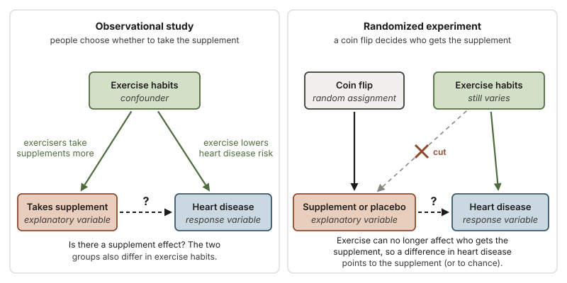
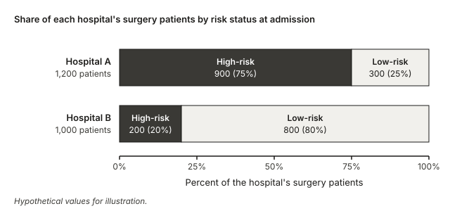
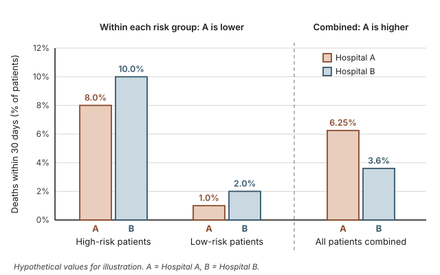
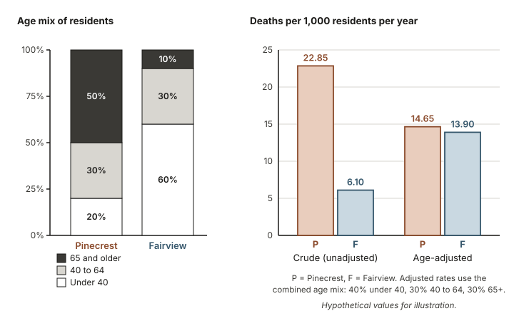
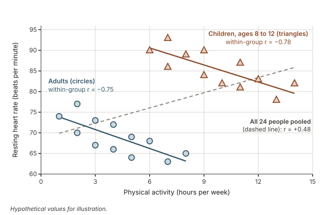

## Warm-up: should you avoid the hospital with more deaths?

A regional health report (hypothetical, for illustration) lists two hospitals that perform the same kind of surgery. Last year, 75 of Hospital A's 1,200 surgery patients died within 30 days of their operation. At Hospital B, 36 of 1,000 surgery patients died within 30 days.

Before you read on, think about two questions:

1. Which hospital has the higher death rate?
2. If you needed this surgery, would these two numbers be enough to choose a hospital? What one extra piece of information would you want first?

Hospital A's death rate is $75/1200 = 0.0625$, or 6.25%, and Hospital B's is $36/1000 = 0.036$, or 3.6%. Many people stop there and choose Hospital B. By the end of this week you will see why that choice could be exactly backwards.

Week 5 was about the association between two variables. This week adds a third. The question behind every example is the same: when two groups differ on an outcome, do they also differ in other ways that could explain it?

## Why a third variable matters for evidence

Most data in health, biology and public policy are observational: researchers record what people already do rather than assigning a treatment. Hospitals do not receive their patients at random, and people choose whether to take vitamins, where to live and how much to exercise. Groups that form by choice or circumstance tend to differ in many ways at once, so a difference in their outcomes might come from the variable you care about, from some other variable that travels with it, or from both.

That is why hospital report cards and news stories about health habits are so easy to misread. A fair comparison asks: compared with whom, and are these groups alike in the ways that matter? These questions return in every later week that interprets a comparison, including regression in Weeks 8 and 9.

## What you will be able to do

By the end of this week you can:

- decide whether a third variable could be a confounder by checking its links to both the explanatory and the response variable;
- draw and read a simple causal diagram with arrows;
- stratify data by a third variable and compare rates within each stratum;
- recognize Simpson's paradox and explain, using each group's mix, how a comparison can reverse when the strata are combined;
- explain in plain words the difference between an unadjusted and an adjusted comparison, and compute a simple adjusted rate as a weighted average;
- explain why random assignment breaks confounding, and what adjustment in an observational study cannot do.

## Words to know this week

| Term | Meaning in this course |
|---|---|
| Confounding variable (confounder) | A variable associated with both the explanatory and the response variable, and not itself a result of the explanatory variable, so it can create, hide or reverse an apparent relationship between them. Some books use the term lurking variable for a confounder the study did not record. |
| Causal diagram | A sketch in which variables are boxes and an arrow from one box to another means "may influence". |
| Stratify | Split the data into groups (strata; one group is a stratum) that share a value of a third variable, then compare within each group. |
| Case mix | The makeup of a group on a third variable, such as the share of a hospital's patients who are high-risk. |
| Unadjusted (crude) comparison | A comparison that pools all the data in each group and ignores the third variable. |
| Adjusted comparison | A comparison that accounts for a third variable, by comparing within strata or by computing each group's rate for one common mix. |
| Simpson's paradox | A comparison points one way within every stratum but the other way when the strata are combined. |
| Random assignment | Using chance, such as a coin flip, to decide which treatment each participant receives. |
| Residual confounding | Confounding left over after adjustment, from a confounder that was unmeasured or measured too coarsely. |

## Confounding: when a third variable is tied to both

Confounding is a main reason an association in observational data can mislead. This section defines a confounder, draws one, and shows how an experiment removes it.

### What makes a variable a confounder

Suppose a large survey (hypothetical) follows adults for ten years and finds that people who take a daily vitamin supplement are less likely to develop heart disease. The explanatory variable is supplement use (yes or no); the response variable is whether the person develops heart disease.

It is tempting to conclude that the supplement protects the heart. But people who choose a daily supplement often look after their health in other ways too. Suppose that in this survey regular exercisers take supplements more often than non-exercisers, and that exercise lowers the risk of heart disease on its own. Then exercise is linked to both variables in the comparison:

- it is associated with the explanatory variable (exercisers are more likely to take the supplement), and
- it is associated with the response variable (exercisers are less likely to develop heart disease).

A variable with both links is a **confounding variable**: its effect is mixed up, or confounded, with the effect of the explanatory variable. The supplement group could have less heart disease even if the supplement did nothing, simply because it contains more exercisers.

So a proposed confounder must pass two checks: it differs between the groups being compared, and it affects the response on its own. It must also not be a result of the explanatory variable itself; a variable the explanatory variable causes is a mediator (see the note below). Eye color might differ slightly between supplement takers and non-takers, but it has nothing to do with heart disease, so it is not a confounder here.

### Drawing a causal diagram with arrows

A causal diagram turns this reasoning into a picture. Each variable is a box, and an arrow means "may influence". In the left panel below, exercise habits sit at the top with an arrow into each of the other two boxes. The arrow from supplement use to heart disease is dashed and marked with a question mark, because that is the effect you want to learn about.

{fig-alt="Two causal diagrams. Left, observational study: exercise habits point to both supplement use and heart disease. Right, randomized experiment: a coin flip sets supplement or placebo, so the arrow from exercise habits is cut."}

The left diagram shows two routes between supplement use and heart disease. One is the direct arrow, the supplement's own effect, if any. The other runs from supplement use back up to exercise habits and down to heart disease. That second route is not an effect of the supplement, yet it still creates an association in the data. An observational comparison of takers with non-takers shows both routes blended together.

::: {.callout-note}
**Not every third variable is a confounder.** A confounder is a common cause: it influences which group a person ends up in and it influences the outcome. A variable on the path from the explanatory variable to the response is different. If a blood pressure drug lowers stroke risk by lowering blood pressure, then blood pressure is a **mediator**, a step from the drug to the outcome, and stratifying on it would hide part of the very effect you want to measure. Before adjusting for a variable, ask where its arrows point.
:::

### Why random assignment breaks confounding

Now imagine the question studied as a randomized experiment. Researchers flip a coin for each volunteer: heads, a daily supplement; tails, an identical-looking placebo. In the right panel, the coin decides who takes the supplement, so exercise habits can no longer influence which group a person lands in. That arrow is cut.

Exercise still affects heart disease, but because the coin ignores exercise, regular exercisers end up in the two groups in about the same proportion, on average. The same holds for smoking, diet, age and every other variable, including ones nobody measured. Balancing unmeasured variables is the great strength of random assignment.

Two cautions. Random assignment balances variables on average, not exactly: in a small experiment chance can leave the groups somewhat different, and measuring that chance variation is the job of the inference methods later in the course. And it protects only the groups as assigned: if some people stop taking their pills, comparing those who kept taking them with everyone else is again a comparison of self-selected groups. Still, when a well-run randomized experiment finds a difference too large to explain by chance, the treatment is the most believable explanation. Week 2 introduced this idea; this week shows what goes wrong without it.

## Stratifying by a third variable

Often you cannot run an experiment. Nobody can assign patients to hospitals by coin flip. When the data are observational and you have measured a possible confounder, the first tool is to **stratify**: split the data by the third variable and make the comparison within each group.

### Comparing like with like within strata

Within one stratum everyone has the same value of the third variable, so it cannot differ between the groups being compared. To handle exercise, compare supplement takers with non-takers among regular exercisers only, then among non-exercisers only. A difference that remains cannot be explained by exercise (as measured by those categories), though other confounders could still be at work. Stratifying works best with a few categories, each holding enough people for its rates to be stable.

### Why an overall rate is a weighted average

An overall rate is not the simple average of the stratum rates. It is a **weighted average**, in which each stratum's rate is weighted by that stratum's share of the group:

$$\text{overall rate} = (\text{share in stratum 1})(\text{rate in stratum 1}) + (\text{share in stratum 2})(\text{rate in stratum 2}) + \cdots$$

The weights are the case mix. Two groups with identical rates in every stratum can still have very different overall rates if their mixes differ. A reversal becomes possible when two things happen together: the third variable strongly affects the response, and the groups being compared have very different mixes of it. The reversal feels impossible, which is why it is called a paradox, but the arithmetic is ordinary. Worked example 1 shows both ingredients.

## Worked example 1: two hospitals and Simpson's paradox

**Question.** Return to the warm-up. The hypothetical report also records each patient's risk status at admission, based on age and other health conditions. Does Hospital A have worse surgical outcomes than Hospital B?

| Hospital | Risk status | Patients | Deaths within 30 days |
|---|---|---|---|
| A | High-risk | 900 | 72 |
| A | Low-risk | 300 | 3 |
| A | All patients | 1,200 | 75 |
| B | High-risk | 200 | 20 |
| B | Low-risk | 800 | 16 |
| B | All patients | 1,000 | 36 |

**Step 1: name the variables.** The explanatory variable is the hospital (A or B). The response variable is death within 30 days (yes or no). The possible confounder is risk status at admission (high or low).

**Step 2: make the unadjusted comparison.** Pool all the patients at each hospital:

$$\text{A: } \frac{75}{1200} = 0.0625 = 6.25\%, \qquad \text{B: } \frac{36}{1000} = 0.036 = 3.6\%.$$

Unadjusted, Hospital A's death rate is $6.25 - 3.6 = 2.65$ percentage points higher.

**Step 3: stratify by risk status.** Compute the death rate within each stratum:

| Risk status | Hospital A death rate | Hospital B death rate | Which is lower |
|---|---|---|---|
| High-risk | $72/900 = 0.080 = 8.0\%$ | $20/200 = 0.100 = 10.0\%$ | A, by 2.0 percentage points |
| Low-risk | $3/300 = 0.010 = 1.0\%$ | $16/800 = 0.020 = 2.0\%$ | A, by 1.0 percentage point |

Within each risk group, Hospital A has the *lower* death rate. The comparison has reversed: this is Simpson's paradox.

**Step 4: check that risk status is a confounder.** It needs a link to each of the other two variables. Risk status is recorded at admission, before any surgery, so it cannot be a result of the hospital's care.

- Link to the explanatory variable (hospital): $900/1200 = 0.75$, or 75%, of Hospital A's patients are high-risk, but only $200/1000 = 0.20$, or 20%, of Hospital B's. One plausible story, which the table cannot confirm, is that Hospital A is a large referral center that receives the most complicated cases.
- Link to the response variable (death): across both hospitals, $72 + 20 = 92$ of the $900 + 200 = 1100$ high-risk patients died ($92/1100 \approx 8.4\%$), but only $3 + 16 = 19$ of the $300 + 800 = 1100$ low-risk patients died ($19/1100 \approx 1.7\%$), both rounded to one decimal place.

{fig-alt="Stacked bars. Hospital A: 900 of 1,200 surgery patients are high-risk (75%) and 300 are low-risk (25%). Hospital B: 200 of 1,000 are high-risk (20%) and 800 are low-risk (80%)."}

**Step 5: see how the reversal arises.** Write each overall rate as a weighted average of its stratum rates, using that hospital's own case mix as the weights:

$$\text{A: } (0.75)(8.0\%) + (0.25)(1.0\%) = 6.0\% + 0.25\% = 6.25\%$$

$$\text{B: } (0.20)(10.0\%) + (0.80)(2.0\%) = 2.0\% + 1.6\% = 3.6\%$$

Both match Step 2. Hospital A's overall rate is pulled toward its high-risk rate of 8.0% because three quarters of its patients are high-risk; Hospital B's is pulled toward its low-risk rate of 2.0% because four fifths of its patients are low-risk. Hospital B looks better overall because it treats mostly low-risk patients, not because it does better with either kind of patient.

{fig-alt="Bar chart of 30-day death rates. High-risk: A 8.0%, B 10.0%. Low-risk: A 1.0%, B 2.0%. All patients combined: A 6.25%, B 3.6%. A is lower within each risk group but higher combined."}

**Conclusion in context.** In these illustrative data, Hospital A's higher overall death rate is explained by its sicker patients. For high-risk and low-risk patients alike, Hospital A's 30-day death rate is lower than Hospital B's, so a patient choosing a hospital should look at the rate for patients like themselves. This is still an observational comparison: two risk categories are a rough summary of how sick someone is, and other differences between the hospitals' patients could remain.

## Adjusted versus unadjusted comparisons in plain words

An **unadjusted** comparison answers "what happened to these groups as they actually were?" An **adjusted** comparison answers "what would the comparison look like if the groups had been alike on the third variable?" They are different questions, and only the adjusted one speaks to whether the groups differ for reasons other than that variable.

Stratum-by-stratum comparisons are already adjusted, but they give one comparison per stratum. To get a single number for each group, choose one common mix of the third variable and apply each group's own stratum rates to it.

### Building an adjusted rate from a common mix

For the hospitals, a natural common mix is all their patients combined: $900 + 200 = 1100$ high-risk and $300 + 800 = 1100$ low-risk patients, out of $2200$, so 50% high-risk and 50% low-risk. Apply each hospital's stratum rates to that mix:

$$\text{A adjusted: } (0.50)(8.0\%) + (0.50)(1.0\%) = 4.0\% + 0.5\% = 4.5\%$$

$$\text{B adjusted: } (0.50)(10.0\%) + (0.50)(2.0\%) = 5.0\% + 1.0\% = 6.0\%$$

Adjusted for risk status, Hospital A's death rate is $6.0 - 4.5 = 1.5$ percentage points lower than Hospital B's, although unadjusted it was 2.65 percentage points higher. The stratum rates did not change; only the weights did.

Three facts are worth remembering. An adjusted rate is a "what if" number: neither hospital actually treated this exact mix. Its value depends on the common mix chosen, so a careful report names its standard. And adjustment can move a comparison in any direction: shrink a gap, erase it, widen it or, as here, reverse it.

### Adjustment by a model: a preview

Stratifying works for one or two categorical variables. Studies that must account for many variables at once, some numerical such as age in years, use a regression model with several explanatory variables, which you will learn to read in Week 9. The idea is the same: in a multiple regression, the coefficient of one variable describes its association with the response when the other variables in the model are held fixed. That is the model's way of comparing like with like, and it is why research reports describe such results as "adjusted for" those other variables.

## Worked example 2: age-adjusted death rates in two towns

**Question.** Two hypothetical towns each have 20,000 residents. In one year, Pinecrest recorded 457 deaths and Fairview recorded 122. A local headline asks whether something in Pinecrest is making people sick. Is Pinecrest's higher death rate evidence that living there is less healthy?

Pinecrest is a popular place to retire, and older people die at much higher rates wherever they live, so age is the obvious third variable.

| Age group | Pinecrest residents | Pinecrest deaths | Fairview residents | Fairview deaths |
|---|---|---|---|---|
| Under 40 | 4,000 | 4 | 12,000 | 12 |
| 40 to 64 | 6,000 | 33 | 6,000 | 30 |
| 65 and older | 10,000 | 420 | 2,000 | 80 |
| All ages | 20,000 | 457 | 20,000 | 122 |

Death rates are often reported per 1,000 residents per year: deaths divided by residents, times 1,000.

**Step 1: compute the crude (unadjusted) rates.**

$$\text{Pinecrest: } \frac{457}{20000} \times 1000 = 22.85, \qquad \text{Fairview: } \frac{122}{20000} \times 1000 = 6.10.$$

Unadjusted, Pinecrest's rate is about $22.85/6.10 \approx 3.7$ times Fairview's.

**Step 2: compute the age-specific rates.**

| Age group | Pinecrest rate per 1,000 | Fairview rate per 1,000 |
|---|---|---|
| Under 40 | $4/4000 \times 1000 = 1.0$ | $12/12000 \times 1000 = 1.0$ |
| 40 to 64 | $33/6000 \times 1000 = 5.5$ | $30/6000 \times 1000 = 5.0$ |
| 65 and older | $420/10000 \times 1000 = 42.0$ | $80/2000 \times 1000 = 40.0$ |

Within each age group the towns are close: equal in the youngest group, Pinecrest slightly higher in the two older groups.

**Step 3: check that age is a confounder.** Age is linked to the explanatory variable (town): $10000/20000 = 0.50$, or 50%, of Pinecrest's residents are 65 and older, compared with $2000/20000 = 0.10$, or 10%, of Fairview's. Age is linked to the response variable (death): in both towns, residents 65 and older die at about 40 times the rate of residents under 40.

**Step 4: choose a common age mix.** Use the two towns combined: $4000 + 12000 = 16000$ residents under 40, $6000 + 6000 = 12000$ aged 40 to 64, and $10000 + 2000 = 12000$ aged 65 and older, out of 40,000. The weights are $16000/40000 = 0.40$, $12000/40000 = 0.30$ and $12000/40000 = 0.30$, which add to 1.

**Step 5: compute the age-adjusted rates.** Apply each town's own age-specific rates to the common mix:

$$\text{Pinecrest: } (0.40)(1.0) + (0.30)(5.5) + (0.30)(42.0) = 0.40 + 1.65 + 12.60 = 14.65$$

$$\text{Fairview: } (0.40)(1.0) + (0.30)(5.0) + (0.30)(40.0) = 0.40 + 1.50 + 12.00 = 13.90$$

Both are deaths per 1,000 residents per year.

{fig-alt="Left: 50% of Pinecrest residents are 65 or older, versus 10% of Fairview. Right: deaths per 1,000 per year are 22.85 versus 6.10 crude, but 14.65 versus 13.90 after age adjustment."}

**Conclusion in context.** Unadjusted, Pinecrest's death rate is about 3.7 times Fairview's (22.85 versus 6.10 per 1,000). Adjusted for age, the gap shrinks to $14.65 - 13.90 = 0.75$ deaths per 1,000, with Pinecrest about 5% higher ($14.65/13.90 \approx 1.05$). Almost all of the crude difference comes from Pinecrest's older population, not from living in Pinecrest. The small remaining gap is not by itself evidence of a health problem: Fairview's rate for residents 65 and older rests on only 80 deaths, so ordinary year-to-year chance variation, or other differences between the towns, could produce a gap this size. This is why public health reports comparing places with different age structures usually give age-adjusted rates.

## Transfer: activity and resting heart rate across age groups

The same reasoning works when both variables are numerical. A hypothetical health survey records weekly hours of physical activity and resting heart rate (beats per minute) for 12 adults aged 25 to 45 and 12 children aged 8 to 12. The scatterplot marks each age group with its own color and shape.

{fig-alt="Scatterplot of weekly activity hours and resting heart rate for 12 adults (circles) and 12 children (triangles). Pooled r = 0.48, but r = −0.75 within adults and r = −0.78 within children."}

**Question.** In these data, does more physical activity go with a higher or a lower resting heart rate?

**Pooled, the association looks positive.** Treating all 24 people as one group gives a correlation of $r = 0.48$, a moderate positive association, shown by the dashed line (a straight line fitted to all 24 people; Week 8 shows how such lines are found).

**Within each age group, the association is negative.** For the adults alone $r = -0.75$, and for the children alone $r = -0.78$. Within each group, each extra hour of weekly activity goes with roughly 1.4 to 1.5 fewer beats per minute (the slopes of the two solid lines, each a straight line fitted to one age group's data), the direction you would expect if activity builds fitness.

**Why the pooled trend reverses.** Age group is linked to both variables. The 12 children's weekly activity hours add to 117, so they average $117/12 = 9.75$ hours per week; the 12 adults' hours add to 50, an average of $50/12 \approx 4.2$ hours. The 12 children's resting heart rates add to 1,025, an average of $1025/12 \approx 85.4$ beats per minute; the 12 adults' add to 828, an average of $828/12 = 69.0$ beats per minute. The children's average is higher because children's hearts normally beat faster at rest. Pooling puts the active, faster-heart children in the upper right and the less active, slower-heart adults in the lower left, so the combined cloud tilts upward even though each group's cloud tilts downward.

**Conclusion in context.** In these illustrative data, the positive pooled correlation is produced by age group acting as a confounder. Comparing children with children and adults with adults, more activity goes with a lower resting heart rate. As with the hospitals, the stratified comparison answers the question you care about, and it is still observational: it rules out age group as the explanation for the within-group pattern, but it does not show that activity causes it.

## A common misreading: adjusting for one variable settles the causal question

After Worked example 1, it is tempting to announce that Hospital A's care causes fewer deaths; after the transfer example, that activity lowers resting heart rate. Both claims go further than the data allow. An adjusted or stratified comparison removes the confounding due to the variables you adjusted for, as you measured them, and nothing more. Three things can still go wrong:

- **Unmeasured confounders.** Hospital B's patients might differ from Hospital A's in ways the report never recorded, such as how quickly they reached the hospital. Adjustment cannot account for a variable that is not in the data. This is also residual confounding.
- **Coarse categories.** "High-risk" is a broad label. If Hospital A's high-risk patients were less sick than Hospital B's, some confounding remains inside the stratum: residual confounding.
- **The wrong kind of variable.** Adjusting for a mediator removes part of the effect you want to measure.

The opposite mistake also happens: treating the unadjusted number as the objective one because no choices went into it. It reflects the case mix as much as anything, so it answers a different question. Which comparison fits depends on the causal story, which you can sketch with a diagram, not on arithmetic alone. Only random assignment balances unmeasured variables, and then only on average. So for any adjusted claim, in the news or in a research paper, ask which variables were adjusted for, how they were measured, and what important variable might be missing.

## Practice on confounding (ungraded)

Try each question before looking back at the worked examples.

1. A hypothetical survey finds that adults who carry a cigarette lighter are more likely to develop lung disease than adults who do not. Name a likely confounder, draw a causal diagram with three boxes, and say what each arrow means. *What to look for:* your confounder needs an arrow into carrying a lighter and an arrow into lung disease.

2. Two physical therapy programs for knee injuries report these hypothetical outcomes. Program P: 45 of 50 patients with mild injuries recovered, and 90 of 150 with severe injuries recovered. Program Q: 132 of 150 patients with mild injuries recovered, and 28 of 50 with severe injuries recovered. Compute each program's recovery rate for mild injuries, for severe injuries and for all of its patients. Which program looks better overall, and which looks better within each severity group? *What to look for:* compare the share of each program's patients whose injuries were severe.

3. County X has a higher crude death rate than County Y but a lower age-adjusted death rate. In two or three sentences, explain to a friend with no statistics background how both can be true.

4. A company notices that employees who join its voluntary lunchtime walking program take fewer sick days than employees who do not. Name one possible confounder and explain why it could produce this difference. Then describe a study design that would break the confounding. *What to look for:* in each design, who or what decides whether an employee walks?

5. A news story reports that, after adjusting for age and income, people who drink tea daily had slightly lower blood pressure than people who do not. Name one thing this adjusted comparison does account for, and one thing it cannot rule out.

## Read further on confounding and adjustment

- *Introduction to Modern Statistics* (IMS), 2nd edition, [Chapter 2: Study design](https://openintrostat.github.io/ims/data-design.html): the parts on observational studies, confounding variables and experiments.
- IMS [Chapter 4: Exploring categorical data](https://openintrostat.github.io/ims/explore-categorical.html): contingency tables (two-way tables), row and column proportions, and bar charts for comparing groups, the tools of Worked example 1.
- IMS [Chapter 8: Linear regression with multiple predictors](https://openintrostat.github.io/ims/model-mlr.html): a preview of adjustment by a model, which returns in Week 9. You can skip the R code and read the output and explanation.
- Optional: *Introductory Statistics for the Life and Biomedical Sciences* (Vu and Harrington, OpenIntro), [book home page](https://www.openintro.org/book/biostat/). Chapter 1, Introduction to data, discusses observational studies and experiments with biomedical examples.

## Where this goes next

- Previous: [Week 5: Association](week05-association.qmd) described how two variables move together; this week asked what a third variable can do to that picture.
- Next: [Week 7: First-half synthesis](week07-synthesis-midterm.qmd) pulls together study design, summaries, association and confounding before the course turns to models.
- Later: [Week 9: Multiple and logistic regression interpretation](week09-multiple-logistic-regression.qmd) returns to adjusted comparisons, read from regression output.
- The [notes overview](index.qmd) lists every week, and the [course schedule](../schedule.qmd) shows the order of the weeks.
