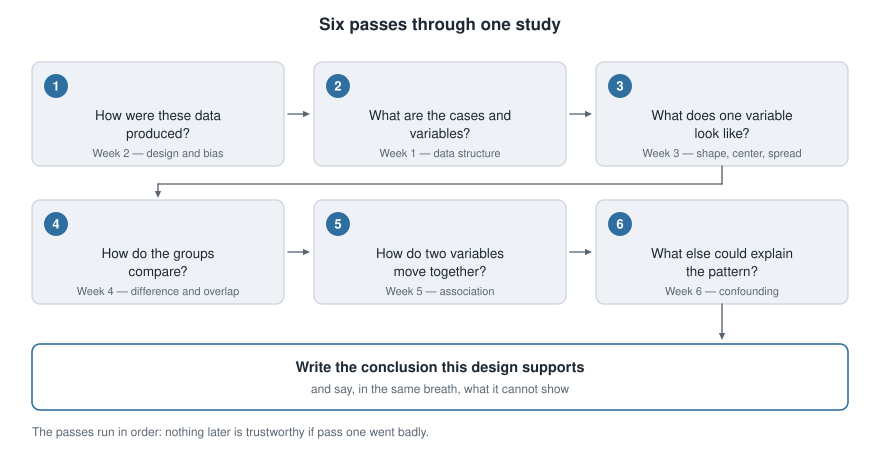
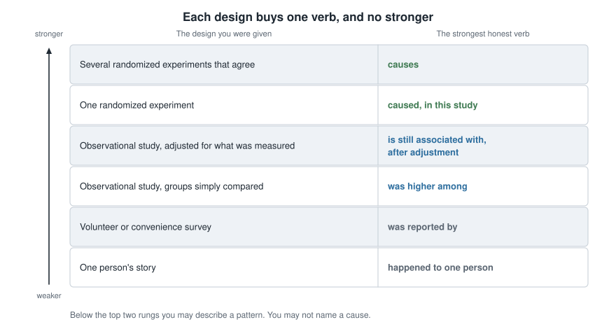
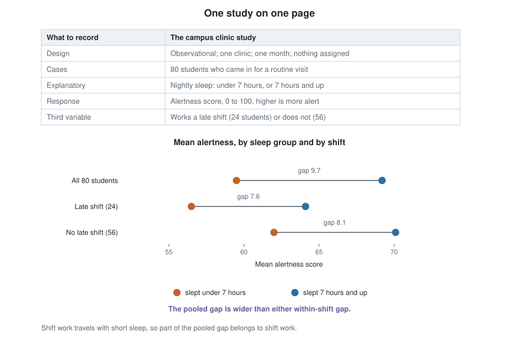
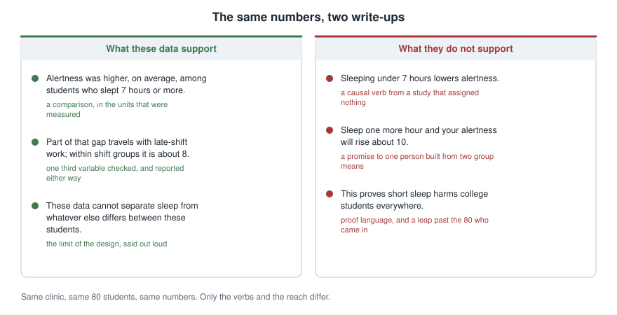

## Where this week starts

For six weeks the tools arrived one at a time, on purpose: cases and variables, then study design, then shape and center and spread, then comparing groups, then association between two numerical variables, and finally Week 6's hardest question — what else could be producing the pattern you just described?

Real studies do not arrive one tool at a time. A study arrives as a paragraph — a few sentences on collection, a table of summaries, one plot, a headline — and all six weeks are relevant at once. Knowing six techniques separately is not the same skill as reading one study with all six.

This week consolidates instead of adding. Nothing new is introduced: no new statistic, no new plot, no new formula. What is new is a routine — a fixed order of six questions you put to any study, and the habit of writing your conclusion in a verb the design can carry. Boring routines are what stop a reader from being fooled by an exciting number.

Week 6 also left something unfinished: you learned to check a third variable by splitting the data, but not when to reach for that check, or what to write down afterward. By the end of this week it will be step six of something automatic.

### Why this matters beyond the course

Picture a clinic manager with one year of outreach money. A study crosses her desk showing that patients who sleep less report worse daytime alertness, so she funds a sleep-education campaign. If most of that gap actually travels with night-shift employment — people on late shifts sleep less *and* are tired for reasons the shift itself creates — the campaign is aimed at the wrong thing and nothing moves. The study was not fraudulent. It was read one pass too shallow.

You will make smaller versions of that decision constantly: whether a supplement is worth the money, whether a city policy has evidence behind it or only a correlation.

## What you will be able to do

- Run six ordered passes over an unfamiliar study description and say, in a sentence each, what every pass found.
- Name the cases, the explanatory variable, and the response variable from a paragraph of prose, with units attached.
- Compare two groups using centers, spreads, and overlap together, stating the difference in the units of the problem.
- Check a named third variable within strata and report whether the comparison shrank, grew, reversed, or held.
- Choose the strongest verb a design supports, and write a two-sentence conclusion carrying its own qualifications.
- Explain why a much larger sample does not repair a badly built one.

## Words worth owning

| Term | What it means in this course |
|------|------------------------------|
| case | one row of the data table — the person, school, or day that was measured |
| explanatory variable | the variable you are treating as the possible reason for the pattern |
| response variable | the outcome you are trying to understand |
| observational study | researchers recorded what people were already doing and assigned nothing |
| response rate | the share of invited people who replied; a small share warns you about who is missing |
| confounding variable | a third variable that travels with the explanatory variable *and* is separately related to the response |
| stratify | split the data by the third variable, then compare inside each group |
| hedge | a verb that reports exactly as much as the design supports, such as "was higher among" |

## Six passes through one study

The routine has six passes in a fixed order, and the order matters. Each borrows a tool from an earlier week. An early failure poisons everything after it: if you cannot say who is in the data, no later arithmetic rescues the reading.

{fig-alt="Six numbered boxes in a flow: how were the data produced, what are the cases and variables, what does one variable look like, how do the groups compare, how do two variables move together, what else could explain the pattern."}

There is no pass for significance; that arrives in Weeks 11 and 12.

### The first three passes: where these data came from and what is in them

**Pass one asks how the data were produced.** Was there an intervention that researchers assigned, or did they record what people were already doing? Who could have ended up in this data set, and who could not? If it was a survey, how many were invited and how many replied? This is Week 2, and it is first because it sets a ceiling on every later claim. An observational study cannot be argued upward into an experiment by clever analysis.

**Pass two asks what the cases and variables are.** Say out loud: one row of this table is one ______. Then name the explanatory and response variables with their units. This is Week 1, and it is where most misreadings begin, because a headline often names one thing while the study measured another. "Sleep improves grades" sounds like it measured grades; if the response was a self-rated alertness item, the headline has swapped in a variable the study does not contain.

**Pass three asks what one variable looks like alone.** Shape, center, spread — the Week 3 questions. A mean without a spread is half a report. Skipping this pass is how a difference between two means gets treated as enormous when it is small next to the variation inside either group.

### The last three passes: comparison, association, and the third variable

**Pass four compares groups.** Difference in means or medians, in the units of the problem, alongside the spreads and the overlap. Week 4's warning applies every time: two groups can differ on average while most individuals in one look like most individuals in the other.

**Pass five asks how two numerical variables move together.** Direction, form, strength — read off the picture first, then summarized by a correlation if the form is roughly linear. A correlation is one number for linear strength only. It is not a slope, it says nothing about curvature, and it carries no cause.

**Pass six asks what else could explain the pattern.** Name a specific third variable — not "other factors", an actual variable someone could have measured. Then check the Week 6 definition in two parts: is it associated with the explanatory variable, and is it separately related to the response? If both hold, split the data on it and compare inside each group. Whatever happens is a finding.

## Choosing the verb your design can carry

The six passes produce a pile of observations. Turning it into a sentence is where studies get overstated, and it happens in one word: the verb. "Was higher among" and "raises" describe the same numbers and make different claims. The design decides which one you have earned.

{fig-alt="A ladder of six designs, weakest at the bottom: a single story, a volunteer survey, an observational comparison, an adjusted observational study, one randomized experiment, several agreeing ones. Only the top two license causal verbs."}

### A ladder of verbs

Read the ladder from the bottom. One person's story supports "happened to one person" and nothing wider. A volunteer survey supports "was reported by the people who replied" — note that the subject there is the repliers, not the population. An observational study with groups compared supports "was higher among", a statement about an observed comparison, not a mechanism. One that adjusts for measured variables earns a little more: "is still associated with, after accounting for age and shift work" — and you name the variables, because "adjusted" means nothing until the reader knows adjusted for what.

Only the top two rungs license causal language, and even there the wording is careful: one randomized experiment supports "caused, in this study", and several agreeing experiments support the plain verb "causes". Nothing done to observational data promotes it onto those rungs, because what random assignment buys — groups comparable before anything happened — cannot be bought afterward with arithmetic.

### Hedges that are honest, not vague

Students often hear hedged language as weakness. It is the opposite: a hedge is a precise report of how far the evidence reaches, and using the wrong one is an error of fact, not of tone.

*"Is associated with"* says two variables travel together in these data and commits to nothing about why. *"Was higher among"* is narrower and often better, naming the direction and the group in one breath. *"These data cannot separate X from Y"* is a finding rather than an apology: it tells the reader which alternative explanation is still standing.

Two habits belong here too. Attach the population you observed — "among the 80 students who came to this clinic", not "among college students". And report the third-variable check whichever way it came out; a comparison that survives adjustment beats one nobody checked.

## Worked example — reading a campus clinic sleep study end to end

**Setting.** A campus health center reviewed the intake forms of every student who came in for a routine visit during one month — 80 students in all. Each form recorded average nightly sleep over the past week, in hours, an alertness score from a standard daytime questionnaire running from 0 to 100 where higher means more alert, and whether the student works a late shift.

**Pass one — how were these data produced?** Observational, one clinic, one month, nothing assigned. The people in the data chose to come in, so they are not a random sample of students on campus. Ceiling set: no causal verb is available, whatever the numbers do.

**Pass two — what are the cases and variables?** One row is one student. The explanatory variable is nightly sleep in hours; the response is the alertness score, 0 to 100. The third variable we will check is late-shift work, a yes-or-no variable. Twenty-four students work a late shift and 56 do not, and $24 + 56 = 80$, so everyone is accounted for.

**Pass three — what does one variable look like?** Sleep hours had a mean of 6.7 hours, a median of 6.9, a standard deviation of 1.2 hours, and quartiles at 6.0 and 7.6. The mean sitting below the median signals a mild left skew — a few very short sleepers pulling the mean down. Alertness had a mean of 64.4, a median of 65, and a standard deviation of 12.3. Hold on to that 12.3: it is the typical person-to-person distance from the mean, and every difference below is judged against it.

**Pass four — how do the groups compare?** Split the students at 7 hours. Forty slept fewer than 7 hours and 40 slept 7 hours or more.

| Sleep group | Late shift | No late shift | All |
|-------------|-----------|---------------|-----|
| Under 7 hours | 18 students, mean alertness 56.5 | 22 students, mean alertness 62.0 | 40 students |
| 7 hours or more | 6 students, mean alertness 64.1 | 34 students, mean alertness 70.1 | 40 students |
| All | 24 students | 56 students | 80 students |

To get mean alertness for all 40 short sleepers, pool the two shift groups, weighting each cell by how many students it holds:

$$\frac{18 \times 56.5 + 22 \times 62.0}{40} = \frac{1017 + 1364}{40} = \frac{2381}{40} = 59.525$$

and among students sleeping 7 hours or more:

$$\frac{6 \times 64.1 + 34 \times 70.1}{40} = \frac{384.6 + 2383.4}{40} = \frac{2768}{40} = 69.2$$

The observed gap is $69.2 - 59.525 = 9.675$, about 9.7 on the alertness scale, favoring the longer sleepers. Now judge it against pass three: the standard deviation of alertness is 12.3, so the gap is smaller than one typical person-to-person distance. Plenty of short sleepers here were more alert than plenty of long sleepers. The groups differ on average and overlap heavily at the same time.

**Pass five — how do two numerical variables move together?** Treated as a numerical variable rather than two buckets, sleep against alertness gives a scatterplot that slopes upward, is roughly straight, and has a correlation of 0.52: direction positive, form roughly linear, strength moderate. That 0.52 does not say how much alertness goes with an extra hour of sleep — that is a slope, and slopes arrive next week.

**Pass six — what else could explain the pattern?** Late-shift work is the obvious candidate, so check both halves of the definition. Is it associated with the explanatory variable? Among late-shift students, 18 of 24 slept fewer than 7 hours, or 75 percent; among the others, 22 of 56, about 39 percent — a gap of roughly 36 percentage points, so yes. Is it separately related to the response? Among short sleepers, mean alertness was 56.5 for late-shift students against 62.0 for the others; among longer sleepers, 64.1 against 70.1. Late-shift students are less alert at both sleep levels, so yes again: shift work is a genuine confounding variable here.

{fig-alt="A design summary table above a dot chart. The pooled gap in mean alertness between short and longer sleepers is 9.7, wider than the within-shift gaps of 7.6 among late-shift students and 8.1 among the rest."}

Now compare inside each shift group. Among late-shift students the gap is $64.1 - 56.5 = 7.6$; among the others, $70.1 - 62.0 = 8.1$. Weighting those by shift-group size gives one adjusted gap:

$$\frac{24 \times 7.6 + 56 \times 8.1}{80} = \frac{182.4 + 453.6}{80} = \frac{636}{80} = 7.95$$

The gap shrinks from about 9.7 to about 8.0 once shift work is held fixed. It shrank, but it did not vanish or reverse. Some of what looked like a sleep pattern was really a shift-work pattern; most of it was not.

**The conclusion, written out.** Among the 80 students who visited this clinic during one month, mean alertness was about 9.7 higher for those sleeping 7 hours or more than for those sleeping less. Late-shift work accounts for part of that difference: within students of the same shift status the gap is about 8.0. Because these students chose to come in and nothing was assigned, these data cannot show that sleeping longer would raise a given student's alertness, and they need not describe students who never came in.

{fig-alt="Two columns of three sentences. The left reports a comparison, the adjusted gap, and the limit of the design. The right uses a causal verb, promises an individual gain, and claims proof, with each fault named in red."}

Every sentence in that figure's left column is a pass from the routine, written down. Every sentence on the right is the same arithmetic with a verb it did not earn.

### The same reasoning, transferred

A school district compares reading gains for 150 third graders. Ninety attended an after-school reading club; 60 did not. Mean gain over the year was 14.2 for attenders and 11.0 for the others, a difference of 3.2 on the district's reading scale, with a standard deviation of gains near 6 in each group. What stayed the same: the design is observational — families chose the club — so the verb ceiling is "was higher among"; a gap of 3.2 against a spread near 6 is heavy overlap again; and the third-variable check runs as before, since family income or a child's starting reading level would travel with attendance and separately relate to the gain.

What changed: the response is a gain rather than a level, and the group sizes are lopsided, so any pooled average leans toward the larger group. The routine and the ceiling are unchanged.

## Second worked example — a wellness app's claim that looks like the same study

**Setting.** A sleep-tracking app surveys all 40,000 of its registered users with one question, asking them to rate daytime alertness from 0 to 100. Two thousand reply, and the company matches each reply to its own records of who has the bedtime-reminder feature switched on: 1,200 of the repliers use it and 800 do not. Mean self-rated alertness is 71 among feature users and 59 among non-users. The company posts: "Our bedtime reminder raises alertness by twelve."

**Pass one.** Observational, and self-selected twice over. Of 40,000 invited, 2,000 replied, a response rate of $2000 / 40000 = 0.05$, or 5 percent. The 38,000 who did not reply are not a random slice, and there is a specific reason to expect them to differ: people who feel good about their sleep are likelier to fill out a sleep survey. And nobody assigned the feature — users switched it on themselves.

**Pass two.** One row is one *replier*, not one user, and the response is a single self-rated item, not a scored questionnaire. The company says "raises alertness"; the study measured a one-question self-rating among volunteers.

**Pass three.** Nothing to work with. Two means are reported and no spread, no shape, no range. Without a standard deviation you cannot tell whether a difference of 12 is large next to the variation between people or small inside it — and that is the half that would let you push back.

**Pass four.** The comparison is 1,200 repliers against 800, and $1200 + 800 = 2000$, so those groups are the whole reply pool. The difference is $71 - 59 = 12$ on the self-rating scale. Note what pass one already did to that number: it compares people who chose the feature with those who did not, among people who chose to reply.

**Pass five.** There is no second numerical variable, so this pass has nothing to describe — worth writing down, because the report holds one comparison and no picture at all.

**Pass six.** No third variable is checked, and several are obvious. Someone who turns on a bedtime reminder is already trying to sleep better; that motivation is associated with using the feature and separately related to alertness through a dozen other habits.

**What is supportable.** Among the 5 percent of users who chose to reply, those who reported using the bedtime reminder also reported higher alertness, on average. That sentence is the whole harvest.

The app's difference is 12 and the clinic's was 9.7; the app's sample is 2,000 and the clinic's was 80. On both counts the app looks better, and it is the far weaker study. A difference produced by a self-selected slice of a self-selected group, with no third variable checked, does not become trustworthy by being large.

## The misreading to avoid

Here is the thought, in the words students actually use: *"The app study had 2,000 people and the clinic study had 80, so obviously the app study is stronger. Bigger sample, better evidence."*

It feels like common sense, and half of it is true. A larger sample does reduce one problem: the random wobble from happening to draw these particular people rather than some others, which Weeks 11 and 12 will make precise. But a large sample does nothing to the other problem, which is bias — a systematic tilt in *who ends up in the data at all*. If the 5 percent who replied are the enthusiastic ones, collecting 20,000 replies from the same self-selecting process gives you the enthusiastic ones more precisely. A big biased sample is not a better estimate; it is a more confident wrong one.

The clinic study is not clean either — students who visit a health center are their own selected group. What makes it stronger is not its size but the passes it survives: the cases are stated, the response is a real instrument, the spread is reported, and a third variable was named and checked.

A quieter misreading rides along with the first: *"Saying 'is associated with' is just being modest about the word 'causes'."* It is neither modesty nor a synonym. "Is associated with" claims the two variables travel together in the data you have; "causes" claims that changing one would change the other. Most of the clinic's sleep gap survived adjustment for shift work, and it remains entirely possible that an unmeasured variable — total hours worked, say — produces both the short sleep and the low alertness. Adjusting for what you measured never adjusts for what you did not.

## Practice on your own

These are for your own checking as you review.

1. A city report states: "Neighborhoods with more bus stops have higher rates of adults meeting exercise guidelines." Run all six passes on that one sentence, saying for each what you can determine and what the sentence withholds. Then name two third variables and argue both halves of the confounding definition.

2. A clinic reports mean pain rating 4.8 among 60 patients who chose physical therapy and 6.1 among 40 who chose medication alone, with a standard deviation near 2.0 in each group; lower ratings mean less pain. State the difference in the units of the problem, say what the spreads imply about overlap, and choose the strongest verb this design supports.

3. One study randomly assigned 120 volunteers to two conditions; another collected 15,000 responses from an open web form. Decide which supports the stronger verb, then write two sentences explaining why the larger number does not settle it.

4. Return to the clinic table and suppose the late-shift means had been 56.5 for short sleepers and 60.5 for longer sleepers, all four group sizes unchanged. Recompute the pooled mean alertness for each sleep group, the two within-shift gaps, and the size-weighted adjusted gap. Does shift work now explain more of the pooled difference, or less?

5. Rewrite this sentence so it is defensible, then name which pass each change came from: "Our study of 500 patients proves that daily walking prevents high blood pressure in adults over fifty."

## Where to read more

- The two applications chapters are built for exactly this week's skill — full study descriptions read end to end: [Applications: Data, Chapter 3 of Introduction to Modern Statistics](https://openintrostat.github.io/ims/data-applications.html) and [Applications: Explore, Chapter 6](https://openintrostat.github.io/ims/explore-applications.html).
- To refresh pass one, reread [Study design, Chapter 2](https://openintrostat.github.io/ims/data-design.html); for passes three and four, [Exploring numerical data, Chapter 5](https://openintrostat.github.io/ims/explore-numerical.html).
- The whole of [Introduction to Modern Statistics](https://openintrostat.github.io/ims) is online for reading around a topic that is not sitting right.
- For the same ideas in health and biology contexts, [Introductory Statistics for the Life and Biomedical Sciences](https://www.openintro.org/book/biostat) covers design and exploratory work early on.
- [StatKey](https://www.lock5stat.com/statkey) is the browser tool this course uses when simulation arrives in Week 11; clicking around it now makes it familiar later.
- Course pages: the [schedule](../schedule.qmd) and the [resources page](../resources/index.qmd).

## Where this goes next

Pass five ended unfinished. You described the sleep-and-alertness relationship with a correlation of 0.52 and then had to stop, because a correlation cannot say how much alertness goes with one more hour of sleep. [Week 8](week08-simple-regression.qmd) supplies that piece: the regression line, its slope read in the units of the problem, the residuals measuring how far the line misses, and the output block you will read rather than produce. Everything on this week's ladder still applies — fitting a line to observational data produces a description and no causal verb.

Keep the routine where you can find it. From Week 8 on, each new tool slots into one of these six passes rather than replacing them: regression sharpens pass five, the inference weeks sharpen pass four, Week 9's adjusted models sharpen pass six. To revisit the third-variable check, go back to [Week 6](week06-confounding.qmd); the [notes index](index.qmd) lists every unit.
