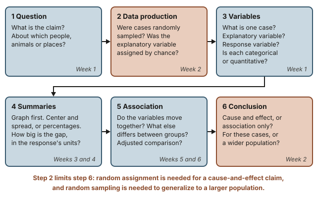
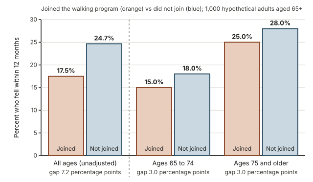
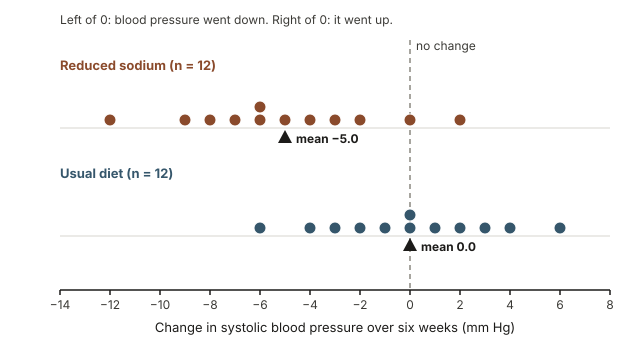

## Warm-up: would you believe this headline?

Here is a made-up headline: "Adults who drink green tea every day have fewer heart attacks, study finds." Before believing it, write down three questions you would want the study to settle. This page shows where each question fits in one routine for reading any study.

## Why this week matters: one study, every tool

Weeks 1 to 6 each gave you one tool: naming cases and variables, judging how data were produced, summarizing, comparing groups, describing association, and thinking about confounding. A real claim, such as a diet story in the news, needs all of them, in order. This week adds no new methods; it reads two illustrative studies from question to conclusion.

## What you will be able to do

By the end of this week you can:

- name a study's question, unit of observation, explanatory variable and response variable;
- tell an observational study from a randomized experiment, and say whether the cases were randomly sampled;
- choose summaries that fit the variables and state a comparison in context, with units;
- explain how a confounding variable can change an unadjusted comparison, and read an adjusted one;
- state what a study can and cannot conclude about cause and effect and about a wider population.

## Words to carry from the first half

| Term | Meaning |
|---|---|
| Unit of observation (case) | The person, animal, place or thing that one row of data describes. |
| Explanatory variable | The variable that may influence the outcome, often defining the groups compared. |
| Response variable | The outcome measured on each case. |
| Observational study | Researchers record variables as they occur, without assigning the explanatory variable. |
| Randomized experiment | Researchers use chance to assign cases to treatment groups. |
| Random sample | Cases chosen from a population by chance, so the sample tends to resemble the population. |
| Confounding variable | A variable associated with both the explanatory and the response variable, which can create, hide or distort an association. |
| Unadjusted comparison | A comparison of groups that ignores other variables. |
| Adjusted comparison | A comparison made within levels of another variable, taking that variable's influence out of the gap. |
| Scope of inference | What a design lets you conclude: whether results extend to a population, and whether a gap shows cause and effect. |

## Reading a study from question to conclusion

The same six steps take you from a claim to a responsible conclusion. Steps 1 to 3 come before any numbers, step 4 holds the arithmetic, and steps 5 and 6 are where misleading reports usually go wrong.

{fig-alt="Flow diagram of six steps: question, data production, variables, summaries and comparison, association and confounders, conclusion. Step 2 (random sampling, random assignment) limits what step 6 can claim."}

### The six-step checklist for any study

| Step | Questions to ask | Where you learned it |
|---|---|---|
| 1. Question | What is claimed, and about whom? | [Week 1](week01-data-evidence.qmd) |
| 2. Data production | Were the cases randomly sampled? Was the explanatory variable assigned by chance? | [Week 2](week02-study-design.qmd) |
| 3. Variables | What is one case? Which variable is explanatory and which is the response? Is each categorical or quantitative? | [Week 1](week01-data-evidence.qmd) |
| 4. Summaries and comparison | What does a graph show? What are the center and spread, or percentages, in each group? How big is the difference, in the response's units? | [Week 3](week03-one-variable-summaries.qmd), [Week 4](week04-comparing-groups.qmd) |
| 5. Association and confounders | How strong is the association? What else differs between the groups? Does the gap survive an adjusted comparison? | [Week 5](week05-association.qmd), [Week 6](week06-confounding.qmd) |
| 6. Conclusion | Cause and effect, or association only? For these cases, or for a wider population? | [Week 2](week02-study-design.qmd) |

For the green-tea headline in the warm-up: did people choose to drink tea, or was it assigned (step 2)? Who was studied, and does the claim reach beyond them (steps 1 and 6)? What else do daily tea drinkers do differently, such as diet or exercise (step 5)?

### Two design questions set the scope of a conclusion

Step 2 limits step 6. Random sampling decides whether results extend to a population; random assignment decides whether a gap between groups can be read as cause and effect.

| | Explanatory variable randomly assigned | Not randomly assigned |
|---|---|---|
| **Cases randomly sampled** | Cause and effect, for the population | Association only, for the population |
| **Cases not randomly sampled** | Cause and effect, for these cases | Association only, for these cases |

Random assignment tends to make the groups alike in every other variable, measured or not, so a gap too large for the random split alone points to the treatment.

### How comparison, association and confounding fit together

A comparison between groups ([Week 4](week04-comparing-groups.qmd)) is an association between a categorical explanatory variable and the response ([Week 5](week05-association.qmd)). In an observational study the groups form themselves and often differ in other ways; a difference that also affects the response confounds the comparison. An adjusted comparison ([Week 6](week06-confounding.qmd)) can remove confounding only by the measured variables it adjusts for.

## Worked example 1: a walking program and falls in older adults

**The study (hypothetical).** A county health department reviewed records for 1,000 adults aged 65 and older who use its senior centers. Some had chosen to join a twice-weekly walking program. The records show whether each adult joined, their age group, and whether they fell at least once in the 12 months after the program started.

**Steps 1 to 3: question, design, variables.** The question is whether joining goes with fewer falls, and ideally whether it prevents them. The unit of observation is one adult. The explanatory variable is program membership (joined or not joined) and the response is whether the adult fell (yes or no); both are categorical. Adults chose whether to join, so the study is observational, and they are one county's center users, not a random sample.

**Step 4: summaries and comparison.** With two categorical variables, compare the percentage who fell in each group.

| Age group | Program | Adults | Fell | Percent who fell |
|---|---|---|---|---|
| 65 to 74 | Joined | 300 | 45 | 15.0% |
| 65 to 74 | Not joined | 200 | 36 | 18.0% |
| 75 and older | Joined | 100 | 25 | 25.0% |
| 75 and older | Not joined | 400 | 112 | 28.0% |
| All ages | Joined | 400 | 70 | 17.5% |
| All ages | Not joined | 600 | 148 | 24.7% |

The unadjusted comparison uses the all-ages rows: $70/400 = 0.175$, so 17.5% of joiners fell, and $148/600 \approx 0.247$, so 24.7% of non-joiners fell. Joiners fell less often, by a gap of $24.7 - 17.5 = 7.2$ percentage points.

**Step 5: association and a possible confounder.** Age is a strong candidate. Among joiners, $300/400 = 0.75$, or 75%, were aged 65 to 74, against $200/600 \approx 0.33$, or 33%, of non-joiners. Age is also related to falling. Combining both program groups, $(45 + 36)/(300 + 200) = 81/500 = 0.162$, or 16.2%, of the younger adults fell, compared with $(25 + 112)/(100 + 400) = 137/500 = 0.274$, or 27.4%, of the older adults. Because age is associated with both variables, it can confound the comparison. Within each age group the gap is 3.0 percentage points (15.0% against 18.0%, and 25.0% against 28.0%), less than half of the unadjusted 7.2.

{fig-alt="Bar chart. All ages: 17.5% of joiners fell vs 24.7% of non-joiners, a 7.2 percentage point gap. Ages 65 to 74: 15.0% vs 18.0%. Ages 75 and older: 25.0% vs 28.0%. Within each age group the gap is 3.0 percentage points."}

**Step 6: conclusion in context.** In these records, program members fell less often. About $7.2 - 3.0 = 4.2$ of the 7.2 percentage points trace back to joiners being younger; within the same age group, joiners still fell about 3 percentage points less often. That remaining gap might come from the program, but chance or other differences could also explain it: people who choose a walking group may already have better balance, strength or health. The study shows an association that survives adjustment for age group, not that the program prevents falls, and it describes center users in one county, not all older adults. A randomized experiment is the way to test the causal question.

## Worked example 2: a randomized trial of a reduced-sodium diet

**The study (hypothetical).** Twenty-four volunteers with mildly high blood pressure were randomly split into two groups of 12. One group followed a reduced-sodium meal plan for six weeks; the other kept their usual diet. Nurses who did not know the group assignments measured systolic blood pressure at the start and end. The response is the change, end minus start, in millimeters of mercury (mm Hg), so a negative change means blood pressure went down.

**Steps 1 to 3: question, design, variables.** The question is whether the plan lowers systolic blood pressure. The unit of observation is one volunteer. The explanatory variable, diet (reduced sodium or usual), is categorical; the response, change in blood pressure, is quantitative. Chance, not the volunteers, decided who changed diet, so this is a randomized experiment. The volunteers are not a random sample of any population.

**Step 4: graph first, then numbers.** The dot plot shows every value; in order, they are:

- Reduced sodium: $-12, -9, -8, -7, -6, -6, -5, -4, -3, -2, 0, 2$
- Usual diet: $-6, -4, -3, -2, -1, 0, 0, 1, 2, 3, 4, 6$

{fig-alt="Dot plot of blood pressure change. Reduced sodium: −12 to 2 mm Hg, mean −5.0, 10 of 12 had a drop. Usual diet: −6 to 6, mean 0.0, 5 of 12 had a drop. The groups overlap, but the reduced-sodium dots sit farther left."}

Both groups look roughly symmetric with no outliers, so the mean and standard deviation are sensible summaries ([Week 3](week03-one-variable-summaries.qmd)).

```
Group            n    mean   median    SD    min   max
Reduced sodium  12   -5.00    -5.5    3.91   -12     2
Usual diet      12    0.00     0.0    3.46    -6     6
```

By hand: the reduced-sodium values add to $-60$, so $\bar{x} = -60/12 = -5.0$; the usual-diet values add to 0, so $\bar{x} = 0.0$. With 12 values, each median is the average of the 6th and 7th ordered values: $(-6 + (-5))/2 = -5.5$ and $(0 + 0)/2 = 0$. For the usual diet, the squared distances from the mean add to 132, so $s = \sqrt{132/11} = \sqrt{12} \approx 3.46$ mm Hg. For reduced sodium, the distances from the mean of $-5$ are $-7, -4, -3, -2, -1, -1, 0, 1, 2, 3, 5, 7$; their squares add to 168, so $s = \sqrt{168/11} \approx \sqrt{15.27} \approx 3.91$ mm Hg.

The difference in means, reduced sodium minus usual diet, is $-5.0 - 0.0 = -5.0$ mm Hg. The groups overlap, but 10 of the 12 reduced-sodium volunteers ended with lower blood pressure, against 5 of the 12 on the usual diet, and the gap between the means is larger than either group's standard deviation.

**Step 5: other explanations.** Random assignment tends to balance age, weight, salt habits and everything else, measured or not, so confounding is not the worry it was in Worked example 1. The nurses did not know who was on which diet, so that knowledge could not nudge their readings. The remaining worry is chance: even a diet with no effect would produce some gap between two randomly formed groups of 12. [Week 11](week11-simulation-based-inference.qmd) shows how to check whether a 5 mm Hg gap would be surprising from the random split alone.

**Step 6: conclusion in context.** If that check shows the gap is too large for chance alone, the design supports a cause-and-effect conclusion: for these volunteers, the reduced-sodium plan lowered systolic blood pressure about 5 mm Hg more, on average, than the usual diet over six weeks. Because the volunteers were not randomly sampled, extending this to all adults with mildly high blood pressure depends on how closely they resemble these volunteers.

## Transfer: bike lanes and traffic deaths across cities

A hypothetical report on 30 mid-sized cities that chose to share their records finds that cities with more miles of protected bike lanes per 100,000 residents had fewer traffic deaths per 100,000 residents per year, with correlation $r = -0.48$.

Run the same six steps. The unit of observation is a city, not a person. Both variables are quantitative rates per 100,000 residents, which makes large and small cities comparable. No one assigned bike lanes by chance, and the cities chose to take part rather than being randomly sampled, so this is an observational study of these 30 cities. A correlation of $-0.48$ is a moderate negative linear association, with plenty of scatter; before trusting it, check the scatterplot, because $r$ describes only straight-line patterns and one unusual city can pull it. Possible confounders include population density (dense cities tend to have more bike lanes and slower traffic) and public transit use (transit-heavy cities often add bike lanes, and more riders means fewer cars). The supported conclusion: among these cities, more bike lanes went with fewer traffic deaths. The study cannot show that building lanes would lower deaths, and it says nothing direct about any individual cyclist's risk.

## A common misreading: adjusting for one variable proves cause

In Worked example 1, adjusting for age shrank the gap from 7.2 to 3.0 percentage points, and it is tempting to call those 3.0 percentage points the program's true effect. That reading goes too far: the remaining gap might be the program's effect, but these records cannot show it. Adjusting removes confounding only by the variables you adjusted for, and only as finely as the groups allow: within the "75 and older" group, joiners may still be younger than non-joiners. Joiners may also differ in balance, fitness, health or motivation, none of which the records show. More adjustment can make an observational comparison more convincing, but never equivalent to a randomized experiment, where chance also balances the variables nobody measured.

## Practice for this week (ungraded)

1. A hypothetical survey of 500 randomly selected adults in one state finds that those who sleep less than six hours a night report more sick days. Name the case, the two variables and the design. To whom does the result extend, and what can it not show? *What to look for:* how the 500 adults were chosen, and whether anyone assigned how much they slept.
2. Suppose the walking program in Worked example 1 had admitted only adults who first passed a balance test. Which checklist step does this change, and how does it affect the conclusion?
3. Patients who chose physical therapy at home recovered faster, on average, than patients who chose therapy at a clinic. Suggest one possible confounding variable and explain how it could be related to both variables.
4. In a hypothetical experiment, a researcher randomly assigns 40 tomato plants to two fertilizers, 20 plants each. After eight weeks the mean heights are 62 cm with fertilizer A and 55 cm with fertilizer B. State the difference in means with units, and the kind of conclusion the design supports if the gap is larger than chance would produce.
5. In the walking-program bar chart, how can you tell without arithmetic that age is related to falling? *What to look for:* compare the two Joined bars, and then the two Not joined bars, across the age groups.

## Read further in the free textbook

The two applications chapters of *Introduction to Modern Statistics* (IMS) below pull the first half together. You can skip the R code and read the output and explanation.

- [IMS Chapter 3, Applications: Data](https://openintrostat.github.io/ims/data-applications.html) closes the part on data and study design (Chapters 1 and 2).
- [IMS Chapter 6, Applications: Explore](https://openintrostat.github.io/ims/explore-applications.html) closes the part on exploring categorical and numerical data (Chapters 4 and 5).

## Where the course goes next

This week closes the first half. If adjusted comparisons still feel unfamiliar, revisit [Week 6: Confounding and multivariable thinking](week06-confounding.qmd). Next, [Week 8: Simple regression](week08-simple-regression.qmd) turns the association in step 5 into a fitted line $\hat{y} = b_0 + b_1 x$. The [notes overview](index.qmd) lists every week, and the [course schedule](../schedule.qmd) shows where this week sits in the term.
