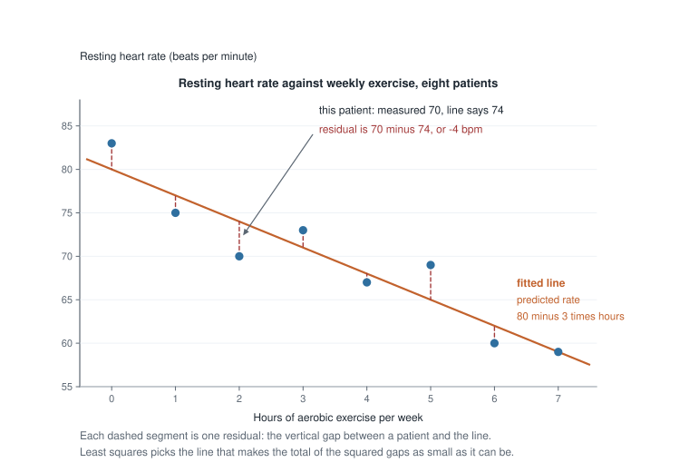
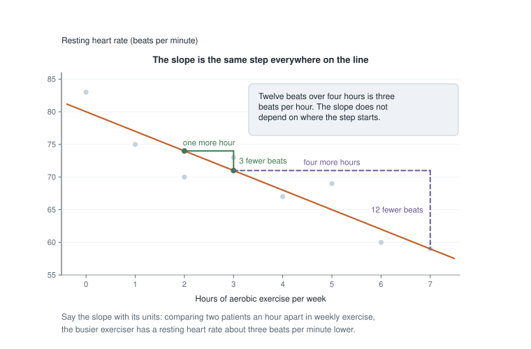
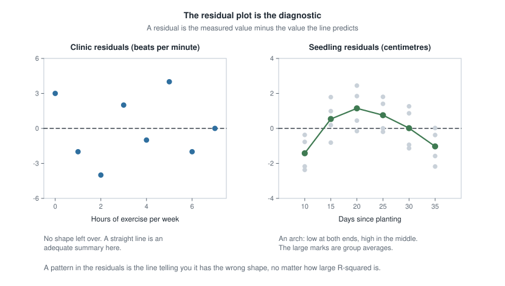
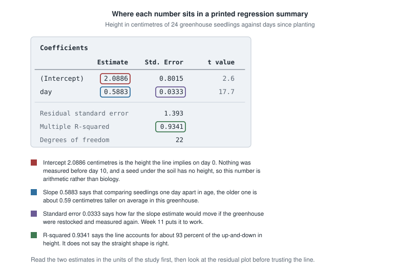

## Where this week starts

Weeks 4 and 6 compared groups: whether one group's centre sat higher than another's, and whether a third variable was doing the work. That way of comparing runs out as soon as the explanatory variable is numerical and finely graded: nobody can sort adults into a three-hours-a-week group and a three-and-a-half-hours-a-week group and expect either to hold anybody. Week 5 did put two numerical variables on a single scatterplot, but the correlation it produced reports only how tightly the dots hug a straight line, never how much the response shifts when the explanatory variable moves by one unit.

This week you meet the tool built for that situation. When both variables are numerical, you draw one straight line through the cloud of dots on a scatterplot and let it summarize. That is a regression line, and it hands you two numbers: where it starts and how steeply it tilts. The week is about what those numbers mean and when they mean nothing.

The second new thing is output literacy. From here on you read printed statistical output rather than produce it — no coding, nothing to install. You find the slope, say what it means in the units of the study, and notice the number nearby that quietly reports the line has the wrong shape. The one line fitted by hand below is there so you can see where a printed slope comes from.

By Friday a scatterplot with a line through it should read like a sentence you can say out loud — including the part most people skip, which is what the line does not entitle anyone to claim.

### Why this matters beyond the exam

A wellness programme reads a fitted line off its own clinic records and prints a poster: exercise one more hour a week and drop your resting heart rate by three beats. That takes a comparison between different people and sells it as a promise about one person's future. If the people in those records who exercise more are also younger, lighter, and less likely to smoke, part of those three beats belongs to age, weight, and smoking.

The other everyday cost is extrapolation. A fitted line runs forever on paper, and a spreadsheet will evaluate it anywhere. A city that fits a line to five years of water demand and reads off year twenty has not made a forecast; it has assumed nothing bends. Two habits stop both mistakes: read a slope as a comparison, and never read a line outside the range that produced it.

## What you will be able to do

- Read a fitted line off a scatterplot or an output block and write the equation it stands for.
- Compute a predicted value and a residual for one case, and say which way the miss went.
- Explain what least squares is choosing, and show by arithmetic that a rival line does worse.
- State a slope in the units of the study, in wording that claims association rather than cause.
- Decide whether an intercept is a real quantity or an artefact of running the line past the data.
- Read $R^2$ as a share of variability, and use a residual plot to judge whether a straight line was the right shape.

## Words worth owning

| Term | What it means in this course |
|------|------------------------------|
| explanatory variable | the variable on the horizontal axis, the one you compare across; numerical this week, though it need not always be |
| response variable | the variable on the vertical axis, the one the line predicts; numerical this week, though it need not always be |
| fitted line | the one straight line chosen to summarize the association |
| predicted value | what the line says the response should be at a given value of the explanatory variable, written $\hat{y}$ |
| residual | measured value minus predicted value, so a positive residual means the case sat above the line |
| least squares | the rule for choosing the line: make the total of the squared residuals as small as possible |
| slope | how much the predicted response changes when the explanatory variable rises by one unit |
| R-squared | the share of the variation in the response that the fitted line accounts for, between zero and one |

## What a fitted line is actually doing

A community clinic pulls the records of eight adult patients. For each it has hours of moderate aerobic exercise in a typical week and resting heart rate in beats per minute. The numbers are invented for teaching and deliberately tidy, so every step below stays checkable by hand; real records are messier.

| Patient | Hours per week | Resting heart rate |
|---------|----------------|--------------------|
| A | 0 | 83 |
| B | 1 | 75 |
| C | 2 | 70 |
| D | 3 | 73 |
| E | 4 | 67 |
| F | 5 | 69 |
| G | 6 | 60 |
| H | 7 | 59 |

Plot those eight pairs and the dots drift downward from left to right. That is the association: patients reporting more weekly exercise tend to have lower resting heart rates. "Tend to" is doing real work, because patient D at three hours has a higher rate than patient C at two.

### The line is a rule for predicting

A regression line replaces the eight dots with one instruction. Here it is

$$\hat{y} = 80 - 3x$$

where $x$ is hours per week and $\hat{y}$, read "y-hat", is the heart rate the line predicts. At four hours it predicts $80 - 3(4) = 68$ beats per minute; at six hours, $80 - 18 = 62$.

Notice what the line is not. It is not a claim that any patient had those rates. Patient E, at four hours, measured 67, not 68. The line is a summary in the sense Week 1 gave that word: it keeps the drift and throws away the individuals.

### Residuals are what the line missed

What the line threw away has a name. A **residual** is measured minus predicted:

$$\text{residual} = y - \hat{y}$$

Patient E measured 67 against a prediction of 68, a residual of $67 - 68 = -1$: one beat below the line. Patient F, at five hours, measured 69 against a prediction of 65, a residual of $+4$. Positive means above the line, negative below, and the size is the vertical gap in the units of the response.

{fig-alt="Scatterplot of resting heart rate against weekly exercise hours for eight patients. The dots fall from about 83 to 59 beats per minute as hours rise, and a straight line runs through them with a dashed vertical segment from each dot."}

Residuals are the honest part of a regression: the record of every place the summary was wrong. Half of this week's work is reading them.

### Why the fit is called least squares

Of all the straight lines through that cloud, why this one? Square every residual, add the squares, and take the line that makes the total smallest. That total is the only thing being minimized, which is what **least squares** names.

For $\hat{y} = 80 - 3x$ the eight residuals are $+3$, $-2$, $-4$, $+2$, $-1$, $+4$, $-2$ and $0$, and the squares add to $9 + 4 + 16 + 4 + 1 + 16 + 4 + 0 = 54$. A rival, $\hat{y} = 82 - 3.5x$, looks plausible enough, but its residuals are $+1$, $-3.5$, $-5$, $+1.5$, $-1$, $+4.5$, $-1$ and $+1.5$, whose squares add to 65 — worse, so least squares rejects it. Nothing beats 54 here, and that is what makes $\hat{y} = 80 - 3x$ *the* fitted line rather than *a* line.

Why square rather than just add the misses? Because misses cancel: a line overshooting by ten and undershooting by ten has residuals adding to zero while fitting nothing. Squaring removes the signs and makes one enormous miss count for more than several small ones. The gaps are measured vertically because the response is what is being predicted.

Two facts fall out of the rule. Residuals from a least-squares line always add to exactly zero, so the line cannot be improved by sliding it up or down. And the line always passes through the point whose coordinates are the two averages: hours average 3.5, rates average 69.5, and indeed $80 - 3(3.5) = 69.5$.

## Reading the two numbers in the units of the study

A fitted line is useless to a reader who cannot say what it means in the language of the study.

### The slope, said out loud

The clinic slope is $-3$. Slope units are always response units per one unit of the explanatory variable, so this is three beats per minute per hour of weekly exercise, and it is negative.

The sentence to write is:

> Comparing two patients in these records whose weekly exercise differs by one hour, the one who exercises more has a resting heart rate about three beats per minute lower, on average.

It is long on purpose. *Comparing two patients*, because a slope compares cases. *In these records*, because that is where the data came from. *On average*, because patients scatter around the line. And no causal verb, for reasons the misreading section gives below.

{fig-alt="The downward fitted line with two step triangles beneath it. A one hour step to the right drops the line three beats per minute, and a four hour step drops it twelve, so the rate of change is the same everywhere."}

Because the summary is straight, the step is the same everywhere: two hours to three drops the prediction from 74 to 71, and three hours to seven drops it from 71 to 59, twelve beats over four hours, which is again three per hour. That constancy is an assumption the line imposes, not a fact the data proved.

### The intercept, and when it means nothing

The intercept is the predicted response when the explanatory variable equals zero. Here it is 80: a patient reporting no weekly aerobic exercise is predicted to have a resting heart rate of 80 beats per minute. That is a meaningful statement, and only because zero hours is real and observed — patient A is sitting right at zero.

An intercept earns its meaning under two conditions: zero must be possible for that variable, and zero must be inside or near the range measured. Neither is guaranteed. Fit heart rate to age using adults between 40 and 70, and the intercept describes a newborn. In such cases it is bookkeeping that positions the line, not a fact about anybody, and saying so is part of reading output well.

### R-squared as a share of variability

Heart rates in these records vary, from 59 to 83. Some of that spread lines up with exercise hours and some does not; $R^2$, said "R-squared", puts a number on the split. Take each rate, subtract the average of 69.5, square it, and add: that total is 432, all the up-and-down there is to account for. Square and add the residuals instead and you get 54, the up-and-down the line failed to account for. So

$$R^2 = 1 - \frac{54}{432} = 1 - 0.125 = 0.875$$

The line accounts for 87.5 percent of the variation in resting heart rate; 12.5 percent is left in the residuals. In simple regression $R^2$ is also the correlation squared, so the correlation here is about $-0.94$, negative because the line slopes down.

Read $R^2$ as a share and nothing else: not the probability that the line is right, not the percentage of predictions that come out correct, and not evidence of cause.

### The residual plot is the diagnostic

A **residual plot** puts the residuals on the vertical axis and the explanatory variable on the horizontal, with a flat line at zero for reference. You are not looking for anything in particular; you are looking for the absence of everything, a shapeless band above and below zero.

Any shape is a message. A plot that curves — low, then high, then low — says the data bends and the line does not. A plot that fans open says predictions are far less dependable at one end than the other. A lone dot far from the rest says one case is doing something the others are not.

{fig-alt="Two panels of residuals against the explanatory variable. Left, eight clinic residuals scatter above and below zero with no shape. Right, twenty-four seedling residuals sit low, then high, then low, tracing an arch."}

The left panel is the clinic data, unremarkable in the best way. The right panel comes from a greenhouse study you will read below, and it arches — yet it has the larger $R^2$ of the two.

## Worked example — exercise hours and resting heart rate at a clinic

**Setting.** The eight clinic patients above, fitted from scratch, so that the numbers quoted so far become numbers you have watched being produced.

**Step 1: the two averages.** The hours add to $0+1+2+3+4+5+6+7 = 28$, so the average is $28 \div 8 = 3.5$ hours. The rates add to $83+75+70+73+67+69+60+59 = 556$, so the average is $556 \div 8 = 69.5$ beats per minute.

**Step 2: build the two columns least squares needs.** For each patient take how far its hours sit from 3.5 and how far its rate sits from 69.5, multiply those deviations, and separately square the hours deviation.

| Hours | Rate | Hours minus 3.5 | Rate minus 69.5 | Product | Hours deviation squared |
|-------|------|-----------------|-----------------|---------|-------------------------|
| 0 | 83 | -3.5 | 13.5 | -47.25 | 12.25 |
| 1 | 75 | -2.5 | 5.5 | -13.75 | 6.25 |
| 2 | 70 | -1.5 | 0.5 | -0.75 | 2.25 |
| 3 | 73 | -0.5 | 3.5 | -1.75 | 0.25 |
| 4 | 67 | 0.5 | -2.5 | -1.25 | 0.25 |
| 5 | 69 | 1.5 | -0.5 | -0.75 | 2.25 |
| 6 | 60 | 2.5 | -9.5 | -23.75 | 6.25 |
| 7 | 59 | 3.5 | -10.5 | -36.75 | 12.25 |
| **Total** | | | | **-126** | **42** |

**Step 3: divide to get the slope.** The slope is the product total divided by the squared-deviation total:

$$b_1 = \frac{-126}{42} = -3$$

The sign is not an accident: a product is negative whenever a patient is below average on one variable and above average on the other, which is the shape of a downward association.

**Step 4: place the line.** It passes through the two averages, so $69.5 = b_0 + (-3)(3.5)$, where $b_0$ is the intercept, giving $b_0 = 69.5 + 10.5 = 80$. The fitted line is $\hat{y} = 80 - 3x$.

**Step 5: predict, then subtract.**

| Hours | Measured rate | Predicted rate | Residual |
|-------|---------------|----------------|----------|
| 0 | 83 | 80 | 3 |
| 1 | 75 | 77 | -2 |
| 2 | 70 | 74 | -4 |
| 3 | 73 | 71 | 2 |
| 4 | 67 | 68 | -1 |
| 5 | 69 | 65 | 4 |
| 6 | 60 | 62 | -2 |
| 7 | 59 | 59 | 0 |

Those residuals add to zero, as they must, and squared they add to 54 — the total the rival line could not beat.

**Step 6: get $R^2$.** The squared deviations of the rates from 69.5 add to 432, so $R^2 = 1 - 54/432 = 0.875$.

**What this means in context.** Among these eight patients, resting heart rate and weekly exercise move together closely, and the line accounts for about 87.5 percent of the variation in rate. That describes eight people who walked into one clinic: not a treatment plan, and thin evidence about anyone else.

### The same reasoning, transferred

Same reasoning, new subject, opposite sign. A state health department has five counties' worth of data: primary-care clinics per ten thousand residents, and the percentage of adults reporting a routine check-up in the past year.

| Clinics per ten thousand | Percentage with a check-up |
|--------------------------|----------------------------|
| 1 | 56 |
| 2 | 55 |
| 3 | 64 |
| 4 | 63 |
| 5 | 72 |

The averages are 3 clinics and 62 percent. The deviation products are $(-2)(-6) = 12$, $(-1)(-7) = 7$, $(0)(2) = 0$, $(1)(1) = 1$ and $(2)(10) = 20$, adding to 40; the squared clinic deviations are 4, 1, 0, 1 and 4, adding to 10. So the slope is $40 \div 10 = 4$ and the intercept is $62 - 4(3) = 50$, giving $\hat{y} = 50 + 4x$.

What stayed the same: two averages, two columns, one division, the averages used to place the line. What changed: the slope is positive, so the sentence runs the other way — comparing two counties one clinic per ten thousand residents apart, the better-supplied county has about four percentage points more adults reporting a check-up. And the intercept has lost its meaning: it describes a county with no clinics, and no such county is here.

## Second worked example — a greenhouse study whose line has the wrong shape

**Setting.** A campus greenhouse plants fast-growing seedlings and measures height in centimetres. Four are measured at each of six ages — 10, 15, 20, 25, 30 and 35 days after planting. Someone fits a straight line and prints this:

```
Coefficients

                       Estimate    Std. Error    t value
(Intercept)              2.0886        0.8015        2.6
day                      0.5883        0.0333       17.7

Residual standard error    1.393
Multiple R-squared         0.9341
Degrees of freedom            22
```

{fig-alt="A block of printed regression output with four numbers boxed in colour: the intercept estimate 2.0886, the slope estimate 0.5883, its standard error 0.0333, and the R-squared value 0.9341, each with a matching note beneath."}

**Step 1: assemble the line.** The Estimate column holds the two numbers: the row named for the variable carries the slope, the row named Intercept carries the intercept. So the fitted line is $\hat{y} = 2.0886 + 0.5883x$, with $x$ in days and $\hat{y}$ in centimetres.

**Step 2: say the slope in units.** Comparing seedlings one day apart in age, the older is about 0.59 centimetres taller on average in this greenhouse. Across five days that is roughly $5 \times 0.5883 = 2.94$ centimetres.

**Step 3: interrogate the intercept.** At day zero the line predicts 2.0886 centimetres. Nothing was measured before day 10, and on planting day the seed is under the soil with no height at all. This intercept positions the line; it is not a fact about seedlings.

**Step 4: read $R^2$.** The output reports 0.9341, so the line accounts for about 93 percent of the variation in height. That looks like a triumph, and it is where most readers stop.

**Step 5: check the residuals anyway.** Average the four measured heights at each age and compare them with what the line predicts.

| Day | Average measured height | Line predicts | Average gap |
|-----|-------------------------|---------------|-------------|
| 10 | 6.55 | 7.97 | -1.42 |
| 15 | 11.45 | 10.91 | 0.54 |
| 20 | 15.00 | 13.85 | 1.15 |
| 25 | 17.55 | 16.80 | 0.75 |
| 30 | 19.75 | 19.74 | 0.01 |
| 35 | 21.65 | 22.68 | -1.03 |

The gaps are not scattered: they start well below zero, climb above it in the middle, and fall below again at the end — the arch in the right panel above. The line sits too high at both ends of the study and too low in the middle, and the miss repeats at each age rather than cancelling out.

**What this means in context.** Seedlings do not grow in a straight line. They grow fast at first and then slow, and a straight line through a bending curve has to cut the corners. $R^2$ of 0.93 did not notice, because it only asks how much of the up-and-down the line captured, never whether the shape was right. Inside the measured range the line is a rough summary, off by a centimetre or so in a predictable direction. Outside it the line is worse: at day 60 it predicts $2.0886 + 0.5883(60) = 37.4$ centimetres, while the growth it was fitted to was already flattening.

One more line of output deserves a word. The standard error, 0.0333, says how far the slope estimate would move if the greenhouse were restocked and the study run again. It is the first number in this course that measures uncertainty rather than describing the data in hand, and Week 11 gives that idea its own machinery.

## The misreading to avoid

Here is the sentence students write every year:

> The slope is $-3$, so if I exercise one more hour a week, my resting heart rate will drop by three beats.

Three things have gone wrong in it.

**It converts a comparison between people into a change within a person.** The slope came from comparing eight different patients, and nobody in that data changed anything. The line reports that patients differing by an hour of weekly exercise also tend to differ by three beats per minute; it says nothing about a patient who takes up an extra hour, because no before-and-after measurement exists in the study.

**Everything else that differs between those patients rides along.** People who exercise more also tend to be younger, lighter, less likely to smoke, and free of the illnesses that make exercise hard. All of it travels with the hours, and least squares cannot separate any of it: it is arithmetic on two columns and knows nothing about the columns nobody collected. This is Week 6's confounding in a new outfit.

**The arrow could point the other way.** Someone whose resting heart rate is already low may find exercise easier and so do more of it. The arithmetic is indifferent: put heart rate on the horizontal axis instead and least squares will cheerfully fit a line to that too. Nothing in the calculation knows which variable came first or which was assigned; only the study design settles that, and this design assigned nothing.

So write "is associated with". Had patients been randomly assigned to exercise schedules, as in Week 2, the causal verb would be earned.

Two smaller misreadings travel with the big one. First: "$R^2$ is 0.93, so the model is right." The seedlings refute that — a fine $R^2$ and a line that bends the wrong way at both ends. Second: reading the line where no data lives. The clinic line at twenty hours a week predicts $80 - 3(20) = 20$ beats per minute, a rate incompatible with being alive.

## Practice on your own

For your own checking, not for submission. Bring whatever puzzles you to Wednesday's application meeting.

1. **Say the slope.** A campus health service fits, across 120 students, the line $\hat{y} = 8.9 - 0.06x$, where $x$ is hours of paid work per week and $\hat{y}$ is predicted hours of sleep per night. Write one sentence giving the slope's meaning in the study's units, with no causal verb. Then say what the intercept 8.9 describes, and whether anyone in that study could have it.

2. **Take a residual.** Using the same line, one student works 20 hours a week and sleeps 6.9 hours a night. Compute the predicted value, then the residual, and say whether this student sleeps more or less than the line expected.

3. **Judge a residual plot.** A residual plot shows a band of dots narrow on the left, fanning steadily wider to the right, with no bend. Say what that does and does not tell you: is the straight shape in trouble, are predictions equally trustworthy across the range?

4. **Repair an overclaim.** A news item reports that each extra hour of weekly exercise lowers resting heart rate by three beats; the study behind it was observational. Rewrite the claim so it says what a fitted line supports, then name one variable that could account for part of the slope.

5. **Try it in a browser.** Open [StatKey](https://www.lock5stat.com/statkey) and choose one of the two-quantitative-variable datasets. Say its slope out loud in that dataset's own units, then look at the residuals and judge whether a straight line was fair.

## Where to read more

- [Introduction to Modern Statistics, Chapter 7](https://openintrostat.github.io/ims/model-slr.html) — the fitted line, residuals, least squares, $R^2$, and residual plots. The reading for the week.
- [Chapter 5, Exploring numerical data](https://openintrostat.github.io/ims/explore-numerical.html) — if scatterplots still feel unsteady, twenty minutes here first.
- [Introduction to Modern Statistics](https://openintrostat.github.io/ims) — the whole book, readable in a browser.
- [Introductory Statistics for the Life and Biomedical Sciences](https://www.openintro.org/book/biostat) — the same ideas in clinical and biological examples.
- [StatKey](https://www.lock5stat.com/statkey) — a browser tool with nothing to install, useful for putting a line on a scatterplot and watching the residuals move.
- The course [resources page](../resources/index.qmd) and the [schedule](../schedule.qmd).

## Where this goes next

Next week the output block grows. Instead of one row for one explanatory variable, [Week 9](week09-multiple-logistic-regression.qmd) shows several rows at once, and each slope changes meaning: it becomes the comparison between two cases differing in that one variable while matching on the others. That is Week 6's stratification done arithmetically, and it is why an adjusted slope can shrink, grow, or flip its sign. The same week takes on yes-or-no outcomes, where a straight line is the wrong tool from the start.

If the shift from group comparisons to a fitted line felt abrupt, [Week 7](week07-synthesis-midterm.qmd) is worth rereading: the study-reading pass is the same, with a scatterplot where a group comparison used to sit. The [notes index](index.qmd) has every unit in order.
