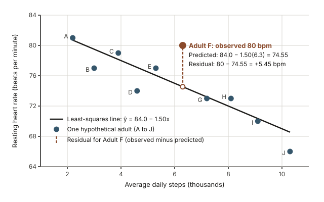
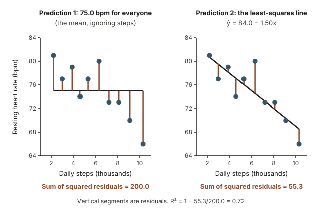
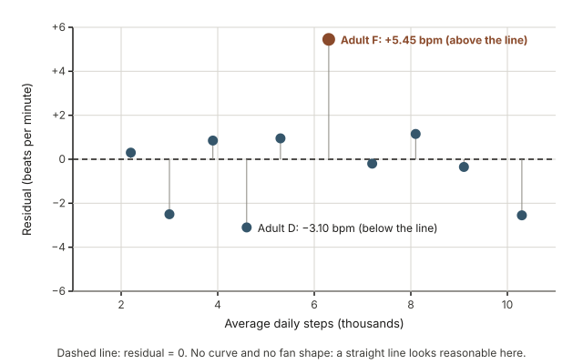
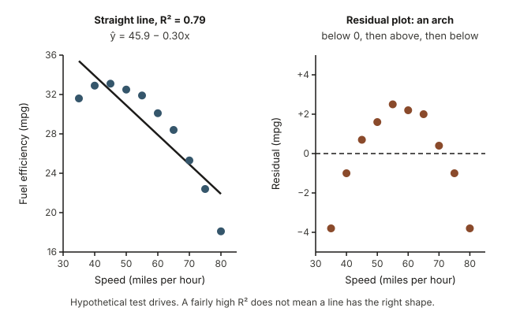
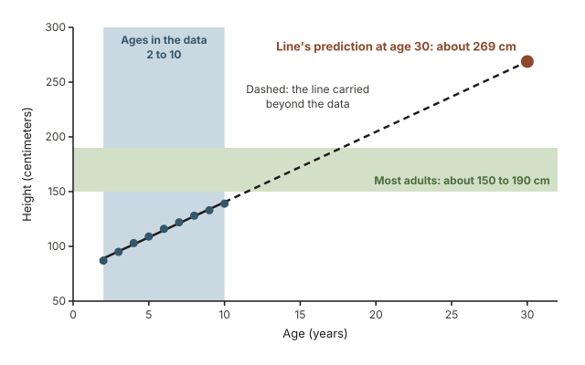

## Warm-up: what is an extra thousand steps worth?

Two adults live similar lives, except that one averages about 4,000 steps a day and the other about 10,000. How much lower would you guess the second person's resting heart rate is? Write down a number of beats per minute. Then ask two harder questions: what evidence would you want before trusting your guess, and if the more active person does have a lower heart rate, does that show that walking *caused* it?

In [Week 5](week05-association.qmd) you described relationships like this with a scatterplot and a correlation $r$. The correlation gives the direction and strength of a straight-line pattern, but not *how much* the response changes when the explanatory variable changes. This week supplies that piece: a straight line fitted to the data, called a **regression line**.

## Why a fitted line matters for evidence

Fitted lines sit behind many quantitative claims: that each extra hour of weekly exercise goes with lower average blood pressure, that counties with higher smoking rates have more hospital admissions for heart disease, that enrollment will grow next year. Reading such a claim carefully means asking four questions. What is the predicted change in the response for a one-unit change in the explanatory variable? How closely do the actual values follow the line? Is the prediction made inside the range of the data or far outside it? And was the study designed to support a causal claim, or only an association? This week gives you the tools for the first three. The fourth reaches back to study design in [Week 2](week02-study-design.qmd) and confounding in [Week 6](week06-confounding.qmd).

## What you will be able to do this week

By the end of this week you can:

- write the least-squares line $\hat{y} = b_0 + b_1 x$ from regression output or from $\bar{x}$, $s_x$, $\bar{y}$, $s_y$ and $r$;
- interpret the slope in context, with units, using "predicted" and "on average";
- decide whether the intercept has a sensible meaning;
- compute a residual and explain what its sign and size say about one case;
- read a residual plot and recognize when a straight line is the wrong shape;
- interpret $R^2$ as the proportion of variability in the response explained by the line;
- recognize when a prediction is an extrapolation that should not be trusted;
- read the estimate and standard error columns of a regression output table.

## Words to know for simple regression

| Term | What it means |
|---|---|
| Explanatory variable ($x$) | The variable used to predict; on the horizontal axis. |
| Response variable ($y$) | The variable being predicted; on the vertical axis. |
| Least-squares line | The line that makes the sum of squared residuals as small as possible; also called the regression line or fitted line. |
| Predicted value ($\hat{y}$, "y-hat") | The response value the line gives for a particular $x$. |
| Slope ($b_1$) | The predicted change in the response for each one-unit increase in $x$, on average. |
| Intercept ($b_0$) | The predicted response when $x = 0$; meaningful only if $x = 0$ makes sense and lies near the data. |
| Residual | Observed minus predicted, $y - \hat{y}$; positive above the line, negative below it. |
| Residual plot | Residuals graphed against $x$, used to check whether a straight line suits the data. |
| $R^2$ (R-squared) | The proportion of the variability in the response that the line explains; between 0 and 1. |
| Extrapolation | Using the line to predict at $x$ values outside the range of the data. |
| Standard error (SE) | How much an estimate, such as the slope, would typically vary from one random sample to another. |

## The least-squares line

### A running example: daily steps and resting heart rate

The table gives illustrative values for a random sample of 10 hypothetical adults. The explanatory variable $x$ is average daily steps, in thousands; the response variable $y$ is resting heart rate, in beats per minute (bpm).

| Adult | Daily steps (thousands) | Resting heart rate (bpm) |
|---|---|---|
| A | 2.2 | 81 |
| B | 3.0 | 77 |
| C | 3.9 | 79 |
| D | 4.6 | 74 |
| E | 5.3 | 77 |
| F | 6.3 | 80 |
| G | 7.2 | 73 |
| H | 8.1 | 73 |
| I | 9.1 | 70 |
| J | 10.3 | 66 |

The summaries are $\bar{x} = 6.0$ thousand steps with $s_x = 2.67$, and $\bar{y} = 75.0$ bpm with $s_y = 4.71$. The correlation is $r = -0.851$, a strong negative association: adults who walk more tend to have lower resting heart rates. The least-squares line is

$$\hat{y} = 84.0 - 1.50x,$$

read as "predicted resting heart rate equals 84.0 minus 1.50 times daily steps in thousands." The hat on $\hat{y}$ is a reminder that the line gives a *prediction*, not anyone's observed value.

{fig-alt="Scatterplot of 10 hypothetical adults: resting heart rate falls as daily steps rise. Line: predicted rate = 84.0 − 1.50 × steps. Adult F (6.3 thousand steps, 80 bpm) sits 5.45 bpm above its prediction of 74.55 bpm."}

### Predicted values and residuals

To use the line for one adult, substitute that adult's $x$. Adult F averages 6.3 thousand steps, so

$$\hat{y} = 84.0 - 1.50(6.3) = 84.0 - 9.45 = 74.55 \text{ bpm}.$$

Adult F's observed heart rate is 80 bpm. The gap between observed and predicted is the **residual**:

$$\text{residual} = y - \hat{y} = 80 - 74.55 = 5.45 \text{ bpm}.$$

Always compute observed minus predicted. A positive residual means the dot is above the line: this adult's heart rate is higher than the line predicts for that many steps. Adult D averages 4.6 thousand steps, so the prediction is $84.0 - 1.50(4.6) = 84.0 - 6.9 = 77.1$ bpm; the observed value is 74, so the residual is $74 - 77.1 = -3.1$ bpm, below the line. A residual is the part of a value the line does not account for: genetics, stress, caffeine or measurement error may all play a part, but the line only knows steps.

### Why the line is called least squares

Many lines could be drawn through the same dots, and each gives every adult a residual. Adding the residuals would let misses above the line cancel misses below it, so instead we square each residual (making every term positive and making large misses count more) and add the squares. The **least-squares line** is the one line with the smallest possible sum of squared residuals.

The figure compares two ways of predicting. The left panel ignores steps and predicts the mean, 75.0 bpm, for everyone; its squared residuals add up to 200.0. The least-squares line on the right leaves only 55.3. No other straight line does better: the line $\hat{y} = 85 - 2x$ looks reasonable by eye, but its squared residuals add up to about 111.4.

{fig-alt="Two panels, same 10 hypothetical adults. Predicting 75.0 bpm for everyone leaves a sum of squared residuals of 200.0; the least-squares line leaves 55.3, so R-squared = 1 − 55.3/200.0 = 0.72."}

Every least-squares line passes through the point of averages $(\bar{x}, \bar{y})$: here $84.0 - 1.50(6.0) = 75.0$, exactly $\bar{y}$. Its residuals also add up to zero, apart from rounding. For the 10 adults they are $0.30$, $-2.50$, $0.85$, $-3.10$, $0.95$, $5.45$, $-0.20$, $1.15$, $-0.35$ and $-2.55$, which sum to $0$.

### Finding the slope and intercept from summary statistics

Software usually fits the line, but the least-squares slope and intercept have short formulas built from five summaries:

$$b_1 = r \, \frac{s_y}{s_x}, \qquad b_0 = \bar{y} - b_1 \bar{x}.$$

The ratio $s_y / s_x$ converts from units of $x$ to units of $y$, and the intercept formula forces the line through the point of averages. For the running example,

$$b_1 = -0.851 \times \frac{4.71}{2.67} = -0.851 \times 1.764 \approx -1.50, \qquad b_0 = 75.0 - (-1.50)(6.0) = 75.0 + 9.0 = 84.0.$$

Two consequences follow. The slope always has the same sign as $r$, because standard deviations are positive. And if $r = 0$, the line is flat at $\bar{y}$: knowing $x$ does not change the prediction. When computing by hand, keep three decimals in $r$ and in $s_y / s_x$ and round at the end.

## Interpreting the slope and the intercept

### The slope: predicted change per unit of x, on average

::: {.callout-tip}
**Slope sentence.** "For each additional *one unit of x*, the predicted *response* is *higher or lower* by *the size of the slope, with its units*, on average." Fill in the italic parts from the context.
:::

For the running example: *for each additional 1,000 daily steps, the predicted resting heart rate is 1.50 bpm lower, on average.* Both "predicted" and "on average" matter, because individual adults scatter around the line, as Adult F does.

The units matter too. The slope is in bpm per thousand steps. Recorded in single steps, the same data give a slope of $-1.50 / 1000 = -0.0015$ bpm per step: the same relationship in different units. So the size of a slope does not tell you how strong a relationship is; $r$ and $R^2$ do that.

You can scale the slope to any change in $x$. In the warm-up, the second adult walks $10 - 4 = 6$ thousand more steps, so the line predicts a heart rate lower by $6 \times 1.50 = 9.0$ bpm. Directly: $84.0 - 1.50(4) = 78.0$ and $84.0 - 1.50(10) = 69.0$, a difference of 9.0 bpm. Compare that with your guess.

### The intercept: meaningful only when x = 0 makes sense

The intercept $b_0 = 84.0$ is the predicted resting heart rate for an adult who takes no steps at all. Nobody in the data walked fewer than 2.2 thousand steps, and someone confined to bed probably differs from these adults in many ways, so 84.0 bpm is not a trustworthy prediction. Its role is to set the height of the line. Read an intercept as "the predicted response when $x = 0$" only if $x = 0$ is possible *and* lies inside or near the range of the data. In a study of weekly exercise minutes and blood pressure where many adults reported 0 minutes, the intercept would be the predicted blood pressure for adults who do not exercise, a meaningful quantity.

### Reading a regression output table

Software reports a fitted line as a table of coefficients. For the running example:

| Term | Estimate | Std. error |
|---|---|---|
| Intercept | 84.00 | 2.13 |
| Daily steps (thousands) | -1.50 | 0.33 |

R-squared = 0.724, with $n = 10$ adults.

The **Estimate** in the Intercept row is $b_0$, and the Estimate in the row named after the explanatory variable is the slope $b_1$, so the table says $\hat{y} = 84.00 - 1.50x$. Programs label things differently, and many add a test statistic and a p-value, which you will learn to read in [Week 12](week12-classical-hypothesis-testing.qmd).

The **Std. error** column describes sampling variability. A different random sample of 10 adults would give a somewhat different line, and the slope's standard error, 0.33 bpm per thousand steps, measures how much the slope estimate would typically vary from sample to sample. Here the estimate is about $1.50 / 0.33 \approx 4.5$ standard errors from zero. A slope several standard errors from zero is hard to explain as sampling variation alone; later weeks make this precise.

## Residuals and R-squared: how well does the line fit?

### Reading a residual plot

A residual plot puts $x$ on the horizontal axis and each residual on the vertical axis, with a reference line at 0. It is like tilting the scatterplot until the fitted line lies flat, which makes departures easy to see. You hope to see a shapeless band of dots above and below zero with about the same spread everywhere, as in the running example.

{fig-alt="Residuals of the 10 hypothetical adults plotted against daily steps scatter above and below zero with no curve or fan. Adult F has the largest residual, +5.45 bpm; Adult D has −3.10 bpm."}

Three patterns call for caution:

- **A curve** (an arch or a U): the relationship is not straight, and the line misses systematically.
- **A fan**, where residuals spread out as $x$ grows: predictions are less precise for some $x$ values than others.
- **A residual far from the rest**: a possible recording error or a different kind of case. One extreme case can pull the whole line; such a case is called influential, as in the sleep and reaction-time example of [Week 5](week05-association.qmd).

The next figure shows a curve. Hypothetical test drives of one car at ten steady speeds from 35 to 80 miles per hour give a straight line $\hat{y} = 45.9 - 0.30x$ for fuel efficiency in miles per gallon (mpg), with $R^2 = 0.79$, which sounds respectable. But the residual is $-3.8$ mpg at 35 mph, rises to $+2.5$ mpg at 55 mph, and falls back to $-3.8$ mpg at 80 mph. The line predicts too high at both ends and too low in the middle. The summary "each extra mile per hour costs 0.30 mpg" hides the real shape: efficiency barely changes from 35 to 55 mph, then drops quickly.

{fig-alt="Left: fuel efficiency of one hypothetical car at speeds from 35 to 80 mph, with a straight line, R-squared 0.79. Right: the residuals are negative at both ends and positive in the middle, forming an arch."}

### R-squared: the share of variability explained

Heart rates in the running example range from 66 to 81 bpm. How much of that variability does the line account for? Without steps, the best single prediction is the mean, leaving a total squared error of 200.0; with the line, 55.3 remains. The fraction remaining is $55.3 / 200.0 = 0.2765$, about 28%, so the fraction explained is

$$R^2 = 1 - \frac{55.3}{200.0} = 1 - 0.2765 = 0.7235 \approx 0.72.$$

::: {.callout-note}
**Interpreting $R^2$.** About 72% of the variability in resting heart rate among these adults is explained by the linear relationship with daily steps. The other 28% reflects everything else that makes heart rates differ.
:::

With one explanatory variable, $R^2$ is the square of the correlation: $(-0.851)^2 = 0.724$, as in the output table (0.7235 differs only because 55.3 was rounded). Squaring removes the sign, so check the slope for direction. Also know what $R^2$ does *not* tell you. It does not show that a line is the right shape (the fuel-efficiency line had $R^2 = 0.79$). It does not show that $x$ causes $y$. It does not protect predictions far outside the data. And a modest $R^2$ does not make a slope useless: in health research individuals differ for many reasons at once, and a line can still describe a genuine average trend.

## Prediction and the danger of extrapolation

### Predicting inside the range of the data

For an adult averaging 5,000 steps a day, $\hat{y} = 84.0 - 1.50(5.0) = 84.0 - 7.5 = 76.5$ bpm. Because 5.0 lies inside the observed range of 2.2 to 10.3 thousand steps, the data support this prediction. Read it as an estimate of the average heart rate among such adults; an individual could be several bpm away, since residuals here reach 5.45 bpm.

### Extrapolation: when the line runs past the data

A fitted line describes the data only over the observed range of $x$. Beyond it, the true pattern may bend, level off or stop making sense, and the data cannot warn you. Using the line there is **extrapolation**.

Consider 9 hypothetical children, one at each age from 2 to 10, with heights of 87, 95, 103, 109, 116, 122, 128, 133 and 139 cm. The least-squares line is $\hat{y} = 76.2 + 6.42x$, with $x$ in years and $\hat{y}$ in centimeters, and the fit is nearly perfect: $R^2 = 0.995$. Across these ages, predicted height is about 6.4 cm greater for each additional year of age. Now ask the line about a 30-year-old:

$$\hat{y} = 76.2 + 6.42(30) = 76.2 + 192.6 = 268.8 \text{ cm},$$

about 269 cm, or nearly 8 feet 10 inches. That is absurd: human growth slows and stops around the end of the teenage years, so the childhood pattern does not continue.

{fig-alt="Heights of 9 hypothetical children aged 2 to 10 lie close to the line predicted height = 76.2 + 6.42 × age, R-squared 0.995. At age 30 the line predicts about 269 cm, far above the 150 to 190 cm of most adults."}

A nearly perfect fit inside the data says nothing about outside it. Interpreting an intercept is often extrapolation too, as in the steps example.

::: {.callout-warning}
**Before you predict, check the range.** If the $x$ value is outside the data, say so and treat the result as a guess about a pattern the data never showed.
:::

## Worked example 1: a sleep and reaction-time line from summary statistics

**The question.** In a hypothetical study, 25 college students reported how many hours they slept the night before and then took a computer reaction test, timed in milliseconds (ms); smaller is faster. Sleep ranged from 4.5 to 9.0 hours. Mean sleep was $\bar{x} = 6.8$ hours with $s_x = 1.2$; mean reaction time was $\bar{y} = 290$ ms with $s_y = 30$; the correlation was $r = -0.62$. Find the least-squares line, interpret it, find $R^2$, and predict the reaction time after 8 hours of sleep.

**Step 1: variables.** The explanatory variable $x$ is hours of sleep; the response $y$ is reaction time in ms.

**Step 2: slope and intercept.**

$$b_1 = -0.62 \times \frac{30}{1.2} = -0.62 \times 25 = -15.5 \text{ ms per hour}, \qquad b_0 = 290 - (-15.5)(6.8) = 290 + 105.4 = 395.4 \text{ ms}.$$

**Step 3: equation and check.** The line is $\hat{y} = 395.4 - 15.5x$. It passes through the point of averages: $395.4 - 15.5(6.8) = 395.4 - 105.4 = 290$ ms.

**Step 4: interpret.** For each additional hour of sleep, the predicted reaction time is 15.5 ms shorter (faster), on average. The intercept, 395.4 ms, is the prediction for 0 hours of sleep. Zero hours is far outside the data (the least sleep was 4.5 hours), so the intercept only positions the line.

**Step 5: $R^2$.** $R^2 = (-0.62)^2 = 0.3844 \approx 0.38$. About 38% of the variability in reaction times is explained by the linear relationship with sleep; the other 62% comes from other differences among students.

**Step 6: predict.** Eight hours is inside the observed range:

$$\hat{y} = 395.4 - 15.5(8) = 395.4 - 124.0 = 271.4 \text{ ms}.$$

For 6 hours, $395.4 - 15.5(6) = 395.4 - 93.0 = 302.4$ ms; the difference, 31.0 ms, is two hours times 15.5 ms per hour.

**Conclusion in context.** In this hypothetical sample, students who slept more tended to react faster: the predicted reaction time is about 15.5 ms faster per extra hour of sleep, on average, with a predicted reaction time of about 271 ms after 8 hours. Sleep explains only about 38% of the variability, so individuals scatter widely around the line. Because students chose their own sleep, this is an association: students who sleep more may also differ in caffeine use, stress or schedules. A causal claim would need a randomized experiment that assigned amounts of sleep.

## Worked example 2: reading output for age and blood pressure

**The question.** A hypothetical health survey measured systolic blood pressure, in millimeters of mercury (mmHg), for a random sample of 40 adults aged 25 to 70, with age in years as the explanatory variable. The output was:

| Term | Estimate | Std. error |
|---|---|---|
| Intercept | 98.2 | 5.3 |
| Age (years) | 0.62 | 0.11 |

R-squared = 0.46, with $n = 40$ adults.

Write the line, interpret the slope and intercept, find the residual for a 50-year-old whose blood pressure is 140 mmHg, and interpret $R^2$, $r$ and the slope's standard error.

**Step 1: the equation.** From the Estimate column, $\hat{y} = 98.2 + 0.62x$.

**Step 2: slope and intercept.** For each additional year of age, the predicted systolic blood pressure is 0.62 mmHg higher, on average, or $10 \times 0.62 = 6.2$ mmHg per decade. The survey compares different people at one moment, so the slope describes differences between age groups, not what happens as one person ages. The intercept, 98.2 mmHg, is the prediction at age 0, far outside the data (the youngest adult was 25), so it has no useful meaning here.

**Step 3: a residual.**

$$\hat{y} = 98.2 + 0.62(50) = 98.2 + 31.0 = 129.2 \text{ mmHg}, \qquad \text{residual} = 140 - 129.2 = 10.8 \text{ mmHg}.$$

This person's blood pressure is 10.8 mmHg above the line's prediction for age 50. By contrast, a 30-year-old with 110 mmHg has $\hat{y} = 98.2 + 0.62(30) = 98.2 + 18.6 = 116.8$ mmHg and a residual of $110 - 116.8 = -6.8$ mmHg, below the line.

**Step 4: $R^2$ and $r$.** About 46% of the variability in systolic blood pressure is explained by the linear relationship with age. The correlation is the square root of $R^2$ with the sign of the slope: $r = +\sqrt{0.46} \approx 0.68$, a moderately strong positive association.

**Step 5: the standard error.** The slope's standard error, 0.11 mmHg per year, describes how much the slope estimate would typically vary from one random sample of 40 adults to another. The estimate is about $0.62 / 0.11 \approx 5.6$ standard errors above zero, so sampling variation alone is an unlikely explanation for the positive slope; [Week 12](week12-classical-hypothesis-testing.qmd) makes this reasoning formal.

**Conclusion in context.** Among these 40 hypothetical adults, predicted systolic blood pressure rises by about 0.62 mmHg per year of age, about 6 mmHg per decade, on average. Age explains about 46% of the variability, so adults of the same age still differ a great deal, as the 50-year-old 10.8 mmHg above the line shows.

## Transfer: the same reasoning for used-car prices

The same moves work in a different setting. A hypothetical set of 30 online listings for one model of used car records each car's age (1 to 10 years) and listed price (in thousands of dollars):

| Term | Estimate | Std. error |
|---|---|---|
| Intercept | 24.6 | 0.9 |
| Age (years) | -1.85 | 0.15 |

R-squared = 0.84, with $n = 30$ listings.

**Line and slope.** $\hat{y} = 24.6 - 1.85x$. For each additional year of age, the predicted listed price is 1.85 thousand dollars (1,850 dollars) lower, on average.

**Intercept.** Age 0 (a new car) is possible and only one year below the youngest car in the data, so the intercept, 24.6 thousand dollars, is a mild extrapolation rather than nonsense. With no new cars in the data, treat it as the line's rough guess, not a new-car price.

**Residual.** A 6-year-old car is listed at 11.5 thousand dollars. Its predicted price is $24.6 - 1.85(6) = 24.6 - 11.1 = 13.5$, so its residual is $11.5 - 13.5 = -2.0$ thousand dollars: 2,000 dollars below the line's prediction for its age. The residual flags the listing as unusual but does not say why: the car might be a bargain, or it might have high mileage or damage.

**$R^2$.** About 84% of the variability in listed prices is explained by the linear relationship with age; mileage, condition and features may account for much of the rest.

**Extrapolation.** For a 12-year-old car the line predicts $24.6 - 1.85(12) = 24.6 - 22.2 = 2.4$ thousand dollars, which looks plausible but is outside the data. For a 14-year-old car it predicts $24.6 - 1.85(14) = 24.6 - 25.9 = -1.3$ thousand dollars, an impossible negative price; the line reaches zero at $24.6 / 1.85 \approx 13.3$ years. The 12-year prediction is also an extrapolation. It looks sensible, but the data cannot confirm it, and the further you go past 10 years the less the line can be trusted, as the impossible 14-year value shows.

**Conclusion in context.** Among these 30 hypothetical listings, older cars were listed for less: the predicted listed price is about 1,850 dollars lower per year of age, on average, and age explains about 84% of the variability in listed price. The line should not be used for cars older than 10 years, the oldest in the data.

**What carried over.** Read the equation from the Estimate column, state the slope with units, check whether $x = 0$ makes sense, compute residuals as observed minus predicted, read $R^2$ as a share of variability explained, and check the range before predicting.

## A common misreading: the slope shows what would happen if you changed x

A tempting sentence about the running example is: "The slope is $-1.50$, so if you walk 1,000 more steps a day, your resting heart rate will drop by 1.5 bpm." This reads the slope as the effect of *changing* one person's $x$, which these data cannot support:

- **The slope compares different people.** Nobody in the data changed their walking, so the data say nothing direct about what happens when someone does.
- **Confounding.** Adults who walk more may also be younger, smoke less or eat differently, and the slope bundles all of that together with walking ([Week 6](week06-confounding.qmd)).
- **Direction.** People whose hearts are already in good condition may find it easier to walk a lot; this is called reverse causation.

A careful version is: "Among these adults, those who walked 1,000 more steps a day had resting heart rates 1.50 bpm lower, on average, according to the fitted line." A causal claim would need a randomized experiment that assigned walking programs ([Week 2](week02-study-design.qmd)).

A related slip is to read a large slope as a strong relationship. As the slope section showed, a slope's size depends on its units; strength is measured by $r$ and $R^2$.

## Practice questions for this week (ungraded)

1. In a hypothetical study of 50 adults, weekly hours of exercise ($x$) and resting heart rate in bpm ($y$) have $\bar{x} = 4$, $s_x = 2$, $\bar{y} = 72$, $s_y = 8$ and $r = -0.5$. Find the least-squares line and interpret its slope in one sentence. *What to look for:* find $b_1$ before $b_0$, and use units, "predicted" and "on average."
2. Using $\hat{y} = 84.0 - 1.50x$, find the residual for Adult J (10.3 thousand steps, 66 bpm). Is Adult J above or below the line? Check your work against the residual plot.
3. A hypothetical line predicts daily emergency-room visits for heat-related illness from the day's high temperature, fitted to days with highs from 80 °F to 105 °F: $\hat{y} = -40 + 0.5x$. Does the intercept have a useful meaning? What does the line predict for a 70 °F day, and why not trust it?
4. In a hypothetical sample of children aged 6 to 12, a regression of reading level on shoe size has $R^2 = 0.64$. A parent concludes that bigger feet help children read. Explain what 0.64 means and what is wrong with the conclusion. *What to look for:* a variable related to both.
5. A residual plot shows residuals tightly clustered near zero for small $x$ and spreading widely for large $x$, with no curve. What does this say about predictions from the line?
6. Two students fit a line to the same distance and travel-time data, one with distance in miles and one in kilometers. Will their slopes match? Will their $R^2$ values match? Explain briefly.

## Read further on simple regression

- *Introduction to Modern Statistics*, [Chapter 7, Linear regression with a single predictor](https://openintrostat.github.io/ims/model-slr.html): fitting a line, residuals, least squares, $R^2$ and outliers, with more examples. The book shows R code in places; skip the code and read the output and explanation.
- Optional, for biomedical examples: Vu and Harrington, *Introductory Statistics for the Life and Biomedical Sciences*, Chapter 6, Simple linear regression, free from [OpenIntro's biostatistics book page](https://www.openintro.org/book/biostat/).
- In [StatKey](https://www.lock5stat.com/statkey/), open Descriptive Statistics and Graphs, then Two Quantitative Variables. Choose a built-in dataset, look at the scatterplot, correlation and fitted line, and ask whether a straight line suits the pattern.

## Where this goes next: more than one explanatory variable

The steps example raised age, smoking and diet as possible confounders, and a single slope cannot separate them. Next you will read regression output with several explanatory variables, where each slope is interpreted with the others held fixed (an adjusted comparison), and meet logistic regression for yes-or-no outcomes. The Estimate column, slopes with units, residuals and caution about extrapolation all carry forward.

- Previous: [Week 7: First-half synthesis](week07-synthesis-midterm.qmd)
- Next: [Week 9: Multiple and logistic regression interpretation](week09-multiple-logistic-regression.qmd)
- [All lesson notes](index.qmd)
- [Course schedule](../schedule.qmd)
