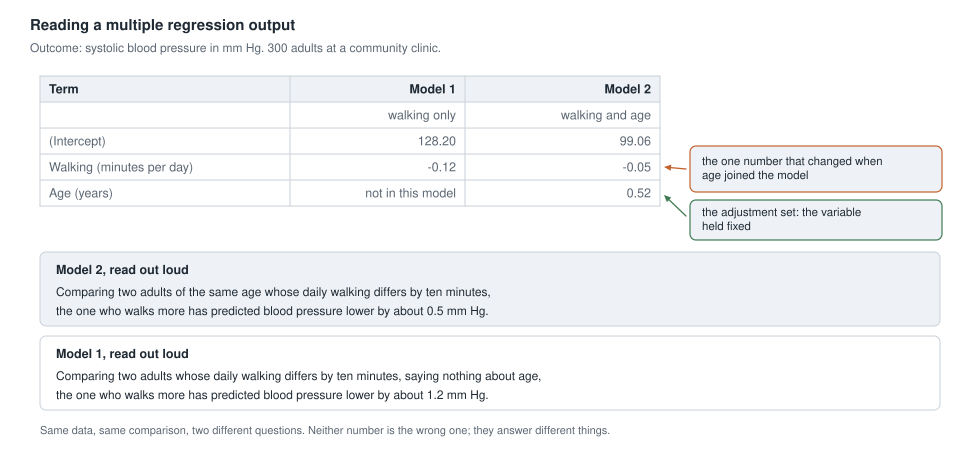
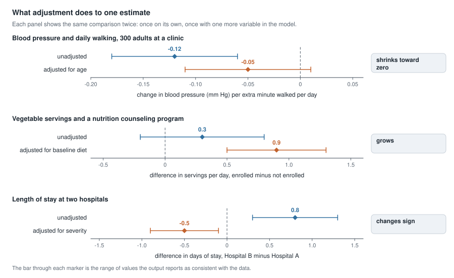
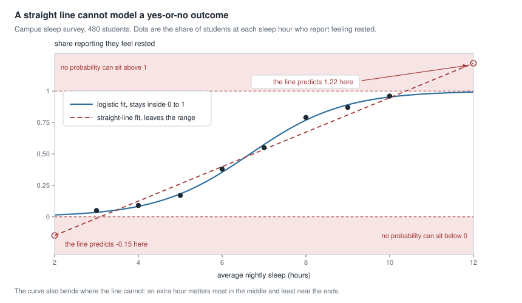
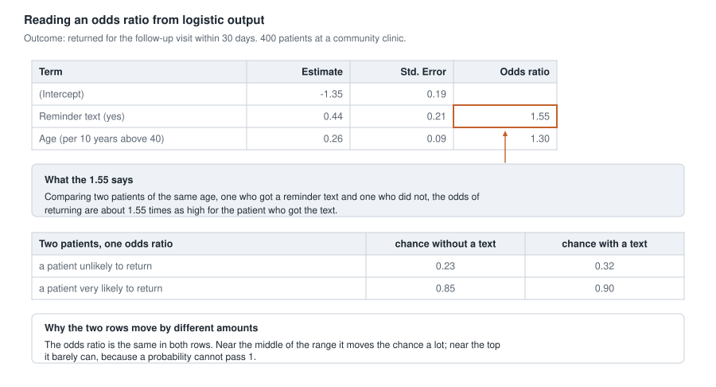

## Where this week starts

Last week you read one line through one scatterplot: one explanatory variable in, one numerical outcome out, and a slope with a plain reading in the units of the problem. Almost no published claim uses that alone. Open a health study and the sentence is longer: "after adjusting for age, sex, and body mass index, the association remained." This week is about that phrase.

You already have the idea. In Week 6 you compared like with like by splitting the data into strata. That works with one background variable that has a few categories, and it falls apart fast: split by age group, then by sex, then by smoking, and the strata thin to three or four people each. Multiple regression writes that same comparison as one equation, so it can hold several variables steady at once.

The second half of the week changes the outcome itself. So far the response has been numerical — blood pressure, days of stay, servings a day. Many real questions are yes-or-no: did the patient come back, did the sample test positive. A straight line is the wrong shape for a probability, and its replacement, logistic regression, reports itself in a unit you have not used yet — odds.

You will not fit any of these models; reading them is the skill. By the end of this week you should be able to take an output block row by row and say which two people each row compares.

### Why this matters beyond the course

Two hospitals report their average length of stay, and Hospital B's patients stay 0.8 days longer. Adjust for how sick patients were on arrival and the comparison reverses: among patients admitted in similar condition, stays at B are half a day shorter. B is the referral hospital. A board that moves resources on the unadjusted number has the story backwards.

The same week protects you in the other direction. A supplement is advertised with "an odds ratio of 1.8 for reporting more energy", and a reader hears "eighty percent more likely". Those are different claims, and knowing which unit a number is in is the difference between quoting a study and misquoting it.

## What you will be able to do

- Read a coefficient in multiple regression output as a comparison between two cases that match on every other variable in the model.
- State which variables an estimate is adjusted for, and name something it is not adjusted for.
- Explain why an adjusted estimate can shrink, grow, or change sign, and reconcile it with the unadjusted one by hand.
- Explain why a straight line is the wrong model for a yes-or-no outcome.
- Convert a probability into its odds and back, and apply a reported odds ratio to a starting probability.
- Write one careful sentence interpreting an odds ratio, without upgrading it into a claim about probability or cause.

## Words worth owning

| Term | What it means in this course |
| --- | --- |
| multiple regression | one equation predicting a numerical outcome from two or more explanatory variables at once |
| unadjusted estimate | the coefficient for a variable when it is the only explanatory variable in the model |
| adjusted estimate | the coefficient for that same variable when other named variables are in the model too |
| adjustment set | the other variables the model holds fixed; never longer than what somebody measured |
| binary outcome | a response with exactly two possible values, recorded as yes or no |
| logistic regression | a model for the probability of a yes, fitted as an S-shaped curve that stays inside 0 to 1 |
| odds | for a probability $p$, the quantity $p$ divided by $1 - p$; "about 54 yes for every 100 no" |
| odds ratio | the odds in one group divided by the odds in another; the column you read in logistic output |

## Adjustment, written as a model

A community clinic recorded three things for each of 300 adults at a routine visit: systolic blood pressure in mm Hg, average daily walking minutes from a phone step counter, and age in years. Walking averaged 30 minutes a day, age 52 years, and blood pressure 124.6 mm Hg.

Fit Week 8's tool first, blood pressure on walking alone:

$$\text{predicted blood pressure} = 128.20 - 0.12 \times \text{walking minutes}$$

Now put age into the same equation:

$$\text{predicted blood pressure} = 99.06 - 0.05 \times \text{walking minutes} + 0.52 \times \text{age in years}$$

Same adults, same measurements, and the walking coefficient moved from $-0.12$ to $-0.05$. More than half the slope has gone somewhere.

{fig-alt="A table compares two models of blood pressure. Model 1 uses walking only and reports a walking coefficient of -0.12. Model 2 adds age and reports -0.05, with callouts on the changed coefficient and the variable held fixed."}

The two equations do not disagree about the clinic as a whole. Put the average adult into each: $128.20 - 0.12 \times 30 = 124.60$, and $99.06 - 0.05 \times 30 + 0.52 \times 52 = 124.60$. Both land on the average blood pressure, because a fitted equation passes through the point where every variable sits at its average.

### What holding age fixed is actually comparing

Read the $-0.05$ slowly. It says: comparing two adults of the same age whose daily walking differs by one minute, the one who walks more has predicted blood pressure lower by 0.05 mm Hg. Two adults, not one before and after. The same age, because age is the other variable in the equation. Predicted, because this is a model of averages.

Nothing was frozen. All 300 adults are in both equations at their real ages. The procedure estimates the walking pattern and the age pattern together, then reports what is left for walking once age has been credited. "Holding age fixed" is arithmetic on a fitted equation, not something that happened to anybody.

The model also holds fixed only what is in it. Adults who walk more may eat, sleep, or work differently; none of that is in the equation, and no machinery can adjust for a variable nobody measured. So the honest reading of any adjusted estimate has two halves: what it controlled for, and what it did not.

One silent assumption remains: the equation insists the walking coefficient is the same at every age, ten more minutes worth the same 0.5 mm Hg at thirty and at seventy. So "adjusted for age" always carries the clause "and assumed to work the same way at every age."

### Why the adjusted number moves, and which way

Here is where the missing $0.07$ went. In these data, adults who walk more are also younger: compare two groups an hour apart in daily walking and the higher-walking group averages about eight years younger.

The second model prices eight years at $8 \times 0.52 = 4.16$ mm Hg, and sixty extra minutes of walking, at the same age, at $60 \times 0.05 = 3.00$ mm Hg. Together those groups should differ by $4.16 + 3.00 = 7.16$ mm Hg. Ask the first model, which has never heard of age, about the same comparison: $60 \times 0.12 = 7.20$ mm Hg. They agree to rounding. The unadjusted slope was not wrong; it reported a gap that walking and age produced together and credited all of it to walking.

That gives you a rule for any pair of estimates: the unadjusted estimate equals the adjusted estimate plus what the other variable is worth, times how much that variable differs between the groups. Three things can happen.

{fig-alt="Three panels each show an unadjusted and an adjusted estimate on one axis with a zero line. The first shrinks from -0.12 to -0.05, the second grows from 0.3 to 0.9, and the third flips from plus 0.8 to minus 0.5."}

**It shrinks** when the other variable pushes the same way. That is the clinic: walkers are younger, and being younger already lowers blood pressure, so part of the raw gap was age wearing walking's coat. Notice that the adjusted interval in the top panel now reaches across zero.

**It grows** when the other variable pushes the opposite way and hides the pattern. A community program offered nutrition counseling, and the people who enrolled ate worst to begin with — 1.2 servings of vegetables a day against 2.2 for those who did not. At follow-up the enrolled group ate only 0.3 servings more. But baseline diet is worth about 0.6 follow-up servings per baseline serving, and the enrolled group started a full serving behind. Add that back: $0.3 + 0.6 = 0.9$.

**It changes sign** when the other variable's pull is larger than the pattern beneath it — the hospital comparison, worked through below.

## Modeling a yes-or-no outcome

Change the outcome and the toolkit changes with it. A clinic wants to know whether patients came back for a follow-up visit, so for each patient the response is not a number on a scale; it is one of two words. Record it as 1 for returned and 0 for not, and the average of that column is the proportion who returned. So the thing worth modeling is the probability of a yes — not one patient's outcome, but how that probability shifts as a predictor changes.

### Why a straight line cannot do this job

A campus survey asked 480 students their average nightly sleep and whether they feel rested. Group them by sleep hour and plot the share saying yes: the dots crawl along the floor, rise steeply through the middle, then flatten near the ceiling.

{fig-alt="The share of students who feel rested rises with nightly sleep along an S-shaped curve staying between 0 and 1, while a fitted straight line predicts about -0.15 at two hours and 1.22 at twelve, inside shaded impossible bands."}

Two things go wrong when you force a straight line through those dots. The first is fatal on its own: extend the line and it predicts a share of about $-0.15$ at two hours of sleep and about $1.22$ at twelve. There is no negative share of students, and none larger than all of them. Nor is this only a problem out at the edges: the same line predicts a share of about $-0.01$ at three hours, which is the lowest value anybody in the study actually recorded. A model that reports impossible values inside the range of its own data is not a model of that outcome.

The second problem matters even where the line stays between 0 and 1. A straight line insists every extra hour is worth the same amount. The fitted curve rises from about 0.35 at six hours to about 0.57 at seven — roughly twenty-two percentage points. From ten to eleven it rises from about 0.95 to about 0.98, under three percentage points. Once nearly everyone says yes, there is almost nobody left to convert. Logistic regression fits an S-shaped curve that approaches 0 and 1 without reaching them and bends most steeply in the middle.

### Odds, probability, and the ratio between them

The price of that curve is a new unit. Logistic output reports odds, not differences in probability. The odds of an outcome, for a probability $p$, is $p$ divided by $1 - p$:

$$\text{odds} = \frac{p}{1 - p}$$

If 35 patients in 100 return, the probability is 0.35 and the odds are $0.35 / 0.65 = 0.54$ — about 54 returns for every 100 non-returns. If 23 in 100 return, the odds are $0.23 / 0.77 = 0.30$. Odds run from 0 upward with no ceiling, which makes them convenient to model and awkward to read. Going back: the probability is the odds divided by one plus the odds, so $0.54 / 1.54 = 0.35$.

An **odds ratio** is one group's odds divided by another's: here $0.54 / 0.30 = 1.80$. The sentence to attach is always the same shape: the odds of the outcome are about 1.8 times as high, comparing two people who differ in this one way. An odds ratio of 1 means no difference; below 1 means lower odds.

Now the sentence to write on your hand. **An odds ratio is not a ratio of probabilities.** Above, the probabilities are 0.35 and 0.23, and their ratio is 1.52, not 1.80. Whenever an outcome is more common in one group, the odds ratio sits further from 1 than the probability ratio does, because the shrinking $1 - p$ inflates the odds. The two nearly agree only when the outcome is rare: start at 0.02, apply an odds ratio of 1.8, and you land at 0.035, a probability ratio of about 1.77.

## Worked example — walking, age, and blood pressure at a clinic

**Setting.** The 300 adults from the clinic above, with the two equations shown in the figure.

**Step 1 — name the cases and the variables.** Each case is one adult at one routine visit. The response is blood pressure; the explanatory variable of interest is daily walking. Age is in the second model because it is a plausible confounder: related to how much people walk, and separately related to blood pressure.

**Step 2 — read the unadjusted slope.** Comparing two adults whose daily walking differs by ten minutes, saying nothing about their ages, the one who walks more has predicted blood pressure lower by $10 \times 0.12 = 1.2$ mm Hg.

**Step 3 — read the adjusted slope.** Comparing two adults of the same age whose daily walking differs by ten minutes, the one who walks more is lower by $10 \times 0.05 = 0.5$ mm Hg.

**Step 4 — check that against two predictions.** For a 60-year-old who walks 45 minutes a day, and then one who walks 15:

$$99.06 - 0.05 \times 45 + 0.52 \times 60 = 128.01 \text{ mm Hg}$$

$$99.06 - 0.05 \times 15 + 0.52 \times 60 = 129.51 \text{ mm Hg}$$

The difference is 1.50 mm Hg, exactly $30 \times 0.05$. That is what a coefficient is: the difference the equation produces per one-unit change, with everything else left alone.

**Step 5 — reconcile the two slopes.** Over a sixty-minute comparison the unadjusted model reports 7.20 mm Hg and the adjusted model 3.00 mm Hg. The rest is age: the higher-walking group is about eight years younger, worth 4.16 mm Hg, and $3.00 + 4.16 = 7.16$ mm Hg.

**Step 6 — say what it means, and what it does not.** Among adults of the same age at this clinic, an hour more of daily walking is associated with blood pressure lower by about 3 mm Hg. Is that a lot? Blood pressure here varies from person to person with a standard deviation of about 15 mm Hg, so 3 mm Hg is roughly a fifth of a typical deviation: modest. And nobody was assigned to walk, so the defensible verb stays "is associated with".

### The same reasoning, transferred

A state health department compares average length of stay at two hospitals. Unadjusted, patients at Hospital B stay 0.8 days longer. Each patient also has a severity index recorded on admission, from 0 to 10, and the model says each additional severity unit is associated with 0.65 more days. Hospital B's admissions average 6.0 on that index, Hospital A's 4.0.

Run the same reconciliation. The hospitals differ by 2.0 severity units, worth $2.0 \times 0.65 = 1.3$ days — more than the 0.8 days actually observed. Subtract: $0.8 - 1.3 = -0.5$. Among patients admitted in similar condition, stays at Hospital B are about half a day shorter.

What stayed the same is the arithmetic: unadjusted equals adjusted plus the confounder's coefficient times the confounder's gap. What changed is that the explanatory variable is categorical, so its coefficient is a difference between two groups rather than a slope per unit; the adjustment variable is an index rather than a natural unit like years; and the confounder's pull now exceeds the difference beneath it, so the sign flips instead of shrinking. Staffing and discharge criteria are still not in this equation.

## Second worked example — reminder texts and returning for a visit

**Setting.** A community clinic sends an automated reminder text two days before a follow-up appointment to every patient with a mobile number on file; patients without a number get no text. For 400 patients the clinic recorded whether each one returned within 30 days.

| Group | Returned | Did not return | Total |
| --- | ---: | ---: | ---: |
| Reminder text | 70 | 130 | 200 |
| No reminder text | 46 | 154 | 200 |
| Total | 116 | 284 | 400 |

**Step 1 — proportions first, before any model.** With a text, $70 / 200 = 0.35$ returned; without one, $46 / 200 = 0.23$. The difference is twelve percentage points, and the ratio of the two probabilities is $0.35 / 0.23 = 1.52$.

**Step 2 — the same two groups in odds.** $70 / 130 = 0.54$ and $46 / 154 = 0.30$. Odds come straight from the counts, returns divided by non-returns, with no detour through the proportion.

**Step 3 — the odds ratio.** $0.54 / 0.30 = 1.80$, the same number as the table's cross-product, $(70 \times 154) / (130 \times 46) = 10780 / 5980 = 1.80$. Said carefully: the odds of returning are about 1.8 times as high for patients who got a reminder text.

**Step 4 — recognize that number in output.** Fit a logistic model with the text as the only predictor:

```
Outcome: returned for the follow-up visit within 30 days     400 patients

Term                        Estimate    Std. Error    Odds ratio
(Intercept)                    -1.21          0.17
Reminder text (yes)             0.59          0.22          1.80
```

The odds ratio column reads 1.80 — the number you already worked out by hand. The estimate column carries the same information on a compressed scale that lets the curve bend; the odds ratio column is that estimate translated back for you. Never read an estimate as though it were an odds ratio. As a check, the intercept gives odds of about 0.30 with no text, a probability of $0.30 / 1.30 = 0.23$, matching the table.

**Step 5 — now adjust.** Patients with a mobile number on file have been with this clinic longer and are on average older, and older patients return more often. Age is a confounder here, so the clinic refits with it included.

{fig-alt="A logistic output table shows a reminder-text coefficient of 0.44 with a boxed odds ratio of 1.55 and an age coefficient of 0.26. Below it, the same odds ratio moves one patient from 0.23 to 0.32 and another from 0.85 to 0.90."}

The adjusted odds ratio is 1.55, down from 1.80. Part of what looked like the work of the text was the work of being older. The reading sentence gains a clause: comparing two patients of the same age, one who got a reminder text and one who did not, the odds of returning are about 1.55 times as high for the patient who got the text.

**Step 6 — translate back into probabilities, twice.** A patient whose chance of returning without a text is 0.23 has odds $0.23 / 0.77 = 0.30$; multiply by 1.55 to get about 0.46; convert back with $0.46 / 1.46 = 0.32$. Her chance rises about nine percentage points. A patient already at 0.85 has odds $0.85 / 0.15 = 5.67$; multiplied by 1.55 that is 8.78, and $8.78 / 9.78 = 0.90$. His chance rises about five percentage points. One odds ratio, two very different moves, because the second patient is near the ceiling.

**Step 7 — write the conclusion with its qualifications.** Among patients of the same age at this clinic, receiving a reminder text was associated with odds of returning within 30 days about 1.55 times as high. The comparison is adjusted for age and nothing else: patients with a mobile number on file may also differ in housing stability and in how connected they are to the clinic. These data are consistent with reminder texts helping; the study that would establish it is the one where the clinic assigns the texts at random.

## The misreading to avoid

Four sentences students write every year. Each is wrong in a specific way.

**"So the adjusted number is the real one, and the first number was wrong."** Neither is wrong; they are correct results for different questions. The unadjusted 0.8 days is what actually happens at these two hospitals, and a planner ordering beds needs it. The adjusted $-0.5$ days is what you want if you are asking whether B manages comparable patients better. Quoting one and describing it as the other is the dishonest move.

**"Holding age fixed means age was the same for everyone."** No. Every age in the data is still in the data. The model estimates both patterns together and reports what remains for walking once age is credited.

**"The regression shows that walking lowers blood pressure."** It shows nothing of the sort. It compares adults who already differ in how much they walk, and lowering is a verb about change inside one person over time. Adjusting for age addresses one alternative explanation, not the others.

**"An odds ratio of 1.8 means they were eighty percent more likely to return."** This is the most common misreading of the week. In the clinic data the odds ratio was 1.80 while the probability went from 0.23 to 0.35 — a ratio of 1.52 and a difference of twelve percentage points. "Eighty percent more likely" is a claim about probability; 1.8 is a statement about odds. Convert at a stated starting point, the way Step 6 did.

::: {.callout-note}
Three questions to ask of any adjusted estimate: which variables are in the model, which plausible ones are not, and whether the number is a difference, a ratio of probabilities, or a ratio of odds.
:::

## Practice on your own

Try these and check against your notes.

1. Using the clinic's adjusted equation, find the predicted blood pressure for a 45-year-old who walks 20 minutes a day and for one the same age who walks 50. State the difference, then explain how you could have known it without computing either prediction.

2. A study reports an unadjusted difference in weight change of $+2.4$ kg between two groups, and $+0.6$ kg after adjusting for baseline weight and age. Write one sentence saying which two people the first number compares and one for the second. Then name a variable neither is adjusted for.

3. An output block reports an odds ratio of 0.72, where the outcome is readmission within 30 days. Write the reading sentence in the form used on this page. Is readmission more or less likely for that group, and what would an odds ratio of exactly 1 have meant?

4. A patient's chance of an outcome is 0.50 without a program, and an odds ratio of 2.0 is reported. Work out that patient's chance with the program, then do the same for a patient whose chance without it is 0.90. Write one sentence about why the two changes differ so much.

5. A headline reads "Walking lowers blood pressure, clinic study finds." Given how the clinic collected its data, write one sentence saying what these data do support, and one naming a specific alternative explanation that adjusting for age does not rule out.

## Where to read more

- [Introduction to Modern Statistics, Chapter 8: Linear regression with multiple predictors](https://openintrostat.github.io/ims/model-mlr.html) — the reading for the first half of the week; read it for what a coefficient means with other variables present.
- [Introduction to Modern Statistics, Chapter 9: Logistic regression](https://openintrostat.github.io/ims/model-logistic.html) — the reading for the second half; concentrate on the fitted-probability curve and on reading output.
- [the whole of Introduction to Modern Statistics](https://openintrostat.github.io/ims) — reread the single-predictor chapter if this week feels fast.
- [Introductory Statistics for the Life and Biomedical Sciences](https://www.openintro.org/book/biostat) — a second explanation, written the way medical abstracts write adjusted estimates.
- Course pages worth keeping open: [last week's notes](week08-simple-regression.qmd), the [schedule](../schedule.qmd), and [resources](../resources/index.qmd).

## Where this goes next

Next week the course puts models down and picks up probability directly. [Week 10](week10-probability-risk-diagnosis.qmd) works through risk, conditional probability, and diagnostic testing using tables of counts rather than algebra, and this week's translation work comes straight back: the gap between "the test is 95 percent accurate" and "a positive result means you are sick" is the same kind of gap as the one between odds and probability.

Further out, the questions this page dodged come due. Every estimate here arrived with a standard error you were told to notice and not yet use. Weeks 11 through 13 make those numbers mean something. The [notes index](index.qmd) shows the whole arc.
