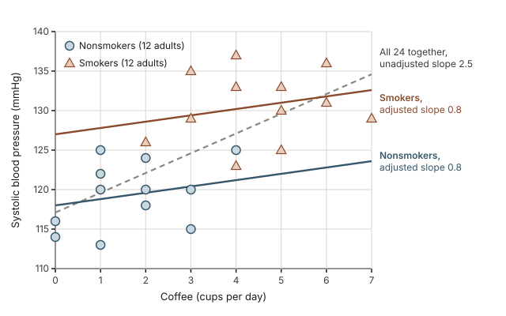
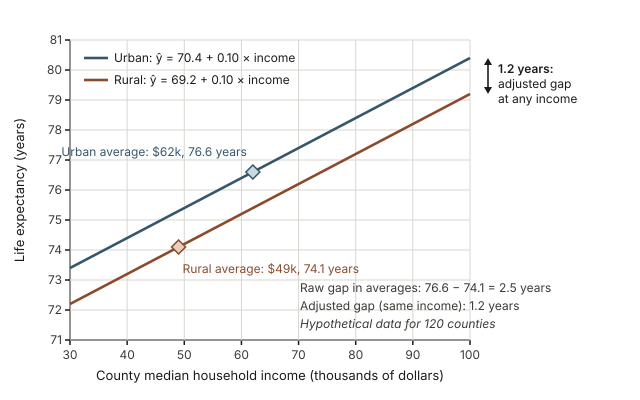
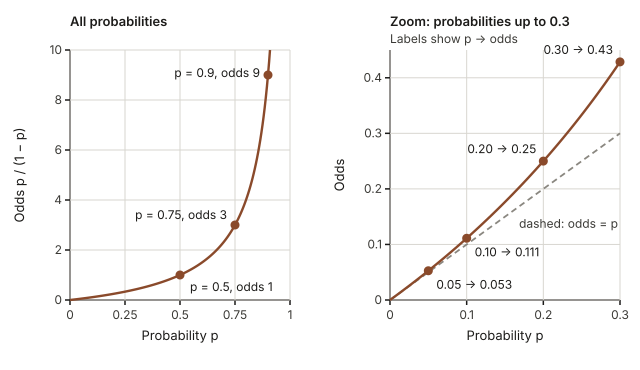
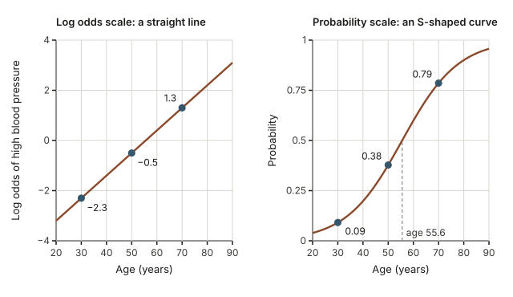
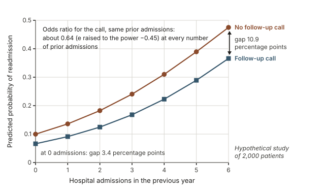
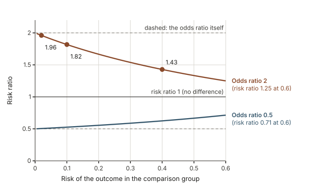

## Warm-up: does coffee raise blood pressure?

A hypothetical health survey of 24 adults finds that people who drink more coffee tend to have higher systolic blood pressure: the fitted line rises about 2.5 mmHg for every extra daily cup. Before you tell anyone to cut back, write down one other way that heavy and light coffee drinkers might differ that could produce the same pattern.

Keep your idea in mind. In [Week 8](week08-simple-regression.qmd) you fit a line with one explanatory variable and read its slope. In [Week 6](week06-confounding.qmd) you saw how a third variable can create or hide an association. This week puts the two together: regression models with several explanatory variables, and a second kind of regression for outcomes that are simply yes or no.

## Why adjusted comparisons fill the health news

Reports of health and policy research are full of phrases such as "after adjusting for age and income" or "the odds were 40% lower." Those phrases come from the two models covered this week. Multiple regression compares people who are alike on the other variables included in the model, which is how an observational study tries to compare like with like. Logistic regression does the same for a yes-or-no outcome, such as whether a patient returns to the hospital, and reports results as odds ratios. Reading these results well means knowing what an adjusted estimate compares, what adjustment cannot fix, and why an odds ratio is not the same thing as "times as likely."

## What you will be able to do

By the end of this week you can:

- read a multiple regression output table and interpret each slope as a comparison that holds the other explanatory variables in the model fixed;
- explain, using confounding, why an adjusted slope can differ sharply from the unadjusted slope;
- interpret the coefficient of an indicator variable as a difference between two groups;
- convert among probability, odds and log odds with a calculator;
- turn a logistic regression coefficient $b$ into an odds ratio $e^{b}$ and state it in context;
- compute a predicted probability from a fitted logistic model;
- explain when an odds ratio is close to a risk ratio and when it is not.

## Words to know this week

| Term | Meaning this week |
|---|---|
| Multiple regression | A linear model for a quantitative response with two or more explanatory variables |
| Adjusted slope | A coefficient in a multiple regression: the predicted change in the response for a one-unit increase in that variable, holding the other explanatory variables in the model fixed |
| Unadjusted slope | The slope from a model with that explanatory variable alone |
| Indicator variable | A variable equal to 1 for one group and 0 for the other |
| Reference group | The group coded 0; an indicator's coefficient compares the other group with it |
| Binary outcome | A response with only two values, such as readmitted or not, coded 1 and 0 |
| Odds | The probability that something happens divided by the probability that it does not, $p/(1-p)$ |
| Log odds | The natural logarithm of the odds, $\ln(\text{odds})$; it can be any number, positive or negative |
| Logistic regression | A model in which the log odds of a binary outcome are a linear function of the explanatory variables |
| Risk ratio | The probability (risk) of the outcome in one group divided by the probability in another; also called relative risk |
| Risk difference | The risk in one group minus the risk in another, often stated in percentage points (0.18 minus 0.12 is 6 percentage points) |
| Odds ratio | The odds in one group divided by the odds in another |
| Adjusted odds ratio | $e^{b}$ from a logistic model with several explanatory variables; it compares people who share the values of the other variables |

## Multiple regression: one slope while the others stay fixed

A multiple regression model predicts a quantitative response from two or more explanatory variables at once:

$$\hat{y} = b_0 + b_1 x_1 + b_2 x_2 + \cdots + b_k x_k$$

Each coefficient answers a narrower question than a simple regression slope does. The slope $b_1$ is the predicted change in the response when $x_1$ goes up by one unit **and every other explanatory variable in the model stays the same**. That phrase, "holding the other variables constant," is the central idea of the first half of this week.

### Reading a multiple regression output table

Return to the warm-up. Here is illustrative output from two models fit to the same 24 hypothetical adults. The response is systolic blood pressure in mmHg. Model A uses coffee alone. Model B adds an indicator for smoking.

**Model A (unadjusted): blood pressure predicted from coffee alone, $n = 24$, $R^2 = 0.48$**

| Term | Estimate | Standard error |
|---|---|---|
| Intercept | 117.1 | 2.0 |
| Coffee (cups per day) | 2.5 | 0.6 |

**Model B (adjusted): blood pressure predicted from coffee and smoking, $n = 24$, $R^2 = 0.67$**

| Term | Estimate | Standard error |
|---|---|---|
| Intercept | 118.0 | 1.7 |
| Coffee (cups per day) | 0.8 | 0.7 |
| Smoker (1 = smoker, 0 = nonsmoker) | 9.0 | 2.6 |

Read an output table one row and one column at a time.

- The **Estimate** column holds the coefficients. Model B's fitted equation is $\hat{y} = 118.0 + 0.8 \times \text{coffee} + 9.0 \times \text{smoker}$. The intercept, 118.0, is the predicted blood pressure for a nonsmoker who drinks no coffee.
- The **Standard error** column estimates how much each coefficient would vary from sample to sample. Software usually adds a test statistic and a p-value for each row; [Week 11](week11-simulation-based-inference.qmd) and [Week 12](week12-classical-hypothesis-testing.qmd) explain the ideas behind those. For now, notice that the adjusted coffee slope (0.8) is barely larger than its standard error (0.7), so a sample this small leaves real doubt about whether the adjusted slope in the wider population differs from zero.
- $R^2$ is the fraction of the variation in the response that the whole model accounts for. Adding smoking raised it from 0.48 to 0.67.

To predict, substitute values. A nonsmoker who drinks 2 cups a day: $118.0 + 0.8(2) + 9.0(0) = 119.6$ mmHg. A smoker who drinks 2 cups a day: $118.0 + 0.8(2) + 9.0(1) = 128.6$ mmHg.

### Adjusted and unadjusted slopes can tell different stories

Model A says each extra cup goes with 2.5 mmHg higher blood pressure. Model B says that among adults with the same smoking status, each extra cup goes with only 0.8 mmHg higher blood pressure. Why the difference? In this hypothetical sample the smokers drink more coffee (4.5 cups a day on average, against 1.7 for nonsmokers), and smokers have higher blood pressure for reasons that have nothing to do with coffee. A single line through everyone mixes those two facts: moving right along the coffee axis also means moving from mostly nonsmokers to mostly smokers.

{fig-alt="Scatterplot of systolic blood pressure against daily cups of coffee for 12 nonsmokers (circles) and 12 smokers (triangles). The dashed unadjusted line rises 2.5 mmHg per cup; the two adjusted lines rise 0.8 mmHg per cup, 9.0 mmHg apart."}

The gray dashed line is Model A. The two solid lines are Model B, one for smokers and one for nonsmokers, each with slope 0.8. Within each group blood pressure climbs only gently with coffee, yet the dashed line climbs steeply because it runs from the nonsmoker cloud at the lower left to the smoker cloud at the upper right.

This is the confounding story from [Week 6](week06-confounding.qmd) written as regression output. Smoking is associated with both the explanatory variable (coffee) and the response (blood pressure), so leaving it out loads part of the smoking difference onto the coffee slope. The unadjusted slope answers the question "how does blood pressure differ between people who drink different amounts of coffee?" The adjusted slope answers "how does it differ between people who drink different amounts of coffee **and have the same smoking status**?" Both describe the data correctly; they answer different questions. Adjustment does not always shrink a slope, either: depending on how the variables are related, an adjusted slope can be larger than the unadjusted one or even change sign.

::: {.callout-warning}
**"Holding constant" describes the model, not the study.** Nobody in the survey was held at a fixed smoking status. The adjusted slope compares people who happen to share the values of the other variables in the model, and it can adjust only for variables that were measured and included. An unmeasured confounder, such as salt intake or stress, can still distort an adjusted slope. Adjustment shortens the list of alternative explanations; it does not turn an observational study into an experiment.
:::

### An indicator variable is a group difference

The smoker row in Model B holds an **indicator variable**: 1 for smokers, 0 for nonsmokers. The group coded 0, nonsmokers, is the **reference group**. Substitute the two values into Model B:

- nonsmokers: $\hat{y} = 118.0 + 0.8 \times \text{coffee}$
- smokers: $\hat{y} = (118.0 + 9.0) + 0.8 \times \text{coffee} = 127.0 + 0.8 \times \text{coffee}$

That is two lines with the same slope and different intercepts: **parallel lines**. The indicator's coefficient, 9.0 mmHg, is the vertical distance between them. It is the predicted difference between a smoker and a nonsmoker **who drink the same amount of coffee**, and because the lines are parallel it is the same at every coffee intake. Compare it with the raw difference in average blood pressure, $130.6 - 119.3 = 11.3$ mmHg, which also carries the smokers' heavier coffee drinking.

Parallel lines are a choice built into this model: it assumes coffee has the same slope in both groups. If the slopes really differ, a more flexible model is needed (one with an interaction term), which is beyond this course.

## Worked example 1: rural and urban county life expectancy

**Question.** A hypothetical public-health analysis of 120 counties models county life expectancy (in years) using the county's median household income (in thousands of dollars) and an indicator for rural counties. Interpret each coefficient, predict life expectancy for two counties, and explain why the adjusted rural gap is smaller than the raw gap.

**Illustrative output: response is life expectancy (years), $n = 120$ counties, $R^2 = 0.46$**

| Term | Estimate | Standard error |
|---|---|---|
| Intercept | 70.4 | 0.9 |
| Median household income (thousands of dollars) | 0.10 | 0.015 |
| Rural (1 = rural, 0 = urban) | $-1.2$ | 0.40 |

In the same hypothetical data, urban counties average 62 thousand dollars in median income and rural counties 49 thousand. A model with the rural indicator alone has an intercept of 76.6 (the urban average, because urban is the reference group) and a rural coefficient of $-2.5$ (the raw difference between the rural and urban averages).

**Step 1: name the pieces.** The units of observation are counties. The response is life expectancy. The explanatory variables are median income (quantitative) and rural (an indicator whose reference group is urban counties). The fitted model is $\hat{y} = 70.4 + 0.10 \times \text{income} - 1.2 \times \text{rural}$.

**Step 2: the income slope.** Among counties of the same type (both rural or both urban), a county with 1 thousand dollars more median income has a predicted life expectancy 0.10 years higher. For a 10 thousand dollar difference that is $10 \times 0.10 = 1.0$ year.

**Step 3: the rural coefficient.** A rural county has a predicted life expectancy 1.2 years lower than an urban county with the same median income.

**Step 4: two predictions.** An urban county with median income 60 thousand dollars: $70.4 + 0.10(60) - 1.2(0) = 70.4 + 6.0 = 76.4$ years. A rural county with the same income: $70.4 + 6.0 - 1.2(1) = 75.2$ years. The difference, $76.4 - 75.2 = 1.2$ years, is exactly the rural coefficient, as the parallel lines promise.

**Step 5: raw gap versus adjusted gap.** The unadjusted model says urban counties average 76.6 years and rural counties $76.6 - 2.5 = 74.1$ years, a raw gap of 2.5 years. Rural counties here average $62 - 49 = 13$ thousand dollars less median income, and the income slope says that goes with $13 \times 0.10 = 1.3$ years. What remains, $2.5 - 1.3 = 1.2$ years, is the adjusted gap.

{fig-alt="Two parallel lines of predicted life expectancy against median income for hypothetical counties, slope 0.10 years per 1,000 dollars, rural 1.2 years below urban. Diamonds mark group averages: urban 76.6, rural 74.1, a raw gap of 2.5 years."}

**Conclusion.** In these hypothetical counties, rural life expectancy averages 2.5 years lower than urban, and about half of that gap (1.3 years) goes along with lower rural incomes. Comparing rural and urban counties with the same median income, the predicted gap is 1.2 years. This is an association among counties, not a measured effect of where a person lives: other differences, such as distance to a hospital, are not in the model, and a county pattern need not hold for every resident.

## Logistic regression for yes-or-no outcomes

Many health and policy outcomes are binary: a patient is readmitted or not, an adult has high blood pressure or not. Code the outcome as 1 (yes) or 0 (no). A straight line fit to such a response can predict values below 0 or above 1, which cannot be probabilities. Logistic regression avoids this by modeling the log odds of the outcome. Reading it requires three scales.

### Probability, odds and log odds

If $p$ is the probability that an event happens, then

$$\text{odds} = \frac{p}{1 - p}, \qquad \text{log odds} = \ln(\text{odds}), \qquad p = \frac{\text{odds}}{1 + \text{odds}}.$$

Odds compare "happens" with "does not happen." A probability of 0.20 means odds of $0.20/0.80 = 0.25$, often said as "1 to 4": for every person with the outcome, four people do not have it. Some conversions, rounded:

| Probability $p$ | Odds $p/(1-p)$ | Log odds |
|---|---|---|
| 0.10 | 0.111 | $-2.20$ |
| 0.20 | 0.25 | $-1.39$ |
| 0.50 | 1 | 0 |
| 0.75 | 3 | 1.10 |
| 0.90 | 9 | 2.20 |

Three patterns are worth noticing. A probability of 0.5 means odds of 1 and log odds of 0. Probabilities run from 0 to 1, odds from 0 upward with no limit, and log odds over all numbers, negative and positive. And for small probabilities the odds are close to the probability itself (0.10 against 0.111), while for large probabilities they are far apart (0.90 against 9). To go back from odds to probability, divide the odds by one plus the odds: odds of 3 give $3/(1 + 3) = 0.75$.

{fig-alt="Left: odds p/(1−p) against probability; p = 0.5 gives odds 1, 0.75 gives 3, 0.9 gives 9. Right: for p up to 0.3 the odds start on the dashed line odds = p and pull above it, reaching 0.43 at p = 0.3."}

### Risk ratios and odds ratios from a two-way table

Two groups can be compared on either scale. Suppose a hypothetical clinic sends appointment reminder texts to 500 patients and no reminder to 500 others:

| Group | Missed appointment | Kept appointment | Total |
|---|---|---|---|
| Reminder text | 60 | 440 | 500 |
| No reminder | 100 | 400 | 500 |

- **Risk** of missing: $60/500 = 0.12$ with a reminder and $100/500 = 0.20$ without.
- **Risk ratio**: $0.12/0.20 = 0.60$. Patients who got a reminder had 0.60 times the risk of missing that patients without one had, a 40% lower risk.
- **Odds** of missing: $60/440 = 0.136$ with a reminder and $100/400 = 0.25$ without.
- **Odds ratio**: $(60/440)/(100/400) = (60 \times 400)/(440 \times 100) = 24{,}000/44{,}000 = 0.545$, about 0.55. The odds of missing were about 45% lower with a reminder.

Both ratios point the same way, but they are different numbers, and the odds ratio is further from 1. You will use risks and risk ratios again in [Week 10](week10-probability-risk-diagnosis.qmd) and two-way tables in [Week 13](week13-categorical-outcomes.qmd).

### The logistic model and its S-shaped curve

A logistic regression model writes the log odds as a linear function of the explanatory variables:

$$\ln\left(\frac{p}{1 - p}\right) = b_0 + b_1 x_1 + \cdots + b_k x_k$$

Take an illustrative model for the probability that an adult has high blood pressure, with age in years as the explanatory variable: log odds $= -5.0 + 0.09 \times \text{age}$. For a 50-year-old:

1. Log odds: $-5.0 + 0.09(50) = -5.0 + 4.5 = -0.5$.
2. Odds: $e^{-0.5} = 0.607$.
3. Probability: $0.607/(1 + 0.607) = 0.607/1.607 = 0.378$, about 0.38.

The same three steps give about 0.09 at age 30 (log odds $-2.3$) and 0.79 at age 70 (log odds 1.3). On the log odds scale the model is a straight line. On the probability scale it is an S-shaped curve that flattens near 0 and near 1, so it never predicts an impossible probability. The curve crosses 0.5 where the log odds equal 0, at age $5.0/0.09 \approx 55.6$.

{fig-alt="Illustrative model log odds = −5.0 + 0.09 × age. Left: log odds rise in a straight line, −2.3 at age 30 to 1.3 at 70. Right: probability follows an S curve, 0.09 at 30, 0.38 at 50, 0.79 at 70, crossing 0.5 near age 55.6."}

::: {.callout-tip}
**On your calculator.** The $e^{x}$ function is usually the second function of the ln button. Compute the log odds first, then $e^{x}$ of it for the odds, then odds divided by (1 + odds) for the probability. Going the other way, the ln button turns odds into log odds. Keep at least three decimal places until the last step.
:::

### Exponentiated coefficients are odds ratios

A logistic slope lives on the log odds scale, which is hard to picture, so exponentiate it. When $x$ goes up by 1, the log odds go up by $b$, which means the odds are multiplied by $e^{b}$. That multiplier is an **odds ratio**. The model assumes the log odds rise by the same amount for every one-unit step in $x$.

In the blood pressure model, $e^{0.09} = 1.094$. Each extra year of age multiplies the odds of high blood pressure by about 1.09: about 9% higher odds per year. Check it directly. The odds at age 50 are $e^{-0.5} = 0.607$, the odds at age 51 are $e^{-0.41} = 0.664$, and $0.664/0.607 = 1.094$. For a ten-year difference the odds are multiplied by $1.094^{10} = e^{0.9} = 2.46$, about 146% higher odds, not by $1 + 10(0.094) = 1.94$: the yearly multipliers compound, they do not add.

The sign of $b$ gives the direction. If $b \gt 0$ the odds ratio is above 1 (higher odds); if $b \lt 0$ it is below 1 (lower odds); if $b = 0$ it is exactly 1 (no association). When the model has several explanatory variables, $e^{b}$ is an **adjusted odds ratio**: it compares people who differ by one unit in that variable but share the values of every other variable in the model. Everything said above about "holding constant" applies here too.

## Worked example 2: odds ratios for hospital readmission

**Question.** A hypothetical study of 2,000 hospital records models whether a patient was readmitted within 30 days of discharge (1 = yes, 0 = no). The explanatory variables are the number of hospital admissions in the previous year (prior admissions) and whether the patient received a follow-up phone call after discharge (1 = yes, 0 = no). Interpret both coefficients as odds ratios, then find the predicted probability of readmission for a patient with two prior admissions, with and without a call.

**Illustrative output: response is readmission within 30 days, $n = 2{,}000$ patients**

| Term | Estimate (log odds scale) | Standard error |
|---|---|---|
| Intercept | $-2.20$ | 0.12 |
| Admissions in the previous year | 0.35 | 0.05 |
| Follow-up call (1 = yes, 0 = no) | $-0.45$ | 0.13 |

**Step 1: the call's odds ratio.** $e^{-0.45} = 0.638$, about 0.64. Among patients with the same number of prior admissions, the odds of readmission for those who got a call are about 0.64 times the odds for those who did not, or about 36% lower odds.

**Step 2: the prior-admissions odds ratio.** $e^{0.35} = 1.419$, about 1.42. With call status the same, each additional prior admission multiplies the odds of readmission by about 1.42.

**Step 3: predicted probabilities for a patient with two prior admissions.**

| Quantity | No call | Call |
|---|---|---|
| Log odds | $-2.20 + 0.35(2) = -1.50$ | $-2.20 + 0.35(2) - 0.45 = -1.95$ |
| Odds | $e^{-1.50} = 0.2231$ | $e^{-1.95} = 0.1423$ |
| Probability | $0.2231/1.2231 = 0.1824$ | $0.1423/1.1423 = 0.1246$ |

**Step 4: check and compare.** The ratio of the two odds is $0.1423/0.2231 = 0.638$, the odds ratio from Step 1, as it must be. On the probability scale the risk ratio is $0.1246/0.1824 = 0.683$ and the risk difference is $0.1824 - 0.1246 = 0.0578$, about 5.8 percentage points. The odds ratio (0.64) is a little further from 1 than the risk ratio (0.68) because readmission is not rare here.

{fig-alt="Hypothetical study: two rising curves for 0 to 6 prior admissions. Predicted probability without a call goes from 0.100 to 0.475; with a call, 0.066 to 0.366. The gap widens from 3.4 to 10.9 percentage points; the odds ratio stays 0.64."}

The figure adds one more lesson: one adjusted odds ratio does not mean one probability difference. The gap between the curves is 3.4 percentage points with no prior admissions and 10.9 with six, although the odds ratio is 0.64 throughout. That constant odds ratio is built into the model, just as the parallel lines were in multiple regression: it assumes the call multiplies the odds by the same amount at every number of prior admissions.

**Conclusion.** In this hypothetical study, a follow-up call is associated with about 36% lower odds of readmission among patients with the same admission history; for a patient with two prior admissions, the predicted risk is about 18% without a call and about 12.5% with one. The calls were not assigned at random, so patients who received them may differ in other ways (for example, in having a working phone number on file). This is an adjusted association, not proof that calls prevent readmissions.

## A common misreading: an odds ratio of 2 means twice as likely

News stories often turn "an odds ratio of 2" into "twice as likely." That phrase describes a risk ratio, and the two are close only when the outcome is rare. Work through it. Suppose the risk in the comparison group is 0.40. Its odds are $0.40/0.60 = 0.667$. Doubling the odds gives 1.333, which is a probability of $1.333/2.333 = 0.571$. The risk ratio is $0.571/0.40 = 1.43$: the group with doubled odds is about 1.43 times as likely to have the outcome, not twice as likely.

Now suppose the comparison risk is 0.02. Its odds are $0.02/0.98 = 0.0204$. Doubled, that is 0.0408, a probability of $0.0408/1.0408 = 0.0392$. The risk ratio is $0.0392/0.02 = 1.96$, and "about twice as likely" is a fair summary.

{fig-alt="Risk ratio against the comparison-group risk from 0 to 0.6. For odds ratio 2 the risk ratio falls from near 2 to 1.82 at 0.10, 1.43 at 0.40 and 1.25 at 0.60. For odds ratio 0.5 it rises from near 0.5 to 0.71."}

The figure shows the pattern for any comparison risk. When the outcome is rare (a few percent or less), the odds ratio and the risk ratio are close. As the outcome becomes more common, the risk ratio moves toward 1 while the odds ratio stays where it is; already at a comparison risk of 0.10, an odds ratio of 2 goes with a risk ratio of 1.82. The odds ratio is always further from 1 than the matching risk ratio. So before you translate an odds ratio into "times as likely," find out how common the outcome is.

## Transfer: adjusted odds ratios for a job-training program

**Setting.** The same reasoning applies in public policy. A hypothetical city reviews records for 1,500 job seekers and models whether each person was employed six months later (1 = yes, 0 = no), using whether the person completed a job-training program (1 = yes, 0 = no) and their years of prior work experience. People chose for themselves whether to enroll.

**Illustrative output: response is employment six months later, $n = 1{,}500$ job seekers**

| Term | Estimate (log odds scale) | Standard error |
|---|---|---|
| Intercept | $-0.20$ | 0.10 |
| Completed training (1 = yes, 0 = no) | 0.85 | 0.14 |
| Years of work experience | 0.08 | 0.02 |

A local headline reads: "Training more than doubles your chances of finding a job."

**The odds ratio.** $e^{0.85} = 2.34$. Among job seekers with the same experience, the odds of employment for those who completed training are about 2.34 times the odds for those who did not.

**Probabilities for a person with 5 years of experience.**

- No training: log odds $-0.20 + 0.08(5) = 0.20$; odds $e^{0.20} = 1.221$; probability $1.221/2.221 = 0.550$.
- Training: log odds $0.20 + 0.85 = 1.05$; odds $e^{1.05} = 2.858$; probability $2.858/3.858 = 0.741$.

**The risk ratio.** $0.741/0.550 = 1.35$. Employment is common in this group, so the odds ratio (2.34) is far from the risk ratio (1.35). The predicted probability is 55% without training and 74% with it, a difference of about 19 percentage points. That is a sizable difference, but it is not "more than double."

**What the adjustment does not cover.** The odds ratio is adjusted for experience only. People who choose to finish a training program may differ in motivation, health, child care or transportation, none of which is in the model. So the headline makes two errors: it reads an odds ratio as a risk ratio, and it claims a causal effect from an observational comparison. A fairer summary: among job seekers with similar experience, those who completed training were more likely to be employed six months later (about 74% against 55% at five years of experience), but these records cannot show how much of that difference the training caused.

## Practice (ungraded)

1. Hypothetical output for resting heart rate (beats per minute) has intercept 74.0, a coefficient of $-1.5$ for weekly hours of exercise, and a coefficient of 4.0 for a smoker indicator (1 = smoker). Write one sentence interpreting $-1.5$ that says what is held constant. Then predict the resting heart rate of a nonsmoker and of a smoker who each exercise 4 hours a week. *What to look for:* your two predictions should differ by exactly the smoker coefficient.
2. In a hypothetical study of city neighborhoods, the unadjusted slope for predicting childhood asthma visits from the number of street trees is clearly negative, but after adjusting for median household income it is close to zero. Describe a confounding path that could explain the change. *What to look for:* a variable related to both the trees and the asthma visits.
3. Convert a probability of 0.30 to odds and to log odds. Then convert odds of 4 to a probability. *What to look for:* odds below 1 go with probabilities below 0.5, and negative log odds go with odds below 1.
4. In hypothetical crash records, a logistic model for serious injury (1 = yes) that adjusts for vehicle speed gives a coefficient of $-0.92$ for a seat-belt indicator (1 = wearing a seat belt, 0 = not). Compute $e^{-0.92}$ and write a sentence, using the word "odds," that names what is held constant.
5. Two hypothetical studies each report an adjusted odds ratio of 1.5. One studies a rare birth defect (about 1 in 1,000 births); the other studies an outcome that affects about 40% of the comparison group. For which study is "about 1.5 times as likely" a fair plain-language summary, and why? *What to look for:* the figure comparing odds ratios with risk ratios.

## Read further on multiple and logistic regression

- *Introduction to Modern Statistics* (Çetinkaya-Rundel and Hardin, OpenIntro), [Chapter 8: Linear regression with multiple predictors](https://openintrostat.github.io/ims/model-mlr.html), for reading coefficients when several predictors share one model, including indicator variables for groups.
- The same book's [Chapter 9: Logistic regression](https://openintrostat.github.io/ims/model-logistic.html), for probability, odds and log odds and for reading logistic output. The book shows R code in places; you can skip the code and read the output and the explanation around it.
- Optional, for biomedical examples: *Introductory Statistics for the Life and Biomedical Sciences* (Vu and Harrington, OpenIntro), [book page](https://www.openintro.org/book/biostat/). Its Chapter 7, Multiple linear regression, has more examples with health data.

## Where this goes next

[Week 10: Probability as risk and diagnosis](week10-probability-risk-diagnosis.qmd) builds on the risks and risk ratios from this week and adds base rates and diagnostic testing. [Week 11](week11-simulation-based-inference.qmd) and [Week 12](week12-classical-hypothesis-testing.qmd) explain what standard errors and p-values mean; the same reading (how many standard errors an estimate lies from zero) applies to each row of regression output. [Week 13](week13-categorical-outcomes.qmd) returns to two-way tables.

- Previous: [Week 8: Simple regression](week08-simple-regression.qmd)
- Next: [Week 10: Probability as risk and diagnosis](week10-probability-risk-diagnosis.qmd)
- [All lesson notes](index.qmd) and the [course schedule](../schedule.qmd)
