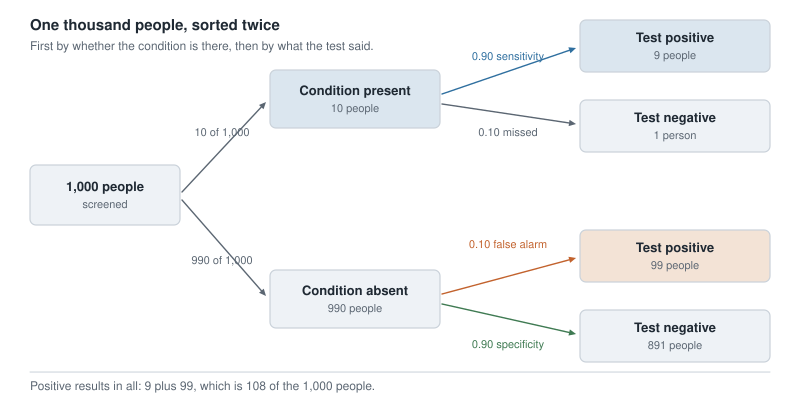
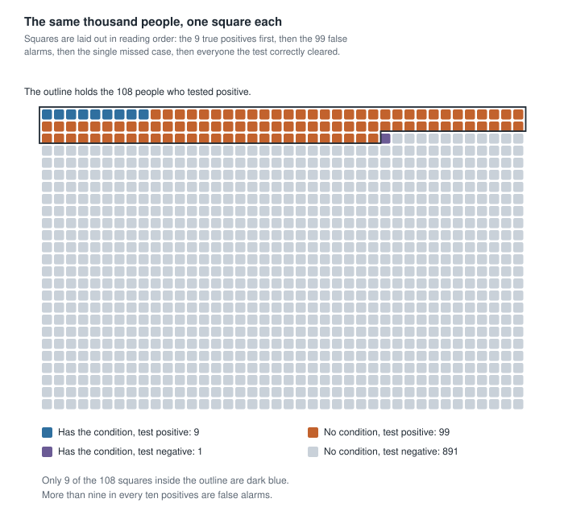
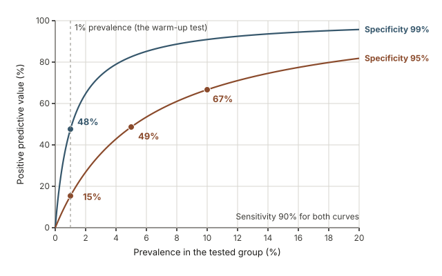
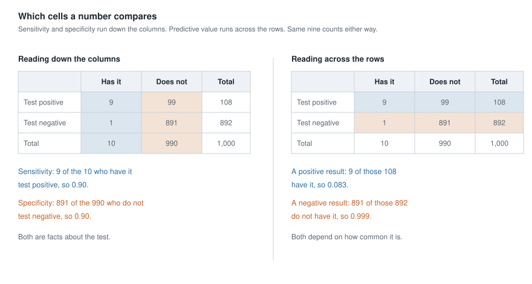

## Where this week starts

Everything you have done since Week 3 has described a group. A mean summarised forty resting heart rates. A slope in Week 8 described how two measurements moved together across a sample. Even last week's odds ratio compared two kinds of people inside one data set. This week the object changes. You take a single person out of the group — someone just handed a test result, or who has just read a headline about a risk — and ask what the numbers say about them.

That question has a name: probability. In this course a probability is a proportion of some group, and nearly all of the skill is knowing which group. Get the group right and the arithmetic is division; get it wrong and no arithmetic will save you.

Week 9 left something unfinished. Logistic regression handed you a fitted probability — the model puts this patient's chance at 0.18 — without our ever saying what a chance is, or what should happen to it when new information arrives. This week we say both, by counting people. A famous rule of probability sits behind everything below, and you will never need to write it down: a table of 1,000 imaginary people does the same work, and unlike the formula it cannot hide which denominator you are using.

By Friday the sentence "this test is 90% accurate" should sound incomplete to you. You should be able to name the two numbers it compresses, explain why neither is the chance that your own positive result is real, and produce that chance yourself from a prevalence and a small table of counts.

### Why this matters beyond the exam

Picture someone who has just tested positive on a screening test for a serious but uncommon condition. They are told the test is 90% accurate, so they go home and spend three weeks believing they have a nine-in-ten chance of being ill. They cancel plans. They may accept an invasive follow-up they would have weighed differently with a clear head. In the situation we build below, their real chance is closer to one in twelve, and the right thing to feel is neither relief nor panic but a specific, quantified concern that justifies a second test.

The pattern is not only medical. A fraud alert on your account, a security screen at an airport, a workplace drug test, an automated flag on a benefits application: every one searches a large population for something rare, and unless the error rate is tiny compared with how rare the thing is, most of the alarms are false. That is a fact about rarity, not a complaint about the test.

## What you will be able to do

- State any probability as a proportion of a named group, and say out loud what its denominator is.
- Turn a prevalence, a sensitivity, and a specificity into a table of counts for 1,000 people, without a formula.
- Compute the chance that a positive result is real, and explain why it is not the sensitivity.
- Explain, using counts, why an accurate test for a rare condition produces mostly false positives.
- Separate absolute risk, risk difference, and relative risk in a claim, and say which one a headline reports.
- Read a probability tree and a two-by-two table and name which cells any quoted number compares.

## Words worth owning

| Term | What it means in this course |
|---|---|
| Probability | The proportion of a named group for whom something is true, or the fraction of times it happens over a long run of repeats. Never free-floating: always has a denominator. |
| Prevalence, or base rate | The proportion of a population that has the condition, before anybody is tested. |
| Conditional probability | A probability worked out inside a smaller group: among commuters, among people who tested positive. |
| Sensitivity | Of the people who truly have the condition, the proportion the test calls positive. |
| Specificity | Of the people who truly do not have it, the proportion the test calls negative. |
| False positive | A positive result in a person without the condition. A false negative is the mirror image. |
| Predictive value of a positive | Of the people whose result came back positive, the proportion who truly have the condition. |
| Absolute risk and relative risk | The size of a chance itself, versus the ratio of two chances. Same evidence, very different sentences. |

## Probability as a count of people

### Two honest ways to finish the sentence

Ask ten people what "a 30% chance of rain tomorrow" means and you will get a small argument. Statistics need not settle it: a probability can always be finished in one of two concrete ways, and both are frequencies.

The first is the **long-run relative frequency**. If a process can be repeated under the same conditions, the probability of an outcome is the fraction of repeats in which it happens, once the number of repeats is large. Flip a fair coin ten times and you may see seven heads; flip it ten thousand times and the fraction of heads settles near one half. That is a statement about the long run, not a promise about the next flip, and the commonest error in casual talk about chance is treating a long-run rate as a guarantee for one case.

The second is a **proportion of a population**. "Three in a thousand adults in this age band have the condition" is a probability in exactly the sense we need: pick one adult from that population at random and the chance they have it is 0.003. Nothing is repeated. The probability is a fact about the composition of a group.

Both versions carry a denominator, and that is the habit to build. Whenever you meet a probability this week, finish the sentence "out of what group?" first. Out of everyone screened. Out of the people who have the condition. Out of the people who tested positive. Those are three different groups, and a number computed in one tells you almost nothing about the others.

### Conditional probability read off a table

The word *conditional* sounds technical. The action is simple: shrink the group, then count.

A campus survey asked 400 students two questions. Do you commute to campus, and did you miss any class last week because of transport? Here is the whole result.

| | Missed a class | Did not miss | Total |
|---|---|---|---|
| Commuted | 60 | 140 | 200 |
| Lived on campus | 20 | 180 | 200 |
| Total | 80 | 320 | 400 |

Check the margins first, every time. The row totals are 200 and 200, which add to 400. The column totals are 80 and 320, which also add to 400. The table is internally consistent, so we can trust the cells.

Now three questions that all come out of that one table.

The **overall** proportion who missed a class is 80 out of 400, which is 0.20. The group is everyone surveyed.

The proportion who missed a class **among commuters** is 60 out of 200, which is 0.30. The group has shrunk to the first row. In symbols, $P(\text{missed} \mid \text{commuted}) = 0.30$, and the vertical bar is read "given" or, more usefully, "within the group of".

The proportion who commuted **among those who missed a class** is 60 out of 80, which is 0.75. The group has shrunk to the first column instead.

Read those last two again. Both come from the same cell, the same 60 students, and they are 0.30 and 0.75. Thirty percent of commuters missed a class. Seventy-five percent of the students who missed a class were commuters. Neither sentence can be swapped for the other, and the only thing that changed was the denominator. Everything difficult in the rest of this week is a disguised version of that one swap.

## What a test knows and what your result means

### Sensitivity and specificity belong to the test

A test is judged by studying people whose true status is already known from a more definitive procedure. Two proportions come out of that study.

**Sensitivity** is the proportion of people who truly have the condition that the test calls positive. If sensitivity is 0.90, then among 100 people who genuinely have it, about 90 get a positive result and about 10 are missed.

**Specificity** is the proportion of people who truly do not have the condition that the test calls negative. If specificity is 0.90, then among 100 healthy people, about 90 are correctly cleared and about 10 get a false alarm.

Both are conditional probabilities whose condition is the *true status*: they start from the truth and look at what the test said. That direction is why a single "accuracy" figure is not enough. One test can have sensitivity 0.99 and specificity 0.50, another the reverse, and calling either "accurate" says nothing about which mistake it makes. They are properties of the test itself, and changing the population leaves them roughly where they were.

### Predictive value belongs to the test in a population

You do not know your true status. That is why you took the test. Your question runs in the opposite direction: given that my result is positive, what is the chance I have the condition?

That number is the **predictive value of a positive result**, and it is not the sensitivity. It starts from the result and looks back at the truth. Because the group who tested positive holds both true cases and false alarms, its make-up depends on how many true cases there were to find. Prevalence is therefore part of your result, even though it is nowhere in the test.

Keep the two kinds of number separated by the direction you read them:

- Sensitivity and specificity start from the true status and ask what the test said.
- Predictive value starts from what the test said and asks about the true status.

## Worked example — screening a crowd of 1,000 for a rare condition

**Setting.** A county health department offers a free screening test at a community health fair. In the crowd that attends, about 1 person in 100 has the condition. The test has sensitivity 0.90 and specificity 0.90. A thousand people are tested over the weekend. What should a person with a positive result conclude?

**Step 1. Work with the whole crowd.** All 1,000 of them. A round number keeps every count a whole person.

**Step 2. Split by the truth, using the prevalence.** One in a hundred means 10 of the 1,000 have the condition, and the other 990 do not.

**Step 3. Split the 10 who have it, using the sensitivity.** The test finds 90% of them, which is 9 people. The remaining 1 is missed and gets a negative result.

**Step 4. Split the 990 who do not have it, using the specificity.** The test correctly clears 90%, which is 891 people. The other 10%, which is 99 people, get a false alarm.

**Step 5. Collect everyone whose result was positive.** The 9 true cases plus the 99 false alarms, giving 108 positive results in all.

{fig-alt="A tree starting from 1,000 people splits into 10 with the condition and 990 without, then each of those splits by test result into 9 and 1, and 99 and 891."}

**Step 6. Answer the question that was actually asked.** Among the 108 people holding a positive result, 9 truly have the condition.

$$\text{predictive value of a positive} = \frac{9}{9 + 99} = \frac{9}{108} \approx 0.083$$

**Checking the arithmetic.** The four cells are 9, 1, 99 and 891, and they add to 1,000. The condition split was 10 and 990. The result split was 108 positive and 892 negative. Every margin agrees, so the table is sound.

{fig-alt="A grid of 1,000 squares. An outlined block of 108 squares marks everyone who tested positive, and only 9 of them, shown in dark blue, actually have the condition, while 99 in orange do not."}

**What the result means in context.** About 108 people leave the fair holding a positive slip, and roughly 9 of them are ill. That is a chance of about 8%, which is exactly one in twelve. Ninety-nine of the 108, more than nine in every ten, are false alarms.

And now the uncomfortable part. This test was not bad. It got 9 of the 10 sick people right and 891 of the 990 healthy people right, so it was correct about 900 of the 1,000 — exactly the 90% the flyer advertised. The 90% was true. It simply never was the number a person holding a positive slip wanted to know.

Two further readings come out of the same table. A negative result here is genuinely reassuring: of the 892 who tested negative, 891 do not have the condition, a predictive value of about 0.999. And a positive result is not worthless. It moved a person from 1 in 100 to 1 in 12, a chance more than eight times as large. That is what a screening test is for: a reason to take the next test, not a diagnosis.

### The same reasoning, transferred

Move the same test into a different room. In a clinic, people arrive because something is already wrong: symptoms, a family history, an abnormal earlier finding. Suppose about 3 in 10 of them have the condition. The test is unchanged, sensitivity 0.90 and specificity 0.90.

Run the identical six steps on 1,000 clinic patients. The prevalence splits them into 300 with the condition and 700 without. Of the 300, the test finds 270 and misses 30. Of the 700, it clears 630 and raises 70 false alarms. The positives number 270 plus 70, which is 340, so the predictive value of a positive is 270 out of 340, or about 0.794.

What stayed the same: the test, both of its properties, all six steps, and the shape of the table. What changed: only the base rate, from 1 in 100 to 3 in 10. And the meaning of an identical slip of paper moved from about 8% to about 79%.

{fig-alt="A rising curve of the predictive value of a positive against prevalence for a fixed test. At 1 percent prevalence the curve sits near 8 percent, and at 30 percent prevalence it has climbed to about 79 percent."}

This is why a careful clinician asks who was tested before interpreting a result. The paper is the same. The news is not.

## Second worked example — a headline that doubles a small risk

**Setting.** A state health bulletin reports that adults who follow a particular habit have "double the risk" of a rare complication over ten years. A local paper runs it as a warning. Should a reader change anything?

The counts are these. Among 10,000 adults without the habit, 4 experienced the complication over ten years. Among 10,000 with it, 8 did. Both are conditional probabilities of the kind built above: one computed within the group without the habit, the other within the group with it.

**Step 1. Absolute risk in each group.** Without the habit, 4 out of 10,000, which is 0.0004, or 0.04%. With it, 8 out of 10,000, which is 0.0008, or 0.08%.

**Step 2. The risk difference.** Subtract: 0.0008 minus 0.0004 is 0.0004. In people, that is 4 extra complications per 10,000 adults over ten years, or 1 extra per 2,500.

**Step 3. The relative risk.** Divide instead of subtracting.

$$\text{relative risk} = \frac{0.0008}{0.0004} = 2.0$$

The ratio is 2, which is where the word "double" came from. Nothing in the bulletin was false.

**Step 4. Say both out loud and notice the difference.** "Doubles your risk" and "adds four cases per ten thousand people over a decade" describe the same two counts. The first says how the rates compare; the second says how many people are affected. A reader deciding whether to change their behaviour needs the second, and the headline gave only the first.

**Why the ratio alone cannot tell you the size of anything.** Imagine a second habit where the ten-year risk without it is 20%, so 2,000 per 10,000, and with it is 40%, so 4,000 per 10,000. The relative risk is again exactly 2.0, but the risk difference is 20 percentage points, or 2,000 extra cases per 10,000 people. Two claims with identical ratios, one of them five hundred times larger in human terms. A ratio compares two numbers and then throws both away, which is why a responsible report states the absolute risk beside it.

One caution carried forward from Week 2 and Week 6: these are observational counts. People with the habit may differ from people without it in many ways, so "double the risk" describes an association, not a demonstrated effect. The arithmetic is correct regardless; the causal verb is the part that is not earned.

## The misreading to avoid

Here is the thought, in the words students actually use: *"The test is 90% accurate and I tested positive, so there is a 90% chance I have it."*

It is a completely reasonable thought, and it is wrong, so let us take it apart precisely rather than just declare it so.

The 90% is a promise made to a group you are not standing in. Sensitivity says: of the people who have the condition, 90% test positive. It reads down the column of people who have it. Your question reads across the row of people who tested positive. The two directions share only one cell, the 9 true positives, and divide it by different totals — by 10 in one case and by 108 in the other. Same numerator, different denominator, different number. That is the commuting table again, wearing a lab coat.

{fig-alt="The same two-by-two table shown twice. On the left the columns are shaded, giving sensitivity 9 of 10 and specificity 891 of 990. On the right the rows are shaded, giving 9 of 108 positives and 891 of 892 negatives."}

There is also a plain counting reason, worth saying in one breath. The condition is rare, so there are only 10 sick people in the crowd of 1,000 and the test can find at most those 10. Meanwhile there are 990 healthy people, and even a small error rate applied to a large group produces many alarms: 10% of 990 is 99. Ninety-nine false alarms against nine real cases. The false positives win because the healthy group is enormous, not because the test is careless.

A second misreading usually follows within a minute: *"So screening is pointless."* That is an overcorrection. The positive result did real work: it multiplied the chance by more than eight, and it narrowed 1,000 people down to 108 worth investigating. Screening is the first filter in a sequence, not the verdict, and the right response to a positive screen is a second, more specific test on that smaller and now much richer group — the same calculation run again with a new base rate.

A third misreading is quieter: *"The prevalence is not part of the test, so it cannot be part of my result."* Two people holding the same slip of paper, one from the health fair and one from the symptom clinic, are holding different news, because they were drawn from different populations. Who was tested is not background detail. It is an input.

## Practice on your own

These are for you, on paper, with a calculator. Nothing here is collected. Build a table of counts before you divide anything.

1. **A different test.** A test has sensitivity 0.95 and specificity 0.80, and 2 people in 100 in the screened population have the condition. Build the table for 1,000 people, find how many test positive, and work out the predictive value of a positive. Then write one sentence you would be comfortable saying to someone who just got that result.

2. **Back to the commuters.** From the campus survey table above, find the proportion who did not miss a class among the commuters, and the proportion who commuted among the students who did not miss a class. Say which group each one describes, and explain to a friend why they are not the same number.

3. **A headline with only a ratio.** A report says an exposure is associated with "50% higher risk" of an outcome, and that the ten-year risk without the exposure is 1 in 500. Express both risks per 10,000 people, give the risk difference, and write the sentence you would put in a newspaper so that a reader is neither frightened nor falsely reassured.

4. **The second test.** Take the 108 people who tested positive at the health fair, 9 with the condition and 99 without. They are offered a confirmatory test with sensitivity 0.95 and specificity 0.99. Work out roughly how many of each group test positive again, and the predictive value of a second positive. Expected counts need not be whole people; leave them as decimals. Then say why two tests in sequence behave so differently from one.

5. **Naming the number.** For each of these, say which quantity it is and which cells of a two-by-two table it compares: "the test catches 19 of every 20 cases"; "8 in 100 of those flagged actually have it"; "1 in 400 adults in this age band are affected"; "the rate is twice as high in the exposed group".

## Where to read more

- The life and biomedical sciences supplement is the strongest source this week; work through its probability chapter and its treatment of diagnostic testing in [Introductory Statistics for the Life and Biomedical Sciences](https://www.openintro.org/book/biostat).
- For more practice reading proportions out of two-way tables, the machinery underneath every calculation above, see [Exploring categorical data](https://openintrostat.github.io/ims/explore-categorical.html).
- For the connection back to odds and fitted probabilities, revisit [Logistic regression](https://openintrostat.github.io/ims/model-logistic.html), or browse [Introduction to Modern Statistics](https://openintrostat.github.io/ims) as a whole.
- Course pages: the [course home page](../index.qmd), the [schedule](../schedule.qmd), and the [resources page](../resources/index.qmd). Last week's notes are at [Week 9](week09-multiple-logistic-regression.qmd).

## Where this goes next

This week the probabilities were handed to you: a prevalence from public health records, a sensitivity and a specificity from a validation study. Next week the direction reverses. You will have a data set and no probabilities at all, and the question becomes whether the pattern in front of you is the kind of thing chance alone produces. The tool is simulation: shuffle the labels, recompute, and repeat until you can see the whole range of what chance can do.

Bring the denominator habit with you. In [Week 11](week11-simulation-based-inference.qmd) the phrase "how often does that happen by chance" has the same structure as this week's "out of what group", and the students who keep asking it are the ones for whom p-values in Week 12 arrive as an old friend rather than a new formula. The full sequence is laid out on the [course home page](../index.qmd).
