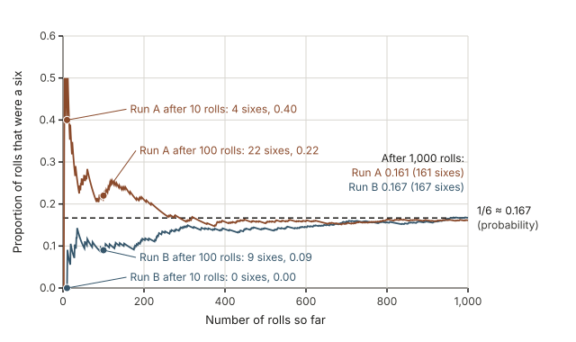
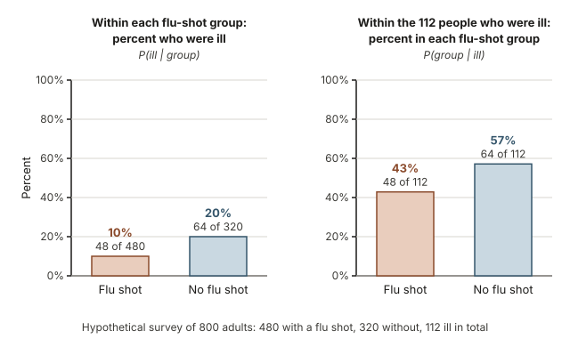
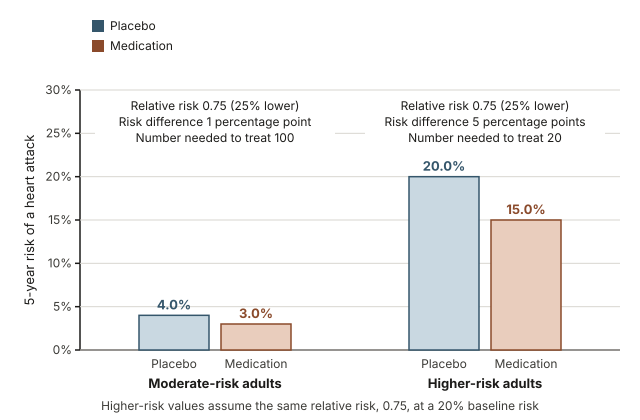
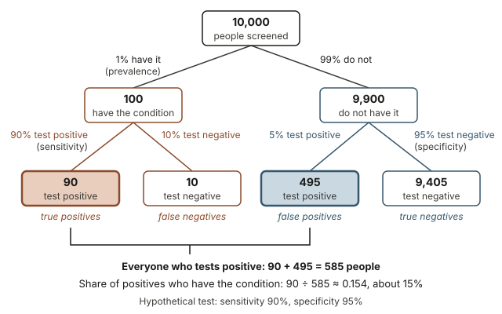
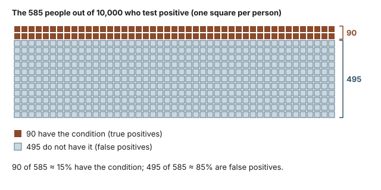

This week is about the numbers used to describe chance in health and everyday life: the risk of an illness, the benefit of a treatment, and the meaning of a test result. The main tool is simple: turn every claim into counts of people.

## Warm-up: what does a positive screening test tell you?

A hypothetical screening test is offered to adults with no symptoms. About 1 in 100 of the people screened have the condition it looks for. The test detects 90% of the people who have the condition, and it correctly gives a negative result to 95% of the people who do not. A friend of yours tests positive.

Before reading on, write down a guess: is the chance that your friend has the condition closer to 90%, 50%, or 15%? Worked example 3 settles the question by counting people.

## Why risk and diagnosis need careful numbers

A news story says a food raises the risk of an illness by 20%. A doctor says a medication cuts the risk of a stroke by a third. A lab report says a test came back positive. Whether each claim informs or misleads depends on details that are easy to leave out: risk of what, over what time, compared with what, and for whom. Many people, including some health professionals, overestimate the chance of disease after a positive test for a rare condition, and the same treatment effect can sound large or small depending on how it is reported. Decisions about screening and treatment depend on reading these numbers correctly.

## What you will be able to do

By the end of this week you can:

- explain a probability as a long-run relative frequency, and say what it does not promise about a short run;
- compute complements, "and", "or" and conditional probabilities from a two-way table, and explain why $P(A \mid B)$ and $P(B \mid A)$ usually differ;
- compute and interpret absolute risk, risk difference, relative risk and number needed to treat;
- compute positive and negative predictive values from sensitivity, specificity and prevalence, using natural frequencies and a tree;
- explain in plain language why a positive result for a rare condition is often a false positive.

## Words to know this week

| Term | Meaning |
|---|---|
| Probability | The proportion of times an outcome would occur in a very long run of repetitions; a number from 0 to 1. |
| Law of large numbers | Over many repetitions, the proportion of times an outcome occurs settles near its probability. |
| Complement | The event that $A$ does not happen, with probability $1 - P(A)$. |
| Conditional probability | The probability of $A$ counting only the cases where $B$ happened, written $P(A \mid B)$ and read "$A$ given $B$". |
| Independent events | Knowing that one happened does not change the probability of the other: $P(A \mid B) = P(A)$. |
| Absolute risk | The proportion of a group who have an event over a stated time, such as 4% over 5 years. |
| Risk difference | One group's risk minus another group's risk, written as a proportion (such as 0.010) or in percentage points (1.0). |
| Relative risk | One group's risk divided by another group's risk; 1 means no difference. |
| Relative risk reduction | 1 minus the relative risk, often given as a percent. |
| Odds | The number who have the event divided by the number who do not. |
| Odds ratio | One group's odds divided by another's; close to the relative risk when the event is rare. |
| Number needed to treat (NNT) | How many people need the treatment, on average, for one fewer person to have the event; 1 divided by the risk difference written as a proportion. |
| Prevalence (base rate) | The proportion of the tested group who have the condition. |
| Sensitivity | Among people with the condition, the proportion who test positive. |
| Specificity | Among people without the condition, the proportion who test negative. |
| False positive, false negative | A positive result for someone without the condition; a negative result for someone with it. |
| Positive predictive value (PPV) | Among people who test positive, the proportion who have the condition. |
| Negative predictive value (NPV) | Among people who test negative, the proportion who do not have it. |
| Natural frequencies | Counts of people out of a round total, such as 10,000, used in place of percentages. |

## Probability as long-run relative frequency

In this course, the probability of an outcome is its long-run relative frequency: the proportion of times it happens when the same chance process is repeated a very large number of times. Probabilities run from 0 (never happens) to 1 (always happens), and the probabilities of all the possible outcomes of a process add to 1.

### What a probability claims about the long run

The probability of rolling a six with a fair die is $1/6 \approx 0.167$. That does not promise one six in every six rolls; it says that over a very large number of rolls, the proportion of sixes settles near 0.167.

The plot below follows two simulated runs of 1,000 rolls each. After 10 rolls, Run A had 4 sixes (a proportion of 0.40) and Run B had none. After 100 rolls the runs were at 0.22 and 0.09. After 1,000 rolls they were at 0.161 and 0.167, both close to the dashed line at 1/6. Short runs wobble; long runs settle. This pattern is the law of large numbers.

{fig-alt="Line plot of the running proportion of sixes over 1,000 simulated rolls in two runs. After 10 rolls Run A is at 0.40 and Run B at 0; both settle near the dashed line at 1/6, ending at 0.161 and 0.167."}

The settling does not happen because the die catches up. After 10 rolls, Run A had about 2.3 more sixes than one sixth of the rolls ($4 - 10/6 \approx 2.3$); after 1,000 rolls it had about 5.7 fewer ($161 - 1000/6 \approx -5.7$). The gap in the count grew, but divided by 1,000 rolls it is small. A die has no memory, so a long stretch without a six does not make a six more likely on the next roll.

The same idea gives meaning to a risk. A 4% risk of a heart attack over 5 years means that in a large group of similar adults followed for 5 years, about 4 in every 100 would have one. The probability describes the group. It is applied to one person because no one can tell in advance who will be among the 4.

### Probability rules you can read from a two-way table

In a two-way table, each probability rule is a count divided by the right total. Let $A$ and $B$ be two events, such as "had a flu shot" and "was ill".

- **Complement:** $P(\text{not } A) = 1 - P(A)$.
- **And:** $P(A \text{ and } B)$ is the count in the one cell where both happen, divided by the grand total.
- **Or:** $P(A \text{ or } B) = P(A) + P(B) - P(A \text{ and } B)$. Adding the two totals counts the overlap twice, so subtract it once.
- **Conditional:** $P(A \mid B) = P(A \text{ and } B) \div P(B)$. In a table, divide the cell count by the total of the row or column for $B$, not by the grand total.
- **Multiplication:** $P(A \text{ and } B) = P(B) \times P(A \mid B)$. Tree diagrams use this rule branch by branch.

Order matters. $P(A \mid B)$ and $P(B \mid A)$ share a cell count but have different denominators, so they usually differ and address different questions. If $P(A \mid B) = P(A)$, the events are independent. In a table, independence means every row has the same row proportions, the pattern of no association.

## Worked example 1: flu shots and illness in a two-way table

**The question.** A hypothetical survey asked 800 adults whether they got a flu shot last fall and whether they had a flu-like illness during the winter.

| | Flu-like illness | No flu-like illness | Total |
|---|---|---|---|
| Flu shot | 48 | 432 | 480 |
| No flu shot | 64 | 256 | 320 |
| Total | 112 | 688 | 800 |

For one of these adults chosen at random, find the probability of illness, of no illness, of a flu shot and illness, and of a flu shot or illness. Then find the probability of illness within each flu-shot group, and of a flu shot among the ill.

**Step 1: illness.** $P(\text{ill}) = 112/800 = 0.14$.

**Step 2: the complement.** $P(\text{not ill}) = 1 - 0.14 = 0.86$. Check against the table: $688/800 = 0.86$.

**Step 3: "and".** This is one cell: $P(\text{shot and ill}) = 48/800 = 0.06$.

**Step 4: "or".** First, $P(\text{shot}) = 480/800 = 0.60$, so $P(\text{shot or ill}) = 0.60 + 0.14 - 0.06 = 0.68$. Check by counting people: the 480 with a shot plus the 64 ill people without one gives $544/800 = 0.68$.

**Step 5: illness given flu-shot status.** Use one row at a time: $P(\text{ill} \mid \text{shot}) = 48/480 = 0.10$ and $P(\text{ill} \mid \text{no shot}) = 64/320 = 0.20$.

**Step 6: flu shot given illness.** Use the illness column: $P(\text{shot} \mid \text{ill}) = 48/112 \approx 0.43$ and $P(\text{no shot} \mid \text{ill}) = 64/112 \approx 0.57$.

{fig-alt="Two bar panels from a hypothetical survey of 800 adults. Left: 10% of the flu-shot group (48 of 480) and 20% of the no-shot group (64 of 320) were ill. Right: of the 112 ill, 43% had a flu shot and 57% did not."}

**Conclusion in context.** In this hypothetical survey, 14% of the adults were ill: 10% of those with a flu shot and 20% of those without, twice as high. Yet 43% of the ill adults had a flu shot. That is no contradiction: 60% of the whole group had a flu shot, so that group contributes many people to both columns. Steps 5 and 6 use the same 48 people but different denominators, 480 and 112. Because $P(\text{ill} \mid \text{shot}) = 0.10$ differs from $P(\text{ill}) = 0.14$, illness and flu-shot status are not independent here. The survey is observational, so this is an association, not proof that the shot prevented illness: people who choose flu shots may differ in age, habits or contact with sick people, the confounding problem from [Week 6](week06-confounding.qmd).

## Describing risk: absolute risk, relative risk, and number needed to treat

In health, a risk is the probability of an unwanted event, such as a heart attack, for a group of people over a stated time. The standard ways of describing how a treatment changes a risk can make the same result sound very different.

### Absolute risk and the risk difference

The absolute risk is the proportion of a group who have the event in the stated time, for example 40 of 1,000 people (4.0%) over 5 years. A risk with no group or no time period attached cannot be compared with anything. The risk difference subtracts: risks of 4.0% and 3.0% differ by 1.0 percentage point. Say "percentage points" for a difference between two percents, so that no one mistakes it for a relative change. The risk difference tells you how many people per 100 the change affects: here, 1.

### Relative risk, and why headlines prefer it

The relative risk, also called the risk ratio, divides:

$$\text{relative risk} = \frac{\text{risk in the treated or exposed group}}{\text{risk in the comparison group}}.$$

A value of 1 means no difference; below 1 means lower risk in the treated or exposed group; above 1 means higher risk. With risks of 3.0% and 4.0%, the relative risk is $0.030/0.040 = 0.75$, and the relative risk reduction is $1 - 0.75 = 0.25$, or 25%.

A relative risk hides the starting level. If a hypothetical side effect rises from 1 in 10,000 people to 2 in 10,000, a headline can truthfully say the drug "doubles the risk" (a relative risk of 2), yet the risk difference is 1 in 10,000, which is 0.01 percentage point. Relative changes make bigger numbers and more dramatic headlines, so whenever you see one, ask: relative to what baseline?

The logistic regression output in Week 9 reported odds ratios, not relative risks. The two are close for rare events and can differ noticeably for common ones; Worked example 2 compares them.

### Number needed to treat

The number needed to treat turns a risk difference, written as a proportion rather than a percent, into a count of people:

$$\text{NNT} = \frac{1}{\text{risk difference}}.$$

A risk difference of 0.010 gives $\text{NNT} = 1/0.010 = 100$: on average, 100 people need the treatment over the study period for one fewer person to have the event. With risks of 4% untreated and 3% treated, among 100 treated people about 96 would have been fine anyway, about 3 still have the event, and about 1 is spared. An NNT that does not come out whole is usually rounded up. For a harm, the same calculation gives the number needed to harm; for the side effect above, it is $1/0.0001 = 10{,}000$.

::: {.callout-tip}
**Three questions for any risk claim.** Risk of what, for whom, and over what time? Compared with what baseline? How many people per 100 (or per 1,000) does the change affect?
:::

## Worked example 2: one hypothetical trial reported two ways

**The question.** In a hypothetical randomized trial, 20,000 adults at moderate risk of heart disease were randomly assigned, 10,000 to a daily medication and 10,000 to a placebo, and followed for 5 years. In the placebo group 400 people had a heart attack, and in the medication group 300 did. A news story says the medication "cuts heart attack risk by 25%". Is that accurate, and what does it mean for someone deciding whether to take the medication?

**Step 1: absolute risks.** Placebo: $400/10{,}000 = 0.040$, or 4.0%. Medication: $300/10{,}000 = 0.030$, or 3.0%. Both are 5-year risks.

**Step 2: risk difference.** $0.040 - 0.030 = 0.010$, or 1.0 percentage point.

**Step 3: relative risk.** $0.030/0.040 = 0.75$, a relative risk reduction of $1 - 0.75 = 0.25$. The headline's 25% is this relative reduction.

**Step 4: number needed to treat.** $1/0.010 = 100$. About 100 people would need to take the medication for 5 years for one fewer heart attack than on placebo.

**Step 5: odds ratio.** The odds of an event are the number of people who have it divided by the number who do not. The odds of a heart attack were $300/9{,}700 \approx 0.0309$ on the medication and $400/9{,}600 \approx 0.0417$ on placebo, so the odds ratio is about $0.0309/0.0417 \approx 0.74$, close to the relative risk of 0.75 because heart attacks were rare.

**Step 6: a higher baseline.** Suppose the same relative effect holds in a hypothetical higher-risk group: 2,000 of 10,000 on placebo (20%) and 1,500 of 10,000 on the medication (15%) have a heart attack. The relative risk is again $0.15/0.20 = 0.75$, but the risk difference is $0.20 - 0.15 = 0.05$, or 5 percentage points, so $\text{NNT} = 1/0.05 = 20$. The odds ratio, $(1{,}500/8{,}500) \div (2{,}000/8{,}000) \approx 0.71$, is now further from 0.75 because the event is more common.

{fig-alt="Bar chart of hypothetical 5-year heart attack risk. Moderate-risk adults: 4.0% on placebo, 3.0% on medication. Higher-risk adults: 20.0% and 15.0%. Relative risk is 0.75 in both; numbers needed to treat are 100 and 20."}

**Conclusion in context.** The headline is accurate but incomplete. For moderate-risk adults in this hypothetical trial, the medication lowered the 5-year risk of a heart attack from 4 in 100 to 3 in 100; about 100 people would need to take it for 5 years to prevent one heart attack. If the same 25% relative reduction held for higher-risk adults (Step 6), it would prevent about 5 heart attacks per 100 people treated, and about 20 would need treatment to prevent one; the trial itself studied only moderate-risk adults. The trial randomly assigned the medication ([Week 2](week02-study-design.qmd)), and with 10,000 people per group a difference this large is unlikely to be due to chance alone (Weeks 11 and 12 show how to check), so it supports a causal effect for people like those studied. Whether the medication is worth taking also depends on side effects and cost, which everyone who takes it bears.

## Diagnostic tests: sensitivity, specificity, and base rates

A screening or diagnostic test sorts people into positive and negative results, and it can be wrong in either direction.

### The four possible outcomes of a test

Each person tested has a true status and a test result, which gives four possibilities:

| | Test positive | Test negative |
|---|---|---|
| Has the condition | true positive | false negative |
| Does not have the condition | false positive | true negative |

- **Sensitivity** is $P(\text{positive} \mid \text{condition})$: the true positives divided by everyone with the condition. A highly sensitive test rarely misses a case.
- **Specificity** is $P(\text{negative} \mid \text{no condition})$: the true negatives divided by everyone without the condition. A highly specific test rarely gives a false alarm. The false-positive rate is $1 - \text{specificity}$.

A person holding a result needs the conditional probabilities in the other direction:

- **Positive predictive value (PPV)** is $P(\text{condition} \mid \text{positive})$: the true positives divided by everyone who tests positive.
- **Negative predictive value (NPV)** is $P(\text{no condition} \mid \text{negative})$: the true negatives divided by everyone who tests negative.

Sensitivity and specificity read across the rows of the table, starting from the truth; predictive values read down the columns, starting from the result. Sensitivity and specificity are usually treated as properties of the test. Predictive values also depend on the **prevalence**, or base rate, in the group being tested, so the same test can have very different predictive values in different groups.

### Natural frequencies: count people instead of multiplying percentages

Conditional probabilities are easiest to handle as counts of people:

1. Choose a round number of people, large enough that every count comes out whole; 10,000 often works.
2. Split them by the prevalence into those with and without the condition.
3. Split those with the condition by the sensitivity, and those without it by the specificity.
4. Collect everyone who tests positive. The fraction of them who have the condition is the PPV. Do the same with the negatives to find the NPV.

Each split is the multiplication rule at work. With 1% prevalence and 90% sensitivity, a fraction $0.01 \times 0.90 = 0.009$ of everyone both has the condition and tests positive, which is 90 people out of 10,000. A tree diagram lays out the splits and lets you check that the counts add up at every level.

## Worked example 3: the screening result from the warm-up

**The question.** The warm-up test has sensitivity 90% and specificity 95%, and 1% of the people screened have the condition. Your friend tests positive. What is the probability that your friend has the condition?

**Step 1: start with 10,000 people.** A prevalence of 1% gives $0.01 \times 10{,}000 = 100$ people with the condition and $10{,}000 - 100 = 9{,}900$ without it.

**Step 2: split the 100 by sensitivity.** $0.90 \times 100 = 90$ test positive (true positives) and $100 - 90 = 10$ test negative (false negatives).

**Step 3: split the 9,900 by specificity.** $0.95 \times 9{,}900 = 9{,}405$ test negative (true negatives) and $9{,}900 - 9{,}405 = 495$ test positive (false positives).

**Step 4: collect the positives.** $90 + 495 = 585$ people test positive.

**Step 5: the positive predictive value.** $90/585 \approx 0.154$.

{fig-alt="Tree diagram. 10,000 people split into 100 with the condition and 9,900 without. Of the 100, 90 test positive and 10 negative. Of the 9,900, 495 test positive and 9,405 negative. 90 of the 585 positives, about 15%, have it."}

The same counts as a two-way table:

| | Test positive | Test negative | Total |
|---|---|---|---|
| Has the condition | 90 | 10 | 100 |
| Does not have the condition | 495 | 9,405 | 9,900 |
| Total | 585 | 9,415 | 10,000 |

The icon array below shows only the people who test positive, one square per person. The two dark rows are the only people in the picture who have the condition.

{fig-alt="Icon array of 585 squares, one per person who tested positive. 90 dark orange squares mark people who have the condition; 495 light blue squares mark false positives. About 15% of positives have the condition."}

**Step 6: the negative predictive value.** Of the 9,415 people who test negative, 9,405 do not have the condition: $9{,}405/9{,}415 \approx 0.999$.

**Conclusion in context.** A positive result from this hypothetical test means about a 15% chance of having the condition, not 90%: about 85 of every 100 positives are false ($495/585 \approx 0.85$). The base rate is the reason. The 5% false-positive rate applies to 9,900 people and produces 495 false positives, while the 90% detection rate applies to only 100 people. The positive result still matters, raising your friend's probability from 1% to about 15%, which is why a positive screen leads to further testing. A negative result is very reassuring: about 99.9% of negatives are correct.

## How the base rate changes what a positive result means

With the sensitivity and specificity of a test held fixed, the base rate is what changes from one setting to another. The plot shows the PPV of a test with 90% sensitivity across a range of prevalences.

{fig-alt="Line plot of positive predictive value against prevalence from 0% to 20%. With 95% specificity, PPV is about 15% at 1% prevalence, 49% at 5% and 67% at 10%. With 99% specificity, PPV is about 48% at 1% prevalence."}

For the warm-up test (specificity 95%, the lower curve), the PPV is about 15% at 1% prevalence, 49% at 5%, and 67% at 10%. Check the 10% value by counting: of 10,000 people, 1,000 have the condition and 900 of them test positive; 5% of the other 9,000, or 450 people, also test positive; so the PPV is $900/(900 + 450) = 900/1{,}350 \approx 0.67$. Specificity matters most when the condition is rare. With 99% specificity (the upper curve) at 1% prevalence, only 99 of the 9,900 people without the condition test positive, and the PPV rises to $90/(90 + 99) = 90/189 \approx 0.48$.

Two practical lessons follow. First, a positive result means more when the test is used on people with symptoms or risk factors, who have a higher base rate, than when it screens everyone (a negative result means somewhat less there, because the NPV falls as the base rate rises). Second, a positive screen is usually followed by a more specific second test: among people who screened positive the base rate is already about 15%, not 1%, so a positive second result is far more convincing (provided its errors are not tied to the first test's errors).

## Transfer: the same reasoning for a bank's fraud alerts

**The new setting.** A bank's hypothetical fraud-detection system flags 95% of fraudulent card transactions and wrongly flags 2% of legitimate ones. About 0.2% of transactions are fraudulent. A purchase on your card is flagged. How likely is it that the purchase was fraud?

Fraud plays the role of the condition and a flag plays the role of a positive result, so the sensitivity is 95% and the specificity is 98%.

**Step 1: choose 100,000 transactions.** Fraudulent: $0.002 \times 100{,}000 = 200$. Legitimate: $100{,}000 - 200 = 99{,}800$.

**Step 2: flags among fraud.** $0.95 \times 200 = 190$ are flagged and 10 are missed.

**Step 3: flags among legitimate transactions.** $0.02 \times 99{,}800 = 1{,}996$ are flagged and $99{,}800 - 1{,}996 = 97{,}804$ are not.

**Step 4: collect the flags.** $190 + 1{,}996 = 2{,}186$ transactions are flagged.

**Step 5: the positive predictive value of a flag.** $190/2{,}186 \approx 0.087$.

**Conclusion in context.** Only about 8.7% of flagged transactions in this hypothetical system, fewer than 1 in 10, are fraud; most flags land on legitimate purchases. That is why a flag usually brings a quick check with the cardholder rather than an accusation. An unflagged transaction is almost certainly legitimate: $97{,}804/97{,}814 \approx 0.9999$. Whenever a rare event is screened for among a huge number of ordinary cases, even a small false-alarm rate produces many false alarms.

## A common misreading: a 90% sensitive test means a positive is 90% certain

**The misreading.** "The test catches 90% of cases, so if I test positive, there is a 90% chance I have the condition."

**Why it is wrong.** Sensitivity, $P(\text{positive} \mid \text{condition})$, starts from the people who have the condition. After a positive result, the question is $P(\text{condition} \mid \text{positive})$, which starts from the people who test positive. Worked example 1 showed that the two directions of a conditional probability can be very different numbers; swapping them is called the confusion of the inverse. Reading the sensitivity as the PPV also ignores the base rate, a mistake called base-rate neglect, and in Worked example 3 the base rate was the reason most positives were false.

A related trap is the word "accurate". The warm-up test gives the right result for $90 + 9{,}405 = 9{,}495$ of 10,000 people, so it is 94.95% accurate. A useless "test" that calls everyone negative would be right for all 9,900 people without the condition, 99% accurate, and would never find a single case. To judge a test, ask for its sensitivity, its specificity and the base rate, then count people.

## Practice questions (ungraded)

1. A forecast gives a 30% chance of rain, and the day stays dry. Was the forecast wrong? Explain what a 30% chance claims and how you could check this forecaster's 30% forecasts. *What to look for:* many days with a 30% forecast, not one day.

2. In a hypothetical group of 200 students, 120 usually sleep at least 7 hours, and 84 of them feel rested most mornings; 28 of the other 80 also feel rested. Build the two-way table and find $P(\text{rested} \mid \text{at least 7 hours})$ and $P(\text{at least 7 hours} \mid \text{rested})$. Say in words what each number describes. *What to look for:* one denominator is a row total, the other a column total.

3. A hypothetical supplement is advertised as cutting the 5-year risk of kidney stones by 50%. In the trial behind the claim, the risk was 2% without it and 1% with it. Find the risk difference and the number needed to treat, and restate the claim using people out of 100. *What to look for:* write the risk difference as a proportion before dividing.

4. A hypothetical rapid test for an infection has sensitivity 80% and specificity 98%. In a clinic where 30% of the patients tested have the infection, use a tree for 1,000 patients to find the PPV and the NPV. *What to look for:* your four end counts should add to 1,000.

5. The same rapid test is proposed for screening a whole town where 0.5% of people have the infection. Predict whether the PPV will be higher or lower than in the clinic, then check with a tree for 10,000 people. *What to look for:* which group, infected or not, produces most of the positive results?

6. A hypothetical news report says that 60% of the people hospitalized with a disease had been vaccinated and concludes that the vaccine does not work. Which conditional probability is the 60%, and which would you need to judge the vaccine? What other fact about the population would help? *What to look for:* in Worked example 1, 43% of the ill adults had a flu shot, yet the flu-shot group had half the illness rate.

## Read further on probability and risk

- [Introductory Statistics for the Life and Biomedical Sciences](https://www.openintro.org/book/biostat/) (Vu and Harrington, OpenIntro, free), chapter 2, Probability: probability rules and conditional probability with biomedical examples. Optional; it goes further than this page.
- [Introduction to Modern Statistics, chapter 4: Exploring categorical data](https://openintrostat.github.io/ims/explore-categorical.html) (Çetinkaya-Rundel and Hardin, OpenIntro, free): two-way tables (called contingency tables there), row and column proportions, and graphs for two categorical variables. The book shows R code in places; skip the code and read the output and explanation.

## Where this goes next

This week treated probability as what happens over many repetitions. [Week 11: Simulation-based inference](week11-simulation-based-inference.qmd) builds on exactly that idea: to judge whether a difference between two groups could be due to chance alone, you will simulate many repetitions of a study in which only chance is at work and see how often a result as extreme as the real one appears. [Week 13: Categorical outcomes](week13-categorical-outcomes.qmd) later returns to rates and proportions in two-way tables.

Looking back, [Week 9: Multiple and logistic regression interpretation](week09-multiple-logistic-regression.qmd) reported odds ratios, which this week connected to relative risk. See the [notes overview](index.qmd) for all weeks and the [course schedule](../schedule.qmd) for the order of the weeks.
