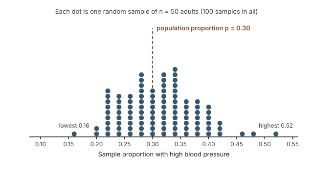
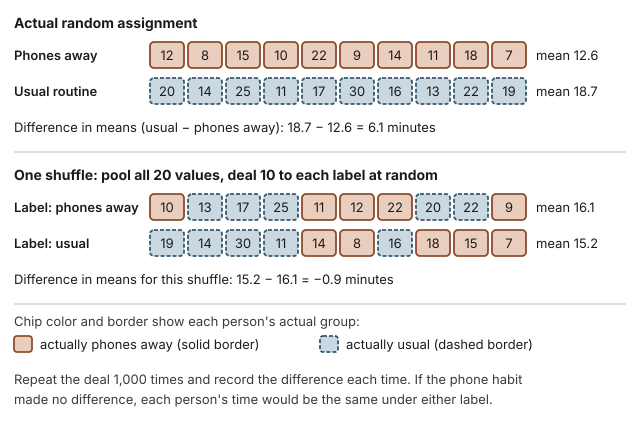
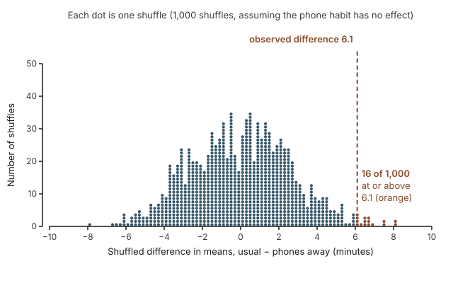
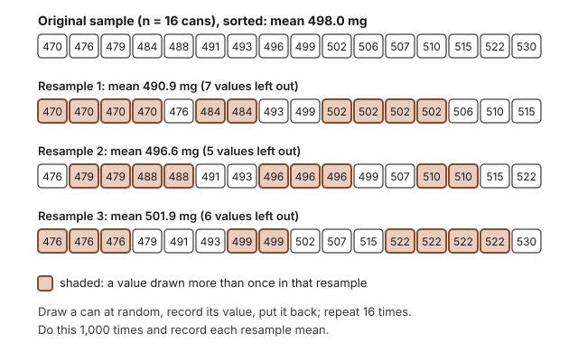
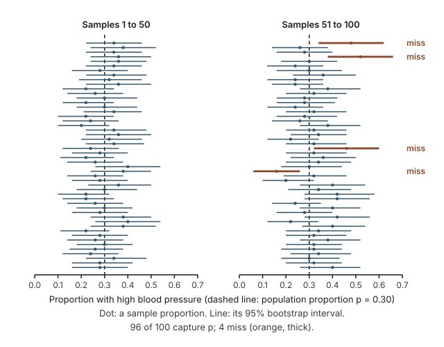
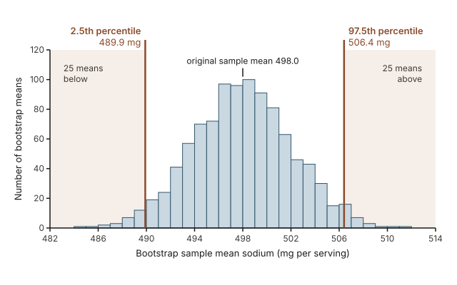

## Warm-up: could a gap this large come from chance alone?

In an illustrative sleep experiment, 20 volunteers were split at random into two groups of 10. The "phones away" group put their phone in another room one hour before bed for a week; the other group kept their usual routine. On the last night, the phones-away group took 12.6 minutes on average to fall asleep and the usual-routine group took 18.7 minutes, a gap of 6.1 minutes.

Before reading on, write down your first thoughts on this question: **if putting the phone away made no difference at all, could the random split alone have produced a gap of 6.1 minutes?** What would you need to know to decide?

You know from [Week 2](week02-study-design.qmd) that random assignment makes groups comparable, and from [Week 4](week04-comparing-groups.qmd) how to describe a difference between groups. This week asks whether a difference is larger than chance usually produces, and how precisely one sample pins down a population value, using only repeated random shuffling and resampling.

## Why chance explanations need checking

Every study that compares groups finds some difference, even when the treatment does nothing, because no two groups are exactly alike. A health department weighing a sleep tip, a seed supplier testing a new seed coating, and a consumer group checking a nutrition label all face the same question: is this pattern a real signal, or the kind of wobble chance produces all the time?

Simulation answers by building the "chance alone" world directly: re-run the random part of the study many times and look at what it produces. The ideas you meet here (null hypotheses, p-values, standard errors, confidence intervals) are the same ones behind the formulas in [Week 12](week12-classical-hypothesis-testing.qmd).

## What you will be able to do

By the end of this week you can:

- explain sampling variability: why a statistic changes from sample to sample while the parameter stays fixed;
- state null and alternative hypotheses for a comparison of two groups;
- carry out the logic of a randomization test and estimate a p-value as a proportion of shuffles;
- describe how the bootstrap resamples with replacement, and read a 95% percentile interval from a bootstrap distribution;
- explain what "95% confidence" does and does not mean;
- choose the right StatKey menu for a randomization test or a bootstrap interval;
- write a conclusion in context that matches the strength of the evidence and the study design.

## Words to know this week

| Term | Meaning this week |
|---|---|
| Parameter | A number describing a whole population or process, such as $\mu$ or $p$. Usually unknown. |
| Statistic | A number computed from a sample, such as $\bar{x}$ or $\hat{p}$. It changes from sample to sample. |
| Sampling variability | The variation of a statistic from one random sample, or one random assignment, to another. |
| Null hypothesis $H_0$ | The "nothing going on" claim: no effect, only chance. |
| Alternative hypothesis $H_A$ | The claim the study looks for evidence of. |
| Randomization test | A test that shuffles the group labels many times, as if $H_0$ were true, to see what chance alone produces. |
| Null distribution | The statistics from all the shuffles; also called a randomization distribution. |
| p-value | The probability, assuming $H_0$ is true, of a statistic at least as extreme as the observed one. A randomization test estimates it by the proportion of shuffles that are at least that extreme. |
| Bootstrap resample | A sample of the same size drawn with replacement from the original sample. |
| Bootstrap distribution | The statistics from many bootstrap resamples. |
| Percentile interval | The middle 95% of a bootstrap distribution, from its 2.5th to its 97.5th percentile. |
| Standard error (SE) | The standard deviation of a statistic across repeated samples. |
| Confidence level | The long-run proportion of intervals, made by the same method, that capture the parameter. |

## Sampling variability: every sample tells a slightly different story

### Statistics vary from sample to sample; parameters stay put

Imagine a very large town in which exactly 30% of adults have high blood pressure, so the population proportion is $p = 0.30$. In real life you would not know that number; here it is fixed in advance (a hypothetical population) so you can watch what samples do. A survey of 50 randomly chosen adults gives a sample proportion $\hat{p}$. A second survey of 50 different adults would very likely give a different $\hat{p}$, though nothing about the town changed.

The dot plot shows 100 such random samples of 50 adults, drawn by computer. Each dot is one sample's $\hat{p}$.

{fig-alt="Dot plot of sample proportions from 100 random samples of 50 adults drawn from a population where 30% have high blood pressure. The dots pile up near 0.30 but range from 0.16 to 0.52."}

What to notice:

- The sample proportions pile up around the parameter, 0.30. Their average is 0.312.
- They range from 0.16 to 0.52. Most (93 of 100) landed within 0.10 of 0.30, and only 9 hit 0.30 exactly.
- No sample is "wrong". Each is an honest random sample; the differences come from chance alone.

The standard deviation of these 100 sample proportions is about 0.066. It measures how far a typical sample proportion lands from the parameter. The standard deviation of a statistic across repeated samples is called its **standard error** (SE), so the SE of $\hat{p}$ for samples of 50 from this town is about 0.066. Larger samples give smaller standard errors, which is why bigger surveys are more precise.

### Two sources of chance: random sampling and random assignment

Chance enters a study in two ways.

- **Random sampling** makes a statistic vary because each sample holds different people. The question is how far the statistic might be from the parameter; the bootstrap addresses this.
- **Random assignment** makes a difference between groups vary because each random split puts different people in each group. The question is whether an observed difference is bigger than the split alone would produce; the randomization test addresses this.

Both tools repeat the chance process many times and look at the pattern of results. In practice the tools are used more widely: a bootstrap interval can also estimate a difference between randomly assigned groups, as in the seed-coating example later on this page. In StatKey (see Read further), **Sampling Distributions > Proportion** lets you do what the dot plot did: set a population proportion and sample size, then generate samples.

## The logic of a randomization test

Back to the sleep experiment: the groups differed by $\bar{x}_{\text{usual}} - \bar{x}_{\text{away}} = 18.7 - 12.6 = 6.1$ minutes. A randomization test asks: *if the phone habit had no effect, how often would random assignment alone produce a difference this large?* It answers in four steps.

### Step 1: state the two competing claims

- $H_0$ (no effect): putting the phone away makes no difference. Each volunteer would have taken the same time to fall asleep in either group, so $\mu_{\text{usual}} - \mu_{\text{away}} = 0$.
- $H_A$ (the researchers' claim): putting the phone away shortens the time, so $\mu_{\text{usual}} - \mu_{\text{away}} > 0$.

Here $\mu_{\text{usual}}$ and $\mu_{\text{away}}$ are the long-run mean times under each routine. The alternative points one way because the researchers said, before collecting data, that they were testing whether the habit *shortens* the time.

### Step 2: shuffle the group labels as if there were no effect

If $H_0$ is true, each person's time is fixed, and the labels "phones away" and "usual" are tags the random split happened to attach. So re-run the split: write the 20 times on 20 cards, shuffle, deal 10 to each label, and compute the new difference in means. The diagram shows one shuffle.

{fig-alt="Two panels. Top: the actual groups, phones away (mean 12.6 minutes) and usual routine (mean 18.7), difference 6.1. Bottom: the same 20 values dealt into new groups at random, difference −0.9."}

Here the "phones away" label landed on 5 people from each real group (in the bottom rows, count the solid and the dashed borders). The new means were 16.1 and 15.2 minutes, a difference of $15.2 - 16.1 = -0.9$ minutes: what chance alone produced this time.

### Step 3: repeat many times to build the null distribution

Repeat the shuffle 1,000 times and plot all 1,000 differences. That plot is the **null distribution**: what random assignment produces when the habit does nothing. It centers near 0, because under $H_0$ neither label has an advantage, and its spread shows how big a gap chance alone can create.

### Step 4: locate the observed statistic and find the p-value

Mark the observed difference on the null distribution and count the shuffles at least as extreme, in the direction $H_A$ names:

$$\text{p-value} \approx \frac{\text{number of shuffles at least as extreme as the observed statistic}}{\text{total number of shuffles}}$$

A small p-value means a difference at least as large as the one observed would be rare if $H_0$ were true, so the data give evidence against $H_0$; the smaller the p-value, the stronger the evidence. A large p-value means such differences are common under chance alone. That does not show $H_0$ is true, only that the data are consistent with it. Studies often compare the p-value with a significance level $\alpha$ chosen in advance, commonly $\alpha = 0.05$; Week 12 develops that rule and its risks.

### One tail or two tails

Count in the direction $H_A$ names:

- "greater than": shuffles **at or above** the observed statistic (right tail);
- "less than": shuffles **at or below** it (left tail);
- "different from": shuffles **at least as far from 0** as the observed statistic, on **either side** (both tails).

Choose the direction from the research question before seeing the data; picking a tail afterward makes the evidence look stronger than it is.

### Running a randomization test in StatKey

Open **Randomization Hypothesis Tests > Test for Difference in Means** (numerical response) or **Test for Difference In Proportions** (yes/no response). Enter your groups with **Edit Data** and press **Generate 1000 Samples**. Tick **Right Tail**, **Left Tail** or **Two-Tail** to match $H_A$, and type the observed statistic into the box on the horizontal axis; StatKey reports the proportion of shuffles beyond it. Check the order of subtraction: if StatKey computes phones away minus usual, the observed difference is $-6.1$ and you want the left tail. Each run uses new shuffles, so counts vary a little.

## Worked example 1: a randomization test for phones and sleep

**Question.** Do the illustrative data give convincing evidence that putting the phone away one hour before bed shortens the time it takes to fall asleep?

| Group | Minutes to fall asleep (10 volunteers each) | Sum | Mean |
|---|---|---|---|
| Phones away | 12, 8, 15, 10, 22, 9, 14, 11, 18, 7 | 126 | 12.6 |
| Usual routine | 20, 14, 25, 11, 17, 30, 16, 13, 22, 19 | 187 | 18.7 |

**Step 1: the hypotheses.** $H_0: \mu_{\text{usual}} - \mu_{\text{away}} = 0$ (no effect) and $H_A: \mu_{\text{usual}} - \mu_{\text{away}} > 0$ (the habit shortens the time). The direction was set before the data were collected, because the researchers asked whether the habit *shortens* the time.

**Step 2: the observed statistic.** $\bar{x}_{\text{away}} = 126/10 = 12.6$ minutes and $\bar{x}_{\text{usual}} = 187/10 = 18.7$ minutes, so the observed difference is $18.7 - 12.6 = 6.1$ minutes.

**Step 3: shuffle 1,000 times.** Pool the 20 times, deal them at random into two groups of 10, compute usual minus phones away, and repeat.

{fig-alt="Dot plot of 1,000 shuffled differences in mean time to fall asleep, centered near 0 and ranging from −7.9 to 8.1 minutes. A line marks the observed 6.1; 16 shuffles are at or above it."}

**Step 4: read the null distribution.** The shuffled differences center on 0 (mean 0.01 minutes), with a standard deviation of 2.65 minutes and a range of −7.9 to 8.1 minutes; 736 of the 1,000 fall between −3 and 3. With no effect, gaps of a few minutes either way are routine.

**Step 5: the p-value.** Only 16 of the 1,000 shuffles gave a difference of 6.1 minutes or more (the orange dots).

$$\text{p-value} \approx \frac{16}{1000} = 0.016$$

**Step 6: interpret.** If the phone habit made no difference, random assignment alone would produce a gap of 6.1 minutes or more only about 1.6% of the time. That is rare enough to count as convincing evidence against $H_0$. At a significance level of $\alpha = 0.05$ chosen in advance, researchers would reject $H_0$, since 0.016 is below 0.05.

**Conclusion in context.** The data give convincing evidence that, for volunteers like these, putting the phone away one hour before bed shortens the time it takes to fall asleep; in this sample the average gap was about 6 minutes. Because the groups were formed by random assignment, a cause-and-effect reading is reasonable. The 20 people were volunteers, not a random sample of adults, so extending the result to all adults goes beyond these data.

::: {.callout-note}
**Simulation wobble.** Another run of 1,000 shuffles would give a slightly different count; for this experiment, runs typically land between about 5 and 17. Every count in that range leads to the same conclusion. For a two-sided question (does the habit change the time in either direction?), also count the shuffles at or below −6.1. There were 8, for 24 in all and a p-value of about 0.024.
:::

## The bootstrap: learning from a single sample

A randomization test asks whether an effect is there. The next question is how precisely a sample pins down a parameter. In practice you have one sample, not the 100 of the blood-pressure dot plot, and the population is unknown. The **bootstrap** uses the sample as a stand-in for the population.

The running example: a consumer group bought a random sample of 16 cans of one brand of vegetable soup and measured the sodium in one serving from each. The illustrative values, in milligrams (mg), are 470, 502, 488, 515, 496, 479, 530, 491, 507, 484, 499, 522, 476, 510, 493 and 506. The label says 480 mg. The sample mean is $\bar{x} = 7968/16 = 498.0$ mg and the sample standard deviation is $s = 16.73$ mg. How far might 498.0 be from $\mu$, the mean sodium per serving of all cans of this soup?

### Resampling with replacement

A **bootstrap resample** is drawn the way you would draw names from a hat if you put each name back after reading it: pick one of the 16 values at random, record it, return it, and repeat until you have 16 values. Some values appear two or more times in a resample and others not at all. The diagram shows the first three resamples, sorted so repeats sit side by side.

{fig-alt="The 16 sodium values in the original sample (mean 498.0 mg), then three bootstrap resamples of 16 drawn with replacement. Some values repeat and others are left out; resample means are 490.9, 496.6 and 501.9 mg."}

The three resample means were 490.9, 496.6 and 501.9 mg. Resample 1 drew 470 and 502 four times each and left out 7 of the 16 original values. On average a resample of 16 leaves out about 6 values, roughly a third. That mixing makes resample means vary, and the way they vary imitates how sample means would vary if you could buy new samples of 16 cans.

Replacement matters: without it, every resample would be the original 16 values in a new order, with the same mean every time.

### The bootstrap distribution and the percentile interval

Repeat the resampling 1,000 times and record each resample mean. Those 1,000 means form the **bootstrap distribution**. Two features matter:

- Its **center** sits near the sample mean, not near the unknown $\mu$. The bootstrap does not improve the estimate; it measures its uncertainty.
- Its **spread** estimates the sampling variability of $\bar{x}$. Its standard deviation is the **bootstrap standard error**.

For a 95% **percentile interval**, sort the 1,000 bootstrap means and cut off the lowest 2.5% (25 means) and the highest 2.5% (25 means). The cut-offs are the 2.5th and 97.5th percentiles, and the interval between them holds the middle 95% of the bootstrap distribution.

### What 95% confidence means

"95% confidence" describes the method, not any single interval. If you repeated the whole process many times (new random sample, bootstrap, interval), about 95% of the intervals would capture the parameter and about 5% would miss.

The figure goes back to the hypothetical town, where $p = 0.30$ is known. For each of the 100 samples in the first dot plot, a computer made a 95% bootstrap percentile interval for $p$.

{fig-alt="One hundred horizontal 95% bootstrap intervals, one per random sample of 50 adults, in two panels of 50, against a line at the population proportion 0.30. 96 intervals cross the line and 4 miss it."}

Here 96 of the 100 intervals capture $p = 0.30$ and 4 miss: those from the samples whose $\hat{p}$ was unusually far from 0.30 (0.16, 0.46, 0.48 and 0.52). A capture rate of 96% is close to the promised 95%; another 100 samples might give 93 or 97. In practice you see one interval and never learn whether it is a hit. The 95% is your confidence in the method that produced it.

Two cautions. For bootstrap percentile intervals the capture rate is only approximately 95%, and it can fall short when the sample is small or the data are strongly skewed. And an interval for a mean or proportion is about that parameter, not about individual values.

### Building a bootstrap interval in StatKey

Open **Bootstrap Confidence Intervals > CI for Single Mean, Median, St.Dev.** for a mean, **CI for Single Proportion** for a proportion, or **CI for Difference In Means** or **CI for Difference In Proportions** for two groups. Enter the sample with **Edit Data**, press **Generate 1000 Samples**, and tick **Two-Tail**. StatKey marks off the middle 95% (0.025 in each tail) and shows the two cut-offs on the axis: the ends of the percentile interval. It also reports the standard error.

## Worked example 2: a bootstrap interval for sodium in soup

**Question.** Using the illustrative sample of 16 cans, estimate $\mu$, the mean sodium per serving for all cans of this soup, with a 95% bootstrap percentile interval. Is the label value of 480 mg plausible for $\mu$?

**Step 1: the sample statistic.** Sorted, the 16 values are 470, 476, 479, 484, 488, 491, 493, 496, 499, 502, 506, 507, 510, 515, 522 and 530. Their sum is 7,968, so $\bar{x} = 7968/16 = 498.0$ mg.

**Step 2: resample.** Draw 1,000 bootstrap resamples of size 16 with replacement and record each mean. The first three appear in the resampling diagram above.

**Step 3: the bootstrap distribution.**

{fig-alt="Histogram of 1,000 bootstrap means of sodium, centered near 498 mg. Lines mark the 2.5th percentile, 489.9 mg, and the 97.5th percentile, 506.4 mg; the middle 95% of bootstrap means lie between them."}

The bootstrap means form a roughly symmetric mound. Their mean is 497.97 mg, almost exactly the sample mean, and their standard deviation is 4.09 mg, so the bootstrap standard error is about 4.1 mg. They range from 484.4 to 511.3 mg.

**Step 4: the percentile interval.** Sorted, the 25th and 26th bootstrap means are 489.875 and 489.9375 mg, and the 975th and 976th are 506.375 and 506.4375 mg. Taking the midpoint of each pair as the cut-off (so exactly 25 means fall below the lower one and 25 above the upper one) and rounding to one decimal place gives the **95% percentile interval: 489.9 mg to 506.4 mg**.

**Step 5: a quick check.** The sample mean plus or minus two bootstrap standard errors is $498.0 \pm 2(4.09) = 498.0 \pm 8.18$, or 489.8 to 506.2 mg, very close to the percentile interval because the bootstrap distribution is roughly symmetric.

**Step 6: compare with the label.** The whole interval lies above 480 mg; none of the 1,000 bootstrap means was at or below 480 mg (the lowest was 484.4). So 480 mg is not a plausible value for the mean sodium, according to these data.

**Conclusion in context.** We are 95% confident that the mean sodium per serving across all cans of this soup is between about 490 and 506 mg, roughly 10 to 26 mg above the 480 mg on the label. "95% confident" means the method behind this interval captures the true mean in about 95% of random samples. Whether that gap matters for health is a separate question, and the conclusion rests on the 16 cans being a fair random sample of the soup on sale.

## Transfer: a seed coating and germination

The same reasoning works for a yes/no response. A seed supplier wanted to know whether a new seed coating changes germination. In an illustrative experiment, 100 bean seeds were randomly assigned: 50 were coated and 50 were left uncoated, and after ten days each seed was recorded as germinated or not. The coating could help seeds sprout, but it could also damage some of them, so the supplier asked a two-sided question: does the coating change germination in either direction?

| Group | Germinated | Did not germinate | Total | Proportion germinated |
|---|---|---|---|---|
| Coated | 41 | 9 | 50 | 0.82 |
| Uncoated | 33 | 17 | 50 | 0.66 |
| Both groups | 74 | 26 | 100 | 0.74 |

**Statistic.** $\hat{p}_{\text{coated}} - \hat{p}_{\text{uncoated}} = 41/50 - 33/50 = 0.82 - 0.66 = 0.16$, a gap of 16 percentage points.

**Hypotheses.** Let $p_{\text{coated}}$ and $p_{\text{uncoated}}$ be the long-run proportions of these seeds that germinate with and without the coating. $H_0: p_{\text{coated}} - p_{\text{uncoated}} = 0$ (each seed would have germinated, or not, either way) and $H_A: p_{\text{coated}} - p_{\text{uncoated}} \ne 0$.

**Shuffle.** Under $H_0$ the 74 "germinated" and 26 "did not germinate" outcomes are fixed; only the labels were random. So shuffle 74 "germinated" cards and 26 "did not germinate" cards, deal 50 to each label, and compute the difference in proportions germinated (coated minus uncoated). In StatKey, use **Randomization Hypothesis Tests > Test for Difference In Proportions**, entering 41 of 50 and 33 of 50 with **Edit Data**.

**Result of 1,000 shuffles.** The shuffled differences centered on 0, with a standard deviation of about 0.087, and ranged from −0.24 to 0.32. Because $H_A$ is two-sided, count both tails: 60 shuffles gave 0.16 or more and 44 gave −0.16 or less, 104 in all.

$$\text{p-value} \approx \frac{60 + 44}{1000} = \frac{104}{1000} = 0.104$$

**Interpret.** If the coating made no difference, a gap of 16 percentage points or more in either direction would turn up in roughly 1 of every 10 random assignments. That is not rare, so these data do not give convincing evidence that the coating changes germination; at $\alpha = 0.05$ the supplier would fail to reject $H_0$.

**What this does not mean.** It does not show that the coating is useless. A real gain of 16 percentage points would matter to a grower, but with 50 seeds per group the study was too small to tell a gap that size from chance. A larger trial would give a clearer answer. With these data, a bootstrap interval for $p_{\text{coated}} - p_{\text{uncoated}}$ (StatKey's **CI for Difference In Proportions**) would show the range of effects the data allow.

## A common misreading: the p-value as the chance of no effect

It is tempting to read the phone experiment's p-value of 0.016 as "a 1.6% chance that the habit has no effect", or "a 98.4% chance that it works". That is not what a p-value measures.

The p-value was computed by *assuming* $H_0$. It describes the data, given no effect: if there were no effect, a difference of 6.1 minutes or more would turn up about 1.6% of the time. It is not the chance that the hypothesis is true. Reversing it is the same mistake as confusing the chance of a positive test among people with a disease with the chance of disease among people who test positive, from [Week 10](week10-probability-risk-diagnosis.qmd). Whether "no effect" is likely also depends on things the p-value never uses, such as what other studies found.

Two related misreadings:

- **"A large p-value proves there is no effect."** The seed-coating trial's p-value of 0.104 means the data are consistent with no effect, not that the effect is zero. Small studies often miss real effects.
- **"95% of the values fall inside the 95% interval."** The sodium interval, 489.9 to 506.4 mg, is about the mean. The individual cans ranged from 470 to 530 mg, far wider.

## Practice questions (ungraded)

1. Two hypothetical polls of the same county, taken the same week with separate random samples of 400 adults, report 44% and 48% support for a new park tax. Does the difference mean one poll was done badly? *What to look for:* the role of sampling variability.
2. In a hypothetical experiment, 24 tomato plants were randomly assigned, 12 to a new fertilizer and 12 to none; the fertilized plants were 2.4 cm taller on average. In 1,000 shuffles, 180 gave a difference of 2.4 cm or more. Find the one-sided p-value and say in one sentence what it tells you about the fertilizer. *What to look for:* whether 180 out of 1,000 is rare.
3. Suppose the sleep experiment had shown a gap of only 2.0 minutes. From the dot plot of shuffled differences, would you expect a small or a large p-value? Explain using where 2.0 sits.
4. A classmate says, "A bootstrap resample is just the original sample again, so every resample mean equals 498.0." Use the resampling diagram to explain the mistake.
5. A 95% bootstrap interval for students' mean nightly sleep at a college is 6.4 to 7.1 hours (illustrative). Which statement fits the meaning of 95% confidence, and why? (a) 95% of the students sleep between 6.4 and 7.1 hours. (b) Intervals made this way capture the mean in about 95% of random samples.
6. A school district randomly assigns 30 classrooms to a new reading program and 30 to the usual one, then records whether each classroom meets a reading benchmark. Which StatKey menu would you open to test whether the program changes the proportion meeting the benchmark? *What to look for:* a yes/no response and two groups.

## Read further on simulation-based inference

- *Introduction to Modern Statistics*, 2nd edition (Çetinkaya-Rundel and Hardin, OpenIntro): [Chapter 11, Hypothesis testing with randomization](https://openintrostat.github.io/ims/foundations-randomization.html) works through randomization tests with case studies, and [Chapter 12, Confidence intervals with bootstrapping](https://openintrostat.github.io/ims/foundations-bootstrapping.html) covers the bootstrap and interpreting confidence intervals. Skip the R code; read the output and explanation.
- [StatKey](https://www.lock5stat.com/statkey/) runs free in a web browser. This week's menus: Randomization Hypothesis Tests, Bootstrap Confidence Intervals and Sampling Distributions.
- Optional, for health and biology examples: *Introductory Statistics for the Life and Biomedical Sciences* (Vu and Harrington, OpenIntro), chapter 4, Foundations for inference, from the [book's home page](https://www.openintro.org/book/biostat/).

## Where this goes next

- Previous: [Week 10: Probability as risk and diagnosis](week10-probability-risk-diagnosis.qmd).
- Next: [Week 12: Classical hypothesis testing](week12-classical-hypothesis-testing.qmd), where mathematical models replace the shuffled and resampled distributions and significance levels and decision errors get fuller treatment. The logic stays the same: assume $H_0$, ask how surprising the data are, and interpret with care.
- See [all weekly notes](index.qmd) and the [course schedule](../schedule.qmd).
