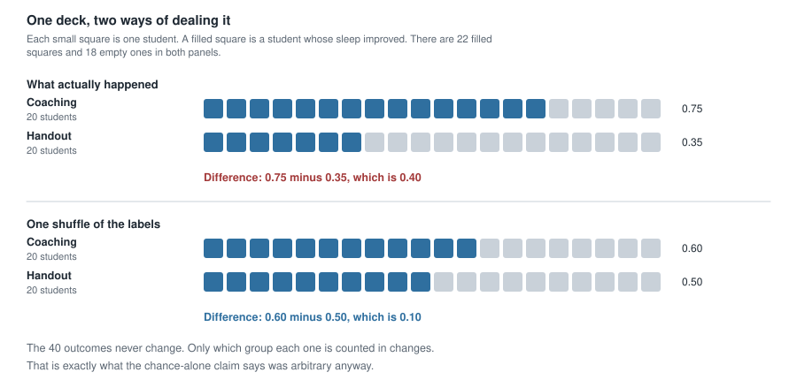
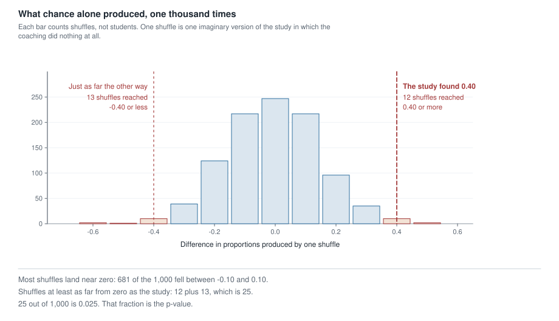
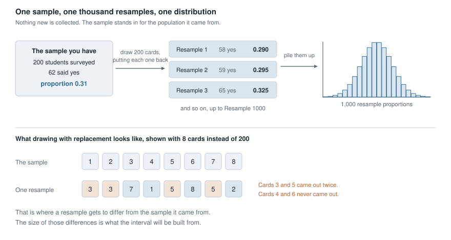
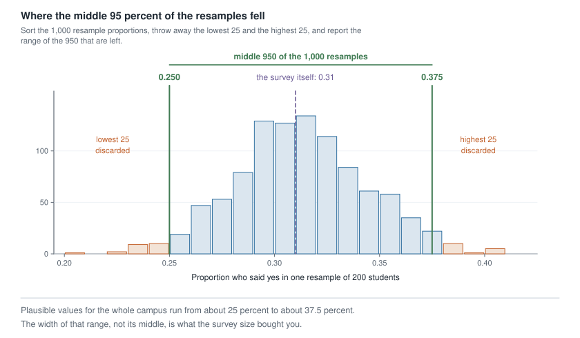

## Where this week starts

Last week every probability was handed to you: a prevalence from health records, a sensitivity and a specificity from a validation study. This week nobody hands you a probability. You have to build one.

Here is the situation the rest of this course is about. You compare two groups and one of them did better. What you do not know is whether a gap that size is unusual. Two groups treated identically still come out different, every time, because the people in them differ, and a coin flip decided who went where. So the honest question is never "is there a difference" — there always is — but "is this difference bigger than the gaps chance manufactures on its own?"

Answering that means knowing what chance alone produces, and no formula arrives this week. Instead you make chance produce its gaps in front of you, hundreds of times, with a deck of cards.

There are two jobs here and two kinds of resampling. The first asks whether chance alone is a workable explanation for what you saw: a randomization test. The second takes your estimate and asks how precise it is: a bootstrap. Both make a mound-shaped picture, and students who blur them spend Week 12 lost.

### Why this matters beyond the exam

A campus health service runs a pilot. Twenty students get a coaching session, twenty get a handout, and the coached group reports better sleep. A director sees 75% against 35%, calls it a success, and funds the session everywhere. But the director never asked how often a gap that big appears when the session does nothing, and without that they cannot tell a program worth scaling from a lucky twenty students.

The opposite mistake is quieter: a small pilot finds nothing, someone concludes the idea does not work, and in truth a study that small would have missed a useful effect most of the time.

## What you will be able to do

- Describe a randomization test as a physical procedure with cards, in the right order, and compute the statistic it tests.
- Read a null distribution: what one bar counts, why the pile sits where it sits, how wide chance made it.
- Turn "how many simulated results were at least as extreme as ours" into a p-value, and state what that number does and does not claim.
- Describe a bootstrap resample, say why the drawing uses replacement, and name what resampling cannot repair.
- Read an interval of plausible values off a bootstrap distribution and write it as a sentence about the population.

## Words worth owning

| Term | What it means in this course |
|---|---|
| Chance-alone claim | The assumption that the grouping made no difference, so any gap is a by-product of who landed where. Its formal name, the null hypothesis, arrives next week. |
| Statistic | The one number that carries the comparison: a difference in proportions or a difference in means. |
| Randomization test | Shuffle the group labels many times, recompute the statistic each time, and see how ordinary the real one looks against that background. |
| Null distribution | The pile those shuffles produce: what chance alone can do, given these group sizes. |
| At least as extreme | The counting rule. Simulated results as far from the centre as yours or further, counted in both directions. |
| p-value | The fraction of simulated chance-alone results at least as extreme as yours. A statement about data under an assumption, never a probability that the assumption holds. |
| Bootstrap resample | A new sample the same size as yours, drawn from your own data with replacement, so some cases appear twice and others not at all. |
| Interval of plausible values | The middle 95% of a bootstrap distribution, read as a range for the population. |

## What chance alone can produce

### Shuffling the labels, told with a deck of cards

Start with the study you will meet in full below. Forty students, twenty coached and twenty handed a printed sheet, and twenty-two of the forty report better sleep four weeks later. The coached group holds fifteen of those twenty-two. How lopsided would that look if the coaching did nothing?

Take that claim seriously. If the session changed nothing, each of the twenty-two who improved would have improved either way, and each of the eighteen who did not would have stayed put. The outcomes were settled before the assignment, and all the coin flip did was decide which label went with which outcome.

Then the labels are stickers, and you may peel them off and stick them back differently. That is the whole procedure:

1. Write the forty outcomes on cards: twenty-two marked improved, eighteen marked not improved.
2. Shuffle, then deal twenty into a coaching pile and twenty into a handout pile.
3. Compute the same statistic you computed on the real study, the coaching proportion minus the handout proportion, then go back to step two.

Notice what is held fixed and what is broken. Held fixed: the forty outcomes and the two group sizes. Broken: the link between a person's outcome and their group — exactly what the chance-alone claim says was never there.

{fig-alt="Two panels of forty small squares. In the top panel the coaching row shows 15 filled squares of 20 and the handout row 7 of 20, a difference of 0.40. After one shuffle the rows show 12 and 10, a difference of 0.10."}

That shuffle put twelve improvements in the coaching pile and ten in the handout pile, a difference of 0.10. Not zero, and it was never going to be zero. Shuffling makes gaps; measuring how big they usually get is the job.

### The null distribution, and how to read it

Pile a thousand shuffled differences up by value and you have a **null distribution**: the distribution of the statistic in a world where the chance-alone claim is true. Read every one you meet in three steps.

**Where is it centred?** Near zero, and it has to be. Shuffling makes the two piles interchangeable, so neither has any reason to run ahead of the other.

**How wide is it?** This is the part students skim and the part that carries the information. Differences of 0.10 either way were entirely ordinary: 681 of the 1,000 shuffles landed between -0.10 and 0.10, and differences of 0.20 turned up 96 times one way and 124 the other. Chance manufactured gaps of twenty percentage points all afternoon. That width is a fact about sample size, not about sleep.

**What is one bar?** One bar counts shuffles, not students. A bar of height 96 means ninety-six imaginary versions of this study — worlds in which the coaching did nothing — came out at 0.20.

{fig-alt="A histogram of 1,000 shuffled differences, mound-shaped and centred on zero, with 681 shuffles between -0.10 and 0.10. Dashed lines mark plus and minus 0.40; only 12 and 13 shuffles reached those shaded outer bars."}

### From a count of shuffles to a p-value

Put the real result on the picture and count. The study found 0.40. Twelve shuffles reached 0.40 or higher. Thirteen reached -0.40 or lower, and those count too: before the study nobody had grounds to insist that coaching could only help, so a gap of 0.40 the other way would have been just as surprising.

$$\frac{12 + 13}{1000} = \frac{25}{1000} = 0.025$$

That fraction is the **p-value**. Say what it means slowly, because the wording is the idea: *if the coaching did nothing, about twenty-five studies in every thousand would produce a gap at least as large as the one we saw.* The assumption is stated up front, and the sentence counts studies rather than people.

Two footnotes. First, the number wobbles, since the simulation is itself a sample; here we can check it, because this deck is small enough for a computer to work out the exact answer instead of sampling deals, and across every possible deal the exact fraction is 0.0248. Second, and more important: 0.025 is small, but a p-value never says how big the effect is. It addresses one question — is chance alone a strained explanation? — and refuses every other.

## Resampling to measure how precise an estimate is

### Why drawing from your own sample works

Change the setting completely: no experiment, no two groups, no chance-alone claim. A campus survey draws 200 students at random and asks whether they skipped a meal in the past week because of cost. Sixty-two say yes, so the estimate of the campus proportion is 62 out of 200, which is 0.31.

The estimate is not the news. The news is that a different 200 students would have given a different number, and you need to know by how much. If a second survey could easily have returned 0.24 or 0.38, then quoting "31%" misleads people.

You cannot run a hundred more surveys. Your one sample of 200 is the best available picture of the campus, so treat it as a stand-in and take the extra samples from it. Put the 200 responses in a bag, 62 marked yes and 138 marked no. Draw one out, record it, put it back, and repeat until you have drawn 200. Compute that resample's proportion, then do it all again, a thousand times.

Two features of that recipe do the real work. **Put the card back**, because without replacement you would draw all 200 cards and get your original sample back every time, so every resample would give 0.31. And **draw the same number**, because resamples of 50 would bounce far more than real surveys of 200 do.

{fig-alt="A left-to-right schematic: a sample of 200 students with 62 yes, an arrow for drawing 200 cards with replacement, three resamples giving 0.290, 0.295 and 0.325, and a mound-shaped pile of 1,000 resample proportions."}

One warning, and it is where the honest limits sit. **The bootstrap measures precision, not accuracy.** If the survey reached only the most engaged students, every resample inherits that skew and what you get is a narrow, confident, wrong range. Week 2's questions about how the data came to exist come first, as they always did.

### Reading the middle 95 percent

A thousand resamples give a thousand proportions. Sort them, throw away the lowest 25 and the highest 25, and report the range of the 950 that remain. Because 950 out of 1,000 is 95%, that range is a **95% interval** — a percentile interval, since its endpoints are percentiles of the bootstrap distribution. Here the cut points landed at 0.250 and 0.375.

{fig-alt="A mound-shaped histogram of 1,000 bootstrap proportions centred near 0.31. Green lines at 0.250 and 0.375 bracket the middle 950 resamples; the shaded outer bars are the lowest 25 and highest 25, which were discarded."}

Be careful with the 95. It does **not** mean there is a 95% probability that the campus proportion lies between 0.250 and 0.375. That proportion is a fixed number, either inside the range or not. The 95 describes the procedure. If many teams each drew their own random sample of 200 and each built an interval this way, about 95 in every 100 of those intervals would contain the true campus value. You hold one of them and do not get to know which kind.

## Worked example — a sleep-coaching session and forty students

**Setting.** A campus health service recruits 40 students who sleep badly. A coin flip assigns 20 to a 15-minute coaching session and 20 to a printed sheet carrying the same advice. Four weeks later each reports whether their sleep improved.

**Step 1. Build the table and check its margins.**

| | Improved | Did not improve | Total |
|---|---|---|---|
| Coaching | 15 | 5 | 20 |
| Handout | 7 | 13 | 20 |
| Total | 22 | 18 | 40 |

Rows: 15 and 5 make 20, and 7 and 13 make 20. Columns: 15 and 7 make 22, and 5 and 13 make 18. Everything reaches 40, so the cells can be trusted.

**Step 2. Choose the statistic and compute it.** The outcome is a yes or no, so compare proportions.

$$\hat{p}_{\text{coaching}} - \hat{p}_{\text{handout}} = \frac{15}{20} - \frac{7}{20} = 0.75 - 0.35 = 0.40$$

The hats mean "estimated from a sample". In words: forty more improvements per hundred students in the coached group.

**Step 3. State the chance-alone claim in words.** The session made no difference: the 22 who improved would have improved either way, and the coin flip only sorted them.

**Step 4. Shuffle, once by hand and then a thousand times by machine.** Forty cards, 22 improved and 18 not, dealt 20 and 20. The first shuffle gave the coaching pile 12 improvements and the handout pile 10, so 0.60 minus 0.50, which is 0.10. Across the full thousand the differences cluster on zero.

**Step 5. Count what is at least as extreme, then divide.** Twelve shuffles reached 0.40 or more and thirteen reached -0.40 or less, so the p-value is 25 out of 1,000, which is 0.025.

**Checking the arithmetic.** The twelve bar heights are 2, 1, 10, 39, 124, 217, 247, 217, 96, 35, 10 and 2, which add to 1,000, so no shuffle went missing. The left tail is 2 plus 1 plus 10, which is 13; the right tail is 10 plus 2, which is 12.

**What it means in context.** If the session did nothing, a gap this large would appear in about 25 of every 1,000 runs of this study, roughly one in forty. That is uncomfortable enough for the chance-alone story that a reasonable person stops leaning on it. And because students were randomly assigned, a causal reading is available here in a way it was not in Weeks 6 and 7.

Now the restraint, because the p-value said nothing about size. Resample the two groups the bootstrap way, 20 outcomes with replacement from each, and the middle 95% of the resulting differences runs from about 0.10 to about 0.65 — between ten and sixty-five extra improvements per hundred students. That range holds both "barely worth booking the room" and "rebuild the service around it", and it belongs beside the p-value.

### The same reasoning, transferred

Same logic, a numerical outcome. A clinic asks 12 volunteers with mildly raised resting heart rates to sit still for five minutes. Six, chosen at random, follow a guided breathing exercise; the other six sit quietly. Each person's drop in resting heart rate is recorded in beats per minute.

The breathing drops are 8, 5, 11, 6, 9 and 9, which sum to 48, so the mean drop is 8. The quiet drops are 4, 2, 7, 3, 5 and 3, which sum to 24, so the mean drop is 4. The difference in means is 4 beats per minute.

Now the same steps. Write the twelve drops on twelve cards, which carry numbers instead of words. Shuffle, deal six and six, recompute the difference in means. A thousand shuffles produced a gap of 4 or more, one way or the other, twelve times, so 0.012. And twelve cards split into groups of six in only 924 ways, so a computer can check every split; exactly 12 of the 924 are at least as extreme, which is 0.013.

What stayed the same: the chance-alone claim, the shuffling, the counting rule, the division. What changed: the outcome is a measurement, so the statistic is a difference in means rather than a difference in proportions.

## Second worked example — how many students skip meals, and how precisely we know it

**Setting.** A campus food-security committee needs a defensible number for how many students go without meals for financial reasons. A random sample of 200 enrolled students is contacted, and 62 report skipping a meal in the past week because of cost.

**Step 1. Name the statistic and compute it.**

$$\hat{p} = \frac{62}{200} = 0.31$$

**Step 2. Notice that the question has changed shape.** No group labels, no chance-alone claim, nothing to shuffle between. What the committee needs is how far from 0.31 the truth could reasonably sit.

**Step 3. Build the bag and draw one resample.** Two hundred cards, 62 yes and 138 no. Draw, record, replace, repeat until 200 cards have been drawn. The first resample came out with 58 yes cards, a proportion of 0.29 — close to 0.31 but not equal to it, which is the point.

**Step 4. Do it a thousand times, then trim.** The proportions pile into a mound whose average came out at 0.310, which is no surprise, since every resample is drawn from a bag that is 31% yes. The centre carries no new information; the **spread** is what you came for. Set aside the lowest 25 and the highest 25, and the surviving 950 run from 0.250 to 0.375.

**Step 5. Write the sentence a committee can use.** "In a random sample of 200 students, 31% reported skipping a meal in the past week because of cost. Plausible values for the student body as a whole run from about 25% to about 37.5%." On a campus of 12,000 students, that is roughly 3,000 to 4,500 people.

**Checking the arithmetic.** 62 out of 200 is 31 out of 100, so 0.31 exactly. The cut points sit at whole numbers of cards, since $0.250 \times 200 = 50$ and $0.375 \times 200 = 75$. And a check from outside the simulation: the standard formula for a proportion, which Week 12 will supply, gives 0.246 to 0.374. Two very different methods agree to within a few thousandths.

**What it means in context.** The width is the finding. A survey of 200 cannot pin a share this size down more tightly than a band twelve and a half percentage points wide, and a committee reporting "31% of students skip meals" without that band claims a precision it does not have. The fix for a tighter number is more students surveyed, not more resamples.

## The misreading to avoid

Here is the sentence students actually say: *"The p-value is 0.025, so there is only a 2.5% chance that the coaching did nothing."* Almost everyone says it once, so take it apart rather than calling it wrong.

Every one of those thousand shuffles was carried out inside a world where the coaching did nothing; that assumption is what gave us permission to shuffle. A simulation run under an assumption can report how data behave given the assumption. It cannot turn around and report on the assumption. The p-value is the fraction of chance-alone worlds that produce data as striking as yours. The sentence above asks for the fraction of worlds-that-produced-data-like-yours in which chance was the whole story. Different fractions, different denominators.

You met this swap in Week 10. Sensitivity asked "of the people who have the condition, how many test positive", and predictive value asked "of the people who tested positive, how many have the condition" — one cell of one table divided by two different totals. Put "chance alone was the whole story" where "has the condition" was, and "this study produced a gap of 0.40" where "tested positive" was, and you have this week's error exactly.

The second misreading runs the other way: *"The p-value came out at 0.30, so the program does nothing."* With twenty per group, chance routinely produced gaps of 0.20 by itself, so a study that small can miss a real effect easily. Failing to show that chance is strained is not the same as showing that nothing is there. The honest report is "this study could not distinguish the program from chance", delivered with an interval showing how much room a real effect still has.

The third is aimed at the bootstrap: *"Drawing the same student twice is making up data."* No information is being added. The bag stands in for the population, and every draw from it is a legitimate draw from that stand-in.

The fourth follows students into Week 12, so keep a rule for it. Shuffling labels *between* groups tests whether chance suffices, and that picture is centred on zero. Drawing with replacement *inside* one sample measures precision, and that picture is centred on your estimate.

## Practice on your own

Nothing here is collected. These are for a quiet half hour with a calculator.

1. **A different two-group study.** A campus writing centre tries a new drop-in format. Of the 15 students who used it, 11 said it helped; of the 15 who used the old format, 6 said it helped. Compute the difference in proportions, then describe the deck you would shuffle.

2. **Reading somebody else's null distribution.** A study produced a difference in means of 2.6 units, and 500 shuffles gave 9 results of 2.6 or more and 7 of -2.6 or less. Compute the fraction at least as extreme, then write one sentence beginning "If the grouping made no difference" that says what the fraction describes.

3. **A bootstrap by hand.** Eight students reported these minutes of exercise yesterday: 10, 25, 0, 40, 15, 30, 20, 20. Compute the sample mean, then build five resamples of size eight by drawing with replacement and compute each resample mean. What does the spread of those five tell you that the sample mean did not?

4. **Four sentences about one interval.** A survey of 400 adults estimates that 0.18 of them delayed filling a prescription because of cost, with a bootstrap interval from 0.145 to 0.216. For each sentence, decide whether you would put your name to it, and say why.
   - "Eighteen percent of all adults delayed filling a prescription."
   - "There is a 95% probability that the true proportion is between 0.145 and 0.216."
   - "Values from about 0.145 to about 0.216 are plausible for the population this sample came from."
   - "This shows that cost is a barrier to taking medication."

5. **Which simulation fits?** Say whether a randomization test or a bootstrap is right, and describe one repetition: a city wants a range for the proportion of households with no car; a lab compares mean germination time under two lighting conditions.

## Where to read more

- The randomization half of this week is [Hypothesis testing with randomization](https://openintrostat.github.io/ims/foundations-randomization.html). Work its examples with the pictures beside you rather than the formulas.
- The bootstrap half is [Confidence intervals with bootstrapping](https://openintrostat.github.io/ims/foundations-bootstrapping.html), which develops "percentile interval" carefully.
- [StatKey](https://www.lock5stat.com/statkey) is the tool used in class on Wednesday. Its randomization and bootstrap pages run a thousand shuffles while you watch, worth doing slowly at least once.
- The [Introductory Statistics for the Life and Biomedical Sciences](https://www.openintro.org/book/biostat) supplement gives these ideas a health framing, and [Introduction to Modern Statistics](https://openintrostat.github.io/ims) is browsable whole.
- Course pages: the [course home page](../index.qmd), the [schedule](../schedule.qmd), and the [resources page](../resources/index.qmd). Last week's notes are at [Week 10](week10-probability-risk-diagnosis.qmd).

## Where this goes next

Everything you did this week was honest and slow, and before there was a computer on every desk nobody could afford a thousand shuffles. So statisticians described mathematically what a null distribution would look like if you did all that shuffling — smooth curves whose width follows from the sample sizes — and used those instead. Week 12 hands you that machinery: null and alternative claims written formally, a test statistic measured in units of typical variation, a p-value read off a curve, and the two kinds of error a decision can make.

Read it as a shortcut, not a new subject. Every picture in [Week 12](week12-classical-hypothesis-testing.qmd) is a smooth version of one you built by hand this week, and when a formula's conditions fail the shuffling still works while the formula quietly stops being trustworthy. The full sequence is on the [course home page](../index.qmd).
