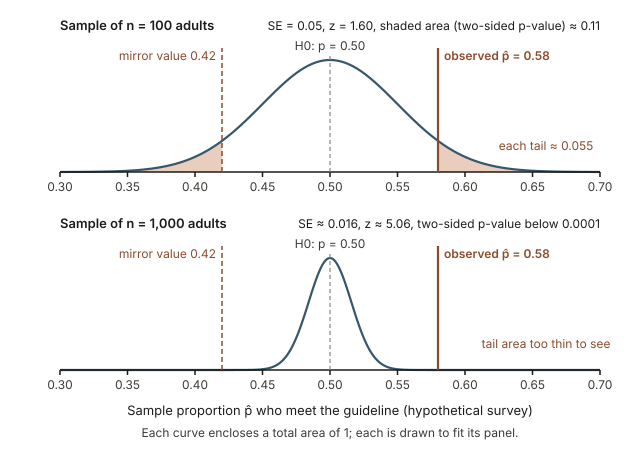
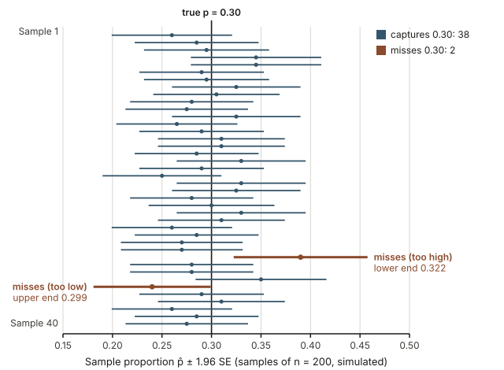
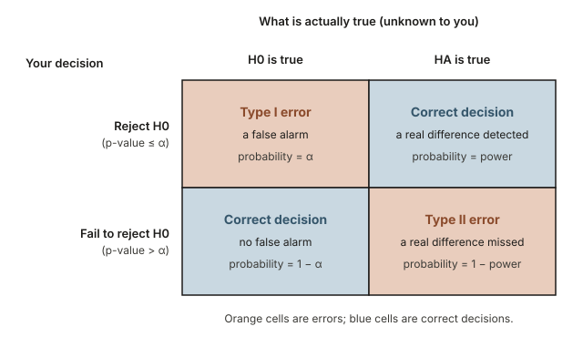
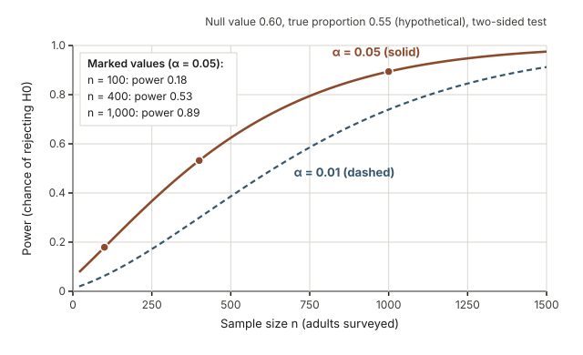
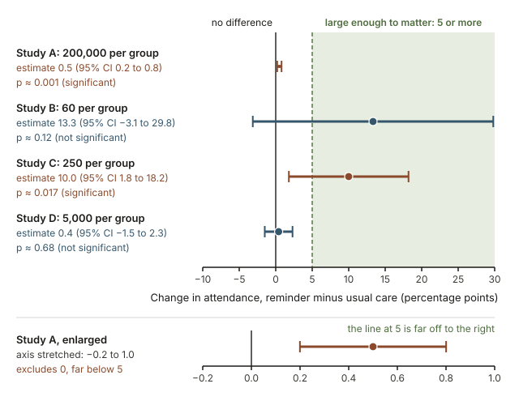

## Warm-up: does 58 out of 100 settle the question?

A city health office (hypothetical) says that half of its adults meet the weekly physical-activity guideline. You survey a random sample of 100 adults in the city and find that 58 meet it, so $\hat{p} = 58/100 = 0.58$.

Before calculating anything, write down your first reaction to two questions:

1. Does 58 out of 100 make you doubt the city's figure of 50%?
2. Would you feel differently if 580 of 1,000 surveyed adults met the guideline, the same 58%?

In [Week 11](week11-simulation-based-inference.qmd) you would have settled this by simulation. This week replaces the simulated samples with a smooth curve; by the end of the section on p-values you will have a precise reply to each question, and the two replies differ.

## Why a formula can stand in for the simulation

Reports of medical trials, health surveys and policy evaluations rarely show a simulation. They show sentences such as "attendance rose by 10 percentage points (95% confidence interval 2 to 18; p = 0.02)." This week shows what each of those numbers says and when a writer leans on it too hard. The formulas need only a calculator and a table, and they show why larger samples give sharper evidence, but they hold only under conditions you must check.

## What you will be able to do

By the end of this week you can:

- state null and alternative hypotheses in words and in symbols before looking at the data;
- check the conditions for a normal model and compute a standard error;
- compute a $z$ test statistic, find its p-value with a table or StatKey, and interpret it in context;
- build a 95% confidence interval as estimate $\pm$ 1.96 SE and explain what "95% confident" means;
- explain why a two-sided test and a confidence interval tell a consistent story;
- describe Type I errors, Type II errors and power in plain words;
- separate statistical significance from practical importance, and explain why a p-value is not proof.

## Words to know this week

| Term | Meaning this week |
|---|---|
| Null hypothesis $H_0$ | The skeptical claim of no change or no difference. It names one value for the parameter, such as $p = 0.50$. |
| Alternative hypothesis $H_A$ | What the investigator suspects instead, such as $p \ne 0.50$, chosen before seeing the data. |
| Null value $p_0$ | The value of the population proportion named in $H_0$. |
| Standard error (SE) | The standard deviation of a statistic across repeated samples: its typical sample-to-sample variation. |
| Test statistic $z$ | How many standard errors the observed statistic lies from the null value. |
| p-value | Assuming $H_0$ is true, the probability of a test statistic at least as extreme as the one observed. |
| Significance level $\alpha$ | A cutoff for calling a p-value small, chosen in advance; often 0.05. |
| Confidence interval | A range of plausible parameter values, from a method with a known long-run capture rate. |
| Type I error | Rejecting $H_0$ when it is true: a false alarm. |
| Type II error | Failing to reject $H_0$ when $H_A$ is true: a missed difference. |
| Power | The probability of rejecting $H_0$ when a particular alternative is true. |
| Practical significance | Whether a difference is large enough to matter in the real setting. |

## From simulation to a mathematical model

In Week 11 the null distribution was a dot plot of simulated statistics, and it was roughly bell-shaped. The normal model is the smooth curve that describes that shape; once you know its center and spread, you can find tail areas without simulating.

### Stating the hypotheses before looking at the data

A test weighs two claims about a parameter, a number that describes the whole population, such as the proportion $p$ of all the city's adults who meet the guideline. The null hypothesis names one value; the alternative is what you conclude if the data argue strongly against it. For the warm-up:

$$H_0: p = 0.50 \qquad H_A: p \ne 0.50$$

This alternative is **two-sided**: a true proportion either above or below 0.50 would contradict the city. A **one-sided** alternative such as $H_A: p > 0.50$ fits only a question that was one-directional from the start; choosing the direction after seeing the data overstates the evidence. Hypotheses are about parameters ($p$, $\mu$), never about statistics ($\hat{p}$, $\bar{x}$). You already know that $\hat{p} = 0.58$; the question is what that says about $p$.

### The normal model for a sample proportion

Sample proportions vary from one random sample to the next. That variation follows a normal curve closely when two conditions hold:

- **Independence:** the data come from a random sample or a randomized experiment, and one person's response does not affect another's.
- **Success-failure condition:** you expect at least 10 successes and at least 10 failures. In a test, check $n p_0 \ge 10$ and $n(1 - p_0) \ge 10$.

Then $\hat{p}$ is approximately normal, centered at the true $p$, with standard error

$$\text{SE} = \sqrt{\frac{p(1-p)}{n}}.$$

A test assumes $H_0$ is true, so it puts $p_0$ into this formula. For the warm-up, $100 \times 0.50 = 50$ successes and 50 failures are expected, and

$$\text{SE} = \sqrt{\frac{0.50 \times 0.50}{100}} = \sqrt{0.0025} = 0.05.$$

With 1,000 adults, $\text{SE} = \sqrt{0.25/1000} \approx 0.0158$. Ten times the data shrinks the standard error by a factor of $\sqrt{10} \approx 3.16$, not 10: precision grows with the square root of the sample size.

A sample mean behaves in a similar way. It is approximately normal, centered at $\mu$, with standard error $\sigma/\sqrt{n}$, which you estimate by $s/\sqrt{n}$. Small samples call for a slightly wider curve, the t distribution; the transfer example shows why that hardly matters for a large sample.

### The z test statistic: counting standard errors

A test statistic measures the distance from the null value in units of standard error:

$$z = \frac{\text{observed statistic} - \text{null value}}{\text{SE}}, \qquad \text{so for one proportion} \quad z = \frac{\hat{p} - p_0}{\sqrt{p_0(1-p_0)/n}}.$$

For the warm-up, $z = (0.58 - 0.50)/0.05 = 0.08/0.05 = 1.60$: the sample sits 1.6 standard errors above the claimed value. With 1,000 adults, $z = 0.08/0.0158 \approx 5.06$. Every $z$ is judged against the same standard normal curve, with center 0 and standard deviation 1, on which values within about 2 of zero are common and values beyond 3 are rare.

### The p-value and how to read it

The **p-value** is the probability, computed assuming $H_0$ is true, of a test statistic at least as extreme as the one observed. For a two-sided test it is the total area in both tails, beyond $z$ and beyond $-z$.

{fig-alt="Two normal curves centered at 0.50. For n = 100 (SE 0.05) the tails beyond 0.42 and 0.58 are shaded, total area about 0.11. For n = 1,000 (SE about 0.016) the curve is narrow and 0.58 is about 5 SE out, area below 0.0001."}

With 100 adults each shaded tail holds about 0.055, so the p-value is about 0.11. In words: according to the normal model, if half of the city's adults met the guideline, about 11% of random samples of 100 would land 8 or more percentage points from 50%, in one direction or the other. That is not unusual, so this sample is not convincing evidence against the city. With 1,000 adults the p-value is below 0.0001: if the city were right, a count 80 or more away from 500, in either direction, would almost never happen. The same 58% is weak evidence in the small sample and very strong evidence in the large one.

A basic calculator cannot find normal areas, so use the table below or StatKey: open **Theoretical Distributions > Normal**, keep mean 0 and standard deviation 1, choose the two-tail option, and set the cutoff to your $z$. StatKey shows the area in each tail; add the two tail areas (or double one) to get the two-sided p-value.

| Size of $z$ (ignore the sign) | Two-sided p-value | Area in one tail |
|---|---|---|
| 1.00 | 0.317 | 0.159 |
| 1.50 | 0.134 | 0.067 |
| 1.645 | 0.100 | 0.050 |
| 1.96 | 0.050 | 0.025 |
| 2.33 | 0.020 | 0.010 |
| 2.576 | 0.010 | 0.005 |
| 3.00 | 0.0027 | 0.0013 |
| 3.29 | 0.0010 | 0.0005 |

For $z = 1.60$, the table brackets the two-sided p-value between 0.100 and 0.134; StatKey shows about 0.055 in each tail, so the p-value is about 0.110.

::: {.callout-note}
The normal curve is an approximation. For the warm-up with 100 adults, a simulation gives a p-value of about 0.13 rather than 0.11. Differences of that size change no conclusion on this page.
:::

### Significance level and the decision

Choose a **significance level** $\alpha$ before looking at the data; 0.05 is the usual choice. If the p-value is at most $\alpha$, **reject $H_0$**: the data would be hard to explain by chance variation alone if $H_0$ were true. Otherwise, **fail to reject $H_0$**: the data are consistent with it.

Say "fail to reject," never "accept." A jury's verdict of "not guilty" does not declare the defendant innocent; it says the evidence fell short. The survey of 100 adults fails to reject $H_0$, yet the city's true proportion could still be 0.55 or 0.60: the sample is too small to tell. Always finish with a sentence in context that gives the direction and size of the result.

## Confidence intervals from the normal model

A test asks whether one value of the parameter is believable. A confidence interval asks which values are.

### Estimate plus or minus 1.96 standard errors

About 95% of the area under any normal curve lies within 1.96 standard deviations of its center, so in about 95% of samples $\hat{p}$ lands within 1.96 SE of the true $p$. Turned around, that gives the interval

$$\hat{p} \pm 1.96 \times \text{SE}, \qquad \text{where} \quad \text{SE} = \sqrt{\frac{\hat{p}(1-\hat{p})}{n}}.$$

With no null value to assume, the standard error uses $\hat{p}$, and the success-failure check uses the observed counts of successes and failures. The quantity $1.96 \times \text{SE}$ is the **margin of error**. For 90% or 99% confidence, replace 1.96 with 1.645 or 2.576; more confidence needs a wider interval.

For the warm-up, $\text{SE} = \sqrt{0.58 \times 0.42/100} = \sqrt{0.002436} \approx 0.0494$, and the margin of error is $1.96 \times 0.0494 \approx 0.097$, so the interval runs from $0.58 - 0.097 = 0.483$ to $0.58 + 0.097 = 0.677$. With 1,000 adults, $\text{SE} = \sqrt{0.0002436} \approx 0.0156$, the margin is $1.96 \times 0.0156 \approx 0.031$, and the interval runs from 0.549 to 0.611.

### What 95% confidence means

The 95% describes the **method**, not any one interval. If the study were repeated many times, about 95% of the intervals would capture the true parameter. The figure shows 40 intervals, each from its own simulated random sample of 200, drawn from a hypothetical population whose true proportion is 0.30.

{fig-alt="Forty intervals, each a sample proportion plus or minus 1.96 SE from a simulated sample of 200. A vertical line marks the true proportion 0.30. Thirty-eight intervals cross it; two, in orange, miss it, one only just (upper end 0.299)."}

Here 38 of the 40 intervals cross 0.30. The two misses came from samples with an unusually high proportion (78 of 200, or 0.39) and a low one (48 of 200, or 0.24), whose interval stops just short of 0.30 at 0.299. A real study produces just one interval, and you never learn whether it is a hit or a miss. So "we are 95% confident that $p$ is between 0.483 and 0.677" means that the interval came from a method that captures $p$ about 95% of the time. It does not mean that 95% of the adults, or 95% of future sample proportions, fall in that range.

### Tests and intervals tell a consistent story

A two-sided test at $\alpha = 0.05$ rejects $H_0$ when the null value lies outside the 95% interval and fails to reject when it lies inside. With 100 adults, 0.50 lies inside 0.483 to 0.677 (p about 0.11); with 1,000, it lies outside 0.549 to 0.611 (p below 0.0001). The interval adds what the test cannot: how large the difference might be. For a proportion, the test puts $p_0$ in the standard error while the interval uses $\hat{p}$, so in rare borderline cases the two can disagree; then report both and call the evidence borderline.

## Worked example 1: has the county flu-vaccination rate changed?

**The question.** A county health office (hypothetical) has long used 60% as the share of adults who get a seasonal flu vaccine. This season a random sample of 400 adults finds 214 vaccinated. Is there evidence that the county's rate is no longer 60%?

**Step 1: hypotheses.** Let $p$ be the proportion of all adults in the county vaccinated this season. There was no reason in advance to look only for a rise or only for a drop, so the test is two-sided:

$$H_0: p = 0.60 \qquad H_A: p \ne 0.60$$

Use a significance level of $\alpha = 0.05$, chosen before looking at the data.

**Step 2: conditions.** The sample is random. Under $H_0$ the expected counts are $400 \times 0.60 = 240$ vaccinated and $400 \times 0.40 = 160$ not vaccinated, both at least 10.

**Step 3: statistic, standard error and z.** The sample proportion is $\hat{p} = 214/400 = 0.535$. Using $p_0$ in the standard error,

$$\text{SE} = \sqrt{\frac{0.60 \times 0.40}{400}} = \sqrt{0.0006} \approx 0.0245, \qquad z = \frac{0.535 - 0.600}{0.0245} = \frac{-0.065}{0.0245} \approx -2.65.$$

**Step 4: p-value.** A $z$ of size 2.65 falls between 2.576 and 3.00 in the table, so the two-sided p-value is between 0.0027 and 0.010; StatKey shows about 0.004 in each tail, so the p-value is about 0.008. If the rate were still 60%, only about 8 in 1,000 random samples of 400 adults would land this far from 0.60.

**Step 5: decision.** The p-value of 0.008 is below $\alpha = 0.05$, so reject $H_0$.

**Step 6: interval.** The sample had 214 vaccinated and 186 not, both at least 10, so use $\hat{p}$ in the standard error:

$$\text{SE} = \sqrt{\frac{0.535 \times 0.465}{400}} = \sqrt{0.000622} \approx 0.0249, \qquad 1.96 \times 0.0249 \approx 0.049.$$

The interval $0.535 \pm 0.049$ runs from 0.486 to 0.584. It lies entirely below 0.60, in agreement with the test.

**Conclusion in context.** The survey gives strong evidence that the county's vaccination rate is no longer 60% (p about 0.008). The rate appears to have fallen, to somewhere between about 48.6% and 58.4%. The survey cannot say why; that question needs other information.

## Worked example 2: does a reminder text raise follow-up attendance?

**The question.** In a hypothetical randomized experiment, a clinic randomly assigned 500 patients who needed a follow-up visit to two groups of 250. One group received a text reminder two days before the visit; the other received usual care. Attendance was 180 of 250 in the reminder group and 155 of 250 in the usual-care group. Does the reminder change attendance, and by how much?

**Step 1: hypotheses.** Let $p_R$ and $p_U$ be the attendance proportions under the reminder and under usual care. A reminder could in principle lower attendance too (for example by annoying patients), and no direction was fixed in advance, so the test is two-sided:

$$H_0: p_R - p_U = 0 \qquad H_A: p_R - p_U \ne 0$$

Use a significance level of $\alpha = 0.05$, chosen before looking at the data.

**Step 2: sample proportions.** $\hat{p}_R = 180/250 = 0.72$ and $\hat{p}_U = 155/250 = 0.62$, a difference of $0.72 - 0.62 = 0.10$, or 10 percentage points.

**Step 3: conditions and the standard error under $H_0$.** Random assignment makes the groups independent and supports a cause-and-effect reading. If $H_0$ is true, both groups share one attendance rate, estimated by pooling them: $\hat{p}_{\text{pool}} = (180 + 155)/500 = 335/500 = 0.67$. The expected counts in each group, $250 \times 0.67 = 167.5$ attending and $250 \times 0.33 = 82.5$ not, are well above 10. Then

$$\text{SE} = \sqrt{0.67 \times 0.33 \times \left(\frac{1}{250} + \frac{1}{250}\right)} = \sqrt{0.2211 \times 0.008} = \sqrt{0.0017688} \approx 0.0421.$$

**Step 4: test statistic and p-value.** The statistic is $z = (0.10 - 0)/0.0421 \approx 2.38$. That falls between 2.33 and 2.576 in the table, so the two-sided p-value is between 0.010 and 0.020; StatKey shows about 0.009 in each tail, and before rounding the two tails total about 0.017. Since 0.017 is below 0.05, reject $H_0$.

**Step 5: interval for the difference.** All four observed counts (180, 70, 155 and 95) are at least 10. For the interval, each group keeps its own proportion:

$$\text{SE} = \sqrt{\frac{0.72 \times 0.28}{250} + \frac{0.62 \times 0.38}{250}} = \sqrt{0.0008064 + 0.0009424} = \sqrt{0.0017488} \approx 0.0418.$$

The margin of error is $1.96 \times 0.0418 \approx 0.082$, so the interval $0.10 \pm 0.082$ runs from 0.018 to 0.182. Zero lies outside it, matching the test.

**Conclusion in context.** In this hypothetical experiment, 72% of patients attended with the reminder and 62% without (p about 0.017). Because patients were randomly assigned, the evidence supports the conclusion that the reminder itself raised attendance. Its size is uncertain: the 95% interval runs from about 2 to 18 percentage points, and a clinic weighing the cost of reminders should notice how small the low end is.

## Transfer: the same reasoning for average nightly sleep

The same steps work for a mean; only the standard error changes.

**The setting.** A hypothetical random sample of 100 students at one university records how long each slept on a recent weeknight: $\bar{x} = 6.8$ hours and $s = 1.1$ hours. Seven hours is often cited as a minimum for adults. Does the mean $\mu$ for all students at this university differ from 7 hours? Test $H_0: \mu = 7$ against $H_A: \mu \ne 7$. Use a significance level of $\alpha = 0.05$, chosen before looking at the data.

**Conditions.** The sample is random, and with 100 students $\bar{x}$ is close to normal unless a dot plot of the sleep times shows extreme outliers.

**Test statistic and p-value.**

$$\text{SE} = \frac{s}{\sqrt{n}} = \frac{1.1}{\sqrt{100}} = \frac{1.1}{10} = 0.11, \qquad T = \frac{6.8 - 7}{0.11} = \frac{-0.2}{0.11} \approx -1.82.$$

For a mean the statistic is called $T$ and is compared with a t distribution, which with 100 observations is nearly identical to the normal curve. A size of 1.82 falls between 1.645 and 1.96 in the table, so the two-sided p-value is between 0.05 and 0.10; software gives about 0.07. That is above 0.05, so fail to reject $H_0$.

**Interval.** $6.8 \pm 1.96 \times 0.11 = 6.8 \pm 0.22$, which runs from 6.58 to 7.02 hours and contains 7, as the test led you to expect.

**Conclusion in context.** The data do not give convincing evidence that these students average something other than 7 hours of sleep on a weeknight (p about 0.07). Nor do they show that the average **is** 7 hours: the plausible values include an average about 25 minutes short of 7 hours.

The table puts the three settings side by side. In every row the test statistic is the estimate minus the null value, divided by SE, and the interval is the estimate plus or minus a multiplier times SE.

| Setting | Estimate | SE for a test | SE for an interval |
|---|---|---|---|
| One proportion | $\hat{p}$ | $\sqrt{p_0(1-p_0)/n}$ | $\sqrt{\hat{p}(1-\hat{p})/n}$ |
| Difference of two proportions | $\hat{p}_1 - \hat{p}_2$ | $\sqrt{\hat{p}_{\text{pool}}(1-\hat{p}_{\text{pool}})(1/n_1 + 1/n_2)}$ | $\sqrt{\hat{p}_1(1-\hat{p}_1)/n_1 + \hat{p}_2(1-\hat{p}_2)/n_2}$ |
| One mean | $\bar{x}$ | $s/\sqrt{n}$ | $s/\sqrt{n}$ |

## Decision errors: two ways a test can go wrong

Even when every calculation is right, a decision based on a sample can be wrong.

### Type I and Type II errors

{fig-alt="A 2 by 2 table. Columns: H0 true, HA true. Rows: reject H0, fail to reject H0. Rejecting a true H0 is a Type I error (probability α). Failing to reject when HA is true is a Type II error. The other two cells are correct decisions."}

- A **Type I error** rejects $H_0$ when it is true: a false alarm. When $H_0$ is true, the probability of this error is $\alpha$. At $\alpha = 0.05$, about 1 in 20 tests of a true null hypothesis rejects it by chance alone.
- A **Type II error** fails to reject $H_0$ when $H_A$ is true: a real difference goes undetected.

These mirror the false positives and false negatives of diagnostic testing in [Week 10](week10-probability-risk-diagnosis.qmd). In Worked example 1, a Type I error would declare a change when the vaccination rate really stayed at 60%, perhaps sending outreach money where it is not needed. A Type II error would miss a real drop. Lowering $\alpha$ makes false alarms rarer but missed differences more common, so the choice of $\alpha$ should reflect which error costs more in the setting at hand.

### Power: the chance of detecting a real difference

**Power** is the probability of rejecting $H_0$ when a particular alternative is true; it equals 1 minus the probability of a Type II error for that alternative. Suppose the county's true vaccination rate had fallen from 60% to 55% (hypothetical). The figure shows, from the normal model, how often a two-sided test of $H_0: p = 0.60$ would detect that drop for surveys of different sizes.

{fig-alt="Line chart of power against sample size for a two-sided test of p = 0.60 when the true proportion is 0.55. At α = 0.05 power is about 0.18 at n = 100, 0.53 at n = 400 and 0.89 at n = 1,000. The dashed α = 0.01 curve is lower throughout."}

At $\alpha = 0.05$, a survey of 100 adults detects the drop only about 18% of the time. With 400 adults, the size of the survey in Worked example 1, power is about 0.53, close to a coin flip; with 1,000 adults it is about 0.89. At $\alpha = 0.01$ power is lower everywhere, about 0.30 with 400 adults. Worked example 1 did reject with 400 adults because its sample happened to fall 6.5 percentage points below 60%; power measures, before any data exist, how often a study of that size would succeed.

Power rises with the sample size, the size of the true difference, and $\alpha$; studies are usually planned for power of at least 0.80 at the smallest difference that would matter. With only an 18% chance of detection, a small study's "not significant" says little.

## Statistical versus practical significance

"Statistically significant" means only that the p-value fell at or below $\alpha$. It does not mean large, important or useful. The figure shows four hypothetical studies of reminder programs, each measuring the change in follow-up attendance. Suppose a clinic considers a program worth its cost only if it raises attendance by at least 5 percentage points, the shaded region.

{fig-alt="Intervals for the change in attendance in percentage points, shaded at 5 or more as large enough to matter. A: 0.5 (0.2 to 0.8), p ≈ 0.001. B: 13.3 (−3.1 to 29.8), p ≈ 0.12. C: 10.0 (1.8 to 18.2), p ≈ 0.017. D: 0.4 (−1.5 to 2.3), p ≈ 0.68."}

### A tiny difference in a very large study

Study A had 200,000 patients per group: 62.5% attended with reminders and 62.0% without, a difference of 0.5 percentage points. With groups that large the standard error is only about 0.0015, which puts $z$ at about 3.3 and the p-value near 0.001. The evidence for a nonzero effect is strong and the interval is narrow, 0.2 to 0.8 percentage points (the lower strip of the figure enlarges it), yet the whole interval is far too small to be worth the cost. With enough data, almost any nonzero difference becomes statistically significant.

### A large estimate from a small study

Study B had only 60 patients per group: 45 (75%) attended with reminders and 37 (about 61.7%) without. Its estimate of 13.3 percentage points is the largest of the four, yet the p-value is about 0.12 and the interval runs from $-3.1$ to $29.8$ percentage points. The study can rule out neither no effect nor a very large one. Here "not significant" means "not enough information," not "no effect."

### Studies C and D: reading each interval against the threshold

Study C is Worked example 2: significant, with an interval from 1.8 to 18.2 percentage points that lies mostly, though not entirely, above the threshold. Study D, with 5,000 patients per group, is not significant (p about 0.68), but its narrow interval, $-1.5$ to $2.3$ percentage points, sits well below 5: good evidence that any effect is too small to matter. Report the estimate and its interval in meaningful units alongside the p-value, and judge size with knowledge of the setting.

## A common misreading: the p-value is the chance that the null is true

The most common p-value mistake is to read "p = 0.017" as "a 1.7% chance that $H_0$ is true," or as "a 98.3% chance that the reminder works." Both readings are wrong. The p-value is computed by *assuming* $H_0$ is true and asking how surprising the data would be: it is a probability about the data, given the hypothesis. The misreading flips it into a probability about the hypothesis, given the data. [Week 10](week10-probability-risk-diagnosis.qmd) showed the same flip: the chance of a positive test given no disease is not the chance of no disease given a positive test. Whether a surprising result reflects a real effect also depends on how plausible that effect was before the study, which the p-value does not measure.

A correct reading of Worked example 2 is: "If reminders made no difference, a gap of 10 percentage points or more, in either direction, would turn up in only about 1.7% of experiments like this one."

### Why a p-value is not proof

Even a correctly read small p-value is evidence, not proof:

- **Chance.** At $\alpha = 0.05$, about 1 in 20 tests of a true null hypothesis still comes out "significant."
- **Bias.** A p-value accounts only for the variation from random sampling or random assignment. A biased sample, or confounding in an observational comparison (see [Week 6](week06-confounding.qmd)), can give a tiny p-value for a misleading difference.
- **Replication.** Trust grows when independent studies point the same way, the subject of [Week 14](week14-meta-analysis-forest-plots.qmd).

In the other direction, a large p-value is not proof of no effect; the study may simply have had low power.

## Practice questions (ungraded)

Explain your reasoning in words as well as numbers.

1. A hospital's 30-day readmission rate has long been 15% (hypothetical). After a new discharge program starts, 36 of a random sample of 300 recent patients are readmitted. Carry out a two-sided test at $\alpha = 0.05$, from hypotheses to a conclusion in context. *What to look for:* use $p_0 = 0.15$ in the standard error, and ask whether a before-and-after comparison like this could show that the program caused any change.
2. A hypothetical trial reports a 95% confidence interval of 0.03 to 0.11 for the recovery rate with a new treatment minus the recovery rate with the standard one. Explain what "95% confident" means here. Would a two-sided test of no difference at $\alpha = 0.05$ reject $H_0$? How can you tell without calculating?
3. An inspector tests $H_0$: a town's tap water meets the safety standard for lead, against $H_A$: it does not. Describe a Type I error and a Type II error in this setting. Which would you most want to avoid, and would that push you toward a larger or a smaller $\alpha$?
4. In a hypothetical randomized experiment with 400,000 people, those given a phone app averaged 40 more daily steps than those without it, with p = 0.0002. Write two sentences for a general reader that report both the strength of the evidence and the size of the effect.
5. Rewrite this sentence so that it is correct: "The p-value was 0.03, so there is only a 3% chance that the new policy had no effect."
6. Two teams test the same reminder program, one with 60 patients per group and one with 600, and neither finds a significant difference. Which result is stronger evidence that the program has little effect? *What to look for:* compare the widths of the intervals you would expect.

## Read further on tests and intervals

- *Introduction to Modern Statistics*: [Chapter 13, Inference with mathematical models](https://openintrostat.github.io/ims/foundations-mathematical.html) covers the normal model, standard errors, $z$ statistics and intervals; [Chapter 14, Decision errors](https://openintrostat.github.io/ims/foundations-errors.html) covers error types and power; [Chapter 16, Inference for a single proportion](https://openintrostat.github.io/ims/inference-one-prop.html) matches Worked example 1. For Worked example 2 and the transfer example, see [Chapter 17, Inference for comparing two proportions](https://openintrostat.github.io/ims/inference-two-props.html) and [Chapter 19, Inference for a single mean](https://openintrostat.github.io/ims/inference-one-mean.html). The book shows R code in places; you can skip the code and read the output and explanations.
- [StatKey](https://www.lock5stat.com/statkey/): **Theoretical Distributions > Normal** finds tail areas for any $z$. To connect back to Week 11, run **Randomization Hypothesis Tests > Test for Single Proportion** with the warm-up numbers; the simulated p-value will be about 0.13, a little above the normal model's 0.11 (see the note after the table).
- Optional, for health examples: [Introductory Statistics for the Life and Biomedical Sciences](https://www.openintro.org/book/biostat/), Chapter 4, Foundations for inference.

## Where this goes next

- Back: [Week 11: Simulation-based inference](week11-simulation-based-inference.qmd) built the null-distribution logic that this week turns into formulas.
- Next: [Week 13: Categorical outcomes](week13-categorical-outcomes.qmd) applies these tools to rates, proportions and two-way tables.
- Later: [Week 14: Meta-analysis and forest plots](week14-meta-analysis-forest-plots.qmd) lines up confidence intervals from many studies, much like the four reminder studies above.
- See the [notes overview](index.qmd) for all weeks and the [course schedule](../schedule.qmd) for the order of the weeks.
