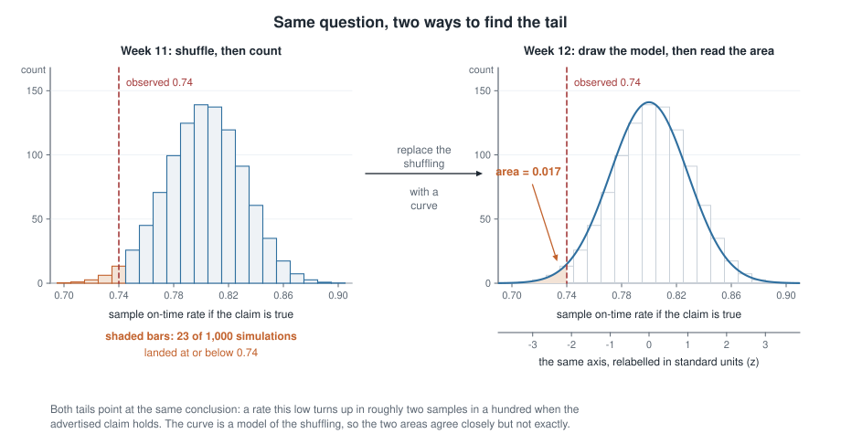
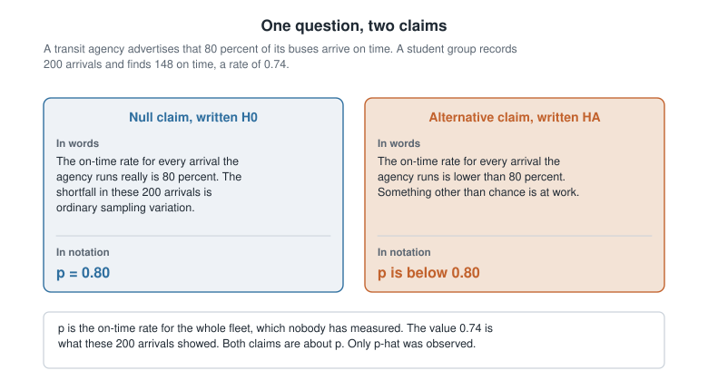
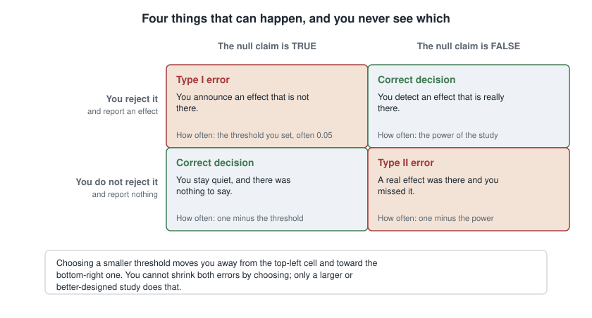
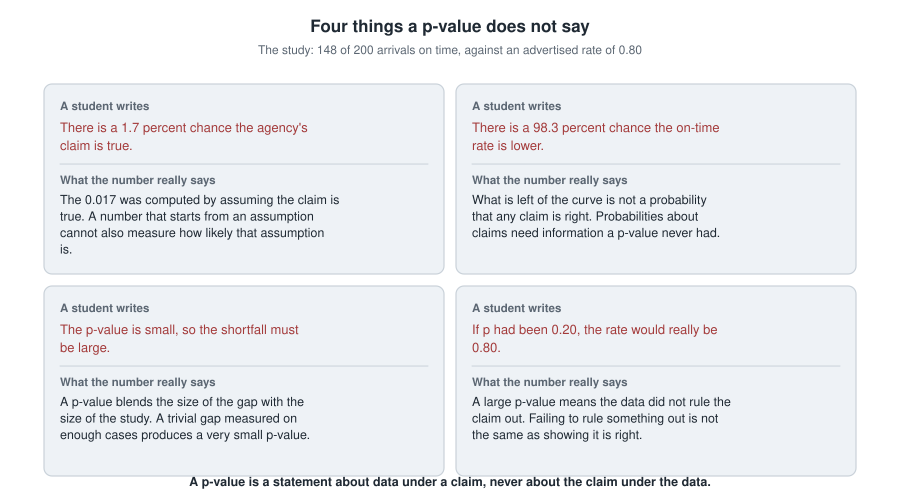

## Where this week starts

Last week you tested a claim with your hands: outcomes on cards, group labels shuffled, the statistic recomputed, a thousand times over. That pile of results was the null distribution — a picture of what chance alone produces when the claim being tested is true. You marked the real result on it, counted the shuffles that landed at least as far out, and called that proportion a p-value.

This week the shuffling goes away and a formula stands in its place. Nothing else changes. The question is still whether chance alone could plausibly have produced a result like yours, and the picture is still a distribution with your result marked and a tail shaded. Only its source changes: a mathematical model now stands in for the simulation.

Why bother, when simulation already worked? Because a formula is quick, needs no computer, and is the language of nearly every study you will ever read. By the end of this week you should be able to see "t = 2.45, p = 0.014" and say what claim was on trial, what the 2.45 counts, and what the 0.014 is — and is not — the probability of.

### Why this matters beyond the classroom

Picture a hospital committee deciding whether to buy a text-message reminder system for the thousand patients it sees each year. The vendor's report says the program lowered blood pressure and prints "p = 0.014" in bold. A member who has only learned the word "significant" votes yes. A member who has done this week's work asks how big the drop was, and how precisely it was measured.

The gap opens the other way too. A study reports no significant difference and a headline turns that into "no difference". A study too small to notice a real effect and a study that genuinely found nothing produce the same sentence and mean entirely different things.

## What you will be able to do

- State a null and an alternative claim in plain words, then write each one in notation.
- Compute a test statistic as the distance from an observed result to a null value, measured in standard errors.
- Read a p-value off a reference distribution and say in one sentence which probability it reports.
- Name which of the four standard misreadings a sentence commits, and rewrite it defensibly.
- Place a study in the truth-by-decision table, say what each kind of error would mean there, and describe what would raise its power.
- Separate a statistically significant result from a practically important one, using an estimate and its interval.

## Words worth owning

| Term | What it means in this course |
|------|------------------------------|
| Null hypothesis | The deliberately boring claim on trial: no effect, or the advertised value is right. Written H0, and it names one number. |
| Alternative hypothesis | What you would credit if the null fails. Written HA. It names a departure or a direction, never a value. |
| Test statistic | How far the observed result sits from the null value, counted in standard errors, not original units. |
| Standard error | The typical sample-to-sample wobble of a statistic; the ruler a test statistic is measured with. |
| p-value | The probability of a result at least as extreme as the one observed, computed while assuming the null claim is true. |
| Significance level | A threshold chosen before seeing the data, below which you agree to call a p-value small. Written alpha. |
| Type I and Type II error | Rejecting a true null claim; and failing to reject a false one. |
| Power | The chance a study would detect an effect of a stated size if it is real. A property of the design. |

## From shuffling to a formula

A city transit agency advertises that 80 percent of its buses arrive on time. A sceptical student group records 200 randomly chosen arrivals over one month and finds 148 on time. That is 148 divided by 200, or 0.74 — six hundredths short of the advertised rate.

Six hundredths is not nothing, but 200 arrivals is not the whole fleet. Even if the agency's figure were exactly right, a sample of 200 would not land on 0.80 every time; it would wobble. So the honest question is not whether the sample fell short, but whether a shortfall this size is an ordinary wobble.

Last week you would have settled that by simulating: draw 200 arrivals from a fleet whose true rate really is 0.80, compute the sample rate, repeat a thousand times, count how often you land at 0.74 or lower. That is the left panel below. This week you draw a smooth curve through the histogram and read the area under its left tail instead.

{fig-alt="Two panels on one horizontal axis. The left is a histogram of one thousand simulated on-time rates centred at 0.80 with bars at or below 0.74 shaded. The right is a smooth curve with the same left tail shaded, area 0.017."}

The two panels share almost everything: same axis, same centre, same width, same shaded region. The simulation put twenty-three of its thousand samples at or below 0.74; the curve puts 0.017 of its area there. Close but not identical, because the curve models the shuffling rather than transcribing it. Both agree on what matters: a shortfall this large turns up in roughly two samples in a hundred when the claim holds.

### The two claims, in words before symbols

Before any arithmetic, write both claims down, and write them in words first. Notation that arrives before the sentence it abbreviates is notation you will misuse.

{fig-alt="Two panels. The left states the null claim, that the fleet on-time rate really is 80 percent, as p equals 0.80. The right states the alternative, that the rate is lower, as p below 0.80. Both claims are about the whole fleet."}

The **null hypothesis** is the claim on trial. Here it says the on-time rate across every arrival the agency runs really is 0.80, and the 0.74 is ordinary sampling variation. In notation, $H_0: p = 0.80$, where $p$ is the fleet's true rate.

Notice that it names one specific number. It has to: the method asks what the world would look like if the null claim were true, and "somewhere below 0.80" gives you nothing to centre a distribution on. The **alternative hypothesis** is what you would credit if the null fails: $H_A: p$ is below $0.80$, in words, the real rate is lower than advertised. It names a direction, not a value.

Three habits to build now. Both claims are about the population, never the sample — writing $H_0: \hat{p} = 0.80$ makes no sense, since everyone can see the sample gave 0.74. Choose the direction of the alternative before you look, because picking whichever tail your result landed in manufactures surprise. And you never prove the null claim; the method only finds evidence against it.

### The test statistic as a distance in units of noise

The observed gap is $0.74 - 0.80 = -0.06$. Is 0.06 large? The question is empty until you say large compared to what, and here the comparison is to the typical wobble of a sample this size.

That wobble is the standard error. For a sample proportion, when the null claim holds,

$$ SE = \sqrt{\frac{p_0 (1 - p_0)}{n}} = \sqrt{\frac{0.80 \times 0.20}{200}} = \sqrt{0.0008} \approx 0.0283 $$

with $p_0$ the null value and $n$ the sample size. In words: audits of 200 arrivals, drawn from a fleet that really runs at 80 percent, usually land within about three hundredths of 0.80. Now gap and wobble can be compared, and the comparison is division:

$$ z = \frac{\hat{p} - p_0}{SE} = \frac{0.74 - 0.80}{0.0283} \approx -2.12 $$

Read it aloud: the sample rate sits about 2.12 standard errors below the advertised rate. That is the whole content of a test statistic. Every one you will meet — $z$ and $t$, and in squared-up form chi-square and $F$ — measures the same thing: how far the data sit from what the null claim predicted, relative to the typical size of the noise. The units cancel, so 2.12 means the same thing for a proportion or a blood pressure.

## Reading a p-value honestly

### What the number actually counts

Here is the sentence, worth memorising in this exact shape: **a p-value is the probability of a result at least as extreme as the one observed, computed while assuming the null claim is true.**

Three parts carry the weight. It is a probability *of a result*, so it is a statement about data. It counts results *at least as extreme*, which is why it is a tail area. And it is computed *assuming the null claim is true*, so it describes what data would do in a world we stipulated, not which world we are in.

For the bus audit, the tail left of $z = -2.12$ is about 0.017. In the language of the study: if the 80 percent figure were exactly right and the students repeated their audit over and over, about seventeen audits in every thousand would come back at 0.74 or lower. They got one on the first try. That is real evidence, but of the form *this would be a coincidence*, not proof.

One decision has to be explicit. The students suspected overstatement, so they used one tail. With no direction in mind they would count both tails and report $2 \times 0.017 = 0.034$: same data, same statistic, different p-value, because a different set of results counts as extreme.

### The threshold is a convention, not a fact of nature

You will be told to compare the p-value with 0.05 and reject the null claim when it comes out smaller. That is a useful discipline, and 0.05 is a genuine convention with a history in early twentieth-century agricultural statistics. But it is not a boundary in the world: nothing about the fleet changes as a p-value slides from 0.051 to 0.049.

Several habits follow. Report the p-value itself, not just the verdict. Fix the threshold before seeing the data, because one chosen afterwards is not a threshold. Treat 0.06 and 0.04 as nearly the same evidence. And be wary of a study that tested twenty things and reports the one below 0.05: when the null claim holds for all twenty, roughly one in twenty clears that bar by luck.

## When a decision goes wrong

{fig-alt="A two-by-two table. Columns are whether the null claim is true or false; rows are whether you reject it. Rejecting a true null is a Type I error, failing to reject a false null is a Type II error; the other two cells are correct."}

### Two ways to be wrong

Agreeing to decide from a threshold is agreeing to be wrong sometimes. The columns above are the two ways the world could be, the rows the two things you could do. Two of the four cells are fine and two are not.

A **Type I error** is rejecting a null claim that was true — a false alarm. Here the students would accuse the agency of overstating punctuality when the fleet really runs at 80 percent, their sample having drifted low by chance. Its rate is the threshold you chose: at alpha of 0.05 you accept a false alarm in about five percent of studies where the null claim holds.

A **Type II error** is failing to reject a null claim that was false — a miss. Here the fleet really runs at 74 percent and the audit lets it off. This rate has no tidy value in advance, because it depends on how wrong the null claim is: a fleet at 74 percent is easier to catch than one at 79 percent.

The two trade against each other. Dropping your threshold from 0.05 to 0.01 makes false alarms rarer and misses commoner; raising it does the reverse. No threshold makes both small, because it only decides where to draw a line on a picture you already have. What reduces both is a better picture: more data, cleaner measurement, less noise by design. And you never learn which column you were in.

### Power, in plain words

**Power** is the chance a study would detect an effect of a stated size, supposing that effect is really there. It is the top-right cell of the table, and it is one minus the Type II error rate.

Power belongs to a design, not to the data you ended up with, so ask about it before collecting anything. Four things move it: a larger real effect, a larger sample, less variability between cases, and a more permissive threshold, which buys detections at the price of false alarms.

The consequence is blunt. A low-powered study is not neutral; it was always likely to report nothing, whatever the truth. So "no significant difference" from a small study is close to uninformative, and the next question is how big an effect it could have seen.

## Worked example — is the on-time rate really eighty percent?

**Setting.** A transit agency advertises an 80 percent on-time rate. A student group records 200 randomly chosen arrivals across one month; 148 arrive on time. Test at a significance level of 0.05 whether the true rate is lower than advertised.

**Step 1 — write both claims.** The null claim says the fleet's true rate really is 80 percent and this sample wobbled low; the alternative says the true rate is below 80 percent. In notation, $H_0: p = 0.80$ against $H_A: p$ below $0.80$. One-sided, because the suspicion was one-sided from the start.

**Step 2 — check the model is usable.** The curve is an approximation and needs enough data behind it. The usual condition is that the null claim predicts at least ten successes and ten failures: $200 \times 0.80 = 160$ on-time and $200 \times 0.20 = 40$ late. Both clear ten, and the arrivals were random.

**Step 3 — estimate and standard error.** The sample rate is $\hat{p} = 148 / 200 = 0.74$, and under the null claim

$$ SE = \sqrt{\frac{0.80 \times 0.20}{200}} = \sqrt{\frac{0.16}{200}} = \sqrt{0.0008} \approx 0.0283 $$

**Step 4 — test statistic.** Dividing gives $z = (0.74 - 0.80) / 0.0283 \approx -2.12$: the audit came in about 2.12 standard errors below the advertised rate.

**Step 5 — p-value.** The area to the left of $-2.12$ under the standard normal curve is about 0.017, and because the alternative points one way only, that tail is the whole p-value.

**Step 6 — decide, then say what it means.** Since 0.017 falls below the threshold set in advance, reject the null claim. Then write the sentence that matters, for a reader who has never taken this course: *these 200 arrivals show an on-time rate of 74 percent, and a shortfall that large would happen in only about seventeen audits in a thousand if the advertised 80 percent were accurate, so there is real evidence the fleet runs below what it advertises.*

One caution keeps that honest: the evidence reaches the fleet only as far as the sample represented it, and an audit that quietly over-sampled rush hour would give identical arithmetic while meaning much less.

### The same reasoning, transferred

Now run the identical reasoning on a smaller audit. A different group records 50 arrivals and finds 37 on time: $37 / 50 = 0.74$, the same rate and the same six-hundredth shortfall. What stayed the same: the claims, the null value, the observed rate, the gap, every step of the procedure. What changed: the sample size, and therefore the ruler.

$$ SE = \sqrt{\frac{0.80 \times 0.20}{50}} = \sqrt{0.0032} \approx 0.0566 \qquad z = \frac{-0.06}{0.0566} \approx -1.06 $$

The area to the left of $-1.06$ is about 0.145, nowhere near the threshold. With 50 arrivals an ordinary wobble is about 0.057, so landing 0.06 low is barely one wobble. The lesson: a p-value does not measure how big a shortfall is, since both audits saw the same one. It measures how surprising that shortfall is given the evidence behind it. The smaller audit also sits at the edge of what the model can handle, since $50 \times 0.20 = 10$ expected late arrivals is the bare minimum.

## Second worked example — a reminder program with a real but tiny effect

**Setting.** A state health department tests whether automated text-message refill reminders lower blood pressure among adults treated for hypertension. Across its clinics, 2,400 patients are randomly assigned, 1,200 to reminders and 1,200 to usual care, with systolic blood pressure measured at six months. Because assignment was random, a group difference can be read causally.

```
Outcome: systolic blood pressure at six months (mm Hg)

Group             n     mean     sd
Reminders      1200    128.4   15.0
Usual care     1200    129.9   15.0

Difference in means, usual care minus reminders  :  1.5
Standard error of the difference                 :  0.612
Test statistic                                   :  2.45
p-value, two-sided                               :  0.014
95 percent interval for the difference           :  0.30 to 2.70
```

**Step 1 — the claims.** The null claim says reminders make no difference on average to six-month blood pressure; the alternative says they make some difference either way. Writing $\mu_R$ and $\mu_U$ for the two group means, $H_0: \mu_U - \mu_R = 0$ against $H_A: \mu_U - \mu_R \neq 0$. Two-sided this time, because a reminder system could in principle be counterproductive.

**Step 2 — estimate and standard error.** The observed difference is $129.9 - 128.4 = 1.5$ mm Hg in favour of reminders, and its standard error combines both groups' variability:

$$ SE = \sqrt{\frac{15.0^2}{1200} + \frac{15.0^2}{1200}} = \sqrt{0.1875 + 0.1875} = \sqrt{0.375} \approx 0.612 $$

**Step 3 — statistic and p-value.** Dividing gives $1.5 / 0.612 \approx 2.45$. With samples this large the reference curve is indistinguishable from the standard normal one, and the two-sided area beyond 2.45 is about 0.014 — below the conventional 0.05 threshold.

**Step 4 — what a p-value cannot do.** The 95 percent interval gives 0.3 to 2.7 mm Hg as the plausible range for the true average effect, and its arithmetic is visible: $1.5 \pm 1.96 \times 0.612$, which is $1.5 \pm 1.20$. One or two millimetres of mercury is smaller than the swing in one person's own reading between morning and afternoon. Both sentences are therefore true at once: the reminders had an effect chance cannot comfortably explain, and the effect was small. The p-value establishes the first, the interval the second, and it is the second a committee spending money needs. That is the gap between **statistical significance** and **practical importance**.

**Step 5 — the same program, a smaller study.** Suppose the department had used 100 patients per group instead of 1,200:

$$ SE = \sqrt{\frac{15.0^2}{100} + \frac{15.0^2}{100}} = \sqrt{4.5} \approx 2.12 $$

A two-sided test at alpha of 0.05 needs a statistic of at least 1.96, so it would need an observed difference of at least $1.96 \times 2.12 \approx 4.16$ mm Hg before calling anything significant. If the real effect is about 1.5, such a study has power of only about eleven percent against it: roughly nine times in ten it would report "no significant difference" while the reminders quietly worked. The design settled that before any data arrived.

## The misreading to avoid

Here, near enough word for word, is the sentence that shows up every year: *"p equals 0.017, so there's only about a 1.7 percent chance the agency is telling the truth."*

It is understandable, and it even sounds like what a p-value ought to mean. But look at how the 0.017 was produced. Every step — the 0.80 at the centre, the standard error of 0.0283, the shape of the curve — was built by *assuming* the agency's claim is exactly true. A number computed inside that assumption cannot then tell you how likely the assumption is. It is like measuring a person's height from their shadow while stipulating in advance that they are six feet tall.

Said carefully, a p-value is the probability of the *data*, given the *claim*; the misreading flips it into the probability of the claim, given the data. Swapping those is the same mistake you met in Week 10, when a test's sensitivity got confused with the chance that someone with a positive result actually has the disease.

{fig-alt="Four panels, each pairing a sentence students write about a p-value with its correction underneath: two read the p-value as the probability that a claim is true or false, one reads a small p-value as a large effect, and one reads a large p-value as proof the claim holds."}

Three near relatives wear different clothes. *"So there's a 98.3 percent chance the rate really is lower"* treats what remains of the curve as a probability that the alternative is right; it is only what is left of an area. *"The p-value is tiny, so the shortfall must be big"* forgets that a p-value blends the size of an effect with the size of the study — the same 0.06 shortfall gave 0.017 with 200 arrivals and 0.145 with 50. And *"it wasn't significant, so there's no effect"* mistakes failing to rule the null claim out for ruling it in; a study with eleven percent power reports a non-significant result almost every time even when the effect is real.

One rule to carry out of this week: a p-value is a statement about data under a claim, never a statement about a claim under the data.

## Practice on your own

These are for your own checking, not for submission. Work them on paper, and note what puzzles you.

1. A campus health service claims that 30 percent of students get a flu shot each year. A survey of 400 randomly selected students finds 132 who did. Write both claims in words and in notation for a two-sided question, then compute the sample proportion, the standard error under the null claim, and the test statistic. Before looking anything up, say whether you expect a large or small p-value.
2. Two groups audit a cafeteria's claim that 90 percent of orders arrive within five minutes. One times 40 orders and finds 32 fast; the other times 400 and finds 320. Both saw 80 percent. Without computing a p-value, say which group has the stronger case and name the quantity that makes the difference.
3. A trial of a sleep app reports a mean improvement of 4 minutes per night, a 95 percent interval from 1 to 7 minutes, and p equal to 0.009. Write two sentences a journalist could print: one for what the study established, one for what it did not. Then say which number did more work for you.
4. Name the misreading in each sentence, then rewrite it defensibly. (a) "The p-value was 0.30, which proves the two groups are the same." (b) "There is a 4 percent chance these results are a fluke." (c) "We tested eighteen outcomes and two were significant, so we found two real effects."
5. A researcher comparing two teaching methods expects a difference of about two marks on a scale of 100, with a standard deviation near 12 in each group. Using the second worked example as a model, compute the standard error of the difference for 50 students per group, then the smallest difference that would reach significance at alpha of 0.05. Say what that tells her.

## Where to read more

- [Chapter 13 of Introduction to Modern Statistics](https://openintrostat.github.io/ims/foundations-mathematical.html) is this week's core reading: the mathematical models that replace last week's simulation.
- [Chapter 14 of Introduction to Modern Statistics](https://openintrostat.github.io/ims/foundations-errors.html) goes deeper on decision errors, thresholds, and power.
- [Chapter 11 of Introduction to Modern Statistics](https://openintrostat.github.io/ims/foundations-randomization.html) is worth rereading beside Chapter 13: seeing one test built twice is what makes the correspondence click.
- [StatKey](https://www.lock5stat.com/statkey) lets you rebuild the left-hand panel of this week's first figure. Change the sample size and watch the p-value move while the estimate stays put.
- The [whole of Introduction to Modern Statistics](https://openintrostat.github.io/ims) is open online, and the [life and biomedical sciences supplement](https://www.openintro.org/book/biostat) carries extra clinical examples.
- Course pages: the [resources page](../resources/index.qmd) and the [schedule](../schedule.qmd).

## Where this goes next

Week 13 turns this machinery on categorical outcomes, where the data arrive as counts in a two-way table rather than as a mean or a proportion. You will compare risks between groups, meet relative risk and the odds ratio, and see the chi-square idea: compare every observed count with the count expected if the two variables were unrelated, then add up the mismatch. The vocabulary carries over unchanged; only the statistic in the middle is new. Read ahead in [Week 13](week13-categorical-outcomes.qmd).

If this week's logic still feels like a magic trick, go back to [Week 11](week11-simulation-based-inference.qmd), rebuild one null distribution by shuffling, and draw the matching curve beside it. The classical machinery is not a different idea; it is the same idea with the labour taken out. The [notes index](index.qmd) has both weeks side by side.
