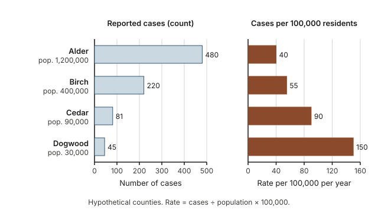
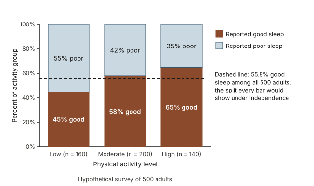
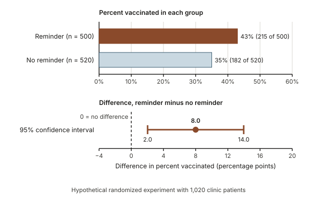
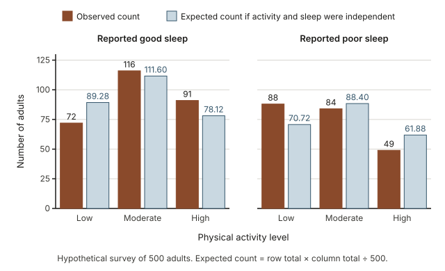
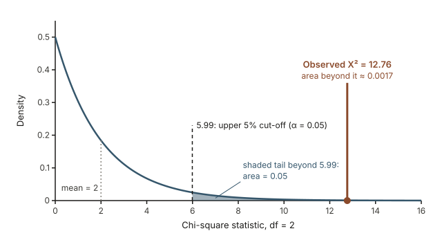

## Warm-up: more cases, or more risk?

Last year Alder County reported 480 cases of a tick-borne illness, and Dogwood County reported 45 (hypothetical figures). A local news story says Alder County has "more than ten times the problem." If you lived in one of these counties, where would you be more likely to get sick? What one extra piece of information would you need to be sure?

Keep your first guess in mind. A count on its own cannot tell you about risk; you also need to know how many people could have been counted.

## Why categorical outcomes need their own tools

Many outcomes that matter in health and public policy are not measurements on a number line. A patient was vaccinated or was not. A surgery ended with a complication or without one. A resident supports a proposal, opposes it, or is unsure. For categorical outcomes like these, the mean and standard deviation do not apply directly. Instead you count how many cases fall in each category and turn the counts into proportions.

Categorical outcomes are also where many public claims go wrong. Stories compare raw counts across places of very different sizes, quote a percentage without saying "a percent of whom?", or call a survey result "significant" as if that settled how large the difference is. This week gives you a tool for each situation: rates on a common scale, two-way tables read with the right conditional proportions, a confidence interval for the difference between two proportions, and the chi-square test for association. It draws on comparing groups ([Week 4](week04-comparing-groups.qmd)), confounding ([Week 6](week06-confounding.qmd)), risk ([Week 10](week10-probability-risk-diagnosis.qmd)) and the inference ideas of Weeks 11 and 12.

## What you will be able to do

By the end of this week you can:

- turn counts into proportions and into rates per 1,000 or per 100,000, and explain when a rate is the fair comparison;
- read a two-way table and choose the row or column conditional proportions that match the question;
- read a segmented bar chart and describe an association between two categorical variables;
- estimate the difference between two proportions with a 95% confidence interval and interpret it in context;
- compute expected counts, the chi-square statistic and its degrees of freedom, and read a p-value from software output;
- explain what a significant chi-square result does and does not show.

## Words to know this week

| Term | Meaning |
|---|---|
| Proportion | The count in one category divided by the total count, a number from 0 to 1 (often written as a percent). A sample proportion is written $\hat{p}$. |
| Rate | A count divided by the size of its group, stated per a fixed base such as per 1,000 or per 100,000 people, usually over a stated period such as one year. |
| Two-way table | A table of counts that classifies each case by two categorical variables at once (also called a contingency table). |
| Conditional proportion | A proportion computed within one row or one column of a two-way table. |
| Segmented bar chart | One bar per group, each stretched to 100% and divided into segments for the categories of the response variable. |
| Independence | Two categorical variables are independent when the distribution of one is the same in every category of the other. |
| Expected count | The count a cell would have, on average, if the two variables were independent. |
| Chi-square statistic | A single number, written $X^2$, measuring how far the observed counts are from the expected counts. |
| Degrees of freedom (df) | For a two-way table, (rows − 1) × (columns − 1); it picks out which chi-square distribution to use. |

## Counts, proportions and rates

A count tells you how many; a proportion tells you what fraction of a group; a rate is a proportion rescaled to be easy to read. Mixing them up produces many misleading headlines.

### From a count to a proportion

If 45 of Dogwood County's 30,000 residents reported the illness, the proportion who reported it is

$$\frac{45}{30{,}000} = 0.0015,$$

or 0.15%. Proportions let you compare groups of different sizes, because each group is measured against its own total. Always ask "a proportion of whom?" The denominator defines what the number means: "15% of patients had a complication" is a different claim when the 15% is of all patients than when it is of patients over 65.

### Rates put groups of different sizes on a common scale

Small proportions are hard to read: 0.0015 and 0.0004 look alike at a glance. A **rate** rescales the proportion to a convenient base:

$$\text{rate per 100,000} = \frac{\text{count}}{\text{population}} \times 100{,}000.$$

For Dogwood County, $0.0015 \times 100{,}000 = 150$ cases per 100,000 residents in one year, which is the same as $0.0015 \times 1{,}000 = 1.5$ cases per 1,000. Use per 100 (a percent) for common outcomes, per 1,000 for events such as births or hospital admissions, and per 100,000 for rare outcomes such as a specific disease. The base is a presentation choice; it never changes which group is higher.

| County (hypothetical) | Population | Reported cases | Rate per 100,000 per year |
|---|---|---|---|
| Alder | 1,200,000 | 480 | 40 |
| Birch | 400,000 | 220 | 55 |
| Cedar | 90,000 | 81 | 90 |
| Dogwood | 30,000 | 45 | 150 |

{fig-alt="Two bar panels for four hypothetical counties. Counts: Alder 480, Birch 220, Cedar 81, Dogwood 45. Rates per 100,000: Alder 40, Birch 55, Cedar 90, Dogwood 150. The order reverses."}

Back to the warm-up. Alder County has more than ten times as many cases as Dogwood (480 against 45), but Dogwood's rate is $150 / 40 = 3.75$ times Alder's. Ranked by counts, the four counties run one way; ranked by rates, they run exactly the other way. Counts describe the size of the problem for a health department (how many people need care). Rates describe the risk to an individual resident. A ratio of two such rates, like 3.75, is called a relative risk.

Two cautions. First, epidemiologists sometimes reserve "rate" for events per unit of person-time (for example, infections per 1,000 patient-days); in this course a rate is a count divided by group size, stated per a fixed base. Second, a rate removes differences in size, not other differences. If Dogwood has an older population, or more residents who work outdoors, its higher rate may partly reflect that. This is the confounding story from [Week 6](week06-confounding.qmd), and it is why public-health reports often give age-adjusted rates.

## Two-way tables and conditional proportions

When each case is classified by two categorical variables, the counts go in a two-way table. Here is a hypothetical random sample of 500 adults from one city. Each reported their usual level of physical activity (the explanatory variable) and whether they usually sleep well (the response variable).

| Activity level | Good sleep | Poor sleep | Row total |
|---|---|---|---|
| Low | 72 | 88 | 160 |
| Moderate | 116 | 84 | 200 |
| High | 91 | 49 | 140 |
| Column total | 279 | 221 | 500 |

The six inner numbers are **cell** counts, and every adult appears in exactly one cell. The row and column totals are the **marginal totals**; 500 is the grand total.

### Row proportions match the usual question

Raw counts are hard to compare when groups differ in size. More moderate-activity adults sleep well (116) than high-activity adults (91), but there were more moderate-activity adults to begin with. To compare fairly, divide each count by its group's total.

**Row proportions** divide by the row total. Among low-activity adults, $72/160 = 0.45$ report good sleep; among moderate-activity adults, $116/200 = 0.58$; among high-activity adults, $91/140 = 0.65$. These tell you how common good sleep is at each activity level, the natural comparison when activity is the explanatory variable.

**Column proportions** divide by the column total. Among the 279 good sleepers, $72/279 \approx 0.258$ are low-activity, $116/279 \approx 0.416$ moderate and $91/279 \approx 0.326$ high. These describe the activity levels of people who sleep well, a different question. The arithmetic is fine either way; only one set matches the comparison you want.

::: {.callout-tip}
**Which total do I divide by?** The total of the group you are comparing. If the question says "among low-activity adults," divide by the low-activity total. A helpful habit: put the explanatory variable in the rows and compute proportions within rows. The overall proportion with good sleep, $279/500 = 0.558$, ignores activity altogether; it is a marginal proportion.
:::

### Picturing a two-way table with a segmented bar chart

A segmented bar chart draws one bar per group, stretches every bar to 100%, and splits it by the response categories. Because every bar has the same height, you compare segments directly, whatever the group sizes.

{fig-alt="Segmented bars scaled to 100 percent. Good sleep is 45 percent for low activity, 58 percent for moderate and 65 percent for high; a dashed line marks the overall 55.8 percent."}

The good-sleep segment grows from 45% to 58% to 65% as activity rises. If the two variables were **independent**, every bar would be split at the overall 55.8%, the dashed line. The bars depart from that line, so in this sample the variables are associated. Whether differences this large could arise by chance alone is a question for inference, taken up later on this page.

## Comparing two proportions with a confidence interval

With two groups and a two-category response, the natural summary is the difference in proportions, $\hat{p}_1 - \hat{p}_2$: how many percentage points higher one group's proportion is than the other's. Like any statistic, it would change from sample to sample, so we report it with a margin of error.

### The standard error of a difference

For one proportion the standard error is $\sqrt{\hat{p}(1-\hat{p})/n}$. For the difference between two independent groups, the two variances (the quantities under the square root) add:

$$\text{SE} = \sqrt{\frac{\hat{p}_1(1-\hat{p}_1)}{n_1} + \frac{\hat{p}_2(1-\hat{p}_2)}{n_2}}.$$

They add even though the proportions are subtracted, because each group brings its own sampling variability and subtracting does not cancel it. The confidence interval has the familiar form

$$(\hat{p}_1 - \hat{p}_2) \pm z^\star \times \text{SE},$$

with $z^\star = 1.96$ for 95% confidence. As in earlier weeks, the method captures the true difference $p_1 - p_2$ in about 95% of samples in the long run. An interval entirely above 0 is evidence that group 1's proportion is higher; an interval containing 0 means the data are consistent with no difference.

### Conditions for the normal model

1. **Independence.** Cases are independent within each group, and the groups are independent of each other. Random sampling or random assignment supports this.
2. **Success-failure condition.** Each group has at least 10 "successes" and at least 10 "failures."

If a group is small or the outcome rare, the normal model can be poor; the simulation methods of [Week 11](week11-simulation-based-inference.qmd) are one alternative.

## Worked example 1: a reminder message and flu vaccination

**Question.** A clinic randomly assigned 1,020 adult patients (hypothetical) to receive a text-message reminder about flu shots (500 patients) or no reminder (520 patients). By the end of the season, 215 patients in the reminder group and 182 in the no-reminder group had been vaccinated. How much did the reminder change the proportion vaccinated? Give a 95% confidence interval.

**Step 1: Variables and comparison.** The explanatory variable is reminder (yes or no); the response is vaccinated (yes or no). Group 1 is the reminder group and group 2 the no-reminder group.

**Step 2: Sample proportions and their difference.**

$$\hat{p}_1 = \frac{215}{500} = 0.43, \qquad \hat{p}_2 = \frac{182}{520} = 0.35, \qquad \hat{p}_1 - \hat{p}_2 = 0.43 - 0.35 = 0.08.$$

In the sample, the reminder group's vaccination proportion was 8 percentage points higher.

**Step 3: Conditions.** Random assignment makes the groups independent, and it is reasonable to treat patients as independent of one another. Successes and failures: 215 vaccinated and $500 - 215 = 285$ not in the reminder group; 182 and $520 - 182 = 338$ in the no-reminder group. All four are at least 10.

**Step 4: Standard error.** Compute each piece, then add and take the square root:

$$\frac{0.43 \times 0.57}{500} = \frac{0.2451}{500} = 0.0004902, \qquad \frac{0.35 \times 0.65}{520} = \frac{0.2275}{520} = 0.0004375,$$

$$\text{SE} = \sqrt{0.0004902 + 0.0004375} = \sqrt{0.0009277} \approx 0.03046.$$

**Step 5: The interval.** The margin of error is $1.96 \times 0.03046 \approx 0.0597$, so the interval runs

$$\text{from } 0.08 - 0.0597 = 0.0203 \text{ to } 0.08 + 0.0597 = 0.1397,$$

about 0.02 to 0.14, or 2 to 14 percentage points. Keep extra decimal places in the middle steps and round only at the end.

{fig-alt="Top: 43 percent vaccinated with a reminder (215 of 500) and 35 percent without (182 of 520). Bottom: difference 8.0 percentage points, 95 percent interval 2.0 to 14.0, entirely above 0."}

**Conclusion in context.** Using a method that captures the true difference in about 95% of samples, we estimate that a text reminder raises the proportion of patients like these who get a flu shot by between about 2 and 14 percentage points. The whole interval lies above 0, so the data give evidence that the reminder helps. A classical two-sided test of $H_0: p_1 - p_2 = 0$, in the style of [Week 12](week12-classical-hypothesis-testing.qmd), agrees. It uses a pooled proportion in its standard error: the pooled proportion is $397/1{,}020 \approx 0.389$, so $\text{SE} = \sqrt{0.389 \times 0.611 \times (1/500 + 1/520)} \approx 0.0305$ and $z = 0.08 / 0.0305 \approx 2.62$, with a two-sided p-value of about 0.009. Because of random assignment, a causal reading is justified for this clinic's patients, though they are not a random sample of all adults. The interval is also wide: a gain of 2 percentage points and a gain of 14 percentage points would mean quite different things to a clinic deciding whether reminders are worth sending.

## The chi-square idea: how far is the table from independence?

The interval above handles two groups and a yes-or-no response. Many tables are larger. The chi-square test asks one question of any two-way table: are the two variables associated in the population, or could the pattern in the sample be chance variation alone?

- $H_0$: the variables are independent; the distribution of the response is the same in every group.
- $H_A$: the variables are associated; the distribution of the response is not the same in every group.

The test compares what we observed with what we would expect if $H_0$ were true.

### Expected counts under independence

If activity and sleep were independent, each activity group would have the same proportion of good sleepers as the whole sample, $279/500 = 0.558$. The low-activity group has 160 adults, so we would expect $160 \times 0.558 = 89.28$ good sleepers. In general,

$$E = \frac{\text{row total} \times \text{column total}}{\text{grand total}} = \frac{160 \times 279}{500} = 89.28.$$

Expected counts need not be whole numbers, since they describe what happens on average under $H_0$; keep two decimal places. As a check, the expected counts have the same row and column totals as the observed table.

### The chi-square statistic adds up the gaps

For each cell, compare the observed count $O$ with the expected count $E$, then add over all cells:

$$X^2 = \sum_{\text{all cells}} \frac{(O - E)^2}{E}.$$

The difference $O - E$ is the gap between what happened and what independence predicts. Squaring makes every gap positive, so gaps above and below cannot cancel, and weights large gaps more. Dividing by $E$ judges each gap against its cell's size: a gap of 10 is large when 20 were expected and small when 500 were expected. Under $H_0$ the gaps are only chance variation and $X^2$ tends to be small; the stronger the association in the sample, the larger $X^2$.

### Degrees of freedom and the chi-square distribution

When $H_0$ is true and the expected counts are large enough, $X^2$ approximately follows a **chi-square distribution**, a family of curves indexed by degrees of freedom:

$$df = (r - 1)(c - 1),$$

where $r$ is the number of rows and $c$ the number of columns. Once the marginal totals are fixed, only that many cells can be filled in freely. In the activity and sleep table, knowing the good-sleep counts for the low and moderate groups forces every other cell, so $df = (3 - 1)(2 - 1) = 2$.

Chi-square distributions take only values of 0 or more and are skewed to the right. Each has a mean equal to its degrees of freedom, so a statistic far above its df signals a large mismatch. The p-value is the upper-tail area beyond the observed $X^2$: if $H_0$ were true, the probability of a statistic at least as large as the one observed. Only the upper tail counts, because every kind of departure from independence makes $X^2$ larger.

### Conditions and what software reports

1. **Independence.** Each case appears in exactly one cell, and cases are independent, as in a random sample or a randomized experiment.
2. **Expected counts.** Every expected count is at least 5 (check the expected counts, not the observed ones).

The test works on counts, never on percentages or rates: 45% of 20 people and 45% of 2,000 people carry very different amounts of evidence. Software reports the statistic, the degrees of freedom and the p-value, and can list the expected counts.

## Worked example 2: physical activity and sleep quality

**Question.** In the hypothetical random sample of 500 adults, is there evidence of an association between physical activity level and sleep quality? Use $\alpha = 0.05$.

**Step 1: Hypotheses.** $H_0$: activity level and sleep quality are independent among adults in this city. $H_A$: they are associated.

**Step 2: Expected counts.** Each is row total times column total divided by 500, with column totals 279 (good sleep) and 221 (poor sleep).

| Activity level (row total) | Good sleep: observed | Good sleep: expected | Poor sleep: observed | Poor sleep: expected |
|---|---|---|---|---|
| Low (160) | 72 | 160 × 279 / 500 = 89.28 | 88 | 160 × 221 / 500 = 70.72 |
| Moderate (200) | 116 | 200 × 279 / 500 = 111.60 | 84 | 200 × 221 / 500 = 88.40 |
| High (140) | 91 | 140 × 279 / 500 = 78.12 | 49 | 140 × 221 / 500 = 61.88 |

Check: $89.28 + 111.60 + 78.12 = 279.00$ and $70.72 + 88.40 + 61.88 = 221.00$, matching the observed column totals.

**Step 3: Conditions.** The adults are a random sample, each counted in one cell. The smallest expected count is 61.88, well above 5.

{fig-alt="Paired bars for six cells. Good sleep observed vs expected: low 72 vs 89.28, moderate 116 vs 111.60, high 91 vs 78.12. Poor sleep: low 88 vs 70.72, moderate 84 vs 88.40, high 49 vs 61.88."}

**Step 4: Each cell's contribution.** Square the gap and divide by the expected count.

| Cell | $O$ | $E$ | $O - E$ | $(O - E)^2 / E$ |
|---|---|---|---|---|
| Low, good sleep | 72 | 89.28 | $-17.28$ | $298.60 / 89.28 = 3.345$ |
| Low, poor sleep | 88 | 70.72 | $17.28$ | $298.60 / 70.72 = 4.222$ |
| Moderate, good sleep | 116 | 111.60 | $4.40$ | $19.36 / 111.60 = 0.173$ |
| Moderate, poor sleep | 84 | 88.40 | $-4.40$ | $19.36 / 88.40 = 0.219$ |
| High, good sleep | 91 | 78.12 | $12.88$ | $165.89 / 78.12 = 2.124$ |
| High, poor sleep | 49 | 61.88 | $-12.88$ | $165.89 / 61.88 = 2.681$ |

**Step 5: Add.**

$$X^2 = 3.345 + 4.222 + 0.173 + 0.219 + 2.124 + 2.681 = 12.764.$$

The low and high rows contribute most: the low-activity group had fewer good sleepers than independence predicts (72 against 89.28) and the high-activity group had more (91 against 78.12). The moderate group is close to its expected counts.

**Step 6: Degrees of freedom and p-value.** With 3 rows and 2 columns, $df = (3 - 1)(2 - 1) = 2$. The distribution's mean is 2, and our statistic is more than six times that. Software reports:

```
Chi-square test for association: activity level by sleep quality
X-squared = 12.764, df = 2, p-value = 0.0017
```

{fig-alt="Right-skewed chi-square curve with df = 2. The upper 5 percent beyond 5.99 is shaded. The observed statistic 12.76 is marked far to the right; the area beyond it is about 0.0017."}

With 2 degrees of freedom, only 5% of the distribution lies beyond 5.99, and the observed 12.76 is far past that cut-off. The area beyond 12.76 is the p-value, 0.0017, too thin to see at this scale.

**Conclusion in context.** The p-value, 0.0017, is below $\alpha = 0.05$, so we reject $H_0$. The survey gives strong evidence that sleep quality and physical activity level are associated among adults in this city: 45% of the low-activity group reported good sleep, against 58% of the moderate group and 65% of the high group. If activity and sleep were unrelated, a statistic at least this large would turn up in only about 1.7 of every 1,000 random samples. Because the survey is observational, it does not show that exercise causes better sleep. People with health problems may both exercise less and sleep worse, and age, work schedules or stress could also affect both. The direction could also run the other way: people who sleep poorly may be too tired to exercise.

## Transfer: age group and support for a bike lane

Now the same reasoning in a public-policy setting, starting from software output. A city surveyed a random sample of 600 residents (hypothetical) about a proposed protected bike lane, recording age group and opinion.

| Age group | Support | Oppose | Unsure | Row total |
|---|---|---|---|---|
| 18 to 34 | 118 | 52 | 30 | 200 |
| 35 to 54 | 110 | 80 | 30 | 220 |
| 55 and older | 72 | 84 | 24 | 180 |
| Column total | 300 | 216 | 84 | 600 |

```
Chi-square test for association: age group by opinion
Expected counts
                 Support   Oppose   Unsure
18 to 34          100.00    72.00    28.00
35 to 54          110.00    79.20    30.80
55 and older       90.00    64.80    25.20
X-squared = 18.313, df = 4, p-value = 0.0011
```

- **Hypotheses.** Age group (explanatory) and opinion (response) each have three categories. $H_0$: they are independent among the city's residents. $H_A$: they are associated.
- **Check one expected count.** For "oppose, 55 and older," $180 \times 216 / 600 = 64.80$, matching the output. Checking one cell is a quick check that the software used the table you think it used.
- **Conditions.** A random sample, each resident counted once; the smallest expected count, 25.20, is well above 5.
- **Degrees of freedom.** The table is 3 × 3, so $df = (3 - 1)(3 - 1) = 4$. A bigger table has more cells free to vary, so its null distribution sits further right, with mean 4 rather than 2.
- **Decision.** The p-value, 0.0011, is below 0.05, so we reject $H_0$: strong evidence that opinion is associated with age group.
- **Describe the association.** The test does not say what the association looks like; row proportions do. Support is $118/200 = 59\%$ at ages 18 to 34, $110/220 = 50\%$ at 35 to 54, and $72/180 = 40\%$ at 55 and older. Opposition runs the other way: 26%, about 36% and about 47%. The unsure share is about 13% to 15% in every group. The largest contributions to $X^2$ come from the support and oppose cells of the youngest and oldest groups; "oppose, 55 and older" alone contributes $(84 - 64.80)^2 / 64.80 \approx 5.69$ of the 18.31 total.
- **Conclusion in context.** Among this city's residents, opinion on the bike lane is associated with age: in the sample, younger residents were more likely to support it and older residents more likely to oppose it. The survey cannot say why; age is linked to commuting habits, neighborhood and many other factors.

## A common misreading: a significant chi-square proves one variable causes the other

The misreading sounds like this: "The chi-square test was significant, so activity level affects sleep." Close relatives are "so the difference is large" and "so every group differs from every other." A small p-value says only that, if the variables were independent, a mismatch at least this large between observed and expected counts would be rare. That is evidence of association. It is not the probability that the variables are independent, and it does not tell you:

- **Why the variables are associated.** The calculation is identical for a randomized experiment and an observational survey. Only the study design can support a causal claim, and the sleep survey is observational, so confounding remains possible.
- **How strong the association is.** $X^2$ grows with sample size. Multiply every count by 10 and the conditional proportions stay the same, but $X^2$ becomes 10 times as large. With tens of thousands of people, a difference of 1 percentage point can be statistically significant and still unimportant. Describe size with conditional proportions or a difference in proportions with its confidence interval.
- **Which groups differ.** A significant result is about the table as a whole. To say where it departs from independence, look at the conditional proportions and the largest cell contributions.

The opposite mistake matters too. A large p-value is not evidence of independence; the data are consistent with independence, and a small sample may lack the information to detect a real association. Say "we fail to reject $H_0$," never "the variables are independent."

## Practice on your own (ungraded)

1. A town of 8,000 people reported 12 cases of a foodborne illness in a year; a city of 450,000 reported 360 cases (hypothetical). Compute each rate per 100,000. Which place had the higher rate, and why might a story about counts suggest the opposite? *What to look for:* divide each count by its own population first.
2. In the activity and sleep table, what proportion of the poor sleepers were in the high-activity group? Is that a row or a column proportion, and does it tell you whether sleep differs by activity level?
3. In a hypothetical randomized trial, 90 of 300 patients given a new wound dressing developed an infection, compared with 120 of 300 given the standard dressing. Compute the difference in infection proportions (new minus standard) and a 95% confidence interval. Does the interval contain 0? *What to look for:* check the success-failure condition first.
4. A two-way table has row totals 150 and 250 and column totals 100, 180 and 120 (grand total 400). Under independence, what is the expected count for row 1, column 3? How many degrees of freedom does the chi-square test have?
5. A hypothetical report on region and vaccination status gives "X-squared = 1.9, df = 3, p-value = 0.59." Write a one-sentence plain-language conclusion. What would be wrong with writing "region and vaccination status are independent"?
6. A hypothetical survey of 40,000 people (20,000 in each of two regions) finds 51.0% support for a proposal in one region and 50.0% in the other, with X-squared = 4.00, df = 1, p-value = 0.045. Using these numbers, explain how a result can be statistically significant and still unimportant.

## Read further on categorical data

- *Introduction to Modern Statistics*: [Chapter 4, Exploring categorical data](https://openintrostat.github.io/ims/explore-categorical.html) for two-way tables, conditional proportions and segmented bar charts; [Chapter 17, Inference for comparing two proportions](https://openintrostat.github.io/ims/inference-two-props.html) for the interval and test for a difference; and [Chapter 18, Inference for two-way tables](https://openintrostat.github.io/ims/inference-tables.html) for expected counts and the chi-square test. The book shows R code in places; skip the code and read the output and explanation.
- [StatKey](https://www.lock5stat.com/statkey/), a free browser tool: open Descriptive Statistics and Graphs, then Two Categorical Variables, to enter a two-way table and see its proportions and a graph. Open Advanced Randomization Tests, then chi-square Test for Association, to see the chi-square statistic with a null distribution built by randomization, as in Week 11.
- Optional, for biomedical examples: [Introductory Statistics for the Life and Biomedical Sciences](https://www.openintro.org/book/biostat/), the chapter on inference for categorical data (chapter 8).

## Where this goes next

The previous week, [Week 12: Classical hypothesis testing](week12-classical-hypothesis-testing.qmd), set up the logic of tests and p-values that this week applied to categorical outcomes. Next, [Week 14: Meta-analysis and forest plots](week14-meta-analysis-forest-plots.qmd) asks what a collection of studies supports. Many forest plots show each study's difference in proportions (or ratio of proportions) with its confidence interval, exactly the kind of result from Worked example 1, stacked one above another.

- Back to [the notes overview](index.qmd)
- See [the course schedule](../schedule.qmd)
