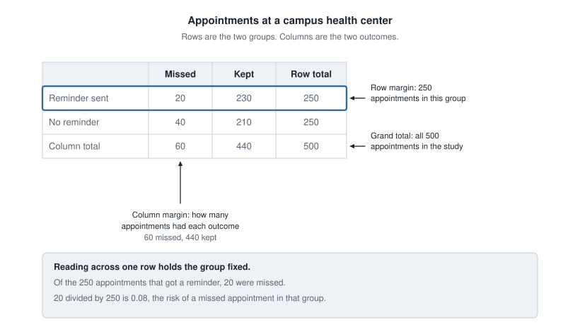
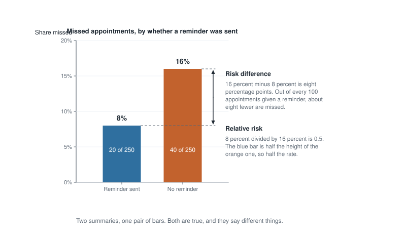
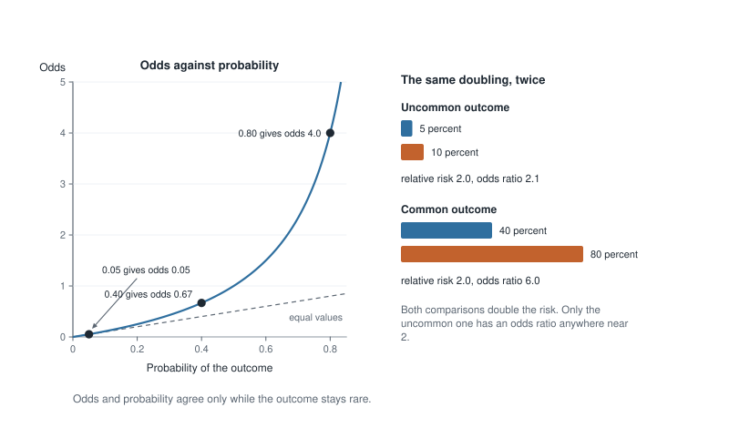
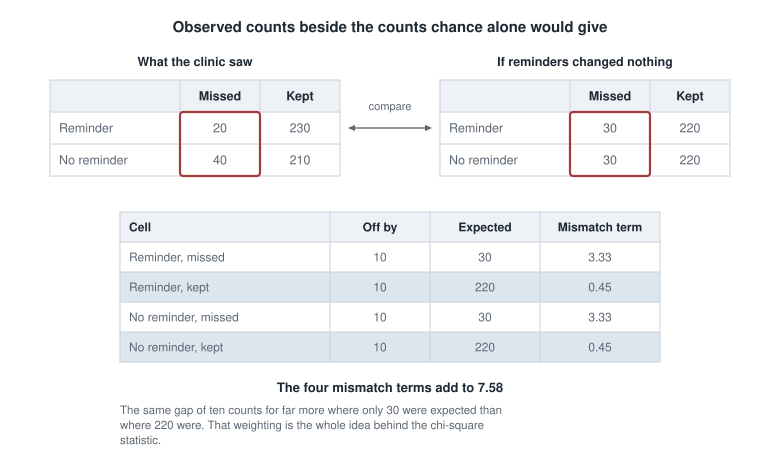

## Where this week starts

A campus health center tried something small. Of the 500 appointments booked in one month, it randomly picked half to get a text message the day before; the other 250 got nothing. Then somebody counted. Among the 250 reminded appointments, 20 were missed. Among the 250 that got no text, 40 were missed.

That is the entire data set. There is no average to take, no line to fit, no standard deviation to work out. Every observation is a word rather than a number: kept or missed, reminded or not. Data that arrive as labels instead of measurements are **categorical**, and most evidence you meet outside this room arrives that way — infected or not, hired or not, voted or stayed home.

Week 12 handed you the machinery of a formal test: a null claim, a test statistic, a p-value, two ways to be wrong. It did not hand you the front half of the job. Before you can test anything about counts you have to organize them, and that is where almost all of the damage happens: a table can be sliced three ways, each producing a legitimate proportion, only one of which addresses the question asked. By Friday you should be able to produce three honest summaries of one gap and notice which one a writer chose.

### Why this matters beyond the exam

Suppose a headline says a supplement doubles the risk of a rare liver condition. "Doubles" sounds like a reason to throw the bottle out. But a ratio hides the size of what it doubles. If the condition strikes 2 people in 100,000 a year, doubling takes it to 4 in 100,000; if it strikes 20 in 100, doubling takes it to 40 in 100. The same word covers both, and only one is a reason to change what you swallow.

The clinic has the mirror-image problem. Its director must decide whether the texting service is worth paying for, and for that the ratio is nearly useless. What the director needs is the difference: about eight fewer missed appointments per hundred reminded. That multiplies by appointments per year and the cost of an empty slot, and becomes a budget line. Ratios describe an association; differences decide what to do.

## What you will be able to do

- Build a two-way table from a short study description and fill in its row, column, and grand totals.
- Take a stated percentage, say which total it was divided by, and recompute it conditioning on the other margin.
- Compute the risk in each group, then the risk difference and the relative risk, and say what each claims.
- Turn a probability into odds and back, and explain why an odds ratio is not a relative risk.
- Say what a chi-square statistic compares, and why a mismatch weighs more where the expected count is small.
- Read a finding reported as a ratio and ask, out loud, for the baseline risk behind it.

## Words worth owning

| Term | What it means in this course |
|------|------------------------------|
| Two-way table | A grid of counts; rows are one variable's categories, columns another's. |
| Margin | A total along an edge: a row total, a column total, or the grand total. |
| Conditional proportion | A count divided by its own row or column total, not by the grand total. |
| Risk | The conditional proportion of a group that had the outcome we are watching for. |
| Risk difference | One risk minus the other, in percentage points: extra cases per hundred people. |
| Relative risk | One risk divided by the other: how many times as often, with no hint of the baseline. |
| Odds ratio | One group's odds divided by the other's; odds is the chance of the outcome over the chance of no outcome. |
| Expected count | What a cell would hold, on average, if the two variables were unrelated. |

## Reading a two-way table without fooling yourself

Here is the clinic month laid out properly: rows are the groups, columns the outcomes, edges the totals.

|  | Missed | Kept | Row total |
|------|------|------|------|
| Reminder sent | 20 | 230 | 250 |
| No reminder | 40 | 210 | 250 |
| Column total | 60 | 440 | 500 |

Before reading anything out of a table, check that it closes. The rows give 250 and 250; the columns give 60 and 440; and 60 plus 440 is 500. A table that does not close hides a category you were not told about.

{fig-alt="A two-by-two table of 500 clinic appointments. Rows are reminder sent and no reminder; columns are missed and kept. Arrows mark the row margin of 250, the column margin of 60 missed, and the grand total of 500."}

### Margins, and the three totals they give you

The word *margin* is literal: the totals live in the margins of the grid. The **row margins** describe the groups — here 250 and 250, so the groups were the same size. The **column margins** describe the outcomes with no regard to group: 60 missed, 440 kept. The **grand total**, 500, is everybody.

### Joint, marginal, and conditional are three different questions

Every count in a table can be divided by three different things, and each division has its own name. Divide a middle count by the **grand total** and you get a *joint proportion*: 20 divided by 500 is 0.04, so 4 percent of appointments were both reminded and missed. Divide a margin by the grand total instead and you get a *marginal proportion*: 60 divided by 500 is 0.12, the month's overall no-show rate. Both are tidy, and both are silent about whether reminders did anything.

Divide by a **row or column total** and you get a *conditional proportion*, which is where the teaching lives. Conditioning means holding something fixed and looking only inside it. Hold the reminder group fixed: 20 of its 250 appointments were missed, so 0.08. Hold the other group fixed: 40 of 250, so 0.16. Those two numbers are the comparison the study was built to make. When the outcome is one we would rather avoid, a conditional proportion gets called a **risk**.

Now condition the other way, on the outcome instead of the group. Among the 60 missed appointments, 20 had a reminder — 33 percent — and 40 did not. Both statements are arithmetically correct, but only conditioning on the group addresses "did the reminder help?". Conditioning on the outcome describes the composition of the missed appointments instead. Mixing the two up is the most common error people make with tables.

## Three summaries of the same gap

You now have two risks, 0.08 and 0.16. There are three standard ways to compress that pair into one number, and the choice among them is rhetorical as much as statistical.

### The risk difference, and what it buys

The **risk difference** is subtraction. Taking the no-reminder group as the baseline, 0.16 minus 0.08 is 0.08, reported as eight percentage points. In units: for every hundred appointments that got a reminder, about eight fewer were missed.

"Percentage points" is not the same phrase as "percent". The risk fell by eight percentage points. It also fell by half, which is 50 percent of its old value. Keep the two words apart.

The difference is the summary that converts into decisions. It also travels badly, because it depends on the baseline risk, and this clinic's baseline is not every clinic's.

### The relative risk, and what it hides

The **relative risk** is division: 0.16 divided by 0.08 is 2.0, so an appointment with no reminder was missed twice as often. Flip the comparison and 0.08 divided by 0.16 is 0.5, and the same fact reads "the reminder halved the risk". Always check which group sits on the bottom of the fraction, because 2.0 and 0.5 can describe the identical table.

{fig-alt="Two bars giving the share of appointments missed: 8 percent with a reminder and 16 percent without. A double-headed arrow marks the gap of eight percentage points, and a note reads that the shorter bar is half the height of the taller."}

Relative risk travels between settings better, which is why research papers lean on it. It also strips out what a reader needs to judge importance: "twice as often" reads the same whether the risk went from 1 in a million to 2 in a million or from 30 percent to 60 percent.

### Odds, and why they are not probabilities

**Odds** compare an outcome to its absence rather than to the whole group. In the reminder group, 20 appointments were missed and 230 kept, so the odds of missing are 20 to 230, about 0.087; in the other group, 40 to 210, about 0.190. In general,

$$\text{odds} = \frac{p}{1 - p}$$

where $p$ is the probability of the outcome, and going back is $p = \text{odds} / (1 + \text{odds})$. A probability of 0.5 is odds of 1, usually said as "even odds", and a probability of 0.8 is odds of 4. But a probability of 0.05 is odds of about 0.053, close enough that down there the two scales are nearly interchangeable.

The **odds ratio** divides one group's odds by the other's, and the cross-product of the table is the cleanest route to it: 40 times 230 is 9,200, and 20 times 210 is 4,200, so the odds ratio is 9,200 divided by 4,200, about 2.19. The relative risk for that same table was 2.00, so the odds ratio sits further from 1.

### When the odds ratio runs ahead of the risk ratio

That gap is no accident, and it is not small when the outcome is common. Take two comparisons that both double the risk. From 5 percent to 10 percent, the odds go from 0.05 divided by 0.95, about 0.0526, to 0.10 divided by 0.90, about 0.1111, so the odds ratio is 2.11 against a relative risk of 2.00. From 40 percent to 80 percent, the odds go from 0.40 divided by 0.60, about 0.667, to 0.80 divided by 0.20, which is exactly 4. The odds ratio is 4 divided by 0.667, which is 6.0 — while the relative risk is still 2.00.

{fig-alt="A curve of odds against probability rises slowly near zero and steeply past 0.5, pulling away from the dashed equal-value line. Beside it, doubling risk from 5 to 10 percent gives an odds ratio of 2.1; from 40 to 80 percent it gives 6.0."}

The reason is the denominator. Odds divide by the chance of *not* having the outcome, so when the outcome is common that leftover chance is small and shrinking and the fraction blows up. Under roughly 10 percent in both groups, an odds ratio and a relative risk are close enough that a careless reader is not badly misled. Above that, an odds ratio is a ratio of odds and nothing more.

## Observed counts against expected counts

Everything so far has been description. The inference question is the Week 12 question in new clothing: if the reminder truly changed nothing, how surprising is a table like this one?

So write down the table you would expect if the reminder changed nothing. "Nothing" means the missed rate is the same in both groups, and the only sensible value for that shared rate is the overall one, 0.12. Applied to each group of 250, that is 30 missed and 220 kept per row. The general recipe is

$$\text{expected count} = \frac{\text{row total} \times \text{column total}}{\text{grand total}}$$

and for the top-left cell that is 250 times 60, divided by 500, which is 30. Expected counts need not be whole numbers; they are averages, not predictions about a particular month.

### What the chi-square statistic adds up

The clinic saw 20 missed among the reminded where 30 were expected, and 40 in the other row where 30 were expected. Every one of the four cells is off by exactly ten.

{fig-alt="Two count tables side by side. The observed table reads 20 and 230 in the reminder row and 40 and 210 without; the expected table reads 30 and 220 in both rows. Every cell is off by ten and the four mismatch terms add to 7.58."}

The chi-square statistic turns those four mismatches into one number:

$$X^2 = \sum \frac{(\text{observed} - \text{expected})^2}{\text{expected}}$$

Read that in words. Square each cell's miss so misses in either direction count alike, then divide by the expected count so a gap of ten matters more where 30 were expected than where 220 were. Add the four terms — 3.33 from each missed cell, 0.45 from each kept cell — for about 7.58. Software reports:

```
Two-way table: reminder text (yes / no) by appointment (missed / kept)

  Pearson chi-square statistic   7.576
  degrees of freedom             1
  p-value                        0.0059
```

Degrees of freedom are the rows minus one times the columns minus one, so 1 here. The p-value means what it did last week: if reminders truly made no difference, a table at least this far off would turn up about six times in a thousand months like this one.

::: {.callout-note}
Some software applies a small correction when a table is two by two, moving this p-value from about 0.006 to about 0.009. Both are small, and the reading of the study does not change.
:::

The statistic is silent about direction — it would report the same 7.58 if the reminded group had missed more — and about size, since a big enough study flags a gap of half a percentage point. So it never travels alone: report the two risks, then the difference, then the test.

## Worked example — a walk-in clinic compares two wound dressings

**Setting.** A walk-in clinic treated 400 minor wounds, randomly assigning each to one of two dressings, 200 apiece, and checked for infection two weeks later. Dressing A produced 24 infections; dressing B produced 6.

**Step 1 — build the table and close the margins.**

|  | Infection | No infection | Row total |
|------|------|------|------|
| Dressing A | 24 | 176 | 200 |
| Dressing B | 6 | 194 | 200 |
| Column total | 30 | 370 | 400 |

Check it: the rows give 200 and 200, the columns give 30 and 370, and both routes reach 400.

**Step 2 — condition on the group.** Dressing A: 24 divided by 200 is 0.12. Dressing B: 6 divided by 200 is 0.03.

**Step 3 — risk difference.** 0.12 minus 0.03 is 0.09, nine percentage points. Per hundred wounds, dressing A produced about nine more infections.

**Step 4 — relative risk.** 0.12 divided by 0.03 is 4.0. A wound under dressing A became infected four times as often.

**Step 5 — odds ratio.** Odds under A are 24 to 176; under B, 6 to 194. By cross-product, 24 times 194 is 4,656 and 6 times 176 is 1,056, so the odds ratio is 4,656 divided by 1,056, about 4.41.

**Step 6 — the mismatch test.** If the dressing made no difference, each group of 200 would be expected to yield 15 infections and 185 clean wounds, so every cell is off by nine. Software reports a chi-square statistic of about 11.68 with 1 degree of freedom and a p-value of about 0.0006.

**What it means.** Infection was about four times as common under dressing A, or nine more cases per hundred wounds. Because infection was fairly uncommon in both groups, the odds ratio of 4.41 sits close to the relative risk of 4.0. Random assignment is what lets this be read as an effect rather than an association.

### The same reasoning, transferred

A second clinic ran a smaller version: 120 wounds, 60 under each dressing, with 9 infections under A and 3 under B.

The path is identical. Risks: 9 divided by 60 is 0.15, and 3 divided by 60 is 0.05. Risk difference: 0.10, ten percentage points. Relative risk: 3.0. Odds ratio by cross-product, using the 51 and 57 wounds that stayed clean: 9 times 57 is 513, 3 times 51 is 153, and 513 divided by 153 is about 3.35.

What stayed the same is the order of operations. What changed is worth sitting with: the relative risk fell from 4.0 to 3.0, but the risk difference *rose* from nine percentage points to ten, because wounds here became infected more often to begin with. A smaller ratio can carry a larger absolute effect. And three infections could easily have been one or six, so every summary here inherits that wobble.

## Second worked example — a commuting survey where the margin decides the story

**Setting.** A campus survey asked 600 students how they get to campus and whether they had been late to a first-period class in the past week. Of them, 300 walk, 200 take the bus, and 100 drive. Late at least once: 60 walkers, 56 bus riders, 34 drivers.

**Step 1 — build the table.**

|  | Late at least once | Not late | Row total |
|------|------|------|------|
| Walk | 60 | 240 | 300 |
| Bus | 56 | 144 | 200 |
| Drive | 34 | 66 | 100 |
| Column total | 150 | 450 | 600 |

Rows close at 300, 200, and 100; columns at 150 and 450, which add to 600.

**Step 2 — the claim as printed.** The student paper wrote: *"Walkers are the campus's late-comers. Four in ten students who were late walk to campus, more than any other group."*

**Step 3 — check its arithmetic.** It is right. Of the 150 late students, 60 walk, and 60 divided by 150 is 0.40; bus riders are 37 percent of them and drivers 23 percent.

**Step 4 — recondition on the other margin.** Those percentages divide by the *late* total. The question "does walking go with being late?" needs division by the *mode* total. Walkers: 60 divided by 300 is 0.20. Bus riders: 56 divided by 200 is 0.28. Drivers: 34 divided by 100 is 0.34. Walkers are the *least* likely group to be late.

**Step 5 — see why both are true.** Walkers are half the student body, so even at the lowest rate they supply more late students than a group of 100 at the highest rate. The first calculation measures how big a group is; the second, how it behaves.

**Step 6 — the mismatch test.** The overall lateness rate is 0.25, so expected counts are each row total times 0.25: 75, 50, and 25 late, with 225, 150, and 75 not late. Walkers came in 15 under and drivers 9 over. Software reports a chi-square statistic of about 9.28 with 2 degrees of freedom — 3 rows minus 1 times 2 columns minus 1 — and a p-value of about 0.0097.

**What it means.** Lateness rates climb steadily from walkers to drivers, and a gradient this steep would be unusual if mode and lateness were unrelated. But nothing was assigned: students chose their mode, and drivers may live farther out. The honest sentence is "students who drive reported being late more often", not "driving makes students late".

## The misreading to avoid

Here is the sentence, close to how it gets said aloud:

::: {.callout-note}
*Forty percent of the students who were late walk to campus. That is more than any other group. So walking is what makes people late.*
:::

The first two sentences are correct arithmetic. The third follows from neither, and the break is a swapped denominator before it is a leap from association to cause. "Forty percent of the late students walk" conditions on the outcome; "walkers are late more often" would condition on the group. Those are different fractions with different denominators, and the second is 20 percent, the smallest rate in the table.

The defence is a habit, not a formula. Every time you meet a percentage about a table, say out loud what it is a percentage *of*. Forty percent *of the late students*. Twenty percent *of the walkers*. Once the denominator is spoken, the two stop sounding alike.

A second misreading arrives whenever a ratio travels alone. *The risk doubled, so this is twice as dangerous for me.* A relative risk of 2 gives the ratio and nothing about the size: doubling 2 in 100,000 is a change you can reasonably ignore, doubling 30 in 100 is not.

The third is quieter. *The odds ratio was 6, so that group is six times as likely to have the condition.* Only if the condition is rare. Earlier in this note an odds ratio of 6.0 described a risk moving from 40 percent to 80 percent — a doubling. When an odds ratio is attached to a common outcome, hunt for the underlying percentages first.

## Practice on your own

These are for you, not for submission. Check yourself by making every margin close.

1. A campus food pantry study followed 800 students for a semester: 300 used the pantry at least once and 500 never did. Among users, 90 reported skipping a meal for cost reasons; among non-users, 100 did. Build the table with its margins, compute the risk in each group, the risk difference, the relative risk, and the odds ratio, and write one sentence for each. Then say why a pantry user might report *more* skipped meals without the pantry having caused it.

2. From that same table, compute the proportion of all meal-skippers who were pantry users. State which margin it is divided by, and why it does not address whether the pantry helped.

3. Convert each of these to the other scale, showing the arithmetic: a probability of 0.25; a probability of 0.90; odds of 3; odds of 0.2. Then say which case has odds and probability closest together.

4. A study reports a relative risk of 1.5 and an odds ratio of 3.2 for one comparison. Without seeing counts, what can you say about how common the outcome was?

5. For the commuting table above, compute the expected count for all six cells, then name the cell contributing most to the chi-square statistic and say why.

## Where to read more

- [Inference for a single proportion](https://openintrostat.github.io/ims/inference-one-prop.html) — the one-group case and proportions as estimates.
- [Inference for comparing two proportions](https://openintrostat.github.io/ims/inference-two-props.html) — this unit's comparison, with intervals as well as tests.
- [Inference for two-way tables](https://openintrostat.github.io/ims/inference-tables.html) — expected counts and the chi-square idea, including larger tables.
- [Introductory Statistics for the Life and Biomedical Sciences](https://www.openintro.org/book/biostat) — the same ideas in a clinical setting, where risk and odds ratios are the working vocabulary.
- [StatKey](https://www.lock5stat.com/statkey) — its test for a difference in proportions will shuffle a two-way table for you, worth doing once.
- The whole of [Introduction to Modern Statistics](https://openintrostat.github.io/ims), plus the course [schedule](../schedule.qmd) and [resources](../resources/index.qmd) pages.

## Where this goes next

Fall break falls between this unit and the next, so there is a gap in the Monday-Wednesday-Friday rhythm before Week 14 begins. Use a little of it to re-read one section: conditioning on the group versus conditioning on the outcome is what pays off for the rest of the term.

Week 14 changes the unit of analysis. Instead of asking what one study shows, you will ask how a pile of studies becomes a body of evidence, reading a forest plot line by line — one row per study, an estimate, an interval, a line of no effect. Nearly every estimate on such a plot is a number of the kind you built this week, so the vocabulary carries straight over. Continue to [Week 14 — Meta-analysis and forest plots](week14-meta-analysis-forest-plots.qmd), look back at [Week 12 — Classical hypothesis testing](week12-classical-hypothesis-testing.qmd) for where the p-value came from, or return to the [notes index](index.qmd).
