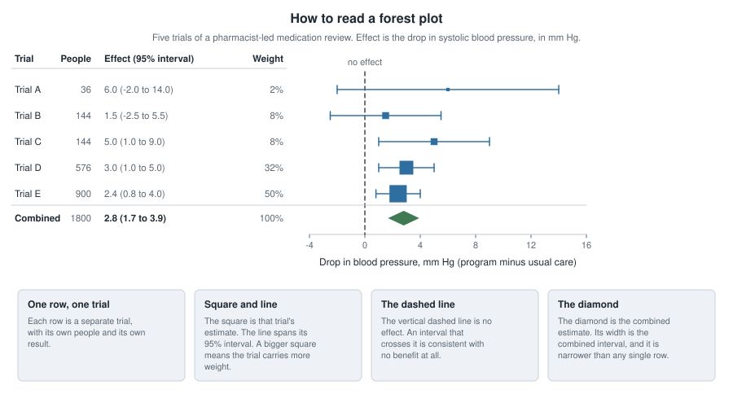
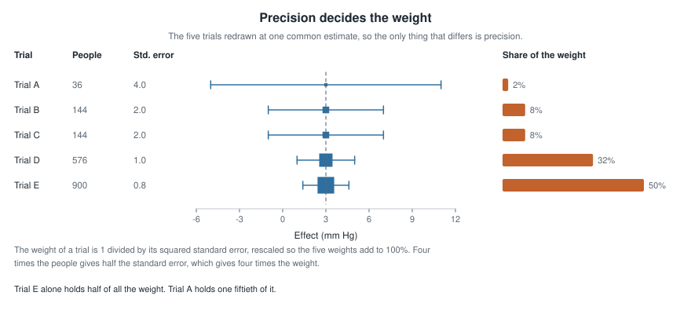
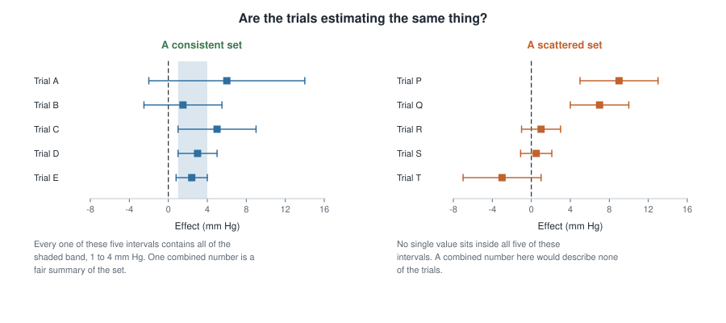
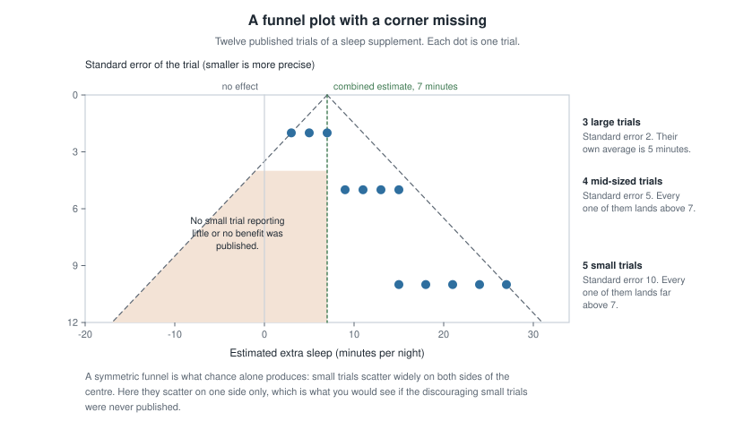

## Where this week starts

Every week of this course has ended in the same place: one study, one estimate, one interval, one careful sentence about what it does and does not support. This week the object you read changes. It is no longer a study but a *body* of studies — several trials of the same treatment, run in different clinics on different numbers of people, reaching results that do not all agree.

That is the situation nearly every real health claim is in. A small trial finds a large benefit. A bigger one finds a small benefit. A third finds nothing at all. A committee then has to say something to patients. **Meta-analysis** is the set of habits for turning that pile into one defensible statement, and the **forest plot** is the picture that shows the pile and the statement at once.

Week 13 left you able to read a single comparison of rates, and you came back from the fall break with that skill intact. What was missing was scale: nothing so far tells you what to do when five people hand you five different intervals. That is this week's job, and the term's last new machinery.

By the end of this week, a forest plot should stop looking like a decorative row of dots and start reading like a paragraph — which trial each row is, how sure it was, what it means to cross the vertical line, and when the diamond at the bottom is a fair summary rather than a mistake.

### Why this matters beyond the classroom

A hospital committee is deciding whether to fund a pharmacist-led medication review for patients with high blood pressure. Someone circulates a study showing a six-unit drop in blood pressure compared with usual care. It is genuine and honestly reported, and it enrolled thirty-six people; four larger trials report more modest results. Reading only that study, the committee will over-promise and be surprised later. Reading all five in a forest plot, it sees one noisy row with a very long line sitting above four steadier rows. The decision changes because of how the evidence was assembled, not because anyone ran a new experiment.

## What you will be able to do

- Explain, in a sentence a non-specialist would follow, why one study is rarely enough to settle a question.
- Read every part of a forest plot: rows, markers, interval lines, marker sizes, the line of no effect, the diamond.
- Combine several estimates into one precision-weighted estimate by hand, and say why that differs from the plain average.
- Judge whether a set of studies is consistent enough that one combined number is honest.
- Read a funnel plot for publication bias and describe what the missing region would have contained.
- Name what meta-analysis cannot repair, and give an example of a body of evidence that is precise and wrong.

## Words worth owning

| Term | What it means in this course |
|---|---|
| Meta-analysis | A study whose cases are other studies: it combines estimates from several studies of one question into one estimate with an interval. |
| Forest plot | The standard picture of a meta-analysis — one row per study showing its estimate and interval, with the combined result at the bottom. |
| Line of no effect | The vertical reference line at the value meaning the treatment did nothing: zero for a difference, one for a ratio. |
| Weight | How much a study counts in the combination. A study earns weight by being precise, which usually means being large. |
| Combined estimate | The single number a meta-analysis reports, drawn as a diamond whose width is its interval. |
| Heterogeneity | Real disagreement between studies, beyond what their own uncertainty explains. |
| Publication bias | The tendency for unimpressive studies to go unpublished, so the readable record is not the record of what was run. |
| Funnel plot | A scatterplot of each study's estimate against its precision, used to spot the lopsidedness publication bias produces. |

## Why one study is rarely enough

### What a single trial can and cannot tell you

A well-run trial gives an unbiased estimate of an effect and an honest measure of how much it could have wobbled by chance. Those are two different things, and the second is where single studies get into trouble.

Suppose the medication review really lowers systolic blood pressure by about three units on average. A trial of thirty-six patients has a standard error near 4 mm Hg, so its 95 percent interval reaches about eight units out on each side. Such a trial can easily report 6.0, or 0.0, or minus 1.0, purely through the luck of which thirty-six people walked in the door. Nothing is wrong with it. The estimate is simply built from too little information to pin down a three-unit effect.

Run that trial in a hundred clinics and the estimates scatter; if only the high ones make the news, the world learns a number nobody careful ever claimed. The remedy is not to distrust small studies but to stop reading them one at a time.

### What combining studies buys, and what it cannot repair

Combining buys precision: five trials of a few hundred people carry, together, far more information than any one, and the combined interval is narrower than every individual interval. It also buys visibility — stacked in one picture, patterns appear that no single paper shows, such as small trials all reporting larger effects than large ones.

What combining cannot do is repair a flaw that every study shares. If all five trials measured blood pressure with an unblinded nurse who rounded down for the program group, all five estimates are too large by the same amount, and so is the combination. The interval narrows as you add studies, and it closes in confidently on the wrong number. That is the sentence to memorise this week: **combining biased studies gives you a precise biased result.** Precision is about random error only; nothing in the arithmetic inspects whether the studies were any good.

## Reading a forest plot line by line

### The parts of the plot, named

{fig-alt="Five trial rows, each with a square estimate sized by its weight and a horizontal 95 percent interval. Two intervals cross the dashed no-effect line at zero. A green diamond at 2.8 mm Hg marks the combined estimate and sits clear of zero."}

Read it from the outside in. The horizontal axis is the effect measured — the drop in systolic blood pressure under the program compared with usual care, in mm Hg. The vertical dashed line sits at zero, meaning the program did nothing. Each row is one trial, labelled on the left with how many people it enrolled and what it found.

Inside a row, the square is that trial's estimate and the horizontal line is its 95 percent interval. The square's *size* is what makes a forest plot worth drawing: a bigger square means more weight in the combination. Trial A's square is a speck with an enormous line through it; Trial E's is large with a short line. You can see which trials drive the result without reading a number.

Whether a row crosses the dashed line matters less than students expect. Trials A and B each cross zero, so neither alone rules out no benefit. They are not failures, and they are not evidence of no effect; they are evidence too weak to tell a three-unit benefit from nothing.

At the bottom sits the diamond: its centre is the combined estimate, its width the combined interval. Here it is narrower than any single row and clears the dashed line — the pooled evidence separates this program from no effect even though two of its five trials could not.

### Weighting by precision

{fig-alt="Five intervals centred on one common value: the 36-person trial spans about 16 mm Hg while the 900-person trial spans about 3. Orange bars beside them show weight shares rising from 2 percent to 50 percent as the trials get larger."}

A meta-analysis does not average the estimates. It takes a **weighted** average, and the weight comes from precision:

$$w = \frac{1}{SE^{2}}$$

In words: a study's weight is one divided by its squared standard error. Halve a study's standard error and you quadruple its weight. Since the standard error of a difference in means falls with the square root of the sample size,

$$SE = \frac{2s}{\sqrt{n}}$$

where $s$ is the spread of the outcome inside a group and $n$ is the total number of people, four times the people gives half the standard error and so four times the weight. That is how a trial of 900 can be worth twenty-five trials of 36.

The figure redraws the five trials at one common estimate, so the only visible difference is precision. The bars convert those widths into shares of the total weight: 2, 8, 8, 32 and 50 percent. Trial E alone holds half the weight; Trial A holds one fiftieth of it. A plain average would treat the thirty-six-person pilot as the equal of the nine-hundred-person trial, which nobody believes. Precision weighting just says formally what you already believed: attend to a study in proportion to what it knows.

### Are these studies estimating the same thing?

{fig-alt="Left panel shows five intervals that all overlap a shaded band running from 1 to 4 mm Hg. Right panel shows five intervals spread from below zero up to 13 mm Hg, with no single value falling inside all five."}

Weighting only makes sense if there is one number to estimate. **Heterogeneity** is the name for the situation where there is not.

In the left panel the five trials scatter, but no more than their own intervals would predict, and every one of those intervals contains the whole band from 1 to 4 mm Hg. A single number can stand for the set without doing violence to any member.

In the right panel, five trials of a different program disagree in a way their intervals cannot absorb. One reports a 9-unit benefit with an interval from 5 to 13; another reports a 3-unit *harm* with an interval from minus 7 to 1. No value at all sits inside all five, so a diamond drawn under those rows would describe none of the trials above it.

When you see that, the useful move is not to combine harder. Ask what differs between the studies: dose, patients, length of follow-up, definition of the outcome. Heterogeneity is usually information, not noise, and the honest report says "results ranged from a 3-unit harm to a 9-unit benefit, and here is what seems to separate them".

The arithmetic in this week's examples assumes the trials share one true effect. When they do not, statisticians switch to a random-effects method that widens the combined interval to allow for the spread between studies.

## What the published record leaves out

### Reading a funnel plot

{fig-alt="Twelve dots plotted against standard error, scattering more widely toward the bottom. Every small and mid-sized trial sits right of the combined estimate of 7 minutes, and the shaded bottom-left region of the funnel holds no trials."}

Everything above assumes you can see the studies that were run. Often you cannot. A small trial that finds nothing is harder to publish and easier to abandon half-finished. The published record therefore over-represents flattering results, and a meta-analysis reading only it inherits the tilt. This is **publication bias**.

The **funnel plot** is the standard diagnostic. Plot every study as a dot: estimate on the horizontal axis, standard error on the vertical, most precise studies at the top. If nothing is missing, the dots form a symmetric triangle — precise studies clustered near the top, imprecise ones spreading below to both sides by chance alone.

Asymmetry is the warning sign. If the bottom-left corner is bare, with no small studies reporting small or negative results, the most economical explanation is that such studies were run and never surfaced. Note the limit: a lopsided funnel is *consistent* with publication bias, and equally consistent with small studies being run differently — on sicker patients, or with more support. Asymmetry raises the question. It does not close it.

## Worked example — five trials of a blood pressure program

**Setting.** Five clinics separately tested a pharmacist-led medication review against usual care for adults with high blood pressure. Each split its participants evenly and at random between the two arms and measured systolic blood pressure after six months. The spread inside a group was about 12 mm Hg in every trial, so the standard errors follow from the sample sizes. A positive effect means blood pressure fell further under the program.

| Trial | People | Estimate (mm Hg) | Standard error | 95 percent interval | Weight |
|---|---|---|---|---|---|
| A | 36 | 6.0 | 4.0 | -2.0 to 14.0 | 2% |
| B | 144 | 1.5 | 2.0 | -2.5 to 5.5 | 8% |
| C | 144 | 5.0 | 2.0 | 1.0 to 9.0 | 8% |
| D | 576 | 3.0 | 1.0 | 1.0 to 5.0 | 32% |
| E | 900 | 2.4 | 0.8 | 0.8 to 4.0 | 50% |

**Step 1 — check the intervals.** Each interval is the estimate give or take about two standard errors. For Trial A, $6.0 - 2(4.0) = -2.0$ and $6.0 + 2(4.0) = 14.0$. For Trial E, $2.4 - 2(0.8) = 0.8$ and $2.4 + 2(0.8) = 4.0$.

**Step 2 — build the weights.** Each raw weight is one divided by the squared standard error: $1/4.0^2 = 0.0625$, $1/2.0^2 = 0.25$, $0.25$ again, $1/1.0^2 = 1$, and $1/0.8^2 = 1.5625$. Those add to $0.0625 + 0.25 + 0.25 + 1 + 1.5625 = 3.125$. Dividing each by 3.125 turns them into shares: $0.0625/3.125 = 0.02$, $0.25/3.125 = 0.08$, $1/3.125 = 0.32$, $1.5625/3.125 = 0.50$. Those are the percentages in the table, and they add to 100 percent.

**Step 3 — combine.** The combined estimate is the weighted average

$$\text{combined} = \frac{w_1 e_1 + w_2 e_2 + \cdots + w_k e_k}{w_1 + w_2 + \cdots + w_k}$$

which, because the shares already add to one, is simply

$$0.02(6.0) + 0.08(1.5) + 0.08(5.0) + 0.32(3.0) + 0.50(2.4)$$

$$= 0.12 + 0.12 + 0.40 + 0.96 + 1.20 = 2.80$$

**Step 4 — attach an interval.** The combined standard error is one divided by the square root of the total raw weight: $1/\sqrt{3.125} = 0.566$. Two standard errors is 1.13, so the interval runs from $2.80 - 1.13 = 1.67$ to $2.80 + 1.13 = 3.93$ — about 1.7 to 3.9 mm Hg.

**Step 5 — compare with the plain average.** The five estimates sum to $6.0 + 1.5 + 5.0 + 3.0 + 2.4 = 17.9$, so the plain average is 3.58 — nearly a full unit higher, because it lets the 36-person pilot push up as hard as the 900-person trial pulls down.

**What it means.** Across 1,800 patients in five trials, the program lowered systolic blood pressure by about 2.8 mm Hg, and values from roughly 1.7 to 3.9 are consistent with what was seen. Two of the five could not alone rule out no benefit; together the five can. The effect looks real but modest — useful across a population, invisible to any one patient — and that pairing is what a careful meta-analysis is for.

### The same reasoning, transferred

Three trials tested a supervised walking program for older adults, measuring how much further a participant could walk in six minutes, in metres. Trial X enrolled 100 people and reported 45 metres with a standard error of 12. Trials Y and Z each enrolled 400 and reported 9 and 18 metres with standard errors of 6.

What stayed the same: the outcome is a difference in means, weights are one over the squared standard error, and the combination is a weighted average. What changed: metres instead of mm Hg, and three studies instead of five.

The raw weights are $1/12^2 = 1/144$ and $1/6^2 = 1/36$ twice. Relative to the smallest, that is 1, 4 and 4, so the shares are one-ninth, four-ninths and four-ninths. The combination is $(1 \times 45 + 4 \times 9 + 4 \times 18)/9 = (45 + 36 + 72)/9 = 153/9 = 17.0$ metres, against a plain average of $(45 + 9 + 18)/3 = 24.0$ metres. The same pattern appears: the small study with the eye-catching result loses most of its influence once precision decides the weights.

## Second worked example — twelve published trials of a sleep supplement

**Setting.** A student searching for evidence on a herbal sleep supplement finds twelve published trials. Each reports extra minutes of sleep per night compared with a placebo. They come in three sizes.

| Group | How many | Standard error | Estimates (minutes) | Weight each |
|---|---|---|---|---|
| Large | 3 | 2 | 3, 5, 7 | 25 |
| Mid-sized | 4 | 5 | 9, 11, 13, 15 | 4 |
| Small | 5 | 10 | 15, 18, 21, 24, 27 | 1 |

**Step 1 — where the weights come from.** A standard error of 2 against one of 10 is a ratio of five, and weight goes as the square, so one large trial is worth twenty-five small ones. Weights of 25, 4 and 1 keep the arithmetic whole.

**Step 2 — combine all twelve.** The large estimates sum to $3 + 5 + 7 = 15$, the mid-sized to $9 + 11 + 13 + 15 = 48$, the small to $15 + 18 + 21 + 24 + 27 = 105$. The weighted total is $25(15) + 4(48) + 1(105) = 375 + 192 + 105 = 672$, and the weights themselves total $25(3) + 4(4) + 1(5) = 75 + 16 + 5 = 96$. The combined estimate is $672/96 = 7.0$ minutes.

**Step 3 — notice who is carrying the plot.** The three large trials hold 75 of the 96 weight units, just over three-quarters. The five small trials hold 5 of 96, about one-twentieth, though they are nearly half the studies.

**Step 4 — look at the funnel.** Plotted against their standard errors, the smaller trials fill only the right-hand side: every mid-sized and small trial sits above 7 minutes, while the large trials, with least room to wander, sit at 3, 5 and 7. Nothing occupies the bottom-left region where small trials with weak or negative results would fall.

**Step 5 — combine the large trials on their own.** They have equal standard errors, so they get equal weight, and their combined estimate is $(3 + 5 + 7)/3 = 5.0$ minutes — two full minutes below the all-twelve figure of 7.0.

**What it means.** The all-twelve result is pulled upward by exactly the studies with the least information, and the funnel suggests those are the surviving half of a larger, less flattering set. Adding all twelve narrows the diamond, but narrower is not more honest here. A careful reader reports that the larger trials suggest about five extra minutes a night, that the smaller published ones suggest more in a pattern consistent with unpublished negative results, and that five minutes is not much either way.

## The misreading to avoid

Here is the thought, in the words students actually use: *"Five separate studies all pointed the same way, and the combined interval is really narrow. That has to be settled."*

The first half is reasonable. The second half goes wrong, because it treats a narrow interval as a measure of how *right* the studies were. It is not: an interval measures how much a result could have wobbled through the luck of the draw. It says nothing about whether the measurement was fair, whether the groups were comparable, or whether the studies you found are those that were run.

Take the five blood pressure trials again and suppose all five made the same mistake: the nurse taking the final reading knew who had been in the program, and every estimate came out 2.0 mm Hg too high. Shifting every estimate down by 2.0 shifts the combination down by 2.0, so the true combined effect would be $2.80 - 2.00 = 0.80$ mm Hg and the interval would run from $1.67 - 2.00 = -0.33$ to $3.93 - 2.00 = 1.93$. That interval now includes zero. The confident, narrow-looking diamond was reporting a shared flaw with great precision.

A second version of the same misreading runs the other way: *"The studies disagree, so meta-analysis proves nothing."* Disagreement is a finding, often the most useful one on the page. When five intervals share no common value, the responsible report describes the range and what separates the studies.

So hold two habits together. Before trusting a diamond, ask what the studies had in common besides the treatment. Before dismissing a scattered plot, ask what the scatter says about who the treatment works for.

## Practice on your own

For self-checking. Work each with a calculator and finish with a sentence of interpretation.

1. A forest plot shows four trials of a step-count app, with estimates and 95 percent intervals in extra steps per day: 900 (-400 to 2,200); 300 (-100 to 700); 450 (150 to 750); 380 (240 to 520). Which rows cross the line of no effect, and which carries the largest square? Say how you can tell without the sample sizes.

2. Two trials estimate the same effect. Trial P reports 8 units with a standard error of 4; Trial Q reports 2 units with a standard error of 2. Compute the raw weights, turn them into shares adding to one, and combine. Then take the plain average of 8 and 2 and explain why the two differ.

3. A meta-analysis of six observational studies of a vitamin and heart disease reports a combined relative risk well below one, with a narrow interval. All six compared people who chose to take the vitamin with people who did not. Write two sentences a careful reader should add before treating this as evidence that the vitamin protects the heart.

4. A funnel plot of eighteen trials of a tutoring program is lopsided: the small trials sit almost entirely on the beneficial side and the bottom-left is empty. Give two explanations for that picture, only one of which is publication bias, and say what would decide between them.

5. Five trials of a diet report 1.0, 1.5, 9.0, 2.0 and 8.5 kilograms lost, with intervals about one kilogram wide on each side. Should the report lead with a single combined number? Write the two-sentence summary you would give instead.

## Where to read more

Be aware of a limitation this week: meta-analysis is beyond the scope of both open texts this course uses, so **these notes are the primary reading for Week 14**. The chapters below support the pieces the method is built from — intervals, standard errors, group comparisons — rather than the synthesis itself.

- [Confidence intervals with bootstrapping](https://openintrostat.github.io/ims/foundations-bootstrapping.html) — Chapter 12 of *Introduction to Modern Statistics*: what an interval is and where its width comes from. Every horizontal line in a forest plot is one.
- [Inference for comparing two independent means](https://openintrostat.github.io/ims/inference-two-means.html) — Chapter 20, for the estimate and standard error behind each row of this week's main example.
- [Inference for two-way tables](https://openintrostat.github.io/ims/inference-tables.html) — Chapter 18, for the categorical outcomes many forest plots summarise.
- [Introduction to Modern Statistics](https://openintrostat.github.io/ims) — the whole book, if you want the interval chapters in order.
- [Introductory Statistics for the Life and Biomedical Sciences](https://www.openintro.org/book/biostat) — a second explanation, with health examples throughout.
- [StatKey](https://www.lock5stat.com/statkey) — draw repeated samples of size 36 and of size 900 from one population and watch the small-sample estimates scatter far more. That scatter is why weighting exists.
- The course [schedule](../schedule.qmd) and [resources](../resources/index.qmd) pages list further reading for this unit.

## Where this goes next

Week 15 is the last meeting of the term, and it reviews the whole course as one argument rather than a list of topics. Meta-analysis is a fitting place to arrive, because it puts every earlier week to work: how the data were produced decides whether a study belongs in the pile, a summary can compress away what matters, an association is still not a mechanism however often it is replicated, and chance is a rival explanation you can now quantify for a whole body of evidence.

Before then it is worth rereading [Week 13](week13-categorical-outcomes.qmd), since most published forest plots summarise risk differences and risk ratios rather than differences in means. Then go on to [Week 15](week15-final-review.qmd) for the review, or back to the [notes index](index.qmd) for every weekly note.
