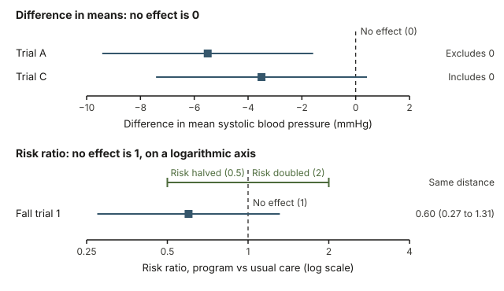
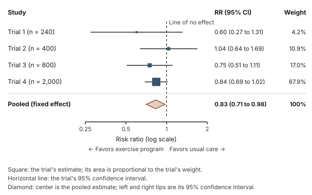
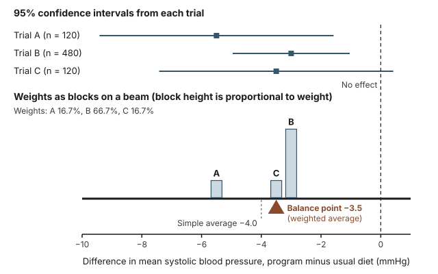
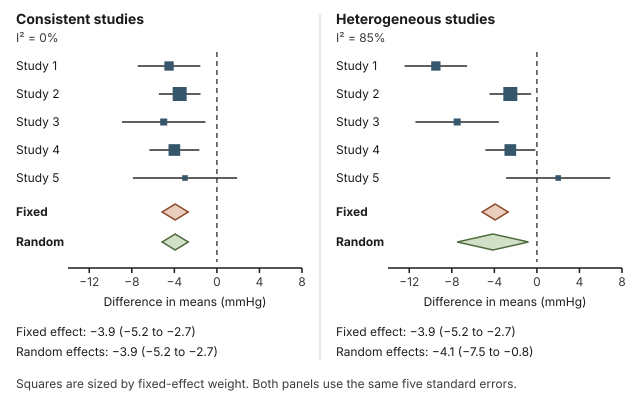
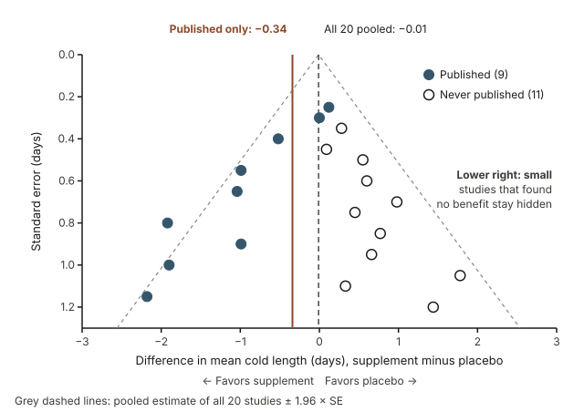

## Warm-up: three trials, three different headlines

Three hypothetical randomized trials tested the same low-sodium diet program against usual eating. Each measured systolic blood pressure after eight weeks.

- Trial A (120 people) found that the program group averaged 5.5 mmHg lower than the usual-eating group, a statistically significant difference.
- Trial B (480 people) found a 3.0 mmHg drop, also statistically significant.
- Trial C (120 people) found a 3.5 mmHg drop, but its 95% confidence interval included zero, so its headline read "Diet program has no significant effect."

Before reading on, take a minute with two questions. Does the program lower blood pressure, and by roughly how much? Does Trial C's headline cancel out the other two?

This week gives you a principled way to settle questions like these: put all the results on one picture, give each study a say that matches its precision, and read off a combined estimate with its own interval. We return to these three trials in Worked example 1.

## Why one study is rarely enough

Every study is one sample. Weeks 11 and 12 showed that a statistic varies from sample to sample, so two honest, well-run studies of the same question can report noticeably different numbers. A small study has a wide confidence interval: it can miss a real but modest effect, or overstate one by chance. Studies also differ in who enrolled, how the treatment was delivered and how the outcome was measured.

So when a clinic decides which treatment to offer, or a city decides which program to fund, the best evidence is usually not one study but a **systematic review**: a planned search for every study on a question, with rules written in advance about which studies count. When the studies measure similar outcomes, a **meta-analysis** combines their results into one pooled estimate. The standard picture of a meta-analysis is the **forest plot**.

Forest plots are so central to evidence-based health care that Cochrane, an international network that produces systematic reviews of health research, uses a simplified one as its logo. The logo summarizes randomized trials of a short course of corticosteroid drugs given to pregnant women expected to give birth too early. Several of the individual trials were too small to be convincing on their own; combined, they showed a clear reduction in deaths among the premature babies. Reading that kind of picture, and saying responsibly what a body of evidence supports, is this week's goal.

## What you will be able to do

By the end of this week you can:

- explain why a collection of studies usually tells you more than any single study;
- read an effect size with its 95% confidence interval, for a difference in means and for a risk ratio, and say whether it is compatible with no effect;
- read a forest plot: the squares, the horizontal lines, the line of no effect and the pooled diamond;
- explain inverse-variance weighting in words, and compute a fixed-effect pooled estimate, its SE and its 95% confidence interval from a few studies;
- describe heterogeneity, the random-effects idea and publication bias, and say what a funnel plot can reveal;
- write a responsible conclusion about what a body of evidence does and does not show.

## Words to know this week

| Term | Meaning |
|---|---|
| Systematic review | A study of studies: a planned, documented search for all studies on a question, with inclusion rules set in advance. |
| Meta-analysis | The statistical step that combines the results of several studies into one pooled estimate. |
| Effect size | A number that measures how big a difference or association is, such as a difference in means or a risk ratio. |
| Risk ratio (RR) | The risk of the outcome in one group divided by the risk in the comparison group. |
| Line of no effect | The vertical line on a forest plot at the value that means no difference: 0 for differences, 1 for ratios. |
| Forest plot | A chart with one row per study, showing its estimate and confidence interval, and a diamond for the pooled estimate. |
| Weight | How much say a study has in the pooled estimate. |
| Inverse-variance weighting | Giving each study a weight of 1 divided by its SE squared, so more precise studies count more. |
| Pooled estimate | The weighted average of the study estimates. |
| Fixed-effect model | A model that assumes every study estimates one common true effect. |
| Random-effects model | A model that lets the true effect differ from study to study and estimates the average true effect. |
| Heterogeneity | Variation among study results that is larger than chance alone would produce. |
| Publication bias | Distortion that arises when whether a study is published depends on what it found. |
| Funnel plot | A scatterplot of each study's estimate against its SE, used to look for missing studies. |

## Effect sizes with confidence intervals

A meta-analysis does not combine headlines or p-values. It combines **effect sizes**, each reported with a measure of its uncertainty. This week uses two effect sizes you have already met.

### Difference in means: no effect is zero

When the response variable is quantitative, such as blood pressure, a study can report the difference in sample means, $\bar{x}_{\text{program}} - \bar{x}_{\text{usual}}$, and its standard error. Using the normal model from Week 12, an approximate 95% confidence interval is

$$\text{estimate} \pm 1.96 \times \text{SE}.$$

A difference of 0 means no effect. If the interval includes 0, the data are compatible with no difference; if the whole interval lies on one side of 0, the result is statistically significant at the 5% level in a two-sided test. Keep the meaning of "95%" straight: the method that produced the interval captures the true difference in about 95% of samples in the long run. Any one interval either contains the true value or it does not.

### Risk ratio: no effect is one

When the response is categorical, such as whether a person had a fall, each group's risk is the proportion of its members who had the outcome, and a study can compare the two risks by division:

$$\text{RR} = \frac{\text{risk in the program group}}{\text{risk in the comparison group}}.$$

An RR of 1 means no effect. An RR of 0.75 means the program group's risk was 25% lower; an RR of 1.25 means it was 25% higher.

Ratios are lopsided on an ordinary number line. Halving a risk (RR of 0.5) moves 0.5 away from 1, while doubling it (RR of 2) moves a full 1 away, even though both are equally large changes. The natural logarithm fixes this: $\ln(0.5) = -0.693$ and $\ln(2) = 0.693$, the same distance from $\ln(1) = 0$. So meta-analysts do all the arithmetic for ratios on the log scale, where estimates behave approximately normally, and then convert back with $e^x$ (the $e^x$ button on a scientific calculator). Forest plots of ratios use a logarithmic axis for the same reason.

{fig-alt="Top: trial A, difference −5.5 mmHg, 95% CI −9.42 to −1.58, lies below 0 (no effect); trial C, −3.5, CI −7.42 to 0.42, crosses 0. Bottom: on a log axis 0.5 and 2 are equally far from 1; fall-prevention trial 1 has RR 0.60, CI 0.27 to 1.31."}

In the top panel, Trial A's interval lies entirely below 0, while Trial C's crosses it. In the bottom panel, the row labeled Fall trial 1 shows Trial 1, the smallest of four hypothetical fall-prevention trials used later on this page (9 of 120 program participants and 15 of 120 usual-care participants had a medically treated fall), with RR 0.60 and 95% CI 0.27 to 1.31. Its interval looks lopsided in ordinary units (it reaches 0.33 below the estimate of 0.60 but 0.71 above it), yet it is symmetric on the log axis.

## Reading a forest plot

### What each mark on a forest plot means

{fig-alt="Forest plot on a log axis. Trial risk ratios 0.60, 1.04, 0.75 and 0.84; every 95% CI crosses the line of no effect at 1. Trial 4 has 67.9% of the weight. Pooled diamond: RR 0.83, CI 0.71 to 0.98, entirely left of 1."}

A forest plot stacks one row per study. For each study:

- the **square** marks the study's estimate, and its area is proportional to the study's weight, so the biggest squares belong to the most precise studies;
- the **horizontal line** is the study's 95% confidence interval;
- the dashed vertical **line of no effect** sits at 1 for ratios and at 0 for differences.

At the bottom, the **diamond** shows the pooled estimate: its center is the pooled value, and its left and right tips are the ends of its 95% confidence interval. The labels under the axis tell you which side favors which group. Always check them, because on some plots the benefit is on the right.

### Reading the fall-prevention forest plot

The figure summarizes four hypothetical randomized trials of a twelve-month exercise program for adults aged 70 and older. The outcome is having at least one fall that needed medical care, so an RR below 1 favors the program. Reading it row by row:

- Three of the four squares sit left of 1, and Trial 2's sits just right of it.
- Every horizontal line crosses 1. On its own, no trial found a statistically significant difference.
- Trial 4, with 2,000 participants, has by far the biggest square: it carries 67.9% of the weight.
- The diamond is centered at 0.83, and its tips, 0.71 and 0.98, both lie left of 1.

Together, the trials point to about a 17% lower risk of a medically treated fall (because $1 - 0.83 = 0.17$), and the pooled interval excludes no effect even though no single trial's interval did. Worked example 2 shows exactly where the diamond comes from.

## Combining studies by inverse-variance weighting

### Why precise studies get more say

A simple average would treat a 240-person trial and a 2,000-person trial as equally informative. A meta-analysis instead weights each study by its precision:

$$w = \frac{1}{\text{SE}^2}.$$

Because an SE shrinks roughly like $1/\sqrt{n}$, a study with four times as many participants has about half the SE, and therefore about four times the weight.

### The fixed-effect pooled estimate in three steps

The **fixed-effect model** (also called the common-effect model) assumes every study is estimating the same true effect, so the study results differ only by chance. Under that assumption:

1. Give each study the weight $w_i = 1/\text{SE}_i^2$.
2. Compute the weighted average: $\text{pooled estimate} = \dfrac{\sum w_i \times \text{estimate}_i}{\sum w_i}$.
3. Compute the pooled SE, $1/\sqrt{\sum w_i}$, and the 95% interval, pooled estimate $\pm 1.96 \times$ pooled SE.

This pooled SE is always smaller than the smallest SE among the studies: combining information buys precision. Precision is not the same as correctness, though. If the studies share a bias, the pooled result inherits it, and its narrow interval makes it look more certain than it deserves.

## Worked example 1: pooling three blood-pressure trials

**Question.** For the three hypothetical low-sodium diet trials from the warm-up, what is the fixed-effect pooled difference in mean systolic blood pressure (program minus usual diet), and what is its 95% confidence interval? A negative difference means lower blood pressure on the program.

| Trial | Participants | Difference in means (mmHg) | SE (mmHg) | 95% CI (mmHg) |
|---|---|---|---|---|
| A | 120 | $-5.5$ | 2.0 | $-9.42$ to $-1.58$ |
| B | 480 | $-3.0$ | 1.0 | $-4.96$ to $-1.04$ |
| C | 120 | $-3.5$ | 2.0 | $-7.42$ to $0.42$ |

**Step 1: weights.** $w_A = 1/2.0^2 = 0.25$, $w_B = 1/1.0^2 = 1$ and $w_C = 1/2.0^2 = 0.25$. The total is $\sum w = 1.5$. As shares of the total, A and C each get $0.25/1.5 = 16.7\%$ and B gets $1/1.5 = 66.7\%$. Trial B has four times the participants of Trial A and half the SE, so it has four times the weight.

**Step 2: weighted average.**

$$\frac{0.25(-5.5) + 1(-3.0) + 0.25(-3.5)}{1.5} = \frac{-1.375 - 3.0 - 0.875}{1.5} = \frac{-5.25}{1.5} = -3.5 \text{ mmHg}.$$

For comparison, the simple average is $(-5.5 - 3.0 - 3.5)/3 = -4.0$ mmHg. The weighted average sits closer to Trial B's result because B is the most precise.

**Step 3: SE and interval.** The pooled SE is $1/\sqrt{1.5} = 1/1.2247 = 0.816$ mmHg. The 95% interval is $-3.5 \pm 1.96 \times 0.816 = -3.5 \pm 1.60$, which runs from $-5.10$ to $-1.90$ mmHg.

{fig-alt="Three hypothetical diet trials: estimates −5.5, −3.0 and −3.5 mmHg with SEs 2, 1 and 2. Block heights show weights 16.7%, 66.7% and 16.7%. The beam balances at the weighted average −3.5, not the simple average −4.0."}

The figure shows the same calculation as a balance. Each trial is a block placed at its estimate, with height equal to its weight. A weightless beam carrying these blocks balances at the weighted average, $-3.5$, not at the simple average, $-4.0$.

**Conclusion in context.** Taken together, the three hypothetical trials estimate that the diet program lowers average systolic blood pressure by about 3.5 mmHg compared with usual eating, with a 95% confidence interval from about 1.9 to 5.1 mmHg lower. Trial C's "no significant effect" headline was misleading: its estimate, $-3.5$, equals the pooled estimate, and its interval was simply too wide to exclude 0. Because all three are randomized trials, a causal reading (the program lowered blood pressure) is reasonable, provided the trials were well run.

## Worked example 2: pooling four fall-prevention trials on the log scale

**Question.** For the four hypothetical exercise-program trials in the forest plot above, what is the fixed-effect pooled risk ratio, and what is its 95% confidence interval?

Each trial reports its counts, its RR and the SE of $\ln(\text{RR})$, which the trial computed from its counts with a formula we do not need here.

| Trial | People with a treated fall, program | People with a treated fall, usual care | RR | ln(RR) | SE of ln(RR) |
|---|---|---|---|---|---|
| 1 | 9 of 120 | 15 of 120 | 0.60 | $-0.511$ | 0.40 |
| 2 | 28 of 200 | 27 of 200 | 1.04 | $0.036$ | 0.25 |
| 3 | 39 of 400 | 52 of 400 | 0.75 | $-0.288$ | 0.20 |
| 4 | 151 of 1,000 | 180 of 1,000 | 0.84 | $-0.176$ | 0.10 |

For example, Trial 1's risk ratio is $(9/120)/(15/120) = 0.075/0.125 = 0.60$, and $\ln(0.60) = -0.511$. The ln(RR) column is computed from each unrounded ratio (for Trial 4, $0.151/0.180 = 0.8389$ and $\ln(0.8389) = -0.176$), so it can differ in the third decimal from the log of the two-decimal RR. All the arithmetic below uses the rounded values in the ln(RR) and SE columns.

**Step 1: weights.** $1/0.40^2 = 6.25$, $1/0.25^2 = 16$, $1/0.20^2 = 25$ and $1/0.10^2 = 100$. The total is $\sum w = 147.25$, so Trial 4 carries $100/147.25 = 67.9\%$ of the weight.

**Step 2: weighted average on the log scale.**

$$\sum w_i \ln(\text{RR}_i) = 6.25(-0.511) + 16(0.036) + 25(-0.288) + 100(-0.176) = -3.194 + 0.576 - 7.200 - 17.600 = -27.418.$$

The pooled log risk ratio is $-27.418/147.25 = -0.1862$.

**Step 3: SE and interval on the log scale.** The pooled SE is $1/\sqrt{147.25} = 1/12.135 = 0.0824$. The interval is $-0.1862 \pm 1.96 \times 0.0824 = -0.1862 \pm 0.1615$, which runs from $-0.3477$ to $-0.0247$.

**Step 4: back to the ratio scale.** $e^{-0.1862} = 0.830$, $e^{-0.3477} = 0.706$ and $e^{-0.0247} = 0.976$. Rounded, the pooled RR is 0.83, with a 95% confidence interval from 0.71 to 0.98. Notice that this interval is not symmetric around 0.83 (it reaches 0.12 below and 0.15 above); it is symmetric on the log scale, where the arithmetic was done.

Statistical software prints the same result in a short block like this one. The heterogeneity line is explained in the next section.

```
Fixed-effect meta-analysis, risk ratio, 4 trials
Pooled RR 0.83    95% CI 0.71 to 0.98
Heterogeneity: Q = 1.72 on 3 df, p = 0.63, I² = 0%
```

**Conclusion in context.** Across four hypothetical randomized trials, the exercise program is estimated to lower the risk of a medically treated fall by about 17% (RR 0.83). The 95% confidence interval runs from about a 29% reduction (0.71) to about a 2% reduction (0.98), so the benefit could be modest. Still, the combined evidence is not compatible with no effect at the 5% level, even though no single trial reached significance on its own.

## Do the studies agree? Heterogeneity and random effects

### Consistent and heterogeneous sets of studies

The fixed-effect model assumes one true effect. Before trusting it, ask whether the study results scatter more than their own confidence intervals would lead you to expect. Variation beyond chance is called **heterogeneity**.

The first check is visual: do the horizontal lines broadly overlap? A numerical check is the statistic $Q = \sum w_i (\text{estimate}_i - \text{pooled})^2$. If the studies differ only by chance, Q tends to be about equal to its degrees of freedom, the number of studies minus 1. From Q, software reports

$$I^2 = \frac{Q - \text{df}}{Q},$$

set to 0% when Q is below df. $I^2$ describes roughly what percentage of the variation among study results reflects real differences rather than chance. As a rough guide, values near 25% are called low, near 50% moderate, and near 75% or above high.

For the four fall-prevention trials, $Q = 1.72$ on 3 degrees of freedom. Q is below its df, so $I^2 = 0\%$: the spread among the trials, including Trial 2's estimate on the far side of 1, is no more than chance alone would be expected to produce. The software output in Worked example 2 also shows $p = 0.63$. That is the p-value for a test of $H_0$: all the trials share one true effect. A large p-value means you fail to reject $H_0$; it does not prove the trials agree, because with only a few studies this test often misses real heterogeneity. That is why the picture and $I^2$ matter too.

{fig-alt="Two hypothetical sets of five studies that share the same five SEs. Left: clustered, I² = 0%, both models give −3.9 mmHg (−5.2 to −2.7). Right: scattered, I² = 85%; fixed effect −3.9 (−5.2 to −2.7), random effects −4.1 (−7.5 to −0.8)."}

Both panels of the figure show five hypothetical studies of a blood-pressure outcome with the same five standard errors, and both give almost the same fixed-effect diamond, about $-3.9$ mmHg. On the left, the intervals overlap heavily and $I^2 = 0\%$. On the right, some intervals do not overlap at all (Study 1's runs from about $-12.4$ to $-6.6$, Study 5's from about $-2.9$ to $6.9$), and $I^2 = 85\%$. The same diamond tells two different stories.

### Random-effects pooling in words

When heterogeneity is real, the studies are not all estimating one number. Programs are delivered differently, populations differ, and outcomes are measured on different schedules. The **random-effects model** treats each study's true effect as drawn from a distribution of true effects and estimates the average of that distribution.

In practice, the model estimates the between-study variance, written $\tau^2$ ("tau squared"), and adds it to every study's squared SE before weighting, so each weight becomes $1/(\text{SE}^2 + \tau^2)$. Three consequences follow:

- the weights become more equal, because the same $\tau^2$ is added to every study, so small studies get relatively more say;
- the pooled interval is wider, because it now includes uncertainty about how much the true effects vary;
- when $\tau^2 = 0$, as in the left panel, the random-effects and fixed-effect results are identical.

In the right panel, the random-effects estimate is $-4.1$ mmHg with a 95% confidence interval from $-7.5$ to $-0.8$, far wider than the fixed-effect interval from $-5.2$ to $-2.7$. The wider interval is the more honest summary. With heterogeneity this large, the most useful next question is not "What is the average?" but "Why do these studies disagree?"

## Missing studies: publication bias and funnel plots

A meta-analysis can only combine the studies it can find. **Publication bias** arises when studies with striking, statistically significant results are more likely to be published, and published sooner and more visibly, than studies that found little. When small studies with unexciting results stay in file drawers, the published record overstates the effect, and pooling it gives a precise-looking but biased result.

A **funnel plot** is a scatterplot with one dot per study: the estimate on the horizontal axis and the SE on the vertical axis, drawn with the most precise studies at the top. Large studies land near the true effect; small studies scatter widely near the bottom. Without bias the cloud is roughly symmetric, like an upside-down funnel. With publication bias, one lower corner is thin or empty.

{fig-alt="Each dot is a study, estimate against SE, most precise at top. 9 published studies (filled) and 11 never published (hollow), all smaller studies that found no benefit. All 20 pool to −0.01 days; the 9 published pool to −0.34 days."}

The figure shows 20 hypothetical studies of a supplement claimed to shorten colds, where, by construction, the true effect is zero. In this illustration, large studies were always published, but a smaller study was published only if it found an apparent benefit. The 9 published studies (filled dots) pool to a difference of $-0.34$ days, colds about 8 hours shorter, with a 95% confidence interval from $-0.64$ to $-0.04$ that excludes zero. All 20 studies together pool to $-0.01$ days, essentially nothing. In practice you never see the hollow dots; you see only a funnel with its lower right corner missing.

The grey dashed lines mark the pooled estimate of all 20 studies plus or minus 1.96 SE at each level of SE; without bias, about 95% of studies fall between them. Here one study of the 20 (a published one with SE 0.80 and an estimate of $-1.92$ days) falls outside, which is about what that 95% leads you to expect.

Two cautions keep funnel plots honest. Asymmetry can have other causes: small studies are sometimes run in different populations, or with less care, than large ones. And with fewer than about ten studies, a funnel plot is too sparse to judge. The strongest protection is structural: registering trials before their results are known, and searching trial registries and unpublished reports rather than journals alone.

## A common misreading: counting significant studies

The misreading goes like this: "Four trials tested the exercise program and none found a significant effect, so the program does not work." Tallying significant and non-significant studies is called **vote counting**, and it misleads in three ways.

First, "not statistically significant" does not mean "no effect." An interval that crosses the line of no effect is compatible with no effect *and* with a real benefit; small studies often cannot tell the two apart. Second, a tally ignores the size, direction and precision of each result. Several imprecise estimates that mostly point the same way add up, which is exactly what the pooled diamond in Worked example 2 shows (RR 0.83, 95% CI 0.71 to 0.98). Third, vote counting can mislead in the opposite direction: a published record full of small, significant studies can look convincing while the studies that found nothing sit unpublished, as in the funnel plot.

The better habit is to read the estimates and intervals, and to let the weighted pooled estimate, not a tally of p-values below 0.05, summarize the evidence.

## Writing a responsible conclusion from a body of evidence

A good conclusion about a collection of studies covers six questions in plain words:

1. **Direction and size.** What is the pooled estimate, in units a reader understands?
2. **Precision.** What does the confidence interval allow, especially at the end nearest no effect?
3. **Consistency.** Do the studies agree, or is there heterogeneity that needs explaining?
4. **Study quality.** Were the studies randomized or observational? Pooling does not remove confounding or bias inside the studies.
5. **Completeness.** Could studies be missing because of publication bias?
6. **Scope.** Who was studied, and who was not?

For the fall-prevention trials, a responsible summary might read: "Four hypothetical randomized trials in adults aged 70 and older together suggest that the exercise program reduces medically treated falls by about 17% (95% CI 2% to 29%). The trial results are consistent with one another ($I^2 = 0\%$), although four trials give little power to detect real differences. The benefit may be modest, and with only four trials we cannot check well for missing studies. The evidence says nothing directly about younger adults."

## Transfer: later school start times and teen sleep

**Question.** Three hypothetical studies compared high schools that moved their start time later with similar schools that did not. The response variable is average nightly sleep reported by students, in minutes. Each study reports the later-start mean minus the comparison mean, so positive values mean more sleep, and each report gives only a 95% confidence interval. What does this body of evidence support?

| Study | Difference in mean sleep (minutes) | 95% CI (minutes) |
|---|---|---|
| 1 | 34 | 14.4 to 53.6 |
| 2 | 22 | 12.2 to 31.8 |
| 3 | 28 | 18.2 to 37.8 |

**Step 1: recover each SE from its interval.** A 95% interval is $2 \times 1.96 = 3.92$ SEs wide, so SE $=$ (upper $-$ lower)$/3.92$. This works when the interval was built as estimate $\pm 1.96$ SE. Each interval here is symmetric about its estimate (for Study 1, $34 - 14.4 = 53.6 - 34 = 19.6$), which fits that. For a ratio, you would do this on the log scale. So for Study 1, the SE is $(53.6 - 14.4)/3.92 = 39.2/3.92 = 10$ minutes. For Studies 2 and 3, $19.6/3.92 = 5$ minutes.

**Step 2: weights.** $1/10^2 = 0.01$ for Study 1 and $1/5^2 = 0.04$ for each of Studies 2 and 3, for a total of 0.09. With half the SE, Studies 2 and 3 each get four times Study 1's weight.

**Step 3: pooled estimate.** $(0.01 \times 34 + 0.04 \times 22 + 0.04 \times 28)/0.09 = (0.34 + 0.88 + 1.12)/0.09 = 2.34/0.09 = 26.0$ minutes.

**Step 4: SE and interval.** The pooled SE is $1/\sqrt{0.09} = 1/0.3 = 3.33$ minutes, so the 95% interval is $26.0 \pm 1.96 \times 3.33 = 26.0 \pm 6.5$, from about 19.5 to 32.5 minutes.

**Step 5: consistency.** All three intervals overlap, and $Q = 0.01(34 - 26)^2 + 0.04(22 - 26)^2 + 0.04(28 - 26)^2 = 0.64 + 0.64 + 0.16 = 1.44$ on 2 degrees of freedom. Q is below its df, so $I^2 = 0\%$.

**Step 6: design and completeness.** None of these studies was randomized. Schools chose whether to change their start times, and schools that chose to change may differ in other ways, such as family income, bus routes or how sleep was surveyed. Pooling three observational studies narrows the interval for the association, but it cannot remove confounding that the studies share. Three studies are also far too few for a funnel plot.

**Conclusion in context.** In three hypothetical studies, students at schools with later start times reported sleeping about 26 minutes more per night than students at comparison schools (95% CI about 19.5 to 32.5 minutes). The results are consistent with one another ($I^2 = 0\%$), which is encouraging, though three studies can say little about disagreement. None was randomized, so part of the difference may reflect other differences between the schools. The evidence is consistent with later start times increasing teen sleep; it does not establish it.

## Practice on your own (ungraded)

1. A forest plot of risk ratios from a hypothetical meta-analysis shows a study with RR 0.70 and 95% CI 0.45 to 1.09. Is this study's result statistically significant at the 5% level? Does it show that the treatment has no effect? *What to look for:* where the line of no effect sits, and what a wide interval can and cannot rule out.
2. Study X has SE 3.0 and Study Y has SE 1.5 for the same kind of estimate. Under inverse-variance weighting, how many times as much weight does Study Y get? *What to look for:* weight is 1 divided by the SE squared.
3. Two hypothetical studies of a walking program report differences in mean resting heart rate of $-4$ beats per minute (SE 2) and $-1$ beat per minute (SE 1). Find the fixed-effect pooled estimate, its SE and its 95% confidence interval. Does the interval include 0? *What to look for:* the pooled estimate should land closer to the more precise study.
4. A funnel plot of 25 studies has plenty of small studies showing a benefit but almost none showing no benefit or harm. Give two different explanations. *What to look for:* one explanation involves which studies get published; the other involves how small studies might differ from large ones.
5. A hypothetical news story says, "Five of eight studies found no significant link between the food additive and headaches, so there is no link." What would you want to see before agreeing? *What to look for:* estimates, intervals, weights and a pooled result, not a tally.
6. Write a two-sentence conclusion for a hypothetical meta-analysis of six observational studies that found a pooled risk ratio of 1.25 (95% CI 1.05 to 1.49) for a health problem among people with long-term night-shift work, with $I^2 = 10\%$. *What to look for:* size, precision, consistency, and what an observational design can and cannot show.

## Where to read further

Neither free textbook for this course covers meta-analysis directly, so this page is your main source for forest plots, pooling, heterogeneity and publication bias. What the textbooks do cover well is the building block underneath all of it: confidence intervals and standard errors.

- [IMS Chapter 12, Confidence intervals with bootstrapping](https://openintrostat.github.io/ims/foundations-bootstrapping.html) explains what a confidence interval is and what "95% confident" means.
- [IMS Chapter 13, Inference with mathematical models](https://openintrostat.github.io/ims/foundations-mathematical.html) covers the standard error, the normal model and intervals of the form estimate plus or minus 1.96 SE.
- Optional, for biomedical examples: Chapter 4, Foundations for inference, in [Introductory Statistics for the Life and Biomedical Sciences](https://www.openintro.org/book/biostat/).

The IMS book shows R code in places; you can skip the code and read the output and the explanation.

## Where this goes next

This week drew on ideas from across the course: study design ([Week 2](week02-study-design.qmd)), confidence intervals and standard errors ([Week 11](week11-simulation-based-inference.qmd) and [Week 12](week12-classical-hypothesis-testing.qmd)), and comparing proportions between groups ([Week 13: Categorical outcomes](week13-categorical-outcomes.qmd)). Next, [Week 15: Final review](week15-final-review.qmd) brings the whole course together, and reading a forest plot is a good way to practice confidence intervals, study design and group comparisons together. See the [notes overview](index.qmd) for every week and the [course schedule](../schedule.qmd) for the order of the weeks.
