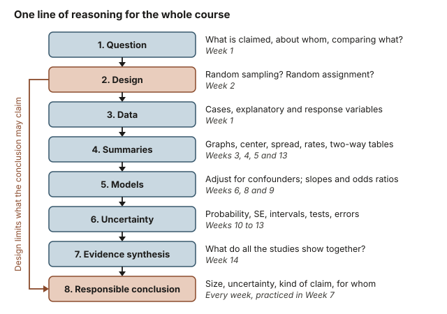
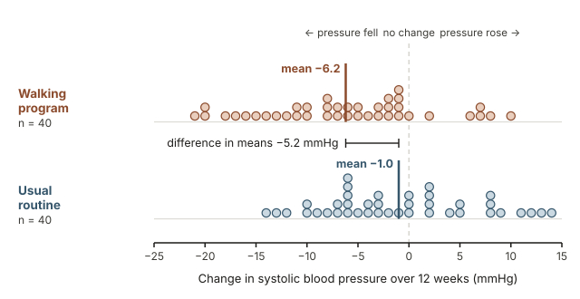
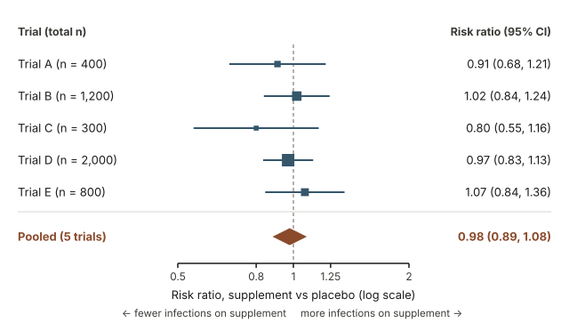

## Warm-up: what would it take to believe a health headline?

A made-up headline reads: "Adults who take Supplement H get 19% fewer winter infections." Before you believe it, write down three questions you would ask, and beside each one, the week of this course it comes from.

This week adds no new material. It joins the earlier weeks into one line of reasoning; the headline returns in Worked example 2.

## Why one chain of reasoning helps you now

Fourteen weeks of material are easier to hold as one argument that every study must make: where the data came from, what they show, how sure we can be, and what may be concluded. You will use that argument whenever a health or policy claim asks for your trust.

## What you will be able to do

By the end of this week you can:

- trace a study from question to conclusion, naming the week behind each step;
- decide from the design whether a study supports a causal claim, an association only, or a generalization;
- read an estimate with its standard error, interval and p-value, and say what each does not show;
- spot common misreadings from the course and correct them in plain language.

## Words to know from the whole course

| Term | Meaning | Week |
|---|---|---|
| Random sampling | Cases chosen by chance from a population; supports generalizing to it | 2 |
| Random assignment | Groups formed by chance; supports cause-and-effect claims | 2 |
| Confounding variable | Linked to both the explanatory and the response variable; can create, hide or reverse an association | 6 |
| Standard error | How much a statistic varies from sample to sample | 11, 12 |
| Risk ratio and odds ratio | Ratio of two groups' risks; ratio of their odds (from logistic regression); 1 means no difference | 4, 9, 10 |
| Confidence interval | Plausible values for a parameter, from a method that captures it in a stated share of samples, such as 95% | 11, 12 |
| p-value | The probability, if $H_0$ were true, of a result at least as extreme as the one observed | 11, 12 |
| Pooled estimate | A weighted average of several studies' results, shown in a forest plot | 14 |

## The course as one line of reasoning

Every week answered one question in a longer argument, laid out below in eight steps. Walk any study down them in order. The worked examples use these step numbers and skip steps that do not apply. The side arrow marks the most important link: the design, fixed before any data exist, sets what the conclusion may say.

{fig-alt="Eight steps and the weeks behind each: question (1), design (2), data (1), summaries (3, 4, 5, 13), models (6, 8, 9), uncertainty (10 to 13), evidence synthesis (14), conclusion (practiced in 7). An arrow: design limits the conclusion."}

### Question and design: what kind of claim is possible

Start with the claim: the cases, the variables, and the comparison ([Week 1](week01-data-evidence.qmd)). Then ask how the data were produced ([Week 2](week02-study-design.qmd)). Random sampling supports generalizing to the sampled population; random assignment supports cause and effect, because it balances other variables between groups on average. An observational study, however large, shows association.

### Data and summaries: describe before you decide

Describe before you test, and match the summary to the variable types: a graph with center and spread for one quantitative variable ([Week 3](week03-one-variable-summaries.qmd)), side-by-side displays to compare groups ([Week 4](week04-comparing-groups.qmd)), a scatterplot and $r$ for two quantitative variables ([Week 5](week05-association.qmd)), and rates and two-way tables for categorical outcomes ([Week 13](week13-categorical-outcomes.qmd)).

### Models: adjusting and describing relationships

A confounding variable can create, hide or reverse an association ([Week 6](week06-confounding.qmd)). Comparing within its levels, or adding it to a model, gives an adjusted comparison. A fitted line $\hat{y} = b_0 + b_1 x$ describes how the mean response differs across cases with different values of $x$ ([Week 8](week08-simple-regression.qmd)); multiple and logistic regression report adjusted slopes and odds ratios ([Week 9](week09-multiple-logistic-regression.qmd)). Adjustment handles only the variables that were measured.

### Uncertainty: could chance alone explain this?

Probability describes risk and diagnostic tests ([Week 10](week10-probability-risk-diagnosis.qmd)). Randomization tests and bootstrap intervals show by simulation how much a statistic varies from sample to sample ([Week 11](week11-simulation-based-inference.qmd)); classical tests and intervals model that variation mathematically ([Week 12](week12-classical-hypothesis-testing.qmd), [Week 13](week13-categorical-outcomes.qmd)). A small p-value says the data would be surprising if $H_0$ were true. Neither a p-value nor an interval repairs a weak design.

### Synthesis and conclusion: what the evidence as a whole supports

A forest plot shows each study's estimate and interval, and a pooled estimate combines them, giving more weight to more precise (usually larger) studies ([Week 14](week14-meta-analysis-forest-plots.qmd)). A responsible conclusion states the effect size, its uncertainty, the kind of claim the design allows, and who it applies to, in plain words, as practiced in [Week 7](week07-synthesis-midterm.qmd).

## Worked example 1: a randomized walking program and blood pressure

**The study (hypothetical).** Eighty adult volunteers with mildly high blood pressure were randomly assigned, 40 to a 12-week brisk-walking program and 40 to their usual routine. The response is the change in systolic blood pressure (mmHg) over 12 weeks; negative means it fell.

**1. Question.** Does the program lower systolic blood pressure, and by how much? The explanatory variable (group) is categorical, and the response variable (change in blood pressure) is quantitative.

**2. Design.** Random assignment makes this a randomized experiment, so a clear difference can be attributed to the program. The volunteers were not a random sample, which limits whom the results describe.

**3–4. Data and summaries.** The dot plot shows every participant: similar spreads, no extreme outliers, and the walking group sitting lower.

{fig-alt="Dot plots of blood pressure change for 40 walkers and 40 adults on their usual routine. Walking mean −6.2 mmHg, usual-routine mean −1.0 mmHg; the two groups overlap a great deal."}

| Group | $n$ | Mean change $\bar{x}$ (mmHg) | Median (mmHg) | SD $s$ (mmHg) |
|---|---|---|---|---|
| Walking program | 40 | −6.2 | −6.0 | 8.0 |
| Usual routine | 40 | −1.0 | −2.5 | 7.5 |

The difference in means, walking minus usual routine, is

$$\bar{x}_W - \bar{x}_U = -6.2 - (-1.0) = -5.2 \text{ mmHg.}$$

**6. Uncertainty.** The standard error of the difference combines two earlier ideas: the one-mean standard error $s/\sqrt{n}$ ([Week 12](week12-classical-hypothesis-testing.qmd)), and the rule that the variances of two independent groups add ([Week 13](week13-categorical-outcomes.qmd)).

$$\text{SE} = \sqrt{\frac{s_W^2}{n_W} + \frac{s_U^2}{n_U}} = \sqrt{\frac{8.0^2}{40} + \frac{7.5^2}{40}} = \sqrt{1.600 + 1.406} = \sqrt{3.006} \approx 1.73 \text{ mmHg.}$$

An approximate 95% confidence interval is the estimate plus or minus 1.96 standard errors, as in Week 12:

$$-5.2 \pm 1.96(1.73) = -5.2 \pm 3.39, \quad \text{about } -8.6 \text{ to } -1.8 \text{ mmHg.}$$

To test $H_0: \mu_W - \mu_U = 0$ against $H_A: \mu_W - \mu_U \ne 0$, the test statistic is $T = -5.2 / 1.73 \approx -3.0$. Software gives a two-sided p-value of about 0.004 (a randomization test gives nearly the same), so at $\alpha = 0.05$ we reject $H_0$.

**8. Responsible conclusion.** In this hypothetical experiment, walking lowered systolic blood pressure by about 5 mmHg on average compared with the usual routine (95% confidence interval for the difference about −8.6 to −1.8 mmHg, that is, a reduction of roughly 2 to 9 mmHg). Because the groups were formed at random, the program is the likely cause. The effect is an average, not a promise: 6 of the 40 walkers saw a rise, while 22 of the 40 on the usual routine saw a fall. The results apply most directly to volunteers like these.

## Worked example 2: Supplement H, smoking, and five trials

**The study (hypothetical).** A survey of 2,000 adults recorded whether each took a daily herbal supplement, Supplement H (1,000 did, 1,000 did not), whether they smoked, and whether they had a respiratory infection that winter.

**1. Question.** Do users have fewer winter infections, and does the supplement prevent them? Supplement use (explanatory) and infection (response) are both categorical.

**2. Design.** This is an observational study: people chose whether to take the supplement, so it can show association but not, by itself, cause. Nothing says the 2,000 adults were a random sample, so even the association applies most directly to adults like those surveyed.

**3–4. Data and summaries.** Infection rates were $210/1{,}000 = 0.210$ for users and $260/1{,}000 = 0.260$ for non-users: a difference of $0.210 - 0.260 = -0.050$ (5.0 percentage points) and a risk ratio (relative risk) of $0.210/0.260 \approx 0.81$, about 19% lower. That is the warm-up headline.

**5. Models: adjusting for smoking.** Only 10% of users smoked, compared with 30% of non-users, and smokers had far more infections, so smoking is a plausible confounder. Compare within smoking groups:

| Smoking status | Users infected | Users rate | Non-users infected | Non-users rate |
|---|---|---|---|---|
| Non-smokers | 172 of 900 | 19.1% | 140 of 700 | 20.0% |
| Smokers | 38 of 100 | 38.0% | 120 of 300 | 40.0% |
| All adults | 210 of 1,000 | 21.0% | 260 of 1,000 | 26.0% |

Within each smoking group, the gap shrinks to 0.9 and 2.0 percentage points. A logistic regression agrees; it reports odds ratios, which is why its unadjusted value is 0.76 rather than the risk ratio of 0.81.

```
Response: winter infection (yes = 1)     Odds ratio    95% CI
Supplement, unadjusted                         0.76    (0.61, 0.93)
Supplement, adjusted for smoking               0.94    (0.75, 1.17)
Smoker, adjusted for supplement                2.64    (2.07, 3.38)
```

**6. Uncertainty.** The standard error of the raw difference in proportions is

$$\text{SE} = \sqrt{\frac{0.21(0.79)}{1000} + \frac{0.26(0.74)}{1000}} = \sqrt{0.000166 + 0.000192} \approx 0.0189.$$

An approximate 95% interval is $-0.050 \pm 1.96(0.0189) = -0.050 \pm 0.037$, about $-0.087$ to $-0.013$. Chance alone does not easily explain the raw gap, but the interval says nothing about why it exists. Adjusted for smoking, the supplement's odds ratio is 0.94, and its interval (0.75 to 1.17) includes 1.

**7. Evidence synthesis.** Now suppose five randomized trials, also hypothetical, compared Supplement H with a placebo. Every trial's interval crosses 1; the pooled risk ratio is 0.98 (95% CI 0.89 to 1.08). The pooled value is a weighted average of the five trials' log risk ratios: Trial D, the most precise, carries about 42% of the weight (the largest square) and Trial C about 7% (the smallest).

{fig-alt="Forest plot of risk ratios for winter infection, supplement versus placebo, in five trials: 0.91, 1.02, 0.80, 0.97, 1.07; every interval crosses 1. Pooled risk ratio 0.98, 95% CI 0.89 to 1.08."}

**8. Responsible conclusion.** Among adults like those surveyed, most of the gap reflects smoking: users smoked less. Adjusted for smoking, and across five randomized trials, the supplement shows little or no benefit. The pooled interval (0.89 to 1.08) is consistent with no effect and does not support a benefit larger than about an 11% reduction in risk. The evidence does not support the headline.

## Transfer: the same chain for a positive screening test

**The setting (hypothetical numbers).** A condition affects 2% of adults who take a pharmacy screening test. The test detects 90% of those who have it (sensitivity) and clears 95% of those who do not (specificity). You test positive. How likely is it that you have the condition?

**Question and design.** You want the chance of the condition given a positive result, not the sensitivity (the chance of a positive result given the condition). The 2% base rate, how common the condition is among those tested, must describe people like you.

**Summary with natural frequencies.** Picture 10,000 adults taking the test.

- With the condition: $0.02 \times 10{,}000 = 200$, and $0.90 \times 200 = 180$ of them test positive.
- Without it: $10{,}000 - 200 = 9{,}800$, and $0.05 \times 9{,}800 = 490$ of them test positive anyway.
- All positives: $180 + 490 = 670$, of whom $180/670 \approx 0.27$ have the condition.

**Conclusion.** With a 2% base rate, only about 27% of positive results come from people with the condition, so a positive screen calls for a confirmatory test, not a diagnosis. At a 10% base rate there would be $0.90 \times 1{,}000 = 900$ true and $0.05 \times 9{,}000 = 450$ false positives, a share of $900/1{,}350 \approx 0.67$: the base rate drives the result. Nothing here needs adjusting or pooling, but uncertainty still applies: the 90% and 95% are themselves estimates from earlier studies. The rest of the chain is unchanged: a clear question, the source of the numbers, a fitting summary, a conclusion sized to the evidence.

## Common misreadings from across the course

Each sounds reasonable and is wrong; the linked week reviews it.

1. **"They are associated, so one causes the other."** Confounding or reversed cause can produce an association; random assignment supports causal claims ([Week 2](week02-study-design.qmd), [Week 6](week06-confounding.qmd)).
2. **"A huge sample fixes a biased design."** More data shrink the standard error, not the bias ([Week 2](week02-study-design.qmd)).
3. **"The p-value is the probability that $H_0$ is true."** It is the probability, assuming $H_0$ is true, of a result at least as extreme as the one observed ([Week 12](week12-classical-hypothesis-testing.qmd)).
4. **"Significant means important, and not significant means no effect."** Significance depends on sample size as well as effect size; judge the estimate and the width of its interval ([Week 12](week12-classical-hypothesis-testing.qmd)).
5. **"Most people fall inside the 95% confidence interval."** The interval is for a parameter. In Worked example 1, the walking group's mean change has an approximate 95% interval of $-6.2 \pm 1.96(8.0/\sqrt{40}) = -6.2 \pm 2.48$, about $-8.7$ to $-3.7$ mmHg, while individual walkers ranged from $-21$ to $+10$ mmHg ([Week 11](week11-simulation-based-inference.qmd)).
6. **"A 90% sensitive test makes a positive result 90% likely to be right."** This swaps the condition and the result; the base rate matters ([Week 10](week10-probability-risk-diagnosis.qmd)).
7. **"Count the significant studies to judge the evidence."** Vote counting ignores each result's size and precision; a pooled estimate uses both ([Week 14](week14-meta-analysis-forest-plots.qmd)).
8. **"The slope says what happens to each person."** It describes how the mean response differs across cases with different $x$, not what would happen to one person; from observational data it is not, by itself, a causal effect ([Week 8](week08-simple-regression.qmd)).

## Practice questions that mix the weeks (ungraded)

1. A news story reports that dog owners have lower blood pressure than other adults. Name the explanatory and response variables and a possible confounder, and describe a study that could support a causal claim. *What to look for:* can dog ownership be assigned at random?
2. In a hypothetical survey of 50 adults, $\hat{y} = 78 - 0.9x$, with $x$ in hours of exercise per week, $y$ the resting heart rate (beats per minute), and $R^2 = 0.30$. Interpret the slope, predict $y$ for 5 hours, and explain why the line does not show that exercise lowers heart rate.
3. A condition (hypothetical numbers) affects 1% of the people screened, and the test has 95% sensitivity and 90% specificity. Out of 10,000 people, how many test positive, and what share of them have the condition? *What to look for:* compare with the transfer example.
4. A hypothetical randomized trial reports a 95% confidence interval of $-0.02$ to $0.10$ for the difference in recovery proportions (treatment minus placebo). What does a two-sided test of $H_0: p_T - p_P = 0$ at $\alpha = 0.05$ conclude, and what does that mean in plain words?
5. Eight hypothetical trials give a pooled risk ratio of 0.80 (95% CI 0.70 to 0.92), yet only two were statistically significant on their own. What does the collection support, and how can both facts be true?
6. Rewrite this sentence so it is accurate for Worked example 1: "The study proves that walking cures high blood pressure."

## Read further in the free textbook

Each Applications chapter of *Introduction to Modern Statistics* applies one part of the book. Skip any R code; read the output and explanation.

- [Chapter 3, Applications: Data](https://openintrostat.github.io/ims/data-applications.html), for Weeks 1 and 2.
- [Chapter 6, Applications: Explore](https://openintrostat.github.io/ims/explore-applications.html), for Weeks 3 to 5.
- [Chapter 10, Applications: Model](https://openintrostat.github.io/ims/model-applications.html), for Weeks 8 and 9.
- [Chapter 15, Applications: Foundations](https://openintrostat.github.io/ims/foundations-applications.html), for Weeks 11 and 12.

## Where this goes next

This is the last week. The previous one is [Week 14: Meta-analysis and forest plots](week14-meta-analysis-forest-plots.qmd), and the [notes overview](index.qmd) lists every week. To review the whole course:

1. For each week, redo one worked example and name the chain step it serves.
2. Use the misreadings list as a self-check, explaining each correction aloud.
3. For each practice question above, first name the design and the kind of claim it allows, then compute.

The [course home](../index.qmd) links everything else.
