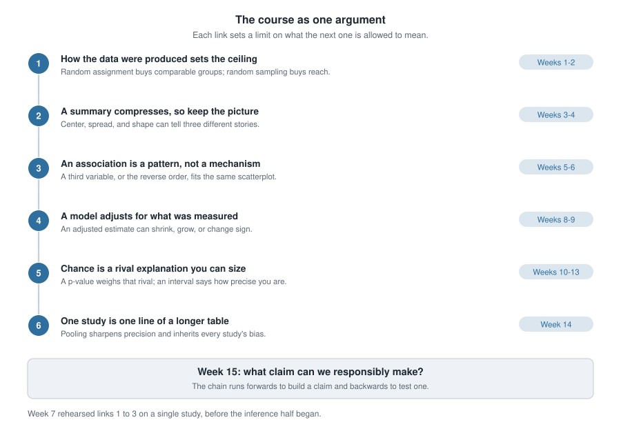
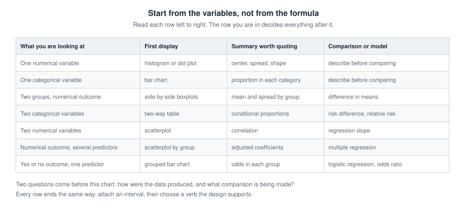
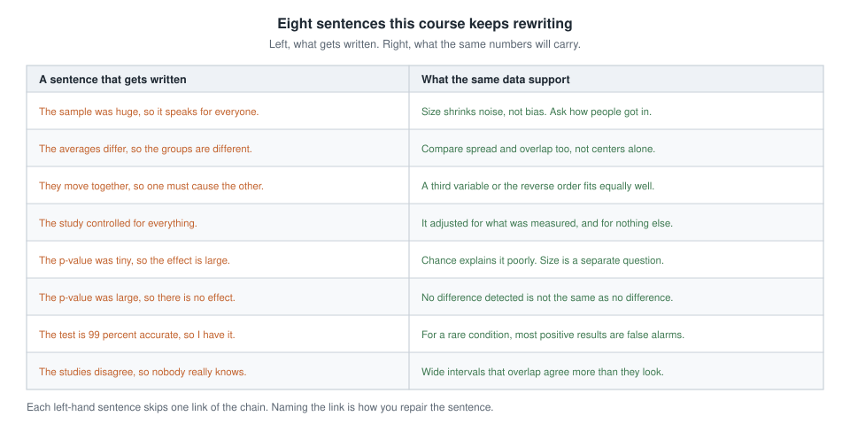
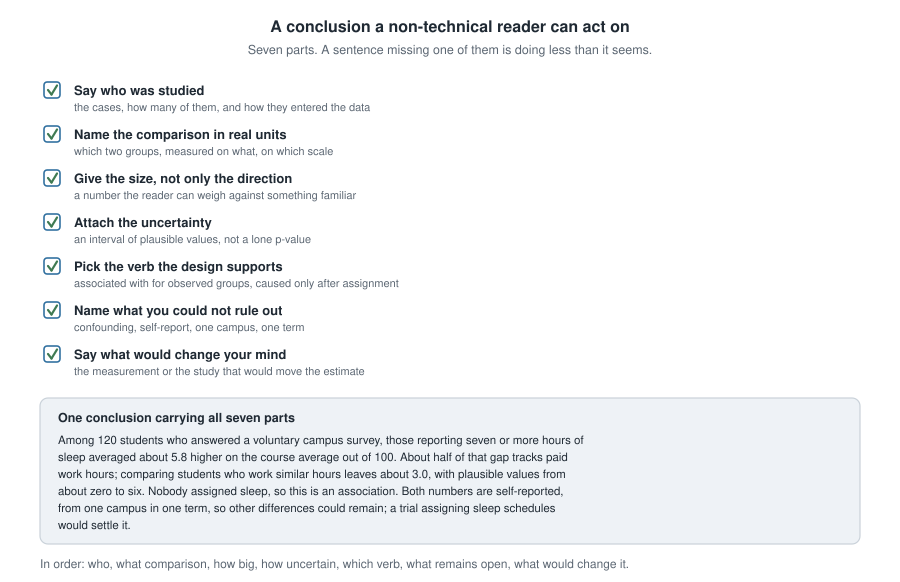

## Where this week starts

This week brings no new machinery. What arrives instead is the shape of everything before it. The course was never fourteen topics; it was one argument, built in order, each piece deciding what the next is allowed to mean.

Here is that argument in a single breath. How the data were produced sets a ceiling on what any comparison can show. A summary compresses. An association is a pattern, not a mechanism. A model adjusts for what somebody measured, and nothing else. Chance is a rival explanation whose size can be measured. And one study is one line of a longer table. Every technique you met serves one of those six sentences.

Week 14 left you at the widest scale, reading a forest plot in which a dozen studies argue with one another. That is where public claims live. Nobody hands you a study; they hand you a headline summarizing somebody's summary of one. This week you practise walking that sentence backwards to the data, then forwards again saying only what the data will carry.

One note first. Every number here is invented for teaching: the arithmetic is real and worth checking with a calculator, the studies are not.

### Why this matters beyond the classroom

Picture a clinic manager holding a one-page summary from a vendor: patients on the new therapy schedule recovered about four days faster. Four days is a lot. The schedule costs money and reshuffles staffing, and she has a meeting on Thursday. If all she can read is the four, the decision has been made for her. If she can ask who ended up on each schedule, the four shrinks to about two, and two days may not be worth the reshuffle. That one question — were the groups comparable before anything happened to them? — separates buying a real improvement from buying a difference in who was sick to begin with.

You will stand on both sides of that page. This week is about not being fooled in either direction: not talked into a claim the design cannot support, nor out of a real finding because a p-value landed at 0.06.

## What you will be able to do

- Trace a claim backwards to its data: what was measured, on whom, how those people entered the study, and which comparison produced the number.
- Choose the display, the summary, and the comparison that a given pair of variables calls for, in that order.
- Turn a crude difference into an adjusted one, and say plainly what the adjustment fixed and what it left untouched.
- Read a p-value, an interval of plausible values, and one line of a forest plot without overstating any of the three.
- Name the misreading a sentence commits, then rewrite it so it stops.
- Write a conclusion for a non-technical reader carrying the size, the uncertainty, and the limits of the design.

## Words worth owning

| Term | What it means in this course |
|------|------------------------------|
| case | one row of the data table: the person, patient, or county measured |
| confounder | a variable linked to both the explanatory variable and the response, so it rivals your explanation |
| crude comparison | two groups compared exactly as they came, with nothing held fixed |
| adjusted comparison | the same comparison made within groups that already match on some measured variable |
| p-value | how often chance alone would produce a result at least as extreme as the observed one |
| interval of plausible values | the values of the estimated quantity that the data do not rule out |
| risk difference | one group's rate minus the other group's rate, in the units of the outcome |
| responsible claim | the strongest sentence the design, size, and uncertainty all support |

## The course as one argument

Fourteen weeks of material is too much to hold as a list, but not as a chain. Each link below is a claim about evidence that constrains the link after it, which is why the order matters more than the vocabulary.

{fig-alt="A vertical chain of six numbered claims, from how data are produced through summaries, association, adjustment and chance, to bodies of evidence, each labelled with the weeks that built it and ending in the Week 15 question."}

### What each link buys you

Link one buys comparability and reach. Random assignment tends to make groups alike on everything, measured or not, before the treatment lands; random sampling tends to make the sample resemble the population you want to talk about. Neither substitutes for the other.

Link two buys honesty about compression. The mean of a right-skewed variable sits above its median for a reason, and reporting only the mean hands the reader a number no typical person has. The picture is the check on the summary.

Link three buys restraint. Two variables moving together is a fact about the data. Which moves which, or whether a third thing moves both, is a question the scatterplot cannot settle.

Link four buys a partial repair. Stratifying, or fitting a model with extra predictors, compares like with like on the variables in the model — valuable and limited at once, because nothing in the arithmetic knows about the variable nobody wrote down.

Link five buys a rival you can size. Before the inference weeks, "that could just be chance" was an unanswerable objection. A null distribution turns it into a number, and an interval turns an estimate into a range.

Link six buys perspective. Five studies with overlapping intervals often agree far more than their headlines suggest, and pooling them sharpens precision without repairing any bias they share.

### Which link a claim actually rests on

Reading forwards builds a claim; reading backwards tests one. Work up the chain and stop at the first link that will not hold.

"Students who use the tutoring centre earn higher grades, so the centre works." The chain breaks at link one: students who go are students who chose to go, and no careful modelling downstream repairs that.

"The screening test caught 96 of every 100 cases, so a positive result means you almost certainly have the condition." This passes link one, since sensitivity is a property of the test. It breaks at link five, in the Week 10 form: the chance of a positive result given the disease is not the chance of the disease given a positive result.

## Choosing the right comparison

Students often arrive at a review week hoping for a flowchart of tests. There is a chart, and it is useful, but it sits lower in the reasoning than people expect. What decides the display, summary, and comparison is the *type* of the variables in front of you.

{fig-alt="A seven-row chart keyed on variable types. Each row runs left to right from what you are looking at, to a first display, to the summary worth quoting, to the comparison or model that fits it."}

### Start from the variables, not from the formula

Ask two questions and the row picks itself. How many variables am I comparing, and is each numerical or categorical? Two groups and a numerical outcome gives side-by-side boxplots, a mean and spread in each group, and a difference in means. Two categorical variables gives a two-way table, conditional proportions, and a risk difference or relative risk. Two numerical variables gives a scatterplot, a correlation, and a regression slope. A yes-or-no outcome gives odds and logistic regression, because a straight line would eventually predict probabilities above one.

The display comes first, because it tells you whether the summary is fair. You never pick a summary and then hunt for a picture that flatters it.

### What the chart cannot decide for you

The chart says which comparison fits. It says nothing about whether that comparison means anything, and that is not a flaw in it. Two questions sit above it: how were these data produced, and what comparison is actually being made, against what?

Two rows deserve a warning label. The multiple-regression row produces adjusted estimates, easy to over-trust: "adjusted for age and income" means adjusted for the age and income that were recorded, in the form they were recorded. The logistic row produces odds ratios, easy to over-read: when an outcome is common, an odds ratio runs noticeably larger than the relative risk, as the second worked example shows.

## Worked example — sleep hours and course averages on one campus

**Setting.** A campus survey invited students to report their average nightly sleep and their course average out of 100. One hundred and twenty responded, and a student newspaper summarized the result as "sleep more, score higher".

**Step 1. Cases and variables.** Each case is one responding student. The explanatory variable is self-reported nightly sleep; the response is the course average out of 100. Hours of paid work per week were recorded too.

**Step 2. How the data were produced.** Students volunteered. Nobody assigned anyone to sleep more, nobody sampled the campus at random, and both quantities are self-reported. That is a link-one problem, and nothing later repairs it.

**Step 3. The crude comparison.** Splitting respondents at seven hours gives two groups.

| Sleep group | Number of students | Mean course average |
|-------------|--------------------|---------------------|
| Under seven hours | 66 | 79.8 |
| Seven hours or more | 54 | 85.6 |
| All respondents | 120 | 82.4 |

The crude difference is $85.6 - 79.8 = 5.8$ on the 0-to-100 scale. Check the margin before trusting it: the group means, weighted by group size, must reproduce the overall mean.

$$\frac{66 \times 79.8 + 54 \times 85.6}{120} = \frac{5266.8 + 4622.4}{120} = \frac{9889.2}{120} = 82.41$$

That rounds to 82.4, so the table is internally consistent.

**Step 4. The rival explanation.** Paid work is tied to both variables: students working long hours sleep less and study less. Splitting the same students by work hours gives four cells.

| Paid work | Sleep group | Number | Mean course average |
|-----------|-------------|--------|---------------------|
| Under 15 hours a week | Under seven hours | 26 | 83.1 |
| Under 15 hours a week | Seven hours or more | 46 | 86.6 |
| 15 hours or more | Under seven hours | 40 | 77.7 |
| 15 hours or more | Seven hours or more | 8 | 80.0 |

Check the margins again. The short-sleep cells hold $26 + 40 = 66$ students and the long-sleep cells $46 + 8 = 54$, matching the first table; the work strata hold $26 + 46 = 72$ and $40 + 8 = 48$, totalling 120.

**Step 5. The adjusted comparison.** Compare within each work stratum, which is the whole idea of adjustment.

- Among students working under 15 hours: $86.6 - 83.1 = 3.5$.
- Among students working 15 hours or more: $80.0 - 77.7 = 2.3$.

Both gaps are smaller than the crude 5.8. Combining them, weighted by stratum size:

$$\frac{72 \times 3.5 + 48 \times 2.3}{120} = \frac{252 + 110.4}{120} = \frac{362.4}{120} = 3.02$$

A gap of about 5.8 becomes about 3.0 once students with similar work hours are compared. Roughly half the crude difference was work hours wearing a sleep costume. Notice why: among light workers, 46 of 72 students sleep seven hours or more, while among heavy workers only 8 of 48 do. The two sleep groups were never made of similar students.

**Step 6. Chance.** Resampling the 120 students many times, the middle 95% of bootstrap crude differences ran from about 2.9 to 8.7, and of adjusted differences from about -0.2 to 6.2. The crude interval clears zero; the adjusted interval does not.

**What it means.** Among students who chose to answer this survey, those reporting seven or more hours of sleep averaged about 5.8 higher, and about 3.0 higher once paid work hours were held fixed, with plausible values for that adjusted gap running from roughly zero to six. Because nobody assigned sleep, and volunteers reported both numbers themselves, these data show an association and cannot show that sleeping more raises a course average.

### The same reasoning, transferred

Return to the clinic manager. Ninety patients received one of two physical therapy schedules, chosen by their therapists rather than assigned. Schedule A took a mean of 21.0 days across 50 patients; Schedule B took 25.4 days across 40. The crude difference favours A by about 4.4 days. Now split by injury severity at intake.

| Severity at intake | Schedule | Number | Mean days to recover |
|--------------------|----------|--------|----------------------|
| Mild | A | 38 | 19.5 |
| Mild | B | 16 | 21.6 |
| Severe | A | 12 | 25.8 |
| Severe | B | 24 | 28.0 |

Within mild cases the gap is $21.6 - 19.5 = 2.1$ days; within severe cases it is $28.0 - 25.8 = 2.2$ days. Weighted by the 54 mild and 36 severe patients, the adjusted gap is $(54 \times 2.1 + 36 \times 2.2) / 90 = 192.6 / 90 = 2.14$ days, about half the crude 4.4.

What stayed the same: the crude-then-adjusted move, and the discovery that the groups were built differently — 38 of A's 50 patients were mild cases, against 16 of B's 40. What changed: the response is a time, so smaller is better; the confounder is clinical rather than a lifestyle variable; and the stakes are a purchase.

## Second worked example — a reminder experiment and the evidence around it

**Setting.** A regional health programme asked whether a text-message reminder raises the share of people who complete a follow-up screening. Eight hundred enrolled people were randomly assigned, 400 to a reminder and 400 to none, and completion within eight weeks was recorded. This exercises a different half of the course: categorical outcomes, an experiment, and a body of evidence.

| | Completed screening | Did not complete | Total |
|---|---|---|---|
| Reminder sent | 232 | 168 | 400 |
| No reminder | 188 | 212 | 400 |
| Total | 420 | 380 | 800 |

**Step 1. Condition on the right margin.** The question is what share completed in each assigned group, so divide along the rows: $232 / 400 = 0.58$ with a reminder, $188 / 400 = 0.47$ without.

**Step 2. Two honest summaries of the same pair of rates.**

$$\text{risk difference} = 0.58 - 0.47 = 0.11 \qquad \text{relative risk} = \frac{0.58}{0.47} \approx 1.23$$

Eleven percentage points more of the reminder group completed, which is the same as saying completion was about 1.23 times as likely. The first number tells a director how many extra people got screened per hundred enrolled; the second gives the proportional change. Only the first counts people.

**Step 3. Watch the odds ratio stretch.** The odds of completing were $232 / 168 \approx 1.381$ with a reminder and $188 / 212 \approx 0.887$ without, so the odds ratio is $1.381 / 0.887 \approx 1.56$. That is far bigger than the relative risk of 1.23, and nothing changed but the scale. This is the Week 13 warning: when an outcome is common, an odds ratio exaggerates a relative risk. Reporting 1.56 as "56% more people completed" would be wrong by more than a factor of two.

**Step 4. The wrong margin, for contrast.** Suppose someone writes "58% of the people who completed the screening had received a reminder". Of the 420 completers, 232 received a reminder, and $232 / 420 \approx 0.55$. That sentence is wrong twice over: wrong figure, and wrong margin, describing completers by their group instead of groups by their completion.

**Step 5. Chance.** Shuffling the group labels many times gives a null distribution centred near zero; about 0.002 of the shuffles produced a gap of 0.11 or larger in size. Resampling gives a middle 95% of about 0.04 to 0.18. Chance alone is a poor explanation for this gap, which is plausibly anywhere from four to eighteen percentage points, a wide range for a budget decision.

**Step 6. One line of a longer table.** Four other programmes studied the same idea. Their risk differences sit alongside this one.

```
Study     n       risk difference    interval of plausible values
A (this)    800         0.11              0.04 to 0.18
B           340         0.03             -0.05 to 0.11
C         1,500         0.08              0.03 to 0.13
D           200         0.02             -0.09 to 0.13
E         2,000         0.06              0.02 to 0.10
Combined  4,840         0.07              0.04 to 0.09
```

Weighting each study by its precision, the combined estimate is about 0.07 with a much narrower interval, roughly 0.04 to 0.09. Studies B and D have intervals including zero, and a careless reader calls them failures to replicate. They are not. They are small, so their intervals are wide, and both are consistent with 0.07. The two largest studies, C and E, land closest to the combined value, which is what precision weighting is for.

**What it means.** Because assignment was random, a causal verb is available here in a way it was not in the first example: sending the reminder raised completion in this programme. The best estimate from the whole body of evidence is about seven additional completions per hundred enrolled, plausibly between four and nine. Two cautions survive: every result comes from a programme that chose to study and report this, so small studies with discouraging results may never have been written up, and each study used its own follow-up window.

## The recurring misreadings in one place

Almost every wrong sentence this term has been one of eight wearing different clothes. Reading them together, with the repair beside each, is faster than rereading eight sets of notes.

{fig-alt="A two-column catalogue. The left column lists eight sentences students commonly write, from big samples to small p-values to disagreeing studies; the right column gives the sentence the same data actually support."}

Read the left column as a diagnostic rather than a scolding. Each sentence skips exactly one link. "The sample was huge, so it speaks for everyone" skips link one; "they move together, so one causes the other" skips link three; the two p-value sentences skip link five in opposite directions. Name the link and you know what the sentence should have said.

## Writing a conclusion someone can act on

A conclusion is not a victory lap. It is the sentence somebody else quotes after they stop reading, so it must carry its own qualifications. Seven parts do that job.

{fig-alt="A seven-item checklist for writing a conclusion, from naming the cases to saying what would change your mind, with a worked example sentence underneath showing every part in place."}

Two of the seven get dropped under pressure. The first is the size: writing "sleep was associated with higher averages" without the 3.0 leaves the reader unable to weigh anything. The second is the verb: "associated with" costs nothing when the design is observational, while "improves" costs the whole claim if a reader checks. Write the verb last, after looking at how the groups were formed.

The seventh part — what would change your mind — is unfamiliar and worth the trouble. Saying "a randomized trial assigning sleep schedules would settle this" shows you know the boundary of your own evidence.

## The misreading to avoid

The sentence to watch for is this one: *"It was statistically significant, so the thing works."* It sounds like a summary of the whole inference half, and it summarizes one small part of it.

Take it apart with numbers already on this page. In the second worked example the reminder gap was significant by any conventional standard, with about 0.002 of shuffles matching it. What that says is narrow: chance alone is a poor explanation for a gap of 0.11. It says nothing about whether eleven percentage points is worth what the programme costs, nothing about whether the effect holds elsewhere, and nothing about the first example's problem, because a significance test assumes the comparison is meaningful and only then asks whether chance could produce it. Test the crude sleep difference and it comes back convincing — its interval, 2.9 to 8.7, sits well away from zero — while still measuring paid work hours as much as sleep. A small p-value cannot detect a confounder.

The mirror image is just as common: *"It wasn't significant, so there's no effect."* Studies B and D above are the whole rebuttal. Each is consistent with a difference of 0.07 and also with zero, because each is too small to tell those apart. Absence of evidence, from a study without the size to find anything, is not evidence of absence.

One more misreading is about you rather than the data: *"I just need to remember which test goes with which situation."* The chart takes ten minutes; the reasoning above it takes a term. When a question in this course looks hard, it is almost never because the test was hard to identify. It is because the design, the confounder, or the size of the difference was doing the work.

## Practice on your own

Work these on paper, then compare your reasoning with a classmate rather than hunting for a number to match.

1. A hospital reports that patients admitted through the emergency department have a higher death rate than patients admitted electively, and concludes the department is dangerous. Name the link this claim breaks, a plausible confounder, and the stratified table you would want to see.

2. A campus survey of 300 students finds that 42% of first-year students and 33% of seniors report skipping breakfast. Compute the risk difference and the relative risk, first-year against senior. Then say what each number tells a dining services director that the other does not.

3. Two studies of the same tutoring programme report gains on a 0-to-100 assessment. One reports 2.0 with plausible values from 1.6 to 2.4; the other reports 6.0 with an interval from -1.0 to 13.0. Which would you weight more heavily when combining them, and why? Then explain why the second is not evidence against the first.

4. Using the decision chart, name the display, summary, and comparison for each: monthly rainfall in one city over 30 years; whether a patient attended a follow-up visit, across three clinics; hours of exercise per week against resting heart rate in 80 adults.

5. Rewrite this sentence so all seven parts of a conclusion are present, inventing nothing outside the second worked example: "Text reminders increase screening rates."

## Where to read more

- The applications chapters of *Introduction to Modern Statistics* are the closest thing the book has to this unit: [Applications: Foundations](https://openintrostat.github.io/ims/foundations-applications.html) for the chance half and [Applications: Model and infer](https://openintrostat.github.io/ims/inf-model-applications.html) for the modelling half. Both work examples end to end rather than teach new tools.
- For a specific gap, open [the whole book](https://openintrostat.github.io/ims) and pick from its table of contents. The chapters on [study design](https://openintrostat.github.io/ims/data-design.html), [exploring numerical data](https://openintrostat.github.io/ims/explore-numerical.html), and [inference for two-way tables](https://openintrostat.github.io/ims/inference-tables.html) cover the three links students most often revisit.
- The health and biology contexts in [Introductory Statistics for the Life and Biomedical Sciences](https://www.openintro.org/book/biostat) give a second explanation of the Week 10 probability and diagnostic-testing material.
- [StatKey](https://www.lock5stat.com/statkey) is worth twenty minutes: build one null distribution and one bootstrap interval from scratch, and the two questions stop blurring together.

## Where this goes next

There is no Week 16, so the forward link points out of the room, not into another unit. What you carry out is the chain: six claims about evidence that hold whether the next dataset you meet is in a laboratory, a policy briefing, a job, or a doctor's office. The procedures will fade; that is fine. The habit of asking how the data were produced, before asking what the number is, will not.

To see how far you have come, reread [Week 1](week01-data-evidence.qmd). It asked you to identify cases and variables in a small table, and at the time that felt like the whole task. Read it now and you will find yourself asking, unprompted, how those cases were selected and what comparison the table is set up to make. That change is the course. The [notes index](index.qmd) keeps all fifteen units together, [Week 14](week14-meta-analysis-forest-plots.qmd) holds the forest-plot material, and the [resources page](../resources/index.qmd) lists everything linked across the term.
